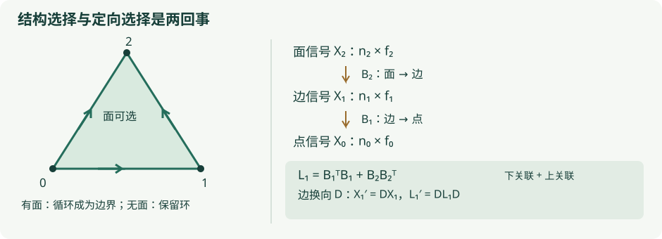

# A6 · 高阶关系、Hodge 算子与神经网络

<div class="chapter-meta">拓扑与人工智能 · Reviewed（独立模型复核；非人类同行评审）<br>理论保证限有限实链复形与明确的换向规则；本章没有训练新模型，也不主张准确率提升。</div>

## 1. 学习目标

读完本章，你应能写出顶点、边、面信号的矩阵形状，证明 Hodge Laplacian 半正定及其核公式，计算空心和填实三角形的区别，并检查一层高阶网络是否对单纯形换向等变。你还应能区分建模中的高阶关系、图的团填充和真实数据中的多人/多体关系，不把一种构造自动当成另一种事实。

## 2. 先修知识

- [链群与线性商空间](../algebraic/linear-algebra-primer.md)、[H1 · 奇异链与边界](../algebraic/homology/singular-chains.md)：边界复合为零、核、像与同调。
- [K1 · 有限复形与边界算法](../computational/boundary-algorithms.md)：边界矩阵、Betti 数和系数选择。
- 实线性代数：内积、正交补、转置、半正定矩阵；神经网络仅需矩阵乘法和逐坐标非线性。
- [A2 · 实验评价协议](evaluation-protocol.md)：训练/验证/测试分离及数据泄漏。

本章使用实系数和有符号边界。浏览器现有同调实验多用 $\mathbb F_2$；那个域没有本章所用的正定实内积，不能不加说明地套用转置平方范数论证。

## 3. 问题引入：直观解释

交通流可以是边上的有向量，三角形协同关系可以是面上的量。只在顶点之间传递消息，会遗漏“沿哪个边流动”和“哪些边围成一个参与关系的面”这些数据。高阶网络尝试把信号放到不同维度的单元上，再用关联结构交换信息。

但边的箭头经常只是坐标选择：把同一条道路的参考箭头反过来，物理流动没有变，系数应变号。一个学习层若因为改画参考箭头就改变物理输出，说明结构与信号的变换规则没有协调。以下从这个可证明、可检查的要求出发。

## 4. 严格定义

**定义 A6.Def1（有限实链数据）。** 固定一个有限定向单纯复形，或已给出有限胞腔链群及整数关联数的有限 CW 复形，张量到 $\mathbb R$。令 $n_k$ 为 $k$ 维单元数，选每个单元的定向基并声明这些基正交归一，则

$$
C_k\cong\mathbb R^{n_k},\qquad
B_k:C_k\longrightarrow C_{k-1},\qquad
B_k\in\mathbb R^{n_{k-1}\times n_k},\qquad B_kB_{k+1}=0.
$$

这里是普通、非约化链复形，取 $B_0$ 为到零空间的零映射；最高维之上的边界也为相应形状的零矩阵。空维层允许 $n_k=0$。任意学习得到的矩阵并不会自动满足链条件。

**定义 A6.Def2（信号与上下算子）。** 单通道定向 $k$-信号为 $x_k\in\mathbb R^{n_k}$，$f_k$ 个通道组成 $X_k\in\mathbb R^{n_k\times f_k}$。顶点信号、边信号、面信号分别取 $k=0,1,2$。定义

$$
L_k^{\mathrm{down}}=B_k^TB_k,\qquad
L_k^{\mathrm{up}}=B_{k+1}B_{k+1}^T,\qquad
L_k=L_k^{\mathrm{down}}+L_k^{\mathrm{up}}.
$$

$L_k$ 称组合 Hodge Laplacian（combinatorial Hodge Laplacian）。在单纯复形中，下关联项连接共享 $(k-1)$ 面的 $k$ 单纯形，上关联项连接同属一个 $(k+1)$ 单纯形的 $k$ 面。符号来自定向，矩阵对角线也含关联次数；不能把完整 $L_k$ 不加区别地称为一个零对角邻接矩阵。对一般胞腔矩阵，应使用实际关联数定义这些算子。

若边信号表示长度而非有向流，它对反向不变；这样的偶信号不遵循下面的变号约定。网络必须先声明信号类型，不能因信号位于边上就一律令它变号。

**定义 A6.Def3（换向与等变）。** 在每维选择对角符号矩阵 $D_k$，其对角元属于 $\{1,-1\}$，表示把部分定向基反转；于是坐标变为 $X_k'=D_kX_k$，边界坐标变为

$$
B_k'=D_{k-1}B_kD_k.
$$

网络层 $\Phi$ 对换向等变（orientation equivariant），指对所有允许的换向都有 $\Phi(L_k',D_kX_k)=D_k\Phi(L_k,X_k)$。等变是输出按同样规则变化；不变（invariant）则要求输出完全相同，两者不能混称。

**定义 A6.Def4（模型类别的范围）。** 本章按所用数据结构区分：图网络通常处理顶点和成对边；单纯神经网络（simplicial neural network）在包含全部面的单纯复形上传递信号；单纯卷积网络（simplicial convolutional neural network，SCNN）常用 Hodge 算子的多项式或分别使用上下算子；胞腔网络（cell complex / cellular neural network）允许多边形等更一般胞腔。名称在论文中并不完全统一，某篇 SCNN 的具体层必须以该论文公式为准。下面证明一种明确写出的层，不能因此为所有这些架构授予相同的表达能力或等变性质。

## 5. 定理与证明

**命题 A6.1（半正定与核）。** 对定义 A6.Def2 中的实矩阵，$L_k$ 对称半正定，且

$$
\ker L_k=\ker B_k\cap\ker B_{k+1}^T.
$$

**证明。** 两个转置乘积均对称。对任意 $x\in\mathbb R^{n_k}$，

$$
x^TL_kx=\|B_kx\|_2^2+\|B_{k+1}^Tx\|_2^2\ge0.
$$

若 $L_kx=0$，等式左端为零，两个非负平方范数的和为零，故二者均为零，得到右侧两个核条件。若两个核条件成立，分别代回两个转置乘积即得 $L_kx=0$。空维层的唯一零向量也满足结论。证毕。

这个矩阵恒等式本身不需要 $B_kB_{k+1}=0$；但没有链条件，下面的同调解释便失去基础。

**命题 A6.2（有限维调和代表）。** 在实链条件下，每个 $H_k=\ker B_k/\operatorname{im}B_{k+1}$ 同调类恰有一个属于 $\ker L_k$ 的代表，所以 $\dim\ker L_k=\dim H_k$。

**证明。** 记 $Z=\ker B_k$、$A=\operatorname{im}B_{k+1}$。链条件给 $A\subseteq Z$。有限维内积空间中的正交分解给出

$$
Z=A\oplus(Z\cap A^\perp).
$$

具体地，对 $z\in Z$，正交投影到 $A$ 得 $a\in A\subseteq Z$，于是 $h=z-a$ 仍在 $Z$ 且垂直 $A$。$A^\perp=\ker B_{k+1}^T$，由 A6.1，$h\in\ker L_k$。若同一个类有两个调和代表，差同时在 $A$ 和 $A^\perp$ 中，因而范数平方为零，只能为零。故每类代表唯一，取商得到线性同构。证毕。

**命题 A6.3（换向协变）。** 按 A6.Def3 换向时链条件保留，且

$$
(L_k^{\mathrm{down}})'=D_kL_k^{\mathrm{down}}D_k,\qquad
(L_k^{\mathrm{up}})'=D_kL_k^{\mathrm{up}}D_k,\qquad
L_k'=D_kL_kD_k.
$$

**证明。** $D_j^T=D_j$ 且 $D_j^2=I$，所以 $B_k'B_{k+1}'=D_{k-1}B_kD_kD_kB_{k+1}D_{k+1}=0$。对下算子，有 $(B_k')^TB_k'=D_kB_k^TD_{k-1}^2B_kD_k=D_kL_k^{\mathrm{down}}D_k$；对上算子同样计算，内部 $D_{k+1}^2$ 消去。相加即得最后等式。证毕。

**命题 A6.4（线性层与奇激活等变）。** 令 $W_j\in\mathbb R^{f\times g}$ 为固定通道权重，定义无偏置层

$$
Z=\sum_{j=0}^{J}L_k^jX_kW_j,\qquad
\Phi(L_k,X_k)=\sigma(Z),
$$

其中 $\sigma$ 逐元素作用。若 $\sigma$ 为奇函数（odd function），即 $\sigma(-t)=-\sigma(t)$，则该层换向等变。将各次幂分别换成上下算子的有限多项式，结论仍成立。

**证明。** A6.3 与归纳给 $(L_k')^j=D_kL_k^jD_k$，也包括 $j=0$。因此 $Z'=\sum_jD_kL_k^jD_kD_kX_kW_j=D_kZ$。逐行乘 $-1$ 时，奇函数使 $\sigma(D_kZ)=D_k\sigma(Z)$；于是输出等变。上下算子各自满足同样的共轭公式，故相同推导逐项成立。证毕。

线性层取 $\sigma(t)=t$，$\tanh$ 也是奇激活。若使用固定且不随换向变换的非零单元偏置 $b$，就需要额外满足 $b=D_kb$，一般不成立；不能忽略偏置。ReLU 不是奇函数，$\operatorname{ReLU}(-1)=0\ne-1=-\operatorname{ReLU}(1)$，因此一般不满足上述结论。此反例不否认经过其他结构设计的 ReLU 架构能实现不同的对称性。

这些都是有限维代数结论，不保证分类器泛化或训练收敛。所引论文关于特定模型的表达能力和实验性能，不在这里重新证明，也不视作任意高阶网络的共同定理。

## 6. 典型例题：正例与反例

**例 1：一个三角环。** 顶点为 $0,1,2$，边按 $e_{01},e_{12},e_{02}$ 排序且从小顶点指向大顶点，则

$$
B_1=\begin{pmatrix}-1&0&-1\\1&-1&0\\0&1&1\end{pmatrix},
\qquad z=\begin{pmatrix}1\\1\\-1\end{pmatrix}.
$$

空心三角环没有面，$B_2$ 是 $3\times0$ 矩阵，$B_1z=0$；$B_1$ 秩为 $2$，所以 $\ker L_1=\operatorname{span}\{z\}$。信号 $z$ 是沿整个环的一次循环流。

**例 2：加入一个面。** 给面定向 $[0,1,2]$，则 $\partial[0,1,2]=[1,2]-[0,2]+[0,1]$，所以 $B_2=z$。直接乘法得 $B_1B_2=0$，且

$$
B_1^TB_1=\begin{pmatrix}2&-1&1\\-1&2&1\\1&1&2\end{pmatrix},\quad
B_2B_2^T=\begin{pmatrix}1&1&-1\\1&1&-1\\-1&-1&1\end{pmatrix},\quad
L_1=3I_3.
$$

此时调和核为零。相同边图可以对应有面或无面的两种复形；把三个顶点的团自动填成面，会改变所建模的对象和同调。图的团复形（clique complex）是合法建模规则，但仅凭三对成对关系，不能证明数据中真的发生过一次三方互动。

**例 3：链条件不能省略。** 若任意取 $B_1=(1)$、$B_2=(1)$，则 $L_1=(2)$ 仍半正定，核公式仍成立；但 $\operatorname{im}B_2=\mathbb R$ 不包含在 $\ker B_1=0$ 中，商 $\ker B_1/\operatorname{im}B_2$ 甚至没有定义。这不是合法链复形。

**例 4：换向反例。** 对一维信号 $x=1$、换向 $D=(-1)$、线性算子为恒等，ReLU 输出原本为 $1$，换向输入输出为 $0$，而正确变换后的输出应为 $-1$。同一个正数若代表“边长”则不该随换向变号，说明信号类型须先明确。

**例 5：胞腔与单纯形。** 一个带边界的方形面可以作为一个二维胞腔，其边界有四条边；单纯二维面却必须有三个顶点。把方形剖成两个三角形会增加一条内部边和一个面，自然地改变信号维数与传播算子。即使底层空间同胚，两个离散网络也不会因此拥有逐元素相同的输出。

## 7. 几何直观与原创图解



图中同一条参考边反向时，边界列与有向信号系数一起变号；面是否存在是另一项结构选择。对球面或数据关系的可视化，只有明确列出单元与边界关联后，才能计算本章的 $L_k$。

## 8. 编程实验

下面用既有 NumPy 依赖核对两个明确有限复形，无须下载数据或安装深度学习框架。所有整数边界乘法在这个小例子中精确；这是计算检查，不代替 A6.1–4 的一般证明。

```python
import numpy as np
B1 = np.array([[-1, 0, -1], [1, -1, 0], [0, 1, 1]], dtype=np.int64)
B2 = np.array([[1], [1], [-1]], dtype=np.int64)
z = B2[:, 0]
assert np.array_equal(B1 @ B2, np.zeros((3, 1), dtype=np.int64))
L_hollow = B1.T @ B1
L_filled = L_hollow + B2 @ B2.T
assert np.array_equal(L_hollow @ z, np.zeros(3, dtype=np.int64))
assert np.array_equal(L_filled, 3 * np.eye(3, dtype=np.int64))
D = np.diag([-1, 1, 1])
B1_new, B2_new = B1 @ D, D @ B2
L_new = B1_new.T @ B1_new + B2_new @ B2_new.T
assert np.array_equal(L_new, D @ L_filled @ D)
x = np.array([1, 2, -1], dtype=np.int64)
assert np.array_equal(L_new @ (D @ x), D @ (L_filled @ x))
assert np.maximum(-1, 0) != -np.maximum(1, 0)
print('Exact finite checks passed; no neural model was trained.')
```

与[三角形的洞](../labs/triangle.md)比较时，注意那个实验的默认系数为 $\mathbb F_2$，本节保留整数符号并在实数上解释调和空间。对于这些三角形例子，Betti 数相同；这不意味着所有空间换系数后都相同。若后续训练模型，必须按 A2 比较图基线、高阶结构和结构消融，报告计算成本与实际结果。

## 9. 课后习题 {#exercises}

1. **基础。** 某二维复形有 $5$ 个顶点、$7$ 条边、$2$ 个面，边信号有 $4$ 个通道。写出 $B_1,B_2,L_1,X_1$ 的形状，以及把通道变为 $6$ 时 $X_1W$ 中 $W$ 的形状。
2. **证明。** 不使用链条件证明 A6.1，并解释为什么 $x^TL_kx=0$ 不是只说明两个非零项“互相抵消”。
3. **计算。** 用正文矩阵计算空心与填实三角形的 $L_1$、核维数及 $z$ 的像。解释加入面为何杀死原一维同调类。
4. **证明。** 独立证明 A6.2 的调和代表存在性与唯一性，指出两次使用链条件的位置。
5. **综合。** 只反转 $e_{01}$，写出三角面的 $B_1',B_2'$，验证链条件与 $L_1'=DL_1D$。说明只改信号、不改边界矩阵会违反什么约定。
6. **反例。** 对单通道恒等层构造 ReLU 不等变例子；再说明奇激活为何可行，以及固定偏置 $b=1$ 即使在线性层中也会失败。
7. **建模反例。** 数据只记录三个人之间的三对通话。列出空心三角环和填实三角形两种合法模型，说明哪一项数据尚不足以判定；若已有一次三人会议记录，你如何在模型说明中区分这一额外关系？
8. **挑战。** 设 $X'=DX$ 是有向 $k$-信号换向。证明每通道总能量 $\sum_iX_{ij}^2$ 在换向下不变，原始和 $\sum_iX_{ij}$ 一般不变性失败。说明这类能量读出丢失了什么，并解释不变性为何不保证分类能力。

<details markdown="1">
<summary>第一层提示</summary>

1：行对应低一维单元，列对应当前单元。2：用平方范数非负。3：$B_2=z$。4：在循环空间内部对边界像作正交分解。5：改边方向就是乘对角符号矩阵。6：从数值 $1$ 开始。7：成对记录不等于同时参与记录。8：平方消除正负，但未必保留空间分布。
</details>

<details markdown="1">
<summary>第二层提示</summary>

3：填面后 $L_1=3I$。4：$\operatorname{im}B_2\subseteq\ker B_1$ 保证减去边界后仍是循环，零向量是像与其正交补的唯一交。5：$B_1'=B_1D$，$B_2'=DB_2$。6：$\sigma(-1)$ 应等于 $-\sigma(1)$；有偏置时需要 $b=Db$。8：$(1,0)$ 与 $(0,1)$ 能量相同，未必代表同一个带位置的信号。
</details>

<div class="admonition question" data-exercise="ai-higher-order-networks"></div>
<noscript>书面题、提示与解答不依赖 JavaScript；即时反馈需启用脚本。</noscript>

## 10. 习题解答

[阅读 A6 八题完整解答](../exercises/a6-solutions.md)。先写系数域和矩阵形状，再进行符号运算。

## 11. 本章总结

高阶结构首先是可审查的链数据，然后才是神经网络输入。半正定与核公式是矩阵事实，调和代表还需要链条件；换向等变同时约束边界、信号、线性层、激活和偏置。结构合理性与预测收益是两项不同的评价任务，后者必须用实际实验回答。

## 12. 参考书目

- Stefania Ebli, Michaël Defferrard and Gard Spreemann, “Simplicial Neural Networks,” 2020，[arXiv:2010.03633](https://arxiv.org/abs/2010.03633)。
- Maosheng Yang, Elvin Isufi and Geert Leus, “Simplicial Convolutional Neural Networks,” 2021 预印本，[arXiv:2110.02585](https://arxiv.org/abs/2110.02585)。具体模型需按论文定义，不能仅按缩写推断。
- Cristian Bodnar et al., “Weisfeiler and Lehman Go Cellular: CW Networks,” 2021，[arXiv:2106.12575](https://arxiv.org/abs/2106.12575)。
- Allen Hatcher, *Algebraic Topology*, Cambridge University Press, 2002，[作者提供的教材页](https://pi.math.cornell.edu/~hatcher/AT/ATpage.html)，链群与胞腔同调基础。

本批核实前三篇链接的题名页面，未声称逐页核查全文或复现原论文训练结果。正文中的有限维证明、例题、代码和图形为本项目原创。[本章审查记录](../project/reviews/A6.md)。
