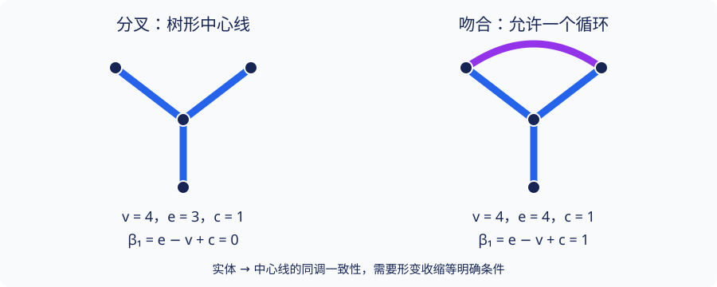

# A5 · 医学图像：骨架、拓扑先验与评价边界

<div class="chapter-meta">研究生应用课程 · 内容状态：Reviewed（独立模型复核；非人类同行评审）<br>区分组织体积、表面、中心线与分割掩膜；数学指标性质不等于临床效能。</div>

## 1. 学习目标

完成本章后，你应能为血管、神经或器官分割明确选择拓扑对象，区分三维分量、隧道与空腔，计算中心线图的循环秩，并准确陈述 clDice 的分母、空集约定和可证明性质。你还应能设计以患者为单位的评价协议，辨别结构假设、理论保证、实验观察与尚未证明的推测。

## 2. 先修知识

- [A3 · 拓扑损失](topological-loss.md)：先验与优化目标是额外选择。
- [A4 · 分割拓扑](segmentation-topology.md)：数字邻接、Dice 和有限复形。
- [同伦与形变收缩](../algebraic/homotopy-fundamental-group.md)、[奇异同调](../algebraic/homology/singular-chains.md)：同伦不变性。
- [胞腔同调](../algebraic/homology/cellular-coefficients.md)：有限图和球面的同调；基础概率与评价协议参见 [A2](evaluation-protocol.md)。

本章不要求医学执业知识，也不为特定疾病规定“正确”的拓扑。实际解剖先验需要标注规范与领域专家确定。

## 3. 问题引入：直观解释

一条细血管在一个体素处断开，可能只增加很小的体积误差，却改变中心线连通性。反过来，一根本来不连通的结构被错误连接，像素重叠也可能很高。拓扑指标帮助描述这种错误，但不能回答所有问题：桥接是否位于正确位置、组织类别是否正确、扫描视野外是否仍有连接，都需要额外信息。

“血管像树”是一个待限定的建模假设。吻合环和侧支循环允许环路；不同神经标注任务可能关注单根纤维、纤维束、网络或其它对象。把所有图强制变成树可能删除应保留的结构。

## 4. 严格定义

**定义 A5.1（对象与三维指标）。** 在有限三维体素（voxel）网格中，掩膜 $P$ 可以解释为闭单位立方体及全部面的并。其同调默认取 $\mathbb F_2$ 系数。$\beta_0$ 计分量，$\beta_1$ 计独立一维循环，$\beta_2$ 计二维同调类；对常见有界实体，分别可直观理解为分量、隧道/环路与内部空腔。曲面边界 $\partial|K(P)|$ 与实体 $|K(P)|$ 是不同空间，不能混用它们的 Betti 数。

三维邻接有面、边、角接触等不同约定。本章没有把二维 A4 的 8/4 规则直接搬到三维。三维软件必须明确闭体素复形、采样/阈值、边界条件及补空间规则，再选择与之匹配的算法。

**定义 A5.2（中心线图与骨架假设）。** 中心线图（centerline graph）$G=(V,E)$ 是有限一维 CW 复形；允许多重边和环边，交叉投影不自动建立顶点。它可以由分割提取，也可以另有人工标注。若存在包含 $i:G\hookrightarrow X$ 与形变收缩 $r:X\to G$，则称这一步具有明确的拓扑保持假设。某段程序输出了名为 skeleton 的数组，并不自动证明这样的 $r$ 存在。

**定义 A5.3（本章有限掩膜 clDice 协议）。** 预测 $P$ 与真值 $T$ 是同一有限网格上的集合。固定骨架算子 $S$，要求 $S(P)\subseteq P$。当 $P,T$ 非空时，要求两骨架非空，定义拓扑精确率（topology precision）$a$、拓扑敏感度（topology sensitivity）$b$ 和中心线 Dice（centerline Dice, clDice）：

$$
a=\frac{|S(P)\cap T|}{|S(P)|},\qquad
b=\frac{|S(T)\cap P|}{|S(T)|},\qquad
\operatorname{clD}(P,T)=
\begin{cases}\dfrac{2ab}{a+b},&a+b>0,\\0,&a+b=0.\end{cases}
$$

本章显式约定：两掩膜均空时分数为 1，仅一方空且另一方骨架有效时为 0；任何非空掩膜却提取出空骨架时，优先报告“骨架提取无效”，不偷偷在分母加小常数得到一个合法分数。这是本教材的评价协议；论文/软件中的平滑常数与空集处理应另外记录，不能假定所有实现一致。

**定义 A5.4（患者层面的误差）。** 令 $M_i$ 为第 $i$ 位患者的一个预先规定的分割指标，患者均值为 $n^{-1}\sum_iM_i$。拓扑误差可另记向量 $(\beta_k(P_i)-\beta_k(T_i))_{k=0}^2$，并报告绝对差和错误类型。不同分支的增加与丢失可能相互抵消，因此 Betti 差为零不等于错误为零。若指标无定义，必须报告有效样本数及预先规定的排除策略。

## 5. 定理与证明

**命题 A5.5（有限图的循环秩）。** 有限图有 $v$ 个顶点、$e$ 条边、$c$ 个分量，则

$$
\beta_0(G)=c,\qquad\beta_1(G)=e-v+c,\qquad\beta_k(G)=0\ (k\ge2).
$$

**证明。** 在 $\mathbb F_2$ 上，普通边的边界是两端点之和，环边的边界为零。在每个含 $v_j$ 个顶点的分量取生成树，它的 $v_j-1$ 列边界线性独立：若有非零列组合，取所选边形成的森林的一个叶点，该点只在一列中出现，不可能抵消。树的边界列还生成该分量中坐标和为零的子空间，因为沿树中道路相加得到任意两个顶点之和。任一非树边的边界也在其中。因此 $\operatorname{rank}\partial_1=\sum_j(v_j-1)=v-c$。图没有二胞腔，$\beta_1=e-\operatorname{rank}\partial_1=e-v+c$，$\beta_0=v-\operatorname{rank}\partial_1=c$；更高链群为零。空图时 $v=e=c=0$ 同样成立。$\square$

**推论 A5.6（加边的两种效应）。** 顶点集固定，加一条边：若连接不同分量，$\beta_0$ 减 1 而 $\beta_1$ 不变；若两端原在同一分量（含环边），$\beta_0$ 不变而 $\beta_1$ 加 1。

**证明。** 前一种 $e$ 加 1、$c$ 减 1，后一种只有 $e$ 加 1。代入 A5.5。$\square$

**命题 A5.7（有条件的实体—骨架同调一致性）。** 若 $G$ 是 $X$ 的形变收缩像，则包含诱导同构 $H_k(G;\mathbb F_2)\cong H_k(X;\mathbb F_2)$。

**证明。** 收缩与包含满足 $r\circ i=\mathrm{id}_G$ 且 $i\circ r\simeq\mathrm{id}_X$。同调函子性与同伦不变性给出 $r_*i_*=\mathrm{id}$ 和 $i_*r_*=\mathrm{id}$，所以 $i_*,r_*$ 互逆。引用的同伦不变性在先修链同伦理论中建立；本命题不替骨架提取算法证明形变收缩假设。$\square$

**命题 A5.8（clDice 的准确逻辑结论）。** 在 A5.3 的有效非空输入上，$0\le\operatorname{clD}\le1$，且

$$
\operatorname{clD}=1\quad\Longleftrightarrow\quad S(P)\subseteq T\ \text{且}\ S(T)\subseteq P.
$$

**证明。** $a,b\in[0,1]$。若 $a+b=0$，分数按定义为 0；否则 $2ab\le a+b$，因为 $a(1-b)+b(1-a)\ge0$。等号要求两项均零：若 $a=0$ 则第二项给出 $b=0$，与正分母矛盾；所以 $a>0$，第一项给出 $b=1$，第二项进一步给出 $a=1$。反向代入即可。有限非空骨架上，$a=1$ 正好表示 $S(P)\subseteq T$，$b=1$ 同理。$\square$

**反例 A5.9（前景互含不够）。** 取 $P$ 为满 $5\times5$，$T$ 为其外圈 16 像素，令 $S(P)=\{(0,2)\}$、$S(T)=T$。这是 A5.3 允许的非空子集输出，两个包含均成立，clDice 为 1；但 $P$ 无洞，$T$ 有一个洞。由此不能在未约束骨架算子时从分数 1 推断同伦等价。

即使在连续几何中要求骨架是形变收缩像，仅有前景互含也不够：令 $P$ 为半径 2 的闭圆盘，$T=\{x:1\le\|x\|\le2\}$。圆盘可线性收缩到 $q=(3/2,0)$，圆环可径向收缩到半径 $3/2$ 的圆。点骨架在 $T$ 中，圆骨架在 $P$ 中，但二者 $H_1$ 分别为 0 和 $\mathbb F_2$。此处是包含关系的几何反例，不对无限集合使用有限像素计数公式。

clDice 论文 §3 的理论论证还涉及**前景与背景**的骨架条件及图型同伦假设，Corollary 1.1 不能简化为“前景软 clDice 为 1 就无条件保持任意三维分割的同伦类型”。本章已实际核对论文 §2–4 的陈述范围，但没有在本教材完整展开其拓扑理论证明。完整证明未在本教材展开；待审义务是逐条核查其图型假设、前/背景骨架构造与现实掩膜是否满足假设，而不是用一次软件得分替代这些义务。

**命题 A5.10（患者均值与切片均值）。** 若患者 $i$ 有 $m_i>0$ 个切片评分，切片平均为 $M_i$，把全部切片合并的均值等于 $\sum_i m_iM_i/\sum_i m_i$，一般不等于患者均值。

**证明。** 将每位患者的切片求和再汇总即得公式。两患者分别有 1 与 9 个切片，所有切片评分分别为 1 与 0，则患者均值为 $1/2$，合并均值为 $1/10$，所以一般不相等。此处只证明加权关系；体积级 Dice 还不是切片 Dice 的算术平均，必须单独计算。$\square$

## 6. 典型例题：正例与反例

**基础例：实体、表面与空腔。** 闭实心球 $D^3$ 可收缩，Betti 向量为 $(1,0,0)$；球面 $S^2$ 为 $(1,0,1)$。实心环面 $S^1\times D^2$ 沿圆盘因子形变收缩到 $S^1$，为 $(1,1,0)$。球壳 $S^2\times[0,1]$ 沿区间收缩到 $S^2$，为 $(1,0,1)$。两个互不接触实心球为 $(2,0,0)$。球壳与球面同调相同，不表示它们同胚。

**非平凡正例：分叉与吻合。** 一个 Y 形中心线图可取 $v=4,e=3,c=1$，所以 $\beta_1=0$。在两个叶点间增加一条吻合边后 $e=4$，$\beta_1=1$。若原标注包含该吻合，惩罚所有循环就是惩罚正确结构。此计算针对图；实体一致性仍需 A5.7 的假设。

**错误反例：裁剪造成假断裂。** 在平面取 U 形折线 $(-2,1)\to(-2,-1)\to(2,-1)\to(2,1)$，它连通；与裁剪窗口 $[-3,3]\times[0,2]$ 相交后只剩两根不接触的竖段，$\beta_0$ 从 1 变为 2。三维中的同一折线仍有此现象。视野内的多个分支可以属于视野外的同一个结构，不能把缺失外部信息解释为算法必然出错。

**综合计算：骨架得分。** 若预测骨架 10 个点中有 8 个落在真值内，真值骨架 20 个点中有 15 个落在预测内，则 $a=4/5,b=3/4$，clDice 为 $24/31$。这些计数不确定体素 Dice，也不确定 $\beta_0,\beta_1,\beta_2$，更不能确定预测是否改善临床结局。

## 7. 几何直观与原创图解



该原创图画的是抽象中心线图。紫色新增边说明正确解剖先验可能允许循环。它没有声称中心线附近画出的任意“粗管子”都会自动保持相同拓扑：管子过粗而相交、填孔或接触边界都可能改变空间。

## 8. 编程实验

先在[A4 实验](../labs/ai-topology.md#segmentation)复核窄桥断开与中心缺损，再用下列只依赖 Python 标准库的有限集合计算核对 A5.8–9。这个算例**不实现骨架提取、不训练网络、不接触患者数据**；它将骨架作为显式输入，从而暴露分数与假设的区别。

```python
from fractions import Fraction

def cldice_from_sets(prediction, target, skeleton_p, skeleton_t):
    P, T, SP, ST = map(set, (prediction, target, skeleton_p, skeleton_t))
    if not SP <= P or not ST <= T:
        raise ValueError("Skeleton points must lie in their own masks")
    if not P and not T:
        return Fraction(1)
    if (P and not SP) or (T and not ST):
        raise ValueError("Nonempty mask with empty skeleton: invalid extraction")
    if not P or not T:
        return Fraction(0)
    a = Fraction(len(SP & T), len(SP))
    b = Fraction(len(ST & P), len(ST))
    return 2*a*b/(a+b) if a+b else Fraction(0)

P = {(r, c) for r in range(5) for c in range(5)}
T = {(r, c) for r, c in P if r in (0, 4) or c in (0, 4)}
assert cldice_from_sets(P, T, {(0, 2)}, T) == 1
assert cldice_from_sets(set(), set(), set(), set()) == 1
assert cldice_from_sets(P, set(), {(0, 2)}, set()) == 0
# A nonempty mask must have a valid skeleton even when the other mask is empty.
for args in [(P, set(), set(), set()), (set(), P, set(), set())]:
    try:
        cldice_from_sets(*args)
    except ValueError:
        pass
    else:
        raise AssertionError("Invalid skeleton was accepted")
```

论文 §4 的软骨架（soft skeleton）使用池化和逐点运算处理连续预测，迭代次数是超参数。它为优化提供代理量，不是本节有限集合算子的同义词；连续输出的梯度存在性也不能证明离散骨架变换保持同伦。采用任何软件版本都应记录骨架算子、阈值、体素间距、迭代次数、空集处理、前/背景是否同时评价。

**可复现的临床研究协议。** 本章只提供设计，不报告尚未运行的医学实验：

1. 先按患者分训练/验证/测试集；同一患者的切片、重复扫描和增强样本不得跨组。跨机构外部测试需单独说明适用范围。
2. 在训练/验证阶段确定拓扑先验、损失权重、阈值、骨架超参数和排除标准，冻结后才打开测试结果。
3. 使用相同数据划分、训练预算和随机种子比较基础损失与增加拓扑项的模型；记录多次训练的变化，避免只挑最好一轮。
4. 患者层面并列报告像素/体积重叠、边界误差、分支/孔洞/空腔错误分布及失败图例。置信区间如使用重采样，应以患者或适当相关组为单位，而非把相关像素当独立样本。
5. 解释裁剪、标注不一致和罕见解剖变体对先验的影响。没有运行记录不得填写 Dice、IoU 或其它性能收益。

## 9. 课后习题

1. **基础题。** 推导实心球、球面、实心环面、球壳和两个实心球的 $\mathbb F_2$ Betti 向量，写明使用了哪些收缩与外部同调事实。
2. **证明题。** 对允许环边和多重边的有限图证明 A5.5，并计算两个顶点间三条平行边的 Betti 数。
3. **综合题。** Y 形图加一条叶点间吻合边与另一个独立分量加一条连接边，各怎样改变 Betti 数？为什么“全体血管皆树”不能作为未经核实的真值约束？
4. **计算题。** 证明 A5.8；计算第 6 节的 $24/31$，并说明两骨架都非空但都不命中对方掩膜时如何处理。
5. **反例题。** 验证 A5.9 的有限掩膜和连续圆盘/圆环两个反例，指出各自否定的逻辑推断，避免对无限集代入像素计数公式。
6. **边界题。** 计算 U 形折线裁剪前后的 $\beta_0,\beta_1$。另举一个裁剪使 $\beta_1$ 减少的例子，并说明需要报告的视野信息。
7. **评价题。** 两位患者分别有 1、9 张切片，各切片评分分别为 1、0。计算患者均值与切片均值，解释为何逐像素重采样可能低估不确定性；能否由此决定哪个模型更好？
8. **挑战题。** 为一个可能有吻合环的管状组织分割任务设计比较协议，列明对象、系数、先验、数据拆分、空集规则和失败分析；分别写出一个可证明的数学结论、一个需实际实验的命题和一个尚无保证的猜想。

??? tip "第一层提示"
    第 2 题用生成树算边界秩，环边的边界为零。第 5 题只需找出两个互含骨架，不要额外假定未给出的算法性质。第 8 题把“指标是多少”与“对患者是否有用”分开列证据。

??? tip "第二层提示"
    第 1 题把实体收缩到点、圆周或球面，再引用对应同调。第 2–3 题代入 $e-v+c$ 时，同时追踪分量数是否改变。第 4 题把 $a+b-2ab$ 写成两个非负项；先排除零分母。第 5 题比较两个空间的 $H_1$，即可否定同伦等价。第 6 题画出裁剪窗口内实际保留的线段，别补回窗外的道路。第 7 题分别以患者和切片为求和单位。第 8 题先冻结评价规则，再区分已证明性质与等待数据的判断。

<div class="admonition question" data-exercise="ai-medical-topology"></div>
<noscript>即时反馈需要 JavaScript；完整书面习题和解答可独立阅读。</noscript>

## 10. 习题解答

[A5 完整解答](../exercises/a5-solutions.md)包含八题的推导与协议示例。应用题没有唯一实验设计，但对象定义、患者隔离与结果证据不能省略。

## 11. 本章总结

医学分割中的拓扑先验必须绑定具体对象、解剖范围和观察窗口。有限图的循环秩、形变收缩的同调后果和 clDice 的互含条件都可严格证明；从这些命题到某个骨架算法的拓扑保证，再到训练改善和临床效能，还需要分别补足算法证明、实验结果与领域评价。下一步应在明确这些条件后连接更高阶网络与点云模型，而非把任何一个指标当成完整的解剖判据。

## 12. 参考书目

- Suprosanna Shit et al., “clDice — A Novel Topology-Preserving Loss Function for Tubular Structure Segmentation,” CVPR 2021。§2 定义，§3 理论条件，§4 软骨架与损失；[官方开放正文](https://openaccess.thecvf.com/content/CVPR2021/papers/Shit_clDice_-_A_Novel_Topology-Preserving_Loss_Function_for_Tubular_Structure_CVPR_2021_paper.pdf)，[arXiv 版本入口](https://arxiv.org/abs/2003.07311)。本批实际读取官方正文 §2–4；没有复现论文临床实验，也未完整复核所有附录证明。
- Allen Hatcher, *Algebraic Topology*, 2002，§1.A 的图与自由群、§2.1 的胞腔同调；[作者书页](https://pi.math.cornell.edu/~hatcher/AT/ATpage.html)。有限图秩计算在本章独立展开，不复制教材文字。
- Tomasz Kaczynski, Konstantin Mischaikow, Marian Mrozek, *Computational Homology*, Springer, 2004，立方同调及有限计算的背景；[出版社入口](https://doi.org/10.1007/b97315)。本章不声称已经逐页核查原书。
