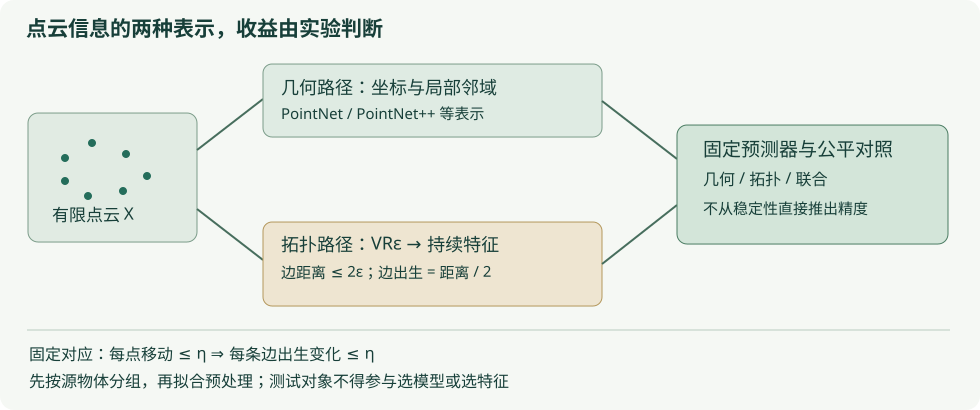

# A7 · 点云学习：几何、持续同调与稳定性

<div class="chapter-meta">拓扑与人工智能 · Reviewed（独立模型复核；非人类同行评审）<br>理论保证：固定对应点扰动下的半径尺度 Rips 包含；条形码界依赖代数稳定性。无新的外部训练依赖或未经实验的性能结论。</div>

## 1. 学习目标

本章结束后，你应能从点坐标写出半径尺度的 Rips 复形，证明固定对应扰动对边出生值和滤过包含的影响，并正确区分置换不变、刚体不变与缩放等变。你还应能解释 PointNet 类几何表示与拓扑摘要的互补动机，识别密度和采样的限制，按原始物体分组设计没有泄漏的评价协议。

## 2. 先修知识

- [PRE3 · 度量空间](../preliminaries/metric-spaces.md)：三角不等式、等距映射、连续性。
- [R1 · 持续模与约化](../persistence/modules-reduction.md)、[R2 · 稳定性](../persistence/stability.md)：区间、交错与瓶颈距离。
- [A1 · 持续特征](features-learning.md)：景观与寿命特征的假设；[A2 · 评价协议](evaluation-protocol.md)：独立抽样与组划分。
- 基础线性代数与欧氏范数；实验使用已安装的 NumPy，现有 Notebook 04 另用 GUDHI。

所有理论几何不等式先在精确实数上陈述。已有浏览器的浮点距离实现与独立 GUDHI 对照，只验证指定 binary64 输入及组合运算，不能替代这些一般证明。

## 3. 问题引入：直观解释

同一个物体被旋转、重新编号、改变采样密度以后，点列表可能变化很大。几何网络可利用局部坐标、法向或邻域关系；持续同调可描述跨尺度的连通分支和环。但采样形成的环不必来自物体的真实孔洞，同样的拓扑也可能对应不同任务类别。

三维点云指坐标属于三维环境空间；它可能采样一条曲线、一张曲面或一个实体，底层形状的维数并不由坐标列数决定。本章的一般论证适用于任意固定欧氏维数，有限代码实例使用三个坐标。另一个独立选择是计算哪些同调维度：只报告前两维同调并不意味着数据只能是二维坐标。

因此问题应拆成：哪些输入变化应该被忽略，哪些变化必须保留；在什么假设下摘要有数学稳定性；将该摘要加入预测器后，是否有新的独立测试证据。下面分别回答，不能把前一问的定理当作后一问的实验结果。

## 4. 严格定义

**定义 A7.Def1（带标签点云与半径尺度）。** 有限带标签点云为 $X=(x_1,\ldots,x_N)$，$x_i\in\mathbb R^d$；允许重复坐标，但不同索引仍是不同顶点。给定 $\epsilon\ge0$，Vietoris–Rips 复形（Vietoris–Rips complex）定义为

$$
\operatorname{VR}_\epsilon(X)=\{\varnothing\ne\sigma\subseteq\{1,\ldots,N\}:
\|x_i-x_j\|\le2\epsilon\ \text{对所有 }i,j\in\sigma\}.
$$

所有顶点出生于零，边 $ij$ 的出生值是 $b_{ij}=\|x_i-x_j\|/2$；高维单纯形出生于其最大边出生值。空点云给出没有非空单形的复形。若使用边长阈值 $r$，关系为 $r=2\epsilon$，不能混用两者的常数。

**定义 A7.Def2（固定对应扰动）。** 比较 $X=(x_i)_{i=1}^N$、$Y=(y_i)_{i=1}^N$ 时，本章假设已指定同标签对应，且存在 $\eta\ge0$ 使每个 $i$ 都有 $\|x_i-y_i\|\le\eta$。改变点数或没有这样的对应时，不能直接引用本章命题；需要另建对应关系或使用核对过常数的 Hausdorff/Gromov–Hausdorff 稳定性定理。

**定义 A7.Def3（摘要的变换）。** 顶点重编号是指标置换。欧氏刚体变换写为 $T(x)=Qx+t$，其中 $Q^TQ=I$，允许反射。正尺度变换为 $x\mapsto s x$，$s>0$。摘要不变（invariant）指变换前后相同；尺度等变（scale equivariant）指端点按确定规则乘 $s$，并非数值不变。

**定义 A7.Def4（几何与拓扑表示）。** 对非空有限点云（$N\ge1$），PointNet 核心的集合读出可写成 $\gamma(\max_i h(x_i))$，其中共享映射 $h$ 逐点作用，最大值逐通道取。空点云上的最大值没有在此定义；实现须明确拒绝空输入，或另订固定输出及其语义。PointNet++ 使用局部度量邻域和层次集合抽象来聚合局部信息。拓扑特征则先构造滤过、算持续图或条形码，再用景观、持续图像或寿命统计形成向量。以上是表示方式；“联合表示”只表示把不同输入送入同一预测管线，不包含任何性能提升保证。

## 5. 定理与证明

**命题 A7.1（边出生扰动界）。** 在 A7.Def2 的假设下，对任意一对标签有

$$
\left|\|x_i-x_j\|-\|y_i-y_j\|\right|\le2\eta,
\qquad |b_{ij}(X)-b_{ij}(Y)|\le\eta.
$$

**证明。** 三角不等式给

$$
\|x_i-x_j\|\le\|x_i-y_i\|+\|y_i-y_j\|+\|y_j-x_j\|
\le\|y_i-y_j\|+2\eta.
$$

交换 $X,Y$ 得反向差界，两式合起来给绝对值界；除以二得到出生值界。重复点不影响证明，$\eta=0$ 时对应距离相同。证毕。

**命题 A7.2（包含与交错）。** 上述假设下，对每个 $\epsilon\ge0$ 有标签恒等诱导的包含

$$
\operatorname{VR}_\epsilon(X)\subseteq\operatorname{VR}_{\epsilon+\eta}(Y),
\qquad
\operatorname{VR}_\epsilon(Y)\subseteq\operatorname{VR}_{\epsilon+\eta}(X).
$$

对固定系数域 $\mathbb F$ 和每个维数 $k$，它们诱导持续同调模的 $\eta$-交错。

**证明。** 若 $\sigma$ 在左侧复形，对其中任意一对顶点，$\|x_i-x_j\|\le2\epsilon$。A7.1 给 $\|y_i-y_j\|\le2\epsilon+2\eta$，所以整个单形在右侧复形。反向相同。两个顶点映射都是相同标签上的恒等，因而与尺度包含交换，来回复合就是 $\epsilon$ 到 $\epsilon+2\eta$ 的包含。取同调后函子性保留这些等式，正是交错要求。空点云和零维顶点情形也成立。证毕。

**外引定理（有限持续模的代数稳定性，完整证明未在本教材展开）。** 对本章由有限滤过复形在固定域上产生、可区间分解的持续同调模，$\eta$-交错推出条形码瓶颈距离 $d_B\le\eta$。允许有限条匹配对角线；无限端点按持续模的标准约定匹配无限端点。这一步使用区间匹配理论，不能由边长估计单独跳到“某一条特定洞必然保持”。参考第 12 节的持续模专著。结合 A7.2 得本章点云的 $d_B\le\eta$；改用边长阈值则常数为 $2\eta$。

若一条寿命严格大于 $2\eta$，它在代价不超过 $\eta$ 的匹配中不能被配到对角线，因为到对角线的最小代价为半寿命。较短条没有这项保证，但仍是计算结果，不能在核心算法中以容差删除。

**命题 A7.3（置换、刚体与尺度）。** 精确欧氏距离下，标签置换诱导每个尺度的复形同构，刚体变换保持每个出生值；它们的条形码不变。正缩放 $s$ 则把所有有限端点乘 $s$，无限端点仍无限。

**证明。** 置换是顶点集双射，且按同一规则传送每对距离条件，所以与全部尺度包含相容地给复形同构。对刚体变换，

$$
\|Qx_i+t-(Qx_j+t)\|^2
=(x_i-x_j)^TQ^TQ(x_i-x_j)=\|x_i-x_j\|^2.
$$

故距离和出生值相同。对正缩放，$\|sx_i-sx_j\|=s\|x_i-x_j\|$，因此 $\operatorname{VR}_\epsilon(sX)=\operatorname{VR}_{\epsilon/s}(X)$；持续模只作参数重标，区间 $[b,d)$ 变为 $[sb,sd)$。证毕。

这些结论描述精确几何，不保证任意浮点平移/旋转在所有极端尺度逐位相等。计算层仍应保留可表示的正区间、拒绝不可表示的数值范围，并清楚说明距离近似。

**命题 A7.4（二维骨架的范围）。** 同一 Rips 复形及其二维骨架，在任意固定域上的 $H_0,H_1$ 及这些维度的持续映射相同；不因此保证 $H_2$ 相同。

**证明。** $H_0,H_1$ 只使用 $C_0,C_1,C_2$ 和两个边界矩阵。包含二维骨架时这些链数据不变，跨尺度的链映射也相同，所以同调群与持续映射相同。$H_2$ 还要除以 $\operatorname{im}\partial_3$，骨架中这项为零而全复形中未必为零。证毕。

**命题 A7.5（PointNet 核心池化的置换不变性）。** 对非空有限点云，若共享函数 $h$ 逐点作用，$\gamma$ 固定，则 $\gamma(\max_i h(x_i))$ 对点顺序不变。

**证明。** 指标置换不改变每个通道参与最大值的实数集合，故每个通道的最大值不变，输入 $\gamma$ 的向量相同。证毕。

这个简单证明不保证刚体或尺度不变，也不自动覆盖 PointNet++ 中采样、邻域选择与平局处理的实现细节。原论文更强的表达能力结果有自己的连续性、集合空间和紧致性假设，本章不调用其普遍逼近结论，也未展开该证明。

## 6. 典型例题：正例与反例

**例 1：半径常数可以取等。** 一维中 $X=(0,4)$、$Y=(1,3)$，对应点各移动 $1$。边出生从 $2$ 变为 $1$，恰好相差 $\eta=1$。若误把边长变化 $2$ 当作半径变化，会把同一个结论的尺度混淆。

**例 2：方形的条形码与缩放。** 单位正方形的唯一正长度 $H_1$ 区间为 $[1/2,\sqrt2/2)$。旋转、平移或重编号保持它；缩放为边长 $s$ 后区间变为 $[s/2,s\sqrt2/2)$。原始总寿命是一次齐次特征，寿命平方和是二次齐次特征，不是缩放不变量。

**例 3：密度与标号不能省略。** 把同一个圆稀疏采样成三点或密集采样成二十点，会改变有限 Rips 的出现尺度和部分短条。两点云点数不同，A7.Def2 没有给它们所需的固定一一对应，不能直接代入 $\eta$。即使数据来自圆，也不能仅由采样点的视觉形状证明它足够覆盖圆、没有离群点，或复形已重建真实空间。

**例 4：相同拓扑不等于相同类别。** 两个合同的方形，一个标签为“红色物体”、另一个为“蓝色物体”，若输入仅有坐标，任何只依赖距离的拓扑表示都相同，无法判断颜色。若尺度与任务有关，把每云都归一化成单位大小也会删除区分类别所需的信息。特征是否适合任务，需要先说明标签语义。

**例 5：几何池化不是旋转不变定理。** 令 $h(x,y)=x$、$\gamma$ 为恒等，点云 $\{(1,0),(-1,0)\}$ 的最大值为 $1$；旋转九十度后两点的第一坐标都为零，最大值变为零。PointNet 核心的置换不变性不能推出刚体不变性。

**例 6：骨架的高维假象。** 四顶点完全图加所有三角面形成四面体边界，二维骨架有 $\beta_2=1$；完整 Rips 此时还包含四面体本身，$\beta_2=0$。浏览器报告 $H_0,H_1$ 是合理范围，不能从同一个画面外推出完整 Rips 的高维同调。

## 7. 几何直观与原创图解



两条路径可以在表示层合并，但训练/验证/测试按原始物体分组的边界必须贯穿两条路径。图中“$\eta$”只对应已指定标签对应下的每点位移界，不代表任意两批扫描之间已经得到这样的界。

## 8. 编程实验

先打开[点云与持续同调](../labs/point-cloud.md)，观察单位正方形的边与三角面，并核对半径 $1/2$、$\sqrt2/2$ 的事件。该浏览器实验限定二维坐标，仅作为尺度与 Barcode 的教学入口，不是三维点云处理器。再运行[Notebook 04](../labs/index.md#learning)，它已有同一划分和分类器下的几何、拓扑及联合特征比较。其二维合成数据结果不构成三维实际任务或普遍优势证据，也不是 PointNet/PointNet++ 的训练复现。

下面是独立可运行的三维有限扰动检查，使用整数坐标使位移界一眼可核对：前两个点在平面内移动，后两个点沿第三坐标移动。它只核对这一个输入的数值输出；一般上界已在 A7.1 证明，不涉及训练或形状重建保证。

```python
import numpy as np
X = np.array([[0, 0, 0], [4, 0, 0], [4, 4, 0], [0, 4, 0]], dtype=float)
Y = np.array([[1, 0, 0], [3, 0, 0], [4, 4, 1], [0, 4, 1]], dtype=float)
eta = 1.0
assert np.all(np.linalg.norm(X - Y, axis=1) <= eta)
def edge_births(points):
    return np.linalg.norm(points[:, None] - points[None, :], axis=2) / 2
bx, by = edge_births(X), edge_births(Y)
assert np.max(np.abs(bx - by)) <= eta
assert bx[0, 1] == 2 and by[0, 1] == 1
for epsilon in [0, 1, 2, 3]:
    assert np.all(~(bx <= epsilon) | (by <= epsilon + eta))
    assert np.all(~(by <= epsilon) | (bx <= epsilon + eta))
print('Fixed correspondence, radius convention, finite checks passed.')
```

若扩展 Notebook 04，先登记独立种子、点数、噪声/离群比例及扰动模型；按原始物体或受试者分组，再生成其训练或测试副本。几何、拓扑、联合三组使用同一数据划分和预测器，标准化只拟合训练集；任何选择核宽、景观网格或模型的过程需验证集。报告全部条件的结果与成本，不按测试成绩选择最有利的点数。无需为了本章增加外部深度学习训练依赖。

## 9. 课后习题 {#exercises}

1. **基础计算。** 边长分别为 $1,\sqrt2,3$ 的边，在本站半径参数下何时出现？若每个端点移动至多 $0.03$，边长和出生值误差界各是多少？
2. **证明。** 从三角不等式重证 A7.1，再对任意单纯形证明 A7.2 的包含；解释为什么只检查一条最长边在原点云中的编号还不够追踪扰动后最长边。
3. **综合。** 若 $\eta=0.02$，条为 $[0.10,0.15)$，代数稳定性保证它不能匹配到对角线吗？对 $[0.10,0.14)$ 呢？说明“不保证”与“应从算法删除”的差别。
4. **计算与证明。** 将单位正方形缩放 $3$ 倍，写出其 $H_1$ 区间。证明任意有限条集合的最大寿命、寿命和、寿命平方和分别如何缩放；这三项是否刚体不变？
5. **反例。** 用四面体证明二维骨架不保 $H_2$，再说明为什么仍保 $H_1$。换成整数系数后，这个骨架范围结论是否仍成立？
6. **建模与反例。** 构造具有同一距离矩阵却任务标签不同的数据例子，解释仅靠拓扑特征的限制。再说明为什么原始点坐标的 PointNet 最大池化只保证置换不变，不保证旋转不变。
7. **实验协议。** 有 $20$ 个原始物体，每个扫描生成 $50$ 个噪声副本。设计几何/拓扑/联合特征对照，列分组、验证集、预处理及最终报告要求。解释逐副本随机切分会破坏哪项独立性。
8. **挑战。** 设已提取的特征映射在适用的数据类上满足 $\|\Phi(X)-\Phi(Y)\|_2\le C\eta$，二分类器以分数 $w^T\Phi(X)+b$ 的符号预测。证明当原分数绝对值严格大于 $\|w\|_2C\eta$ 时预测不变。说明为何仅有条形码瓶颈稳定性，尚不足以使用这个结论。

<details markdown="1">
<summary>第一层提示</summary>

1：边出生要除以二。2：对所有边统一给界。3：到对角线的代价为寿命的一半。4：每个有限端点都乘同一正数。5：比较有没有三维边界像。6：可让标签依赖颜色或未提供的材质。7：抽样单位是物体。8：先控制分数差，再与原分数的裕量比较。
</details>

<details markdown="1">
<summary>第二层提示</summary>

3：严格大于 $2\eta$ 才有排除对角线的保证，等号时可匹配。4：前三者的齐次次数为1、1、2。5：计算 $H_1$ 的链数据止于 $C_2$，不使用 $C_3$。7：先把物体划为训练/验证/测试，再生成或分配副本；两个分区不能有同一源物体。8：Cauchy–Schwarz给分数差至多 $\|w\|_2\|\Phi(X)-\Phi(Y)\|_2$，还需具体特征的稳定界与模型裕量。
</details>

<div class="admonition question" data-exercise="ai-point-cloud-learning"></div>
<noscript>书面题与解答可直接阅读；即时反馈需启用 JavaScript。</noscript>

## 10. 习题解答

[阅读 A7 八题完整解答](../exercises/a7-solutions.md)。先注明半径或边长尺度，再比较误差常数。

## 11. 本章总结

固定对应点的扰动先控制边出生，再给出滤过包含，最后借助明确外引的代数稳定性得到条形码界。置换与刚体不变、缩放等变是三个不同结论；采样不足、点数改变与离群点需要额外假设。PointNet 类几何信息与拓扑摘要可以互补，但稳定表示并不自动带来稳定预测或更高准确率。

## 12. 参考书目

- Charles R. Qi, Hao Su, Kaichun Mo and Leonidas J. Guibas, “PointNet: Deep Learning on Point Sets for 3D Classification and Segmentation,” CVPR 2017，[CVF 官方论文页](https://openaccess.thecvf.com/content_cvpr_2017/html/Qi_PointNet_Deep_Learning_CVPR_2017_paper.html)。
- Charles R. Qi, Li Yi, Hao Su and Leonidas J. Guibas, “PointNet++: Deep Hierarchical Feature Learning on Point Sets in a Metric Space,” 2017，[arXiv:1706.02413](https://arxiv.org/abs/1706.02413)。本批已核题名页，不声称训练复现或逐页核证其全部结果。
- Frédéric Chazal, Vin de Silva, Marc Glisse and Steve Oudot, *The Structure and Stability of Persistence Modules*, Springer, 2016，[预印本 arXiv:1207.3674](https://arxiv.org/abs/1207.3674)。本章区间匹配与代数稳定性作为外引，完整证明未展开。
- Frédéric Chazal and Bertrand Michel, “An Introduction to Topological Data Analysis: Fundamental and Practical Aspects for Data Scientists,” 2021，[期刊文章](https://doi.org/10.3389/frai.2021.667963)。

正文推导、例题、代码与图解为项目原创。阅读论文的公开题名/摘要不等于已完成方法复现；本章未报告新的 Accuracy、IoU 或 Dice 提升。[本章审查记录](../project/reviews/A7.md)。
