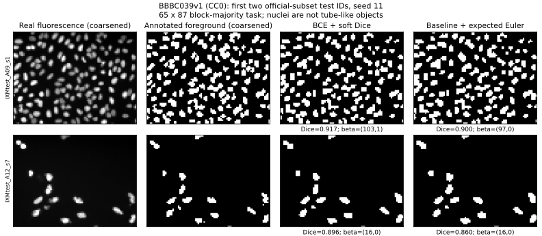
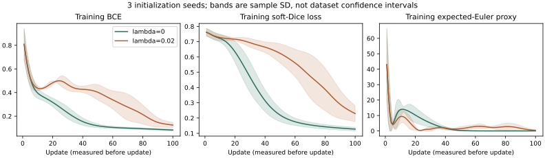

# 项目 D · 真实二维图像分割与 Euler 拓扑损失

本项目状态：**Reviewed（模型交叉检查），实际运行与同环境重跑完成，待人类审阅**；[审查记录](../../project/reviews/AI-PROJECT-D.md)。使用真实公开细胞显微图；实验是探索性小样本语义分割，不是临床验证或原论文复现。

## 1. 学习目标

你将能够核验公开数据的许可与原图分组，定义二维像素对应的拓扑空间，推导期望 Euler 示性数（expected Euler characteristic）及其梯度，训练一个实际更新权重的轻量网络，并用像素、骨架和 Betti 指标分析拓扑代理的局限。最终报告必须允许负结果；“拓扑损失”不是自动提高分割质量的保证。

## 2. 先修知识

[A2 · 评价协议](../evaluation-protocol.md)、[A3 · 拓扑损失](../topological-loss.md)、[项目 C · 持续同调反传](topology-optimization.md)，以及链复形、Euler 交替和、概率独立性和链式法则。需要 Python/NumPy 的数组与矩阵乘法。

本项目采用有限立方复形（cubical complex）：选中方格后同时加入它的边和顶点。抽象同调群与胞腔链群一致性的完整证明仍依赖理论课程的外引定理。下文期望与导数公式完整证明；平面洞数与补集分量的对应明确说明其理论依赖，不用有限测试冒充一般证明。

## 3. 问题引入：直观解释

同一张细胞核图，像素重叠率很高时仍可能把两个相邻核连起来，或填平一个洞。但这些核本来就应有多个分量，不能直接把“越连通越好”当成正确目标。还要问：图像里的像素代表点、开方格，还是闭方格？对角接触是否算连通？

本项目将这些选择写进协议，然后比较同一网络的两种目标：BCE 加 soft Dice，及其加期望 Euler 项的版本。实验显示后者在当前设置下更差。这给我们一个可以追查到输入、梯度和全部预测的失败实例。

## 4. 严格定义、真实数据与固定协议

### 数据来源与分组

[BBBC039v1 官方页面](https://bbbc.broadinstitute.org/BBBC039)提供真实 U2OS 细胞 DNA 通道荧光图、人工细胞核标注和官方划分，并明确采用 [CC0](https://creativecommons.org/publicdomain/zero/1.0/)。获取日期为 **2026-10-14**；图像、标注和metadata归档合计80,687,375字节。来源、长度、SHA256、每幅图ID与plate均保存在项目目录，不需要账号。

在官方训练100幅、验证50幅、测试50幅中，各按文件名排序取前12/6/6幅；不依据图像难度或结果选样。原始图像ID互斥，但**不同集合有plate重叠**，所有数据来自同一高通量实验；不能称为跨批次泛化评估。标注第一通道非零取并，得到二值语义前景；不同实例颜色接触后可能合并，因此这里的 $\beta_0$ 不等于人工实例计数。

为使CPU实验可快速重现，将520×696原图按8×8块平均，标注按块内至少一半为前景，得到65×87。每幅图用自身块平均强度的1%和99%分位数归一化并截到 $[0,1]$，不使用标签或跨图拟合参数。**24幅图的 Betti 数全部因粗化而变化**，原始与粗化值均记录。例如首个测试ID的二值原标注为 $(123,0)$，粗化后为 $(103,6)$。课程结果仅针对粗化网格，不据此报告原分辨率拓扑或细胞计数精度。

项目代码、数据与运行入口：[候选分支项目目录](https://github.com/Kevin20041008/topology-from-zero/tree/codex/v0.6-proof-learning/projects/image-topology)。这是本批候选内容；完整许可记录见目录中的 DATA_LICENSE.md。

### 像素空间与指标

**定义 D.1（闭方格前景）。** 对二值掩膜 $Y\in\{0,1\}^{H\times W}$，令

$$
K(Y)=\bigcup_{Y_{ij}=1}[i,i+1]\times[j,j+1]\subset\mathbb R^2,
$$

并把包含于这些方格的全部边和顶点加入。$\beta_k$ 指该有限复形的 $\mathbb F_2$ 同调维数。角点接触使闭方格相连，因此前景使用8邻接；补集使用4邻接。画布外是一整个背景区域，不使用环绕边界。

实现用前景8邻接分量数求 $\beta_0$；掩膜补集外补一圈背景，4邻接分量数减一求 $\beta_1$。后式是有限平面复形的洞数公式，可由平面 Alexander 对偶得到：$K$ 紧致且局部可缩，$\widetilde H_0(S^2\setminus K;\mathbb F_2)\cong H^1(K;\mathbb F_2)$；其完整对偶证明未在本项目展开，参考 Hatcher 第3章相应对偶主题。离散背景4邻接表示补集中可通过边隙连接的区域，外圈代表包含无穷远点的唯一外部区域。独立显式边界矩阵测试核对有限输入。

空前景取 $(\beta_0,\beta_1)=(0,0)$。硬预测为 $P=\{p_{ij}\ge0.5\}$。Dice 定义为 $2|P\cap Y|/(|P|+|Y|)$；两者都空取1，只有一者空取0。

若 $S(P),S(Y)$ 为所用二值骨架，定义

$$
t_p=\frac{|S(P)\cap Y|}{|S(P)|},\qquad
t_s=\frac{|S(Y)\cap P|}{|S(Y)|},\qquad
\operatorname{clDice}=\frac{2t_pt_s}{t_p+t_s}.
$$

和为零时clDice取0；掩膜都空取1，只有一者空取0。非空掩膜若算法返回空骨架，程序显式报错，不造一个分数。使用 scikit-image 的二维骨架化。**细胞核不是管状对象**；本项目仅把clDice作为骨架覆盖指标，不把管状结构论文的拓扑保证移植到这些核上，也不把骨架分数当同胚判据。

额外输出 $|\widehat\beta_0-\beta_0|$、$|\widehat\beta_1-\beta_1|$、两数同时正确比例、“是否恰有一个分量”的一致率，以及最大前景分量占总前景像素比例的误差。空前景的最大分量占比定义为0。

### 概率模型、网络与损失

**定义 D.2（独立占据的期望）。** 给每个像素概率 $p_i$，构造虚拟随机掩膜 $Z_i\sim\mathrm{Bernoulli}(p_i)$，各像素独立。令 $\mu(p)=\mathbb E[\chi(K(Z))]$。这是训练代理的数学模型，不声称真实细胞像素相互独立，更不是把网络概率直接当某个确定复形。

每像素12个特征为3×3邻域9个强度、7窗口均值、3窗口标准差、15窗口均值；复制边缘填充，特征统一减0.5。共享 MLP 为12→8→1，tanh后接sigmoid，共113个可训练参数，无预训练模型。设每图 $M=65\cdot87$ 个像素，$n=12$，则

$$
L_{\mathrm{BCE}}=\frac1{nM}\sum_{a,i}[\log(1+e^{z_{ai}})-Y_{ai}z_{ai}],
$$

$$
L_{\mathrm{Dice}}=\frac1n\sum_a\left(1-\frac{2\sum_i p_{ai}Y_{ai}+1}
{\sum_i p_{ai}+\sum_iY_{ai}+1}\right),\quad
L_E=\frac1{nM}\sum_a[\mu(p_a)-\chi(K(Y_a))]^2,
$$

$$
L=L_{\mathrm{BCE}}+0.5L_{\mathrm{Dice}}+\lambda L_E,\qquad \lambda\in\{0,0.02\}.
$$

训练损失使用期望 Euler 多项式，**没有持续配对**。它不是PH损失，也不等价于分别匹配 $\beta_0,\beta_1$。辅助灰度H0函数另作教学核对，不参与本实验优化。

协议固定为种子11、23、37，全批量Adam100轮、学习率0.02、矩常数0.9/0.999、分母常数 $10^{-8}$。验证每20轮只监测，检查点固定最终轮；测试数组在最后一次更新后读取。没有按验证或测试选种子、阈值、权重或轮数。记录给出可审查固定协议，**不声称已经独立证明预注册发生的历史时序**。

## 5. 定理与证明

**命题 D.3（期望 Euler 公式）。** 令 $I(c)$ 是与胞腔 $c$ 关联的画布内方格集合；$V,E,F$ 是整个画布格点、格边、格面。则

$$
\mu(p)=\sum_{v\in V}\left[1-\prod_{i\in I(v)}(1-p_i)\right]
-\sum_{e\in E}\left[1-\prod_{i\in I(e)}(1-p_i)\right]+\sum_i p_i.
$$

**证明。** 在给定随机掩膜中，胞腔 $c$ 被加入，当且仅当至少一个关联方格被选中。像素独立意味着全部关联方格未被选中的概率是 $\prod_{i\in I(c)}(1-p_i)$，所以胞腔出现概率是其补。对每个实现，有限胞腔Euler数为顶点数减边数加面数。将每个计数写成出现指示变量的和，再用期望线性性得到公式。这里不需要、也没有假设相邻胞腔的指示变量独立。边界顶点可能只有1或2个关联方格，域外方格视为永远不选；空乘积约定为1。$\square$

**命题 D.4（可反传的精确多项式）。** 对画布内某像素 $j$，

$$
\frac{\partial\mu}{\partial p_j}=
\sum_{v:j\in I(v)}\prod_{i\in I(v)\setminus\{j\}}(1-p_i)
-\sum_{e:j\in I(e)}\prod_{i\in I(e)\setminus\{j\}}(1-p_i)+1.
$$

这个多项式在 $p_j=0$ 或1处也有定义。

**证明。** 有限和可以逐项求导。与 $j$ 无关的项导数为零；相关项 $1-(1-p_j)\prod_{i\ne j}(1-p_i)$ 的导数等于剩余乘积。格面项导数为1。直接计算排除 $j$ 的乘积，不使用“原乘积除以 $1-p_j$”，因此不会在 $p_j=1$ 时引入 $0/0$。$\square$

设每图 $N_a=2\sum_i p_{ai}Y_{ai}+1$、$D_a=\sum_i p_{ai}+\sum_iY_{ai}+1$、$\delta_a=\mu(p_a)-\chi(Y_a)$，则对logit的梯度为

$$
\frac{\partial L}{\partial z_{ai}}=
\frac{p_{ai}-Y_{ai}}{nM}
+\left[\frac{0.5(N_a-2Y_{ai}D_a)}{nD_a^2}
+\frac{2\lambda\delta_a}{nM}\frac{\partial\mu}{\partial p_{ai}}\right]p_{ai}(1-p_{ai}).
$$

这是商法则、D.4和sigmoid链式法则的直接合成。再通过线性层和tanh反传，便得到全部113个参数梯度；代码没有手工移动一个形状参数冒充网络训练。

**反例 D.5（Euler 相同不意味着 Betti 相同）。** 一个实心方块的 $(\beta_0,\beta_1)=(1,0)$；一个方环与一个不相连实心方块的并为 $(2,1)$。两者Euler数均为1，但分量数和洞数不同。

**证明。** 实心方块可缩，所以仅一个零维类。方环形变收缩到圆周，产生一个一维类；另一个不相交实心方块增加一个零维类。因此第二者有两个分量、一个洞，交替和 $2-1=1$。同胚或同伦等价会保持这些Betti数，所以两者也不可能同伦等价。$\square$

此外 $\mu(p)=\chi(Y)$ 只是随机掩膜Euler的**期望**相等，并不强制阈值掩膜的Euler相等。把期望、阈值结果和两个独立Betti数混为一谈，会比D.5再多犯一步错误。

**命题 D.6（辅助H0的短条）。** 给每个闭方格一个进入值 $q_i$，将方格及其面在该值同时加入。8邻接图在任意尺度与该方格并具有相同分量；按elder规则合并所记录的有限条为 $[b,d)$。仅当 $d=b$ 时该条在真实尺度不存活。

**论证。** 交于边或顶点的两方格同处一个分量，未通过这些接触链连接的有限方格簇之间不能连续相连，故分量与8邻接一致。加入方格与相邻已进入方格的连接只合并分量，标准零维elder换基论证见项目C。等值事件的细排序只产生零长度中间对；若 $d>b$，尺度 $b$ 已经见到该类而 $d$ 前尚未死亡，无论 $d-b$ 多小都不能删除。实现保留全部可表示正长度条，包括最小正subnormal，不用容差决定数学类是否存在。一般区间分解定理仍引用理论课程。$\square$

## 6. 典型例题：正例与反例

**单个像素。** 它被选中时贡献4个顶点、4条边、1个面，Euler为1；未选中时为0，所以 $\mu(p)=p$，导数为1。边界补零与像素补一混用会破坏这个最小检查。

**对角相接。** 两个对角闭方格共享一个顶点，$V=7,E=8,F=2$，Euler为1，且只有一个分量。若把前景改成4邻接会得两个分量，和当前空间定义不一致。

**孔洞与边界。** 3×3方格去掉中心是一个环，Betti为 $(1,1)$。把环割开连到画布外，原来的空白区域与外部背景连通，就不再算洞。外补一圈用于统一判断哪个背景分量是外部。

**真实失败例。** 固定首个测试ID IXMtest_A09_s1_w1CE70AD49-290D-4312-82E6-CDC717F32637.png，种子11：粗化真值 $(103,6)$；基线预测 $(103,1)$、Dice0.917210；Euler模型预测 $(97,0)$、Dice0.900130。仅零维计数碰巧正确的基线仍漏了5个洞；Euler模型的两个维数都不对。图像中有很多实体核，不能要求它们合成一个连通前景。

**代理并不保证优化收益。** 种子11最后一次更新前，基线 $L_E=0.006098$，Euler组 $L_E=0.046026$。两者都比初始值小，但增加这个目标并不使非凸有限轮优化必然达到更小的最终代理。不能以“有正则项”代替实测，也不能为得到理想叙事重调测试结果。

## 7. 原创图解与全部结果的关系

图固定显示首两张测试图和种子11，列为真实图粗化结果、人工语义标注粗化结果及两模型预测。全部六个运行的每幅概率都保存，不用这两张图代表完整评价。粗化标注含原图中没有的洞，已在manifest列出。

阴影是同一数据集上3次初始化的样本标准差，不是跨图像总体的置信区间；横轴数据为更新前损失。图由保存的JSON生成，无重新拟合曲线或筛选种子。

## 8. 编程实验、实测数据与复现

使用项目局部requirements建立环境；已提交的24图预处理文件足以运行，无须CI下载原始81MB：

~~~text
python -m pip install -r projects/image-topology/requirements.txt
python projects/image-topology/test_project.py
python projects/image-topology/train.py --output projects/image-topology/results-rerun
python projects/image-topology/verify.py --results projects/image-topology/results-rerun/results.json --rerun
~~~

完整6组训练约27秒，实际运行环境为Python3.14.3及NumPy2.5.2。不同平台应另存结果，再在同一平台重算核验；不要要求Linux BLAS与Windows存档必定逐位一致。无参数verify校验提交的存档，目标是记录环境。NumPy初始化前固定线程配置，避免验证进程与训练进程的归约次序不同。

| 固定损失 | Dice（SD） | clDice（SD） | $\beta_0$绝对误差（SD） | $\beta_1$绝对误差（SD） |
|---|---:|---:|---:|---:|
| BCE + 0.5 softDice | 0.906813（0.007757） | 0.951401（0.005163） | 2.944444（1.004619） | 1.277778（0.096225） |
| 基线 + 0.02 Euler | 0.861300（0.025727） | 0.918000（0.021252） | 4.388889（0.630990） | 1.333333（0.166667） |

两个Betti数同时正确的图像比例，按种子平均为0.166667与0。最大分量占比绝对误差为0.004139与0.006966。“是否连通”一致率两者都是1，因为所有真值和预测都不只有一个分量；它在这批数据上几乎没有区分能力。全部数据是**同6幅测试图上的3次初始化**，不是18幅独立测试图。

本次Euler项未带来收益。该结果既不否定全部拓扑损失，也不支持对其他任务推广。未做超参数搜索、外部分布、原分辨率实例分割或临床实验。

**适用测试。** 512个3×3二值掩膜用显式F2边界矩阵核对 $\partial^2=0$、Betti与Euler；729个2×3灰度输入用独立图边界约化核对H0条和5个阈值；Euler期望与16种独立Bernoulli结果逐项求和相符，另有像素梯度和完整小网络梯度差分、正短条、空输入、骨架除零及24图哈希/分组检查。导数差分容差仅检查浮点导数，不删除拓扑类或放宽Betti断言。有限检查不是形式化验证。

## 9. 项目任务与课后习题

1. **基础。** 对一像素、两个共享边方格、两个对角方格，分别数 $V,E,F$ 并求Betti。解释为何不能混用4邻接前景。
2. **证明。** 重证D.3，指出用了哪一种独立性、哪一步仅用了期望线性性。画布边界为何不能直接当四个可随机选择的方格？
3. **求导。** 推导D.4和softDice的 $p_i$ 导数，解释代码为什么不以除法求排除某因子的乘积。
4. **反例。** 构造两个Euler同为1但Betti不同的有限像素掩膜，并说明低Euler损失不能保证阈值拓扑。
5. **数据审计。** 从manifest找首个测试图原始与粗化Betti，说明其变化不能归因于神经网络。解释为什么当前按原图分组仍不等于按plate隔离。
6. **指标。** 推导clDice的两个分母，写出空掩膜与空骨架策略，并解释高clDice不能在本细胞核任务中直接宣称血管拓扑保证。
7. **结果分析。** 从全部六组结果求Euler组减基线的Dice及两维Betti误差，解释初始化SD的范围。若某个种子改善，能否只报告它？
8. **挑战。** 设计后续跨plate、原分辨率实验：列出训练/验证/测试隔离、拓扑像素模型、缺失/相接实例处理、参数选择和失败案例规则；指出哪些当前证据不能直接复用。

??? tip "第一层提示"
    1：共享角点只减一个顶点。2：对每胞腔用“至少一个相邻像素出现”。3：先令Dice分子为N、分母为D。4：在环旁放一块不相接方格。5：查同一个原始ID与source_plate。6：骨架为空时比例未定义。7：相同6张图被重复评价。8：同一plate的所有图和派生裁剪必须放在同一组。

??? tip "第二层提示"
    1：两个对角方格有7顶点8边2面。2：胞腔指示变量可以相关。3：$\partial(1-N/D)/\partial p_i=(N-2Y_iD)/D^2$。4：分量与洞可同时增加一而抵消Euler变化。5：首图$(123,0)\to(103,6)$发生在预处理。7：报告所有种子、逐图配对和共同测试集。8：当前固定0.5阈值可作为起点，但新协议若选阈值只能用验证组。

## 10. 完整解答

**1.** 一方格 $(V,E,F)=(4,4,1)$；共享一条边时 $(6,7,2)$；仅共享角点时 $(7,8,2)$，Euler均为1。三者都可缩且连通，Betti均为 $(1,0)$。4邻接会把最后一例分成两块，与闭方格角点相交矛盾；若改模型就必须连同全部指标和公式一起重定义。

**2.** 对每个胞腔，未出现等于所有相邻方格未选中，由像素选择独立得乘积概率。然后对有限Euler交替和取期望。不同胞腔共享像素，故它们不独立；线性性不要求它们独立。域外方格不在随机变量集合中，等价于占据概率0，不能向边界额外贡献随机边/顶点。

**3.** 相关乘积中只有 $1-p_j$ 随 $p_j$ 变化，前面的负号与其导数负号抵消，得其他因子乘积；边项再带Euler负号。Dice有 $N'=2Y_i,D'=1$，所以 $-(N'D-ND')/D^2=(N-2Y_iD)/D^2$。排除因子直接相乘在 $p_j=1$ 时仍有意义；用全乘积除以零会产生未定义值，不能以任意小常数掩盖公式错误。

**4.** 一实心方格与“3×3中心挖空的环加一个远处实心方格”Euler均为1，Betti分别为 $(1,0)$ 与 $(2,1)$。两个不变量同时变化抵消，因此即使确定性Euler完全正确也不够。概率期望相等更弱，甚至不要求0.5阈值掩膜Euler相等。

**5.** 首测试ID的原始二值语义掩膜为 $(123,0)$，8×8块多数粗化后为 $(103,6)$；manifest在训练前的数据处理产物中同时保存两者。合并或删除细小结构及粗格布局会改变连通性和洞，网络尚未参与。source_plate例如20608出现在多个划分，不同原图虽不重合，仍可能共享实验批次；新任务若研究跨批次泛化，必须按plate再分组并重新训练。

**6.** 分子分别是预测骨架落在真值中的像素数、真值骨架落在预测中的像素数；除以对应骨架总像素数。两掩膜空约定1，一者空约定0；掩膜非空而骨架空时程序拒绝。这是公开的指标扩展。核是实体小团块，其骨架覆盖与血管路径语义不同；当前没有验证论文拓扑定理的全部前提，不能把一个高分提升为同伦等价结论。

**7.** 测试Dice均值差为约 $-0.045513$，$\beta_0$绝对误差差约 $+1.444445$，$\beta_1$绝对误差差约 $+0.055555$；均对Euler组不利。逐种子值保存在summary中，不得删除失败种子。SD只表示同一数据上的初始化变化，不能把3×6个输出视为18幅独立图或构造未经说明的总体显著性结论。

**8.** 先按plate固定组，源图及所有裁剪/增强跟随其原图；只在训练组拟合归一化统计或模型，验证组按预定规则选参数，最终冻结后评价一次测试组。原分辨率需要重新预算算法并重定义语义/实例边界，尤其接触核是否保留实例分隔。坚持完整保留失败例和全部种子。D.3–4的有限闭方格概率公式仍可用，但24图粗化结果、当前参数、计时、最小特征尺度和测试指标不能直接算作新任务证据。

## 11. 项目总结

真实数据、精确拓扑约定与可复现训练缺一不可。期望Euler给出可完整推导的轻量损失，但同时带来不变量抵消和概率到阈值的差距。当前负结果帮助识别这些限制；它没有被改写成性能收益。

## 12. 参考书目与来源核验

- [BBBC039v1 官方数据与许可页](https://bbbc.broadinstitute.org/BBBC039)，已于2026-10-14核验并下载；数据来源及SHA256见项目记录。
- Juan C. Caicedo et al., *Evaluation of Deep Learning Strategies for Nucleus Segmentation in Fluorescence Images*, Cytometry Part A, 2019，[DOI](https://doi.org/10.1002/cyto.a.23863)。已核验出版方书目信息；本项目未复现该论文网络及基准。
- Suprosanna Shit et al., *clDice — A Novel Topology-Preserving Loss Function for Tubular Structure Segmentation*, CVPR 2021，[作者论文](https://arxiv.org/abs/2003.07311)与[会议页面](https://openaccess.thecvf.com/content/CVPR2021/html/Shit_clDice_-_A_Novel_Topology-Preserving_Loss_Function_for_Tubular_Structure_CVPR_2021_paper.html)。这里只复用指标定义的思想，不宣称复现其训练目标或拓扑保证。
- Allen Hatcher, *Algebraic Topology*, 第3章对偶主题，[作者教材入口](https://pi.math.cornell.edu/~hatcher/AT/ATpage.html)。Alexander对偶的完整证明属于外引，不声称本项目已逐页核验或形式化证明。

说明、推导、代码与结果图由本项目原创；显微图及人工标注来自明确记录的CC0来源。数据许可证与教材代码许可证分别记录。
