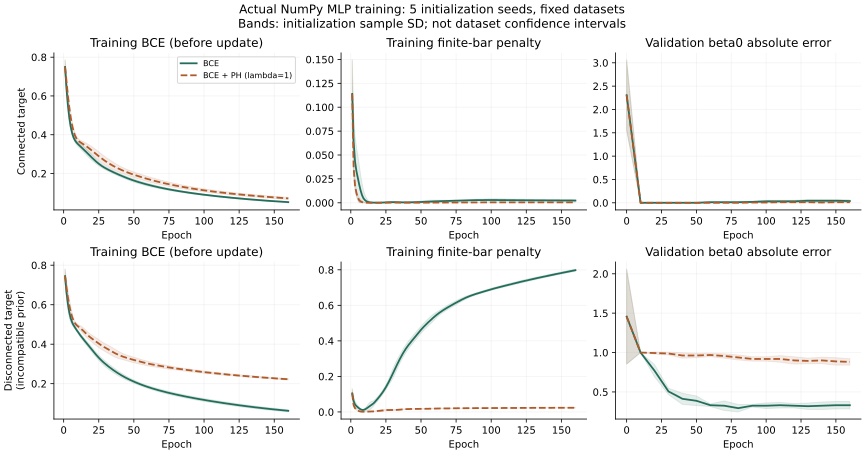

# 项目 C · 真正训练一个带拓扑损失的小网络

<div class="chapter-meta">独立课程项目 · Reviewed（非编写模型复核），待独立人类审稿<br>原创合成任务；NumPy 实际反向传播；五个初始化种子；不是临床实验或论文方法复现，也不是形式化验证。</div>

## 1. 学习目标

完成项目后，你应能训练一个真实的两层网络，把持续同调端点的分支梯度传到网络权重，核对全部参数梯度；按固定训练/验证/测试规则比较普通损失与拓扑项；解释较低拓扑代理损失何时会得到错误的目标拓扑。验收看代码、证据和解释，不以“必须优于基线”为目标。

## 2. 先修知识

[A3 · 拓扑损失](../topological-loss.md)、[A8 · 可微持续同调](../differentiable-persistence.md)、[A2 · 评价协议](../evaluation-protocol.md)和[R1 · 持续模](../../persistence/modules-reduction.md)。另需有限域边界约化、链式法则、矩阵乘法和基本 Python/NumPy。这里不需要深度学习框架或 GPU。

## 3. 问题引入：直观解释

给定12个位置的噪声观测，网络应恢复哪一段位置属于前景。观测中故意压低一个前景点，造成类似窄桥断开的输入；也抬高一个背景点，产生假阳性。一个任务的正确前景是一段连续区间，另一个任务有两个真实分支。

两种任务都比较普通二元交叉熵与加入“压制有限零维持续条”的目标。第二个任务故意保留不兼容的单分支倾向，检验模型是否为了满足先验填掉真实间隙。它是受控合成反例，不把一维数组称为真实血管。

## 4. 严格定义与协议

固定路径 $K=v_0-\cdots-v_{11}$。一个样本的观测 $x\in[0,1]^{12}$，真值 $y\in\{0,1\}^{12}$。网络有612个可训练参数：

$$
h=\tanh(xW_1+b_1),\quad z=hW_2+b_2,\quad p=\operatorname{sigmoid}(z),\quad q=1-p,
$$

其中 $W_1\in\mathbb R^{12\times24}$、$W_2\in\mathbb R^{24\times12}$。顶点 $v_i$ 在 $q_i$ 时进入，下星边在 $\max(q_i,q_{i+1})$ 时进入。系数为 $\mathbb F_2$；最终路径连通，普通 $H_0$ 恰有一条无限条，有限正条记作 $[b_j,d_j)$。

对 $n$ 个训练样本，总损失为

$$
L_{\mathrm{BCE}}=\frac1{12n}\sum_{a,i}\bigl[\log(1+e^{z_{ai}})-y_{ai}z_{ai}\bigr],\qquad
L_{\mathrm{PH}}=\frac1n\sum_a\sum_{j\in\mathcal B_a}(d_j-b_j)^2,
$$

$$
L=L_{\mathrm{BCE}}+\lambda L_{\mathrm{PH}},\qquad \lambda\in\{0,1\}.
$$

BCE 用 `logaddexp` 稳定计算；PH 核心只略过真正零长度条，保留所有可表示正条。无限条不伪造死亡时间。该代理约束有限条，**不是**固定阈值 $p_i\ge0.5$ 的连通性保证，且不包含前景存在性或空间位置保证。

**固定实验协议。** 每个任务的训练/验证/测试各96/32/64个独立生成样本；ID包含任务、集合和序号。随机生成的原始样本不跨集合复制。两个任务的数据种子分别为7301–7303和7401–7403；初始化种子为11、23、37、51、71。每组做160次全批量 Adam 更新，学习率0.02、$\beta_1=0.9,\beta_2=0.999$、分母平滑常数$10^{-8}$。该平滑常数只在优化器中使用，不进入同调区间过滤。

验证集仅监测，不用于选权重或轮数；检查点固定为第160次更新后。测试指标在训练结束后计算，不调参、不挑种子。五次初始化共享数据集，不能称为五个独立数据集。实现、协议与结果的入口见[仓库项目目录](https://github.com/Kevin20041008/topology-from-zero/tree/codex/v0.5-learning-quality/projects/topology-optimization)；链接指本批候选分支。

`protocol.json` 记录本实验的固定协议，并不是任意可调的通用配置接口。当前 `threshold=0.5` 对应评价函数中固定的0.5阈值，数据生成固定为12顶点；若改变阈值或顶点数，必须同步修改实现、数学范围与测试，并完整重跑生成新结果，不能只改 JSON 字段。

## 5. 定理与证明：梯度为何可以进入权重

**命题 C.1（路径 elder 配对的含义）。** 顶点值递增扫描路径，顶点进入时产生一个分量；每条进入的边合并两个不同分量时，让较晚出生的分量死亡。按固定索引打破同值后，记录的正有限区间与下星 $H_0$ 条形码一致。

**证明。** 每个尺度的 $H_0$ 由该尺度的道路分支生成。加入孤立顶点使维数加一；加入连接不同分支的边使两个分支生成元具有同一像，其核为两生成元之和。沿扫描维持每个活动分量的最早出生生成元。合并时保留较早元，用两元之和替换较晚元，后者从较晚出生时已存在，并在当前边进入时映为零，因此给出一个从较晚出生到当前尺度的区间。这个换基不改动此前更早尺度的像；归纳处理全部事件便给出区间分解。路径没有循环边，最后留下最早出生的一条无限条。同值事件细排可能产生零长度对，它们在真实尺度上没有存活区间，删去它们不改变持续模；正长度对不应删去。一般持续模区间分解背景沿用 R1。$\square$

**命题 C.2（固定分支的反传）。** 在顶点次序和端点身份固定的开区域，若区间的出生、死亡来自顶点 $u,w$，其寿命平方对 $q$ 的梯度只在这两个位置贡献 $-2(d-b)$、$2(d-b)$。设 $g^q_{ai}$ 为样本 $a$ 的未平均PH梯度，则

$$
\frac{\partial L}{\partial z_{ai}}
=\frac{p_{ai}-y_{ai}}{12n}
-\frac{\lambda}{n}g^q_{ai}p_{ai}(1-p_{ai}).
$$

**证明。** 固定端点给 $d-b=q_w-q_u$，平方求导得到两项。$q=1-p$，且 $\partial p/\partial z=p(1-p)$；BCE对logit的导数是$p-y$。加入各自归一化系数得式。再以

$$
G_{W_2}=h^TG_z,\quad G_{b_2}=\sum_a(G_z)_a,\quad
G_h=(G_zW_2^T)\odot(1-h^2),\quad
G_{W_1}=x^TG_h,\quad G_{b_1}=\sum_a(G_h)_a
$$

反传即得全部参数的分支梯度。这里的 $G_h$ 表示乘过 tanh 导数后的隐藏层预激活梯度。其有效性依赖当前组合区域；不是对排序/配对切换处的经典可微性证明。$\square$

**命题 C.3（不兼容目标）。** 对二值 $q\in\{0,1\}^{12}$，若前景 $\{i:q_i=0\}$ 有 $c\ge1$ 个分支，则恰有$c-1$条正有限$H_0$条，每条为$[0,1)$，故 $L_{\mathrm{PH}}=c-1$（单样本）。

**证明。** $0\le s<1$ 时子路径正是$c$个前景分支；$s\ge1$时全路径连通。其合并映射秩为1，核维数$c-1$。所以$c-1$个类在1死亡，另一个无限持续。$\square$

在准确恢复双分支二值真值时，PH项等于1；填平间隙成为单分支可把该项降到0。网络训练在概率域权衡BCE与PH，未必达到这两端之一，但二者目标冲突已经严格可见。全空前景$q\equiv1$也没有正有限条，说明零PH损失不能保证有一个前景分支。

## 6. 典型例题：正例、反例与实测失败

**基础例。** $q=(0,0.8,0.2)$有有限条$[0.2,0.8)$和无限条$[0,\infty)$。PH项为0.36，固定分支梯度为$(0,1.2,-1.2)$。它同时可降低桥值、抬高较晚分量出生值，不保证一定选择“补桥”。

**非平凡正例。** 本项目全网络梯度检查采用5输入、4隐藏、5输出的小模型，对49个参数逐一作中央差分，要求左右扰动的配对身份与原点完全一致，再以绝对误差$2\cdot10^{-9}$核对分支梯度。这里的误差界仅用于浮点导数核查，不删减任何同调条。

**不可微反例。** $q=(0,a,b,0)$给损失$\max(a,b)^2$。在$a=b=0.5$，关于$a$的左导数0、右导数1，经典偏导不存在。本实现按索引处理等值，选出的死亡顶点为2；这是一条分支，不是全部方向的导数。保存记录包含两侧输入、端点身份和差商。训练每轮重新计算配对，并统计身份变化；所有完整运行的已采样训练步中顶点同值样本数为0，但多次相邻步配对改变，因此不能宣称整条优化轨迹都处于一个光滑区域。

**真实运行的失败例。** 种子11的`disconnected/test/0000`，真值、基线硬预测及拓扑模型硬预测分别为

```text
真值：      0 1 1 1 1 0 1 1 0 0 0 0   beta0=2
BCE：       0 1 1 1 1 0 1 1 0 0 0 0   beta0=2
BCE + PH：  0 1 1 1 1 1 1 0 0 0 0 0   beta0=1
```

这是训练后按固定ID查看的失败解释，不用于调参。甚至先验匹配的任务也非逐样本改善：`connected/test/0024`在同一种子下基线有一个分支，拓扑模型却有两个分支。平均改善不等于每个预测正确。

## 7. 原创图解与实际优化轨迹



图由`plot_results.py`从原始JSON生成。上行为单分支真值，下行为双分支真值；左列是每次更新前训练BCE，中列是训练PH代理，右列是更新后所记录检查点的验证$\beta_0$绝对误差。实线为BCE，虚线为BCE+PH。阴影为五个初始化的样本标准差，不是数据集泛化置信区间；绘图没有使用测试曲线挑轮数。

## 8. 编程实验：命令、结果与验收

在仓库根目录，使用已安装NumPy的Python运行：

```text
python projects/topology-optimization/test_project.py
python projects/topology-optimization/train.py --smoke --output projects/topology-optimization/results-smoke
python projects/topology-optimization/verify.py
python projects/topology-optimization/verify.py --rerun
```

完整环境安装、生成规则和另存结果的命令在项目README。训练只依赖NumPy，绘图额外使用仓库已有Matplotlib。完整运行20组约13秒；记录平台为CPython3.14.3、NumPy2.5.2。`--smoke`只检验管线能运行，**不能**当完整实验；`verify.py`重新计算已存权重的全部指标；`--rerun`重新训练20次并精确比较记录，当前环境全部通过。跨平台逐位重现不是本项目保证，差异须另存并说明，不能删除短条或放宽拓扑断言。

下表是五个种子在同一固定测试集上的均值，括号为初始化样本标准差。BCE与PH也都是测试集上的独立评价，不是同名训练曲线的末点。

| 任务与损失 | BCE | PH代理 | Dice（SD） | $\beta_0$绝对误差（SD） |
|---|---:|---:|---:|---:|
| 单分支，BCE | 0.156635 | 0.010569 | 0.942954（0.002089） | 0.037500（0.013975） |
| 单分支，BCE+PH | 0.156030 | 0.003689 | 0.944002（0.006978） | 0.021875（0.008558） |
| 双分支，BCE | 0.419488 | 0.787616 | 0.864197（0.006430） | 0.296875（0.045554） |
| 双分支，BCE+PH | 0.325083 | 0.066278 | 0.854629（0.002909） | 0.871875（0.043358） |

双分支任务中测试BCE也下降了，但硬预测Dice和拓扑准确性变差；指标评价的对象不同，不能只选一个有利数值宣称成功。原始记录保留每个种子的配对差、最终权重、全部测试概率与160轮轨迹。没有真实图像、多数据划分、医学外部测试或论文训练复现，当前证据仅支持这个合成协议下的描述。

**测试范围。** 243组五顶点离散值路径与独立F2边界矩阵约化精确一致，并在6个尺度核对$\beta_0$；20个严格顶点排序输入共180个顶点偏导及全网络49个参数通过差分；极小正条含最小正subnormal被保留；输入错误、配对切换、同值策略、分组和真实训练确定性均有测试。自动化通过不等于任意持续学习算法已证明正确。

## 9. 项目任务与课后习题

1. **基础。** 推导612个参数的计数，写出每层矩阵和批量梯度的形状。
2. **证明。** 重证C.3，并解释全空预测为什么也可能取得零PH代理。
3. **计算。** 对$q=(0,0.8,0.2)$计算有限条、PH值和顶点梯度，解释抬高出生值会怎样影响分割。
4. **反例。** 证明四顶点模型在$(a,b)=(0.5,0.5)$不可微；解释代码选一个分支与真实右方向导数的区别。
5. **工程。** 运行8项单测，再运行smoke；说明哪份输出不能填入完整实验结果表，以及验证数据是否被用于选最优epoch。
6. **实证分析。** 用保存的20组结果按种子计算拓扑模型减基线的Dice和$\beta_0$误差；解释为何不能把320个测试预测当320个独立测试对象。
7. **失败分析。** 重建两个指定失败ID的概率、硬掩膜及条形码。提出一种改造目标的思路，但不得通过事后删除失败种子或换测试阈值宣称改进。
8. **挑战。** 将目标改为保留一个有限分支条时，指出缺条、条排序切换、无限条和阈值位置四项必须新增的规则。设计新的预登记训练/验证协议，并说明哪些现有证明仍适用。

??? tip "第一层提示"
    第1题两个偏置也有参数。第2题区分最终路径与阈值前景。第3题寿命是死亡减出生。第4题分开左右差商。第6题各初始化复用了同一测试样本。第8题参考A3中$m>N$时公式未定义的边界。

??? tip "第二层提示"
    第1题为$12\cdot24+24+24\cdot12+12$。第2题有$c$个类在0出生，最后只留一个。第3题$q$增大表示$p$减小。第4题中央差分极限0.5也不能证明导数存在。第7题按原ID对齐模型输出，别把预测按分数重新排序。第8题“保留一条”不自动意味着在$s=0.5$活跃。

## 10. 完整解答与提交要求

**1.** 参数数为$288+24+288+12=612$。批量$x$为$n\times12$，$h$为$n\times24$，$z,p,q$为$n\times12$。$G_z$为$n\times12$，$h^TG_z$为$24\times12$，$(G_zW_2^T)\odot(1-h^2)$为$n\times24$，左乘$x^T$得到$12\times24$。两个偏置梯度分别按样本行求和。

**2.** $0\le s<1$时有$c$个道路分支；在1进入剩余顶点边后全路径连通。$c$维到1维的合并映射核有$c-1$维，形成$c-1$条$[0,1)$。全空前景$q\equiv1$只在1同时出现一条无限类，有限条为空，PH为0，而阈值$s=0.5$前景为空、$\beta_0=0$。因此该损失没有非空保证。

**3.** 较晚分量在0.2出生，0.8合并，寿命0.6、平方0.36；梯度为$(0,1.2,-1.2)$。下降方向既可降低$q_1$补桥，也可提高$q_2$削弱右侧前景。端点损失没有单独声明哪种改动符合真值，BCE提供另一个约束。

**4.** 固定$b=0.5$，左侧$L=0.25$，右侧$L=a^2$，左导数0、右导数1。代码选死亡顶点2时，对$a$给分支值0，但往$a$正向运动的真实右导数是1。中央差分极限0.5只是两侧差商的平均，不能当作存在的普通偏导。

**5.** 单测的成功说明所列有限案例和数学分支被核对；smoke仅2轮、1种子、小训练集，不能复制成160轮5种子的表格。验证轨迹在0、10、20等检查点记录，但没有选最优轮的逻辑；固定最终轮后才计算测试指标。更换此规则应修改协议并重新产生结果，不能保留旧表冒充新协议。

**6.** `summary.json`的`paired_deltas`逐种子保存PH减BCE。单分支Dice均值差约$+0.001048$，$\beta_0$误差差$-0.015625$；双分支分别约$-0.009568$与$+0.575000$。五个初始化共用64个测试对象，320个输出不是320个独立生成对象；初始化标准差也不估计换一批数据后的不确定性。要研究数据变异，需要另行预登记多个独立数据生成种子。

**7.** 先在`results/data/{condition}-test.json`用ID找真值，在两个相同初始化的`test_detail`中取同一行概率，用$p\ge0.5$得到硬掩膜，再对$1-p$调用`path_h0`。双分支ID0000的拓扑模型填了真间隙，单分支ID0024则未能消除全部错误分支；这说明正确先验也没有逐样本保证。可提出按已知目标分支数设计目标条或加入阈值位置约束，但需补缺条处理和新的训练/验证评估，不能从思路直接填写收益数字。

**8.** 必须定义正有限条不足时的目标，不能越界取第一条；最长条身份切换处需声明分支或其它广义求导规则；无限条仍单独处理；要求目标条在指定阈值活跃需显式控制$b\le s<d$，只延长寿命不够。训练集决定梯度，验证集可按预先规定规则选权重或检查点，再冻结协议，新的测试数据仅最终评估。固定分支的C.2和elder配对论证继续适用，但新损失的系数、排序、缺条和不光滑性质必须另证。

提交应包含命令、环境、数据ID/哈希、未经筛选的结果、至少一个失败案例以及上述假设说明。只提交一张最优结果图不满足项目验收。

## 11. 项目总结

本项目实际更新了网络权重，完成了普通损失与持续同调项的固定协议对照。运行证据显示，代理值下降、概率损失下降与阈值拓扑正确并非同一件事。可复现训练、分支梯度证明和不兼容目标反例共同构成教学内容；它们仍不能替代真实任务验证。

## 12. 参考书目与实现边界

- Rickard Brüel Gabrielsson et al., *A Topology Layer for Machine Learning*, AISTATS2020，[官方论文入口](https://proceedings.mlr.press/v108/gabrielsson20a.html)。用于了解可微拓扑层，本项目未复现其数据、网络或结果。
- Mathieu Carrière et al., *Optimizing persistent homology based functions*, ICML2021，[官方论文入口](https://proceedings.mlr.press/v139/carriere21a.html)。一般优化理论的参考；本项目不据此宣称本次Adam训练收敛。
- Diederik P. Kingma and Jimmy Ba, *Adam: A Method for Stochastic Optimization*, [arXiv:1412.6980](https://arxiv.org/abs/1412.6980)。这里只实现明确写出的矩估计更新，不把优化器名称当作全局最优保证。

持续配对与下星局部导数的具体先修见R1、A3、A8。源码、数据生成、图形和解释为本项目原创；[作者自检记录](../../project/reviews/AI-PROJECT-C.md)列出实际验证范围与未尽义务。
