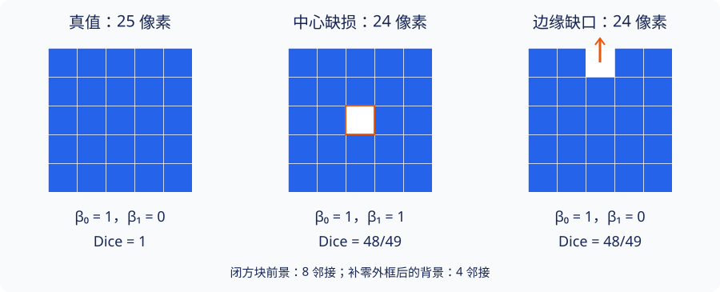

# A4 · 图像分割：像素误差与拓扑错误

研究生应用课程 · 内容状态：Reviewed（独立模型复核；非人类同行评审） 对象：有限二维二值掩膜；系数：\(\mathbb F_2\)；前景闭方块模型。有限实验不代替一般证明。

## 1. 学习目标

本章结束后，你应能把二值分割（binary segmentation）变成明确的拓扑对象，证明 Dice 与对称差的关系，构造“相同 Dice、不同 Betti 数”的反例，并用边界矩阵与 Euler 示性数交叉检查计算。你还应能解释为什么前景与背景的邻接规则必须成对选择，以及为什么 Betti 数相等仍不足以判断解剖结构正确。

## 2. 先修知识

- [链群与商空间预备](../algebraic/linear-algebra-primer.md)：有限域上的秩与核。
- [同调入门](../algebraic/03-homology.md)与[边界矩阵算法](../computational/boundary-algorithms.md)：$H_k=\ker\partial_k/\operatorname{im}\partial_{k+1}$。
- [连通与道路连通](../point-set/connectedness.md)：道路分支。
- [A2 · 评价协议](evaluation-protocol.md)：训练、验证与测试的区别。

平面补空间的论证使用简单多边形的 Jordan 分离定理：一个简单闭多边形将平面分成一个有界和一个无界分支。这是本章明确引用的平面拓扑工具；不把它隐藏在“洞的数目显然等于”一句中。

## 3. 问题引入：直观解释

真值是一块完整的 $5\times5$ 前景。预测甲漏掉中心像素，预测乙漏掉上边缘中点。二者都只错一个像素，都与真值有 24 个像素交集。可是甲围出了一个孔洞，乙只在边界开了一个缺口。

像素重叠、几何距离和拓扑结构回答不同问题。拓扑评价适合补充像素指标，也可能对一个像素的标注歧义非常敏感。开始计算之前，必须先确定一个像素究竟代表开方块、闭方块，还是仅代表图上的一个顶点。

## 4. 严格定义

**定义 A4.1（闭像素复形）。** 有限矩形索引集为 $\Omega\subset\mathbb Z^2$，前景掩膜是子集 $P\subseteq\Omega$。像素 $(r,c)$ 对应闭单位方块 $Q_{r,c}=[c,c+1]\times[r,r+1]$。几何空间是

$$
|K(P)|=\bigcup_{(r,c)\in P}Q_{r,c}.
$$

将所有选中方块以及它们的边和顶点去重收集，得到有限立方复形（cubical complex）$K(P)$。空掩膜给空复形，所有 Betti 数约定为零。本章不是把像素中心之间的距离做 Rips 滤过。

**定义 A4.2（邻接与外部背景）。** 不同像素的行、列差均不超过 1 时称为 8 邻接（8-adjacency）；行差绝对值与列差绝对值之和为 1 时称为 4 邻接。闭方块前景使用 8 邻接。背景在原数组周围补一圈零后使用 4 邻接；与外圈相连的背景分支代表无界补空间。其余背景分支才计为洞。补零是确定有限视野之外为空的建模约定，不是从图像中推断未知组织。

**定义 A4.3（Dice 与拓扑摘要）。** 对同一 $\Omega$ 上的预测 $P$ 和真值 $T$，$|P|$ 表示像素个数。若 $|P|+|T|>0$，Dice 系数（Dice coefficient）为

$$
D(P,T)=\frac{2|P\cap T|}{|P|+|T|}.
$$

本教材约定 $D(\varnothing,\varnothing)=1$；仅一方为空时为 0。实现和报告必须同时写明此约定。拓扑摘要是 $\beta_k(P)=\dim_{\mathbb F_2}H_k(K(P);\mathbb F_2)$。二维平面模型只有 $\beta_0,\beta_1$ 可能非零。误差 $|\beta_k(P)-\beta_k(T)|$ 只比较维数，不包含分支位置或对应关系。

## 5. 定理与证明

**命题 A4.4（Dice 与像素对称差）。** 若分母非零，则

$$
D(P,T)=1-\frac{|P\triangle T|}{|P|+|T|}.
$$

**证明。** $P\setminus T$、$T\setminus P$、$P\cap T$ 互不相交，故 $|P|+|T|=|P\triangle T|+2|P\cap T|$。除以正分母并整理即得。空/空的分式没有定义，由单独约定处理。$\square$

**命题 A4.5（前景分支）。** $\beta_0(P)$ 等于前景 8 邻接图的连通分量数。

**证明。** 两个不同闭单位像素方块相交，当且仅当其索引 8 邻接。每个方块道路连通，沿有限邻接链依次在交点连接道路，所以同一图分量的几何并集道路连通。不同图分量的方块并集不相交；它们是有限个紧集，因此任意两者的距离为正。每个并集于是既是整个空间中的开集，也是闭集，道路不能穿越到另一个并集。空间的道路分支与图分量一一对应，$H_0$ 在域上的维数就是道路分支数。空集情况两边都是零。$\square$

**命题 A4.6（边界平方零与 Euler 检查）。** 设非重复顶点、边、方块数分别为 $V,E,F$，$r_i=\operatorname{rank}\partial_i$。在 $\mathbb F_2$ 上，每条边的边界为两端点之和，每个方块的边界为四边之和。则

$$
\partial_1\partial_2=0,\qquad
\beta_0=V-r_1,\quad\beta_1=E-r_1-r_2,\quad\beta_2=F-r_2=0,
$$

$$
\chi(K)=V-E+F=\beta_0-\beta_1.
$$

**证明。** 一个方块的每个角出现在两条边的边界中，在 $\mathbb F_2$ 上抵消；线性延拓得 $\partial^2=0$。核的维数为定义域维数减秩，而像包含于核，所以商空间维数给出前三个公式。为了证明 $\partial_2$ 单射，从任意非零二链选取纵坐标最大的方块。其顶边没有该二链中位于它上方的方块来抵消；其他方块也不共享这条顶边。因此二链的边界非零，$r_2=F$。最后代入并消去 $r_1,r_2$。$\square$

这里证明的是有限立方链的计算公式。它与几何空间的奇异同调相同，使用胞腔同调比较定理，见[胞腔同调](../algebraic/homology/cellular-coefficients.md)；该比较定理的完整证明不在本应用章重做。

**命题 A4.7（背景洞计数）。** $\beta_1(P)$ 等于补一圈零后不与外圈连通的背景 4 邻接分量数。

**证明。** 空前景直接给出两边为零，以下设前景非空。令 $G$ 为 $K(P)$ 的一维骨架，$c$ 为其分量数，$R$ 为平面中 $G$ 的补空间分量数，包含无界面。平面图 Euler 公式给出 $V-E+R=1+c$。在本方格嵌入下可以这样核对公式：生成森林有 $V-c$ 条边且补空间连通；每加入一条剩余边，它与已有的简单路径形成简单多边形，Jordan 分离使一个面分成两个面，$E,R$ 同时增加 1。有限嵌入树不分割平面，可逐次沿叶边的两个侧面绕过端点，从空边森林开始归纳。

每个选中的单位方块内部是 $G$ 的一个独立有界面，填入全部 $F$ 个方块恰好删去这 $F$ 个补空间分量。于是 $\mathbb R^2\setminus|K(P)|$ 有 $R-F$ 个分量，其中一个无界。有界分量数为

$$
R-F-1=c-(V-E+F)=\beta_0-\chi=\beta_1.
$$

最后对应到背景数组。两个空方块的内部可跨共享边连通；该边没有相邻前景时不属于 $K(P)$。纯对角过渡不能新增连接：若交点属于某个前景闭方块，补空间不能通过；若不属于，围绕交点的四个方块全为空，已有绕行的 4 邻接链。任意补空间道路可在开放补空间中作足够小的折线扰动，避开有限格点；其有限次跨格只能经过空方块之间的边。这给出补空间分量与空方块 4 邻接分量的对应。新增的一圈零将原视野外的连通区域统一表示为外圈分量。因此非外圈分量数就是上面计算的有界分量数。$\square$

**适用范围。** 改成前景 4 邻接就改变了模型；改成周期边界就改变了环境空间；三维的背景分量也不能直接当作所有 $\beta_1$。这些情形不得套用 A4.7。

## 6. 典型例题：正例与反例

**基础例：空集、单像素和满矩形。** 空掩膜的 Betti 数为 $(0,0)$，一个像素与非空满矩形均可收缩，Betti 数为 $(1,0)$。满 $5\times5$ 方块有 $(V,E,F)=(36,60,25)$，$\chi=1$。

**非平凡正例：中心缺损。** 从满 $5\times5$ 删除 $(2,2)$，其四边和四顶点仍属于相邻方块，因此 $(V,E,F)=(36,60,24)$，$\chi=0$。前景仍连通，A4.6 给出 $\beta_1=1$。若删除 $(0,2)$，只减少最外侧一条边，得到 $(36,59,24)$，$\chi=1$，所以 $\beta_1=0$。两者 Dice 均为 $48/49$，不需要浮点近似来判断相等。

**错误反例：把角接触当断连。** 两个像素 $(0,0),(1,1)$ 的闭方块共享顶点，有 $(V,E,F)=(7,8,2)$，Betti 数为 $(1,0)$。前景 4 邻接会报两个分支，那是在计算另一个对象。这个共享点的连接是否符合成像分辨率下的解剖意义，还需另行判断。

**综合例：窄桥断开。** 实验真值有两个 $3\times2$ 矩形，分别占行 $1,2,3$、列 $0,1$ 与 $3,4$，用 $(2,2)$ 的单像素桥相连，共 13 像素。删桥后两个矩形之间相隔一整列，既不共享边也不共享角，$\beta_0$ 从 1 变为 2；两者均无洞，Dice 为 $24/25$。这个拓扑变化由具体像素模型得出，不能自动解释为临床上的血流中断。

**另一个限制：相同 Betti 数。** 一个位置正确的圆盘与远处的另一个圆盘都有 $(1,0)$；它们可以完全不相交、Dice 为零。拓扑摘要不能替代定位、类别识别或边界评价。

## 7. 几何直观与原创图解

图由本项目原创 SVG 绘制。蓝色格子表示包含全部边和角的前景，白格表示背景。中心白格不与外圈背景 4 连通；边缘白格与外圈连通。线宽只用于阅读，不改变方块的数学边界。

## 8. 编程实验

打开[分割拓扑实验](../labs/ai-topology.md#segmentation)，依次选择中心缺损、边缘缺口、完整方块、窄桥断裂和全空预测，先手算再核对输出。输入是固定的二值数组；输出包括 Dice 的分子/分母、$\beta_0,\beta_1$ 和 Euler 示性数。

实现将每个闭方块沿同一对角线分成两个三角形，然后调用已有的精确 $\mathbb F_2$ 边界消元。三角剖分增加了每个方块的一条边，并把一个二维胞腔变成两个，所以显示的 $E,F$ 与本章立方计数不同：$E_{\triangle}=E+F$、$F_{\triangle}=2F$，$V$ 不变，Euler 示性数仍为 $V-E+F$。不能把三角形数误读成像素数。

工程验证方案包括穷举全部 $3\times3$ 二值掩膜，与独立的 8/4 邻接计数比较，并检查 $\partial^2=0$ 与 Euler 等式。具体运行结果在[A4 审查记录](../project/reviews/A4.md)记录；仅有测试计划不算已通过。全部拓扑运算在给定有限复形上精确，Dice 显示采用浮点数。这里没有真实患者数据、网络训练或新的指标提升结果。

## 9. 课后习题

1. **基础题。** 对空掩膜、单像素和两个角接触像素计算 $(V,E,F)$、Euler 示性数与 Betti 数，说明空/空 Dice 的地位。
2. **证明题。** 推导 A4.4，并证明在本章约定下 $D(P,T)=1$ 当且仅当 $P=T$。
3. **计算题。** 不调用软件，完整推导中心缺损与边缘缺口的胞腔计数、Betti 数和 Dice。
4. **反例题。** 在同一足够大的数组中构造两种预测，它们与某一真值的 Betti 数完全相同，但 Dice 分别为 1 和 0。说明这反驳了什么。
5. **证明题。** 对任意非空有限闭像素复形证明 $\partial_2$ 单射；为什么同样的“最上方方块”论证不能直接用于粘合为环面的周期网格？
6. **综合题。** 验算第 6 节的 13 像素窄桥例；计算删除桥前后的 $(V,E,F)$，并用两个独立方法求 $\beta_0,\beta_1$。
7. **建模题。** 对二乘二数组的两个对角前景像素，分别列出前景 4/8 邻接分支数；解释背景 8 邻接为何不符合闭方块补空间。再说明不补外框直接数背景分支为何会误报满矩形。
8. **挑战题。** 推导固定对角三角剖分后的胞腔数变化。设计一个覆盖空集、角接触、中心洞、边缘缺口与窄桥的测试表，说明 $\partial^2=0$ 和 Euler 检查不能单独证明所有输入的算法正确性。

??? tip "第一层提示"
    第 3 题先问删去方块后哪些边仍由邻居保留。第 6 题先分别数两个矩形，再看桥与它们共享的两条边。第 7 题区分数组中的零像素与整个平面的外部区域。

??? tip "第二层提示"
    第 1 题角接触只共享一个顶点；第 2 题用对称差为空刻画相等。第 3 题中心缺损不删边，边缘缺口只删外沿一条边。第 4 题把一个可收缩预测平移到与真值不相交的位置。第 5 题周期识别使“最高边”失去意义。第 6 题桥的四个角已在两个矩形中，只新增上下两条边。第 7 题可再试三乘三方块同时删中心和角像素。第 8 题每方块增加一条对角边，二维单元数翻倍。

<noscript>即时反馈需要 JavaScript；完整书面习题和解答可独立阅读。</noscript>

## 10. 习题解答

[A4 完整解答](../exercises/a4-solutions.md)逐题给出计数或论证。请先完成自己的邻接约定和边界计数，再比较答案；用另一种邻接定义计算出的数字不一定是算术错误，但不再回答本章的问题。

## 11. 本章总结

像素误差的大小不能确定拓扑错误的种类。闭方块模型把这个判断变成可审查的有限链计算，并确定前景 8 邻接、背景 4 邻接的对应关系。下一章将讨论三维医学结构、骨架指标，以及从“指标符合先验”到“临床有益”之间仍需提供的证据。

## 12. 参考书目

- Tomasz Kaczynski, Konstantin Mischaikow, Marian Mrozek, *Computational Homology*, Springer, 2004。立方集合、立方链与算法背景；[出版社入口](https://doi.org/10.1007/b97315)。本章核实书目信息，未声称逐页核查原书。
- Allen Hatcher, *Algebraic Topology*, 2002，第 2 章，尤其 §2.1 的同调及胞腔观点；[作者开放教材页](https://pi.math.cornell.edu/~hatcher/AT/ATpage.html)。本章对有限矩阵重新给出证明，未复制原文。
- James R. Munkres, *Topology*, 第 2 版，Chapter 10 “Separation Theorems in the Plane”。用于定位 Jordan 分离这一外部依赖；本章未重证一般 Jordan 曲线定理，也未作逐页核查。
- Suprosanna Shit et al., “clDice — A Novel Topology-Preserving Loss Function for Tubular Structure Segmentation,” CVPR 2021，§2–4；[开放原文](https://openaccess.thecvf.com/content/CVPR2021/html/Shit_clDice_-_A_Novel_Topology-Preserving_Loss_Function_for_Tubular_Structure_CVPR_2021_paper.html)。其指标与理论假设在 [A5](medical-topology.md)单独分析。
