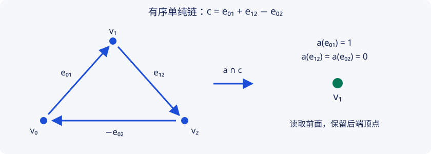

# Q2 · 定向、帽积与 Poincaré 对偶

研究生课程 · 先修：H1–H3、Q1；单纯复形与重心细分 帽积公式与自然性在本文证明；Poincaré 对偶保持 Advanced Outline，完整证明外引。尚无人类审稿或形式化验证。

## 1. 学习目标

你应能逐面证明帽积边界公式，核查零次与过高次端点，计算圆周上的具体帽积，并解释自然性方块。你还应能准确陈述本章对偶定理的假设，分清完整链计算、条件推论与尚待补齐的几何比较，不把奇维 Euler 推论当成独立的对偶证明。

## 2. 先修知识

先读 [H1](../homology/singular-chains.md) 的定向边界、[H2](../homology/exact-excision.md) 的相对长正合列、[H3](../homology/cellular-coefficients.md) 的胞腔比较与系数、[Q1](cochains-products.md) 的上链和杯积。单纯复形、重心细分及单纯链到奇异链的比较是几何输入；本章并未从零证明全部比较。

## 3. 问题引入与直观解释

在闭定向流形上，上同调类不仅可以给循环赋值，还能与整个流形的基本类作帽积，得到互补维数的循环。直观上它描述一个余维 $p$ 的对象，但链级构造不要求学生先掌握横截子流形。对偶依赖局部流形结构、定向及紧致条件，不是任意空间都具有的对称性。

## 4. 严格定义

本章限制为有有限组合三角剖分的闭 $n$ 维 PL 流形 $M$；“闭”指紧且无边界，不要求连通。组合三角剖分（combinatorial triangulation）要求每个 $k$ 单形的链接为 PL 球面 $S^{n-k-1}$，顶维单形的链接记作空球面 $S^{-1}$。定向（orientation）为每个顶维单形选择方向，使公共余维一面诱导方向相反。

若这样选择了定向，所有顶维定向单形之和 $c_M$ 的边界为零：每个余维一面出现两次且符号相反；$n=0$ 时普通边界本来就是零。经单纯到奇异同调的比较，它定义基本类（fundamental class）$[M]\in H_n(M;\mathbb Z)$；不连通时取各分量基本类的和。基本类的局部生成元性质及比较在对偶定理的外引范围内。

取整数系数，上链与链的帽积（cap product）采用

$$\varphi\frown[v_0,\ldots,v_n]=\varphi([v_0,\ldots,v_p])[v_p,\ldots,v_n].$$

$p,n\ge0$；当 $p>n$ 时定义为零；普通链约定 $\partial C_0=0$。对奇异单形先在参数单形上取有序面，再由其映到空间，线性延拓；对有全序顶点的单纯模型也采用同一公式。单纯模型中的计算与空间同调的识别需要标准比较，不能暗中省去。

## 5. 定理与证明

**完整证明（所列依赖下）** · [依赖与审查义务](../../project/proof-ledger.md#proof-q2-1)

**命题 Q2.1。** 对 $p$ 次上链和 $n$ 次链，

$$
\partial(\varphi\frown c)=(-1)^p\bigl(\varphi\frown\partial c-(\delta\varphi)\frown c\bigr).
$$

**证明。** 线性性允许只看有序单形 $\sigma=[v_0,\ldots,v_n]$。当 $n<p$ 时按过高次数约定三项都为零。当 $n=p$ 时三项都为零：左侧是零维链的边界，右侧两项的上链次数都超过所作用链的次数。设 $n>p$，记 $A=\varphi([v_0,\ldots,v_p])$，$B=[v_{p+1},\ldots,v_n]$。按删点位置写出

$$
\varphi\frown\partial\sigma=
\sum_{i=0}^{p}(-1)^i\varphi([v_0,\ldots,\widehat v_i,\ldots,v_{p+1}])B
+\sum_{i=p+1}^{n}(-1)^i A[v_p,\ldots,\widehat v_i,\ldots,v_n],
$$

而 $(\delta\varphi)\frown\sigma$ 是第一和延伸至 $i=p+1$。相减后第一和仅剩被减去的最后一项，即 $(-1)^p AB$。再乘 $(-1)^p$，结果为

$$
A\left(B+\sum_{i=p+1}^{n}(-1)^{i-p}[v_p,\ldots,\widehat v_i,\ldots,v_n]\right)
=A\partial[v_p,\ldots,v_n].
$$

这正是左侧。奇异链的面复合与这些顶点删除相容，因此逐单形同样成立。若 $\delta\varphi=0$ 且 $\partial c=0$，帽积是循环。将 $c$ 换为 $c+\partial b$，变化为 $(-1)^p\partial(\varphi\frown b)$；若 $p\ge1$，将 $\varphi$ 换为 $\varphi+\delta a$，变化为 $(-1)^p\partial(a\frown c)$。因此两种代表改变均给边界。$\square$

**完整证明（所列代数或链先修下）** · [依赖与审查义务](../../project/proof-ledger.md#proof-q2-3)

**命题 Q2.3（帽积自然性，完整证明）。** 对连续映射 $f:X\to Y$、$\varphi\in C^p(Y;\mathbb Z)$ 和 $c\in C_n(X;\mathbb Z)$，

$$f_\#(f^*\varphi\frown c)=\varphi\frown f_\#c.$$

**证明。** 若 $p>n$ 两边都零。否则对单个奇异 $n$ 单形 $\sigma$，左侧为

$$\varphi\bigl(f\circ\sigma|[v_0,\ldots,v_p]\bigr)\,f\circ\sigma|[v_p,\ldots,v_n],$$

与右侧定义逐项相同。线性延拓后对每个链成立，再由 Q2.1 下降到同调。对固定 $z\in H_n(X;\mathbb Z)$，得到

$$
\begin{array}{ccc}
H^p(Y;\mathbb Z)&\xrightarrow{f^*}&H^p(X;\mathbb Z)\\
\downarrow(-\frown f_*z)&&\downarrow(-\frown z)\\
H_{n-p}(Y;\mathbb Z)&\xleftarrow{f_*}&H_{n-p}(X;\mathbb Z).
\end{array}
$$

沿上边再右边再下边，与直接沿左边的值相同。这里没有要求 $f$ 是同胚、满射或流形映射，也没有声称 $f_*[X]=[Y]$。$\square$

**精确陈述与证明概要 / Advanced Outline** · [依赖与审查义务](../../project/proof-ledger.md#proof-q2-2)

**定理 Q2.2（有限 PL 情形的 Poincaré 对偶）。** 若 $M$ 是闭、定向、有有限组合三角剖分的 $n$ 维 PL 流形，则对全部 $p$，

$$D_M:H^p(M;\mathbb Z)\xrightarrow{\cong}H_{n-p}(M;\mathbb Z),\qquad a\longmapsto a\frown[M].$$

负次数普通同调为零。此结论本章引用 Hatcher §3.3；它的完整证明未在本教材展开。下述机制不能当作已经闭合的证明。

**可审查的证明框架。** 重心细分后，$p$ 单形 $\sigma$ 的闭对偶块 $D\sigma$ 来自以 $\sigma$ 为最小面的旗标单形及其面。组合流形的链接条件使该块为 $n-p$ 维球，各块拼成对偶胞腔分解。若给 $\sigma$ 及 $M$ 定向，可按“切向后接法向”的约定为对偶块选方向。

接下来必须证明：$D\sigma$ 的边界与相邻 $(p+1)$ 单形的对偶块之间的关联数，如何由原复形的关联数与一个明确的次数符号决定。还必须写出逐次数重标号，使所得基对应给上链到反向次数链的同构。**本章没有算出该符号，故不在这里断言某个未经验证的 $\partial\Phi=\Phi\delta$ 等式已经成立。** 在完成该引理后，基对应和 H3 的胞腔比较会给抽象群对偶；进一步证明这个同构就是上面指定的 $a\mapsto a\frown[M]$，还需要单纯—奇异比较及对角近似的链同伦。

这两处正是仍开放的证明义务，而非可以用“调整符号即可”略过的步骤。一般拓扑流形版本、非紧空间的紧支撑上同调、带边界的 Poincaré–Lefschetz 对偶以及非定向情形的局部系数版本，均属另外的引用定理。不能从本章结论直接删去紧致、无边界或定向假设。

**条件推论：代数推导完整，对偶输入为引用** · [依赖与审查义务](../../project/proof-ledger.md#proof-q2-euler)

**推论 Q2.4。** 闭定向奇数维有限 PL 流形的 Euler 示性数为零。

**证明。** 用外引的胞腔同调和上同调比较（H3.1、Q1 的胞腔比较条目）进入有限模型。有限链给有限生成整数同调。Q1.3 中 $\operatorname{Ext}(H_{p-1},\mathbb Z)$ 为有限挠群（用有限生成分解，$\operatorname{Ext}(\mathbb Z/m,\mathbb Z)=\mathbb Z/m$），而 $\operatorname{Hom}(H_p,\mathbb Z)$ 的自由秩等于 $b_p=\operatorname{rank}H_p$。因此 $\operatorname{rank}H^p=b_p$。引用 Q2.2 得 $b_p=b_{n-p}$。令 $n=2r+1$，配成

$$\chi(M)=\sum_{p=0}^{r}\bigl((-1)^pb_p+(-1)^{n-p}b_{n-p}\bigr)=0.$$

整数同调的挠群不进入 Euler 自由秩和。此推导已展开，但其对偶输入并未在本章全证。$\square$

## 6. 典型例题：正例与反例

**可以逐项算的圆周。** 取三边圆周，顶点有序 $0<1<2$，边为 $e_{01},e_{12},e_{02}$，没有二维面。循环

$$c=e_{01}+e_{12}-e_{02}$$

满足 $\partial c=(v_1-v_0)+(v_2-v_1)-(v_2-v_0)=0$。边上链 $a(e_{01})=1,a(e_{12})=a(e_{02})=0$ 自动闭合，且 $a(c)=1$，故 $[a]$ 是 $H^1\cong\mathbb Z$ 的生成元。按帽积定义 $a\frown c=v_1$，给 $H_0$ 的生成元；常值为 $1$ 的零次上链 则有 $1\frown c=c$。这直接在有序单纯链模型核对了圆周的两个互补次数。将它识别为奇异帽积仍使用标准模型比较。

**曲面交叉配对的引用例。** 闭定向属 $g$ 曲面的整数 $H_1,H^1$ 均为 $\mathbb Z^{2g}$；在标准几何基下，杯积在基本类的评价矩阵为 $\begin{pmatrix}0&I\\-I&0\end{pmatrix}$。把几何交点与杯积评价识别以及非退化性，依赖对偶和乘积比较，本章作为标准引用，不由帽积边界公式独立推出。

**不可删的假设。** $\mathbb{RP}^2$ 不可定向，整数 $H^0=\mathbb Z$ 而 $H_2=0$，不满足普通整数对偶。模二对偶是另一正确版本，此时不需要整数定向。开直线可缩，$H^0=\mathbb Z,H_1=0$，说明非紧空间不能照搬闭流形公式。圆盘有边界，适用的是相对群。最后，$[M]$ 改成 $-[M]$ 会使 $D_M$ 整体取负；不能在讨论映射度时忽略方向。

## 7. 原创图解：三边圆周

用有向边表示上述基本循环：

全局排序仍为 $0<1<2$，所以从 $v_2$ 回 $v_0$ 的箭头代表标准边 $e_{02}$ 的负号，不是新边。帽积上链 $a$ 只读取 $e_{01}$，保留其后端 $v_1$。这说明“保留后半面”的定义为何必须与边的符号同时使用。

## 8. 编程实验：整数链核对

~~~python
edges = {(0, 1): 1, (1, 2): 1, (0, 2): -1}
boundary = [0, 0, 0]
cap = [0, 0, 0]
a = {(0, 1): 1, (1, 2): 0, (0, 2): 0}
for (i, j), coefficient in edges.items():
    boundary[i] -= coefficient
    boundary[j] += coefficient
    cap[j] += coefficient * a[i, j]
assert boundary == [0, 0, 0]
assert cap == [0, 1, 0]
assert sum(coefficient * a[edge] for edge, coefficient in edges.items()) == 1
~~~

该程序只核对给定三边模型及其整数系数。它不测试全部流形，更不证明 Poincaré 对偶。

## 9. 课后习题

1. **条件证明。** 接受闭定向连通曲面上有理杯积评价为非退化配对这一标准兼容性，证明第一 Betti 数为偶数。
2. **端点符号。** 对任意零上链 $\varphi$，在边 $[v_0,v_1]$ 上核对 Q2.1；不得假设 $\varphi$ 常值。
3. **相对计算。** 对 $n\ge1$，用 H2 的长正合列计算 $H_n(D^n,S^{n-1};\mathbb Z)$ 并比较 $H^0(D^n;\mathbb Z)$。
4. **帽积计算。** 在三边圆周上写出一般整数一上链 $b$ 的评价 $b(c)$，并证明 $b\frown c$ 在 $H_0$ 中等于 $b(c)[v_0]$。
5. **自然性。** 用 Q2.3 对圆周反向自同胚 $r$ 写出 $r_*(r^*a\frown[S^1])=a\frown r_*[S^1]$，计算两边的符号。
6. **反例。** 分别说明 $\mathbb R$、$D^2$、$\mathbb{RP}^2$ 违反了 Q2.2 的哪个假设，并给出失效次数的群。
7. **条件推导。** 在不假定同调无挠的情况下，证明 Q2.4；指出证明中的外引输入。
8. **挑战与证明审查。** 有人声称“对偶胞腔数与原单形数一一对应，所以对偶定理成立”。构造两个逐次秩相同但同调不同的有限自由链，说明还必须比较什么。

??? tip "第一层提示"
    1：分次交换给反对称矩阵。2：保留端点取值差。3：先看约化相对长正合列。4：在连通圆周的 $H_0$ 中三个顶点相等。5：$r_*[S^1]=-[S^1]$，但 $r_*:H_0\to H_0$ 是恒等。6：分别考察次数 $p=0$。7：Ext 是有限挠群。8：比较乘零与乘二。

??? tip "第二层提示"
    1：奇数阶反对称矩阵行列式为自身负数。2：$\varphi\frown\partial e=\varphi(v_1)v_1-\varphi(v_0)v_0$。3：$n=1$ 用 $\widetilde H_0(S^0)$，不是未经约化的 $H_0$。4：$b\frown c=b_{01}v_1+(b_{12}-b_{02})v_2$。8：必须证明基对应与微分相容，并比较到指定帽积映射。

<noscript>即时反馈需要 JavaScript；正文习题与完整解答仍可阅读。</noscript>

## 10. 习题解答

[Q2 八题完整论证式解答](../../exercises/q2-solutions.md)。解答分别注明计算步骤、反例和所用的外引，不把有限代码验证当作一般证明。

## 11. 本章总结

帽积边界公式保证运算能下降到同调，自然性说明它如何与空间映射相容。这两项链计算并不单独证明对偶。Poincaré 对偶还需要流形局部结构、基本类及几何比较；本章保留其精确陈述与未闭合义务，条件推论也明确继承这些依赖。

## 12. 参考书目

- Allen Hatcher, *Algebraic Topology*, Cambridge University Press, 2002，§3.3（帽积与 Poincaré 对偶），及 §3.2（杯积与交叉配对相关内容）。[作者教材页](https://pi.math.cornell.edu/~hatcher/AT/ATpage.html)已访问，本批未声称逐页核验全文。
- Glen E. Bredon, *Topology and Geometry*, Springer, 1993，流形定向与对偶相关内容；原书全文本批未访问，不给未经核验的页码或定理号。

正文、链图、例题与程序均原创。未完成的符号比较和人工复核清单见 [Q2 审查记录](../../project/reviews/Q2.md)。
