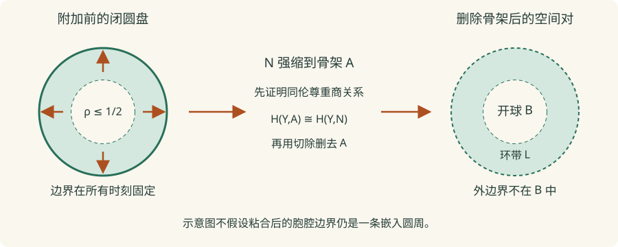

# H3 · 胞腔同调、挠与系数变换

研究生课程 · 先修：H1、H2、F2、PRE5、CT1 本章展开有限 CW 的骨架比较与边界度公式，以及有限链代数证明；空间乘积比较仍外引。尚无人类审稿或形式化验证。

## 1. 学习目标

完成本章后，你应能从骨架对的相对群推导胞腔链的计算结论，构造有限自由链的系数短正合列及其自然映射，计算挠子改变系数后的贡献，并证明自然短正合列未必有自然分裂。你还应能写出张量链收缩的符号，识别几何比较定理与有限代数计算各自承担的任务。

## 2. 先修知识

先读 [H1](singular-chains.md)、[H2](exact-excision.md) 的链复形、长正合列、切除与球面同调；商拓扑和紧空间到 Hausdorff 空间的闭映射性质见[商空间](../../point-set/quotient-spaces.md)与[紧致性](../../point-set/compactness-metric.md)。群的自由子群、张量泛性质与商公式见 [PRE5](../../preliminaries/groups-modules.md)，整数矩阵计算见 [CT1](../../computational/integer-homology.md)。自然系数定理对给定的有限自由整数链独立成立；几何比较把这些代数工具接回空间。

## 3. 问题引入与直观解释

胞腔分解把无限的奇异链计算压缩为每个胞腔一个生成元。整数矩阵除了秩还保存整除信息；改用域系数会改变可见的不变量。对映射也进行比较时，仅列出两个抽象同构的群不够：同构是否与映射交换，决定它能否用于连续变化的空间族。

## 4. 严格定义

有限 CW 复形的 $n$ 骨架记为 $X^n$，$X^{-1}=\varnothing$。胞腔链群（cellular chain group）为 $C_n^{\mathrm{cell}}(X)=H_n(X^n,X^{n-1};\mathbb Z)$。球面自映射的度（degree）是其在 $\widetilde H_n(S^n;\mathbb Z)\cong\mathbb Z$ 上的乘数，$n\ge0$；约化群让零维球面也适用。

这里的有限 CW（finite CW complex）从有限离散 $X^0$ 开始，逐维以附加映射 $\alpha_e:S^{r-1}\to X^{r-1}$ 粘上有限个闭圆盘：

$$X^r=\left(X^{r-1}\sqcup\coprod_e D_e^r\right)/(x\sim\alpha_e(x),\ x\in\partial D_e^r).$$

采用 Hausdorff 的 CW 定义，每一骨架因此是紧 Hausdorff 空间：有限个紧圆盘及前一紧骨架的商仍紧。特征映射（characteristic map）$\chi_e:D_e^r\to X^r$ 在内部是到开胞腔 $e$ 的同胚，边界上不必单射。正则（regular）CW 才额外要求特征映射在整个圆盘上是嵌入；下面不作此假设。胞腔映射（cellular map）$f:X\to Y$ 要求 $f(X^r)\subset Y^r$。

给每个 $D^r$ 选定向，选择相对生成元 $u_e\in H_r(D^r,S^{r-1})$，使其连接像为所选边界球面的生成元。$r=1$ 约定 $\partial u_e=[+1]-[-1]\in\widetilde H_0(S^0)$；不是把 $H_0(S^0)=\mathbb Z^2$ 错写为 $\mathbb Z$。$r=0$ 直接用点生成元。

以下“有限自由链”指非负次数、逐次有限秩自由、仅有限个链群非零的整数链复形。设 $Z_n=\ker d_n$、$B_n=\operatorname{im}d_{n+1}$、$H_n=Z_n/B_n$；负次数的这些群均为零。对任意阿贝尔群 $G$，系数链为 $C\otimes_{\mathbb Z}G$。这里二变量函子 $\operatorname{Tor}_1(M,G)$ 与 PRE5 的挠子子群 $\operatorname{Tor}(M)$ 不是同一个对象。

**完整证明（所列代数或链先修下）** · [依赖与审查义务](../../project/proof-ledger.md#proof-h3-0)

**引理 H3.0（自由表示与 Tor 的映射）。** 有限生成阿贝尔群 $M$ 取自由表示

$$
0\longrightarrow R\xrightarrow{j}F\xrightarrow{p}M\longrightarrow0,
$$

其中 $F,R$ 有限秩自由，$j$ 单射。定义此表示的

$$
T(M;G)=\ker(j\otimes1:R\otimes G\to F\otimes G).
$$

它给出与表示无关、对两变量协变的群，记 $\operatorname{Tor}^{\mathbb Z}_1(M,G)$，本章简写 Tor。

**证明。** 存在性由有限生成满射 $F\to M$ 及 PRE5 的自由子群定理。给定 $a:M\to M'$，为 $F$ 的每个基元素提升 $ap$ 到 $F'$，线性延伸成 $a_0:F\to F'$。因 $p'a_0j=0$，唯一得到 $a_1:R\to R'$ 使 $a_0j=j'a_1$。张量后 $a_1\otimes1$ 将上述核送到对应核。

若换另一提升 $a'_0$，其差落在 $j'(R')$，唯一写成 $a'_0-a_0=j'h$，$h:F\to R'$。于是由 $j'$ 单射得 $a'_1-a_1=hj$。对核中的 $t$，差的作用为 $(h\otimes1)(j\otimes1)t=0$，所以诱导映射不依赖提升。恒等与复合可以用恒等及复合提升计算，给出函子律。对同一 $M$ 的两个表示提升恒等映射，两向复合在核上都是恒等，因此给规范同构，且同构满足传递相容性。系数同态 $G\to G'$ 在张量第二因子作用，与所有这些映射交换。$\square$

取表示 $\mathbb Z\xrightarrow{\times m}\mathbb Z\to\mathbb Z/m$，$m\ge1$，得到 $\operatorname{Tor}(\mathbb Z/m,G)=G[m]=\{g:mg=0\}$；自由群可取 $R=0$，所以其 Tor 为零。直和表示给有限直和可逐项计算。这里的映射构造使“自然”有可检验的含义。

## 5. 定理与证明

### 先补几何输入：不能假定胞腔边界嵌入

**完整证明（H1、H2 与有限附加商先修下）** · [依赖与审查义务](../../project/proof-ledger.md#proof-h3-4)

**引理 H3.4（有限骨架对与指定生成元）。** 对上述有限 CW，

$$H_k(X^r,X^{r-1};\mathbb Z)=0\quad(k\ne r),\qquad
\bigoplus_{e^r}\mathbb Z u_e\xrightarrow{\;\sum(\chi_e)_*\;}H_r(X^r,X^{r-1};\mathbb Z)$$

为同构。它适用于非正则胞腔；空的胞腔集合给零群。

**证明：在附加前构造同伦。** 先设 $r\ge1$，记 $A=X^{r-1}$、$Y=X^r$，附加商映射为 $q$。固定 $a=1/2$，令

$$N=A\cup\bigcup_e\chi_e(\{x:a<\|x\|\le1\}).$$

$A$ 紧且 $Y$ Hausdorff，故 $A$ 闭。$q^{-1}(N)$ 恰为整个 $A$ 与每个圆盘的相对开环带之并，是饱和开集，因此 $N$ 开。为了证明 $N$ 强形变收缩到 $A$，先在**整个附加圆盘**上定义

$$h_t(\rho\theta)=\bigl((1-t)\rho+t\min(2\rho,1)\bigr)\theta,\quad
0<\rho\le1,\qquad h_t(0)=0.$$

径向长度不超过 $2\rho$，故在中心也连续；边界逐点固定。在 $A$ 上取恒等，得到从 $(A\sqcup\coprod D_e^r)\times I$ 到 $Y$ 的连续映射，各边界识别的点在所有 $t$ 下仍有相同像。$q\times\mathrm{id}_I$ 是紧空间到 Hausdorff 空间 $Y\times I$ 的连续满射，因而闭且为商映射；所以同伦确实下降到 $Y\times I$，没有暗用“任意商映射的乘积仍是商”。在 $\rho>a$ 上半径始终大于 $a$，$t=1$ 时到达边界；在 $A$ 上始终固定。限制到 $N$ 即所需强形变收缩。**这不是声称非正则胞腔边界具有嵌入领圈。**

**证明：用切除分离开胞腔。** H1 的同伦不变性和对的长正合列给 $H_*(N,A)=0$。短正合列

$$0\to C_*(N,A)\to C_*(Y,A)\to C_*(Y,N)\to0$$

及 H2.1 给同构 $H_*(Y,A)\to H_*(Y,N)$。由于 $A$ 闭且 $A\subset\operatorname{int}_Y N$，H2.3 允许从 $(Y,N)$ 删去 $A$：

$$H_*(Y,A)\xrightarrow{\cong}H_*(Y,N)
\xleftarrow{\cong}H_*(Y\setminus A,N\setminus A).$$

在固定的 $r$ 骨架中，右侧空间对是不交的有限个 $(B_e,L_e)$，其中 $B_e=\{\|x\|<1\}$、$L_e=\{a<\|x\|<1\}$。开胞腔在 $Y\setminus A$ 中开闭；连通的标准单形不能跨越这些分量，所以奇异链及相对链逐项分裂为直和。$B_e$ 可缩，$L_e$ 沿径向强缩到半径 $3/4$ 的 $S^{r-1}$。H2 的约化长正合列与球面计算给 $H_k(B_e,L_e)=\mathbb Z$ 当 $k=r$，其余普通次数皆零。特别 $r=1$ 时环带有两支，结果来自 $\widetilde H_0(L_e)=\mathbb Z$；因环带非空且开球道路连通，$H_0(B_e,L_e)=0$。

**证明：核对基，不只比较秩。** 在每个源圆盘令 $M_e=\{a<\|x\|\le1\}$。同一径向收缩与切除分别给

$$H_*(D_e^r,S^{r-1})\xrightarrow{\cong}H_*(D_e^r,M_e)
\xleftarrow{\cong}H_*(B_e,L_e).$$

特征映射把此行映到上一行，方块因包含和商映射的实际复合交换；最右端是到对应开胞腔分量的同胚。因此 $(\chi_e)_*u_e$ 正好给直和对应项的生成元，而非仅存在一个未指定的抽象同构。

最后 $r=0$ 时 $(X^0,\varnothing)$ 是有限离散点集，H1 的点空间计算逐分量给结论。若本层没有 $r$ 胞腔，则 $Y=A$，相对链群为零；只有 $X=\varnothing$ 时才说其普通链群也为零。无需约化空空间的额外约定。$\square$

**完整证明（有限 CW；H3.4 与 H2 长正合列下）** · [依赖与审查义务](../../project/proof-ledger.md#proof-h3-1)

**定理 H3.1（有限 CW 的胞腔计算）。** $C_n^{\mathrm{cell}}$ 为定向 $n$ 胞腔上的自由阿贝尔群。以相对群连接映射定义边界后，其同调同构于 $H_n(X;\mathbb Z)$，且对胞腔映射自然。

**证明。** 用已证明的 H3.4。由骨架对长正合列及归纳，$H_k(X^r)=0$ 对 $k>r$ 成立：$X^0$ 是有限离散点集，归纳步使用 $H_k(X^r,X^{r-1})=0$。写

$$
\delta_n:C_n^{\mathrm{cell}}\to H_{n-1}(X^{n-1}),\qquad
 a_n:H_n(X^n)\to C_n^{\mathrm{cell}},\qquad d_n=a_{n-1}\delta_n.
$$

$d_0=0$。同一个骨架对正合列给 $\delta_{n-1}a_{n-1}=0$，所以 $d_{n-1}d_n=0$。当 $n\ge1$ 时，$H_n(X^{n-1})=0$，故 $a_n$ 单射；又因 $H_{n-1}(X^{n-2})=0$，$a_{n-1}$ 单射，故 $\ker d_n=\ker\delta_n=\operatorname{im}a_n$。当 $n=1$ 时这里 $a_0$ 是 $H_0(X^0)\to H_0(X^0,\varnothing)$ 的恒等识别。$n=0$ 则直接有 $\ker d_0=C_0^{\mathrm{cell}}=H_0(X^0)$。

将超过 $\dim X$ 的骨架定义为 $X$，相应胞腔群为零；这样顶维也可使用下一骨架的长正合列：

$$
C_{n+1}^{\mathrm{cell}}\xrightarrow{\delta_{n+1}}H_n(X^n)
\longrightarrow H_n(X^{n+1})\longrightarrow0.
$$

末项为零来自相对群的次数集中。用 $a_n$ 识别中间群后，得到 $H_n(X^{n+1})\cong\ker d_n/\operatorname{im}d_{n+1}$，包括 $n=0$。当 $r\ge n+2$，相对群在 $n,n+1$ 次均为零，故 $H_n(X^{r-1})\to H_n(X^r)$ 为同构。有限次迭代到 $X$ 得结论。

胞腔映射限制为骨架对的映射，由 H2.1 连接映射的自然性，诱导的 $f_n^{\mathrm{cell}}$ 与 $d_n$ 交换。上述 $a_n$、连接、包含以及它们在核/商上的同构全部由这些相对群映射得到；交换方块中的同构取逆后仍交换，故最终同构对胞腔映射自然。这里没有构造到奇异链的链同伦等价，也没有证明一般连续映射的胞腔逼近；这些不能由同调群同构自动推出。$\square$

**完整证明（上述生成元及连接自然性下）** · [依赖与审查义务](../../project/proof-ledger.md#proof-h3-5)

**命题 H3.5（胞腔边界度公式）。** 对 $n\ge2$，定向 $n$ 胞腔 $e_\alpha$ 的 $e_\beta^{n-1}$ 边界系数为

$$[e_\alpha:e_\beta]=\deg(c_\beta\circ\alpha_\alpha),\qquad
c_\beta:X^{n-1}\to D_\beta^{n-1}/S^{n-2}\cong S^{n-1}.$$

$c_\beta$ 将 $X^{n-2}$ 和其他 $(n-1)$ 胞腔压为基点，在目标胞腔的圆盘上是边界压缩。球面定向由所选圆盘相对生成元确定。$n=1$ 时 $d_1e=[\alpha_e(+1)]-[\alpha_e(-1)]$；两个端点相等时为零。

这里的商球面模型可以直接核对：对 $m\ge1$，将 $D^m$ 中的 $\rho\theta$ 送到 $(\sin(\pi\rho)\theta,\cos(\pi\rho))\in S^m$。原点处定义为北极，因第一坐标的范数趋零而连续；边界全送南极。除边界外，最后坐标唯一确定 $\rho\in[0,1)$，第一坐标再确定非零点的 $\theta$，故下降为 $D^m/S^{m-1}\to S^m$ 的连续双射。源为紧空间，目标为 Hausdorff，因而是同胚。定向仍以所选相对生成元为准，不从图形猜符号。

**证明。** 在 $X^{n-2}\sqcup\coprod D_\gamma^{n-1}$ 上，对 $\gamma=\beta$ 使用圆盘到商球面的商映射，对其他圆盘及低骨架取常值；边界都取基点，所以由附加商的泛性质下降为连续的 $c_\beta$。H3.4 的特征生成元比较应用到标准一胞腔球面后，表明

$$H_{n-1}(X^{n-1},X^{n-2})\longrightarrow H_{n-1}(S^{n-1},*)\cong H_{n-1}(S^{n-1})$$

正是 $e_\beta$ 坐标投影：$\beta$ 的生成元送到定向生成元，其余均为零。最后同构因 $n-1>0$ 且球面连通而成立。

相对连接的自然性给 $\delta_n(\chi_\alpha)_*u_\alpha=(\alpha_\alpha)_*\partial u_\alpha$。先作用 $a_{n-1}$ 再取上述坐标，等于直接将这个球面类经 $c_\beta\alpha_\alpha$ 推前，其乘数按定义就是度。因此系数公式与已经定义的胞腔边界一致。$n=2$ 时所用目标一胞腔球面生成元由圆盘对 $(D^1,S^0)$ 的**约化**端点差确定，不把普通 $H_0(S^0)$ 当一维。$n=1$ 无需球面压缩，直接对定向区间的相对基本类使用连接映射即可。$\square$

换一个源胞腔定向会把对应矩阵列取负，换目标定向把对应行取负；这些是整数可逆换基，不改变同调。无限 CW 还需额外的有限支撑/直接极限比较，本章不声称已证明该版本。

**完整证明（任意阿贝尔系数；有限 CW）** · [依赖与审查义务](../../project/proof-ledger.md#proof-h3-6)

**推论 H3.6（系数胞腔比较）。** 对有限 CW 和任意阿贝尔群 $G$，令 $C_*(X;G)=C_*(X;\mathbb Z)\otimes G$。有对胞腔映射及系数同态自然的同构

$$H_n(C_*^{\mathrm{cell}}(X;\mathbb Z)\otimes G)\cong H_n(X;G).$$

整数边界矩阵的每个系数 $m$ 作用为 $g\mapsto mg$。此结论不是从整数同调的抽象群同构直接张量得来的。

**证明：核对几何证明在改系数后仍成立。** 子空间、相对链和小链均由奇异单形自由基的子集描述，所以相应包含和商在每个次数分裂。Mayer–Vietoris 的相加满射也可对每个小单形选它所属的一侧作提升，得到逐度分裂；无需这些选择与微分相容。故将这些短正合列张量 $G$ 后仍短正合，H2.1 可重新构造长正合列和自然连接映射，且

$$C_*(X,A;\mathbb Z)\otimes G\cong C_*(X;G)/C_*(A;G).$$

H1 的棱柱、H2 的细分和 $T$ 都是整数线性链算子，等式张量后仍成立；每条 $G$ 系数链仍只用有限多个单形，选统一细分次数的支撑论证不变。因此同伦不变性、切除、MV 及其自然性可用于 $G$。一点的正次链微分仍交替为恒等与零，所以 $H_0(*)=G,H_{>0}(*)=0$；从 $S^0$ 两点和 H2 的两开集归纳得到球面与圆盘对的对应群为 $G$。该归纳同时识别每个 $g$ 与整数定向生成元乘 $g$，因连接映射在代表链上就是取边界。

H3.4 的径向同伦与切除不改变空间，逐项用 $G$ 群重做给

$$\bigoplus_{e^r}G\xrightarrow{\cong}H_r(X^r,X^{r-1};G),$$

每项的 $g$ 由特征圆盘的 $u_e\otimes g$ 给出；其他次数仍零。由连接映射对系数同态的自然性，边界系数 $m$ 正是 $g\mapsto mg$，从而这条骨架链等于整数胞腔链张量 $G$。H3.1 后半段只用次数消失和正合性，不要求这些 $G$ 群自由，原推导给同调同构。上述特征类、连接和包含对胞腔映射与 $G\to G'$ 交换，故同构自然。$\square$

**完整证明（有限自由链与 PRE5 代数先修下）** · [依赖与审查义务](../../project/proof-ledger.md#proof-h3-2)

**定理 H3.2（有限自由链的同调泛系数定理，universal coefficient theorem）。** 对上述 $C$、任意阿贝尔群 $G$ 与 $n\ge0$，有短正合列

$$
0\to H_n(C)\otimes G\xrightarrow{\alpha}H_n(C\otimes G)
\xrightarrow{\beta}\operatorname{Tor}_1^{\mathbb Z}(H_{n-1}(C),G)\to0.
$$

此列对整数链映射及系数群同态分别协变且自然；它可作为阿贝尔群序列分裂，但不存在对所有链映射自然的分裂选择。

**证明：构造映射。** 写 $i_n:Z_n\hookrightarrow C_n$、$j_n:B_n\hookrightarrow Z_n$，$q_n:C_n\twoheadrightarrow B_{n-1}$ 为 $d_n$ 缩小陪域后的满射。PRE5.10 给 $B_n,Z_n$ 有限自由。提升 $B_{n-1}$ 的一组基得到截面 $s_n$，所以

$$
0\to Z_n\xrightarrow{i_n}C_n\xrightarrow{q_n}B_{n-1}\to0
$$

分裂，张量后仍分裂，尤其 $i_n\otimes1$ 单射。用自由表示 $0\to B_{n-1}\xrightarrow{j_{n-1}}Z_{n-1}\to H_{n-1}\to0$ 表示 Tor。

定义 $\alpha([z]\otimes g)=[i_n(z)\otimes g]$。改变 $z$ 一个边界只改变右端一个张量边界；双可加性使定义下降到张量积。若 $x\in C_n\otimes G$ 为循环，定义

$$
\beta([x])=(q_n\otimes1)x\in\ker(j_{n-1}\otimes1).
$$

确实 $d_n=i_{n-1}j_{n-1}q_n$，由 $i_{n-1}\otimes1$ 单射，循环条件保证落在此核。又 $q_nd_{n+1}=0$，故改变边界代表不改变 $\beta$。

**证明：正合与分裂。** $\ker(q_n\otimes1)=\operatorname{im}(i_n\otimes1)$，所以 $\ker\beta$ 可用 $Z_n\otimes G$ 中的元素代表。张量边界恰是其中的 $\operatorname{im}(j_n\otimes1)$：因为 $q_{n+1}$ 有截面，$q_{n+1}\otimes1$ 满射。PRE5.13 的商公式给

$$
(Z_n\otimes G)/\operatorname{im}(j_n\otimes1)\cong (Z_n/B_n)\otimes G.
$$

这同时证明 $\alpha$ 单射且像为 $\ker\beta$。若 $t\in\ker(j_{n-1}\otimes1)$，则 $(s_n\otimes1)t$ 是循环，且 $\beta([(s_n\otimes1)t])=t$。因此 $\beta$ 满射并有群同态右逆。

**证明：自然性。** 对链映射 $f:C\to D$，限制映射 $f_Z,f_B$ 满足 $q^D_nf_n=f_{B,n-1}q^C_n$ 及 $f_Zj^C=j^Df_B$。后两映射正是 H3.0 的自由表示提升，所以

$$
\begin{array}{ccc}
H_n(C\otimes G)&\xrightarrow{\beta_C}&\operatorname{Tor}_1(H_{n-1}(C),G)\\
\downarrow H_n(f\otimes1)&&\downarrow\operatorname{Tor}_1(H_{n-1}(f),1)\\
H_n(D\otimes G)&\xrightarrow{\beta_D}&\operatorname{Tor}_1(H_{n-1}(D),G)
\end{array}
$$

交换；$\alpha$ 的方块在纯张量 $[z]\otimes g$ 上直接交换。对任意 $u:G\to G'$，所有定义将张量第二因子的 $g$ 换成 $u(g)$，因此两方块同样交换。这里没有要求 $u$ 单射、满射或系数为域。自然性不使用选定的 $s_n$；截面只用于证明存在分裂。不可能自然选择截面的反例见第6节。$\square$

**完整证明（域上有限链）** · [依赖与审查义务](../../project/proof-ledger.md#proof-h3-3)

**命题 H3.3（域上的链 Künneth）。** 对域 $k$ 上有界、逐次有限维链复形 $C,D$，映射 $[c]\otimes[d]\mapsto[c\otimes d]$ 给自然同构

$$H_n(C\otimes D)\cong\bigoplus_{p+q=n}H_p(C)\otimes_k H_q(D).$$

**证明。** 取 $C_n=B_n\oplus H'_n\oplus L_n$，$d:L_n\cong B_{n-1}$，因此 $C=H'\oplus E$，$H'$ 微分零，$E$ 有收缩 $s$：$ds+sd=1_E$。$D$ 同理。张量微分取 $d(x\otimes y)=dx\otimes y+(-1)^{|x|}x\otimes dy$。在 $E\otimes D$ 上令 $S=s\otimes1$，对 $|x|=p$，

$$
(dS+Sd)(x\otimes y)=(ds+sd)x\otimes y+
\bigl((-1)^{p+1}+(-1)^p\bigr)sx\otimes dy=x\otimes y.
$$

而 $H'\otimes E_D$ 上取 $S(x\otimes y)=(-1)^p x\otimes s_Dy$，得到 $(dS+Sd)(x\otimes y)=x\otimes(d_Ds_D+s_Dd_D)y$。故所有含可缩因子的直和项无同调，只留下 $H'\otimes H'_D$。循环张量送到循环；改变任一循环一个边界，张量改变一个边界，故开头的典范映射良定义，且上述分解证明它是同构。链映射与纯张量的公式交换，所以同构自然，尽管证明中选择的补空间不自然。$\square$

**引用定理** · [依赖与审查义务](../../project/proof-ledger.md#proof-h3-ez)

**空间比较的引用范围。** Eilenberg–Zilber 定理给奇异链 $C_*(X\times Y;k)$ 与 $C_*(X;k)\otimes_k C_*(Y;k)$ 的自然链同伦等价。其 shuffle 映射和同伦未在本章构造。奇异链通常不有限维，不能直接把 H3.3 的有限版本套上去；空间的一般域系数 Künneth 作为外引，有限 CW 例子也可借胞腔模型及其乘积比较计算。外引范围与有限链证明分开保留。

## 6. 典型例题：正例与反例

**基础系数计算。** $\mathbb{RP}^2$ 的圆盘边界作对径识别，一维骨架 $\mathbb{RP}^1$ 识别为圆周时，附加边界走两圈。每维一个 $0,1,2$ 胞腔，度公式给整数链 $\mathbb Z\xrightarrow{2}\mathbb Z\xrightarrow{0}\mathbb Z$。所以 $H_0=\mathbb Z,H_1=\mathbb Z/2,H_2=0$。模二后所有边界为零，**借 H3.6 的系数比较**得到空间的 $H_0,H_1,H_2$ 均为 $\mathbb F_2$；H3.2 中 $H_2$ 的新增项来自 $\operatorname{Tor}_1(\mathbb Z/2,\mathbb F_2)$，而非整数 $H_2$ 的张量。

**非平凡胞腔例。** 环面二维胞腔的附加词为交换子，每条边正反各走一次，压去另一条边后次数为零，故整数链微分全零，同调为 $\mathbb Z,\mathbb Z^2,\mathbb Z$。此处使用的是已证明的 H3.4、H3.1、H3.5，而不是把胞腔数直接当 Betti 数。

**上述圆周度的链级核对。** 设可拼接道路 $\gamma,\eta$ 的拼接为 $\lambda$，前后各占半个参数区间。取仿射函数 $f:\Delta^2\to[0,1]$ 在三个有序顶点的值为 $0,1/2,1$。奇异二维单形 $\lambda\circ f$ 的边界恰为 $\eta-\lambda+\gamma$，所以拼接与两段之和的差是边界；闭路时给出同一绝对 $H_1$ 类，一般道路则给出同一相对端点类，不能把非循环直接当作绝对同调类。反向路径同样用顶点值 $0,1,0$ 构造填充，其边界为反向段加原段减常值段；常值一单形又是常值二维单形的边界。因此反向取负。H2 的圆周 MV 计算把正向一圈识别为生成元，两圈便乘2，每边正反一次便相消；无需预先引用 $\pi_1$ 的阿贝尔化定理。

**非正则正例。** 将 $D^r$ 的整个边界压到一个点得到 $S^r$（$r\ge1$），只有一个零胞腔和一个 $r$ 胞腔；特征边界极不单射。H3.4仍给相对群的一维生成元，H3.1计算约化同调仅在 $r$ 次为 $\mathbb Z$。它既说明正则性不必要，也不能反过来替代 H2 对球面同调的先行证明，否则会循环。

**错误推断。** 实数矩阵秩只给 $\mathbb{RP}^2$ 的 Betti 数 $(1,0,0)$，不能区分其整数 $H_1$ 与零群。改变系数不是提高数值精度。

**综合反例：不存在自然分裂。** 取 $C_1=\mathbb Ze\oplus\mathbb Zu$、$C_0=\mathbb Zv$，$de=2v,du=0$，其他群零，系数 $G=\mathbb F_2$。有 $H_1(C)=\mathbb Zu$、$H_0(C)=\mathbb Z/2$，系数序列为

$$0\to\mathbb F_2\langle u\rangle\to\mathbb F_2\langle e,u\rangle\xrightarrow{\beta}\mathbb F_2\to0,\quad\beta(e)=1,\ \beta(u)=0.$$

链自同构 $f(e)=e+u,f(u)=u,f(v)=v$ 在两端都诱导恒等，中间却把 $e$ 与 $e+u$ 交换。任一线性右逆只能将 $1$ 送到这两者之一，均不与 $f$ 交换。因此不存在对全部链映射自然的分裂规则；这比“我们恰好选了基”更强。

## 7. 原创图解：自然性方块

图中的圆只表示附加**前**的二维圆盘。右侧环带与开球来自删去骨架后的空间对，不能将左侧边界圆误认作粘合后空间中的嵌入圆。跨过每个商映射前，先检查同伦是否尊重边界识别。

第5节的交换方块是本章的结构图：横向 $\beta$ 把一个系数循环送到 Tor 障碍，纵向把输入链映到另一条链。沿方块两条路线应得到同一个元素。第6节的剪切自同构说明，给 $\beta$ 选择逆方向的一条箭头可能破坏这个方块。读图时必须同时记录群、映射与方向。

## 8. 编程实验：有限代数核对

下列标准库程序穷举综合反例的四个模二向量。它验证指定例子的映射与两种右逆均不自然；一般 UCT 的证明仍是第5节。

~~~python
from itertools import product
vectors = list(product(range(2), repeat=2))  # (e, u) 系数
beta = lambda x: x[0]
f = lambda x: (x[0], (x[0] + x[1]) % 2)
assert all(beta(f(x)) == beta(x) for x in vectors)
sections_at_one = [x for x in vectors if beta(x) == 1]
assert len(sections_at_one) == 2
assert all(f(x) != x for x in sections_at_one)
~~~

## 9. 课后习题

1. **基础计算。** 链 $C_1=\mathbb Z\xrightarrow{6}C_0=\mathbb Z$ 的整数、$\mathbb F_2$、$\mathbb F_5$ 同调分别是什么？
2. **一致性。** 用环面胞腔数及整数同调的自由秩分别计算 Euler 示性数，解释两种计数为何一致。
3. **空间计算。** 计算 $H_*(S^2\times S^1;\mathbb Q)$，标出使用的空间比较输入。
4. **Tor 计算。** 对正整数 $m,r$，从 H3.0 证明 $\operatorname{Tor}_1(\mathbb Z/m,\mathbb Z/r)\cong\mathbb Z/\gcd(m,r)$。
5. **自然性。** 对上述二项乘六链，比较系数映射 $\mathbb Z/6\to\mathbb Z/3$ 的 UCT 右侧与中间 $H_1$ 上的映射。
6. **反例证明。** 不引用“分裂依赖基”，用第6节的 $f$ 证明不可能选择与所有链映射交换的 UCT 分裂。
7. **符号。** 完整核对 $H'\otimes E_D$ 的收缩公式，为何少掉 $(-1)^p$ 时奇数 $p$ 出错？
8. **挑战。** 对有限自由整数链证明 $H_n(C\otimes\mathbb Q)\cong H_n(C)\otimes\mathbb Q$，说明为什么此结论不能恢复整数挠子。
9. **几何证明。** 对 $D^2/\partial D^2$ 的非正则 CW 结构，逐项检查 H3.4 的 $N$ 开、径向同伦下降及 $H_2(X,*)$ 的指定生成元；指出哪里不能使用“边界嵌入”。
10. **综合计算。** 将一个二维胞腔沿度为 $m\in\mathbb Z$ 的映射附加到一胞腔圆周，记空间为 $X_m$。计算全部整数同调，覆盖 $m=0$、$m<0$、$|m|=1$。说明为什么 $X_2$ 与 $X_0$ 的胞腔数相同却同调不同。
11. **自然性。** 两个图各有一个顶点，源有两条定向环、目标有一条环。设胞腔映射在源两环的圆周同调生成元上分别乘 $2,-1$，写出胞腔链映射、同调映射及其核；说明将其用于任意连续映射还缺什么。
12. **反例与定向。** 三边圆周顶点为 $0,1,2$，边基为 $e_{01},e_{12},e_{02}$。写出整数 $d_1$，求核与余核；把 $e_{02}$ 换为反向基再算。解释为什么 $H_1(X^1)$ 不等于 $C_1^{\mathrm{cell}}$。

??? tip "第一层提示"
    1：求核与余核。2：链秩和同调秩之间隔着边界秩。3：非零次数相加。4：找出模 $r$ 中被 $m$ 杀死的元素。5：用实际循环 $a$ 表示 Tor。6：只需检查右逆在 $1$ 上的值。7：$H'$ 的微分为零。8：先计算循环群与 $\mathbb Q$ 的 Tor。9：先在附加前圆盘操作。10：区分乘零与乘非零整数。11：自然性要求骨架层层相容。12：边的数目不等于独立循环数。

??? tip "第二层提示"
    4：令 $d=\gcd(m,r)$，核由 $r/d$ 生成。5：两端都是约化 $a\mapsto a\bmod3$。7：张量微分和收缩各贡献一次 $(-1)^p$。8：用 CT1 的有限生成阿贝尔群分解及有理数乘非零整数可逆。9：附加前的同伦固定全部边界。10：$d_2=m,d_1=0$。11：核方程 $2x-y=0$。12：先算每条边的终点减起点。

<noscript>即时反馈需要 JavaScript；正文习题与完整解答仍可阅读。</noscript>

## 10. 习题解答

[H3 十二题完整论证式解答](../../exercises/h3-solutions.md)。前八题保留原题号，9–12题专门训练本批几何比较、度公式与自然性；解答不会把有限代码验证当作一般证明。

## 11. 本章总结

本章先在附加圆盘上构造可下降的同伦，经切除建立骨架对的指定基，再从长正合列推出有限 CW 胞腔同调及度公式。改系数另含循环张量与 Tor 两种来源，自然性由具体映射决定，可分裂并不保证自然分裂。空间乘积、上链及杯帽积的比较仍有各自义务；这里的同调群同构没有替它们完成证明。

## 12. 参考书目

- Allen Hatcher, *Algebraic Topology*, Cambridge University Press, 2002，§2.2（胞腔同调）、§3.A（同调泛系数）。[作者教材页](https://pi.math.cornell.edu/~hatcher/AT/ATpage.html)已访问，未声称逐页核验全文。
- Glen E. Bredon, *Topology and Geometry*, Springer, 1993，同调、系数与乘积相关内容；本批未访问原书，不给未经核对的页码或定理号。

本章定义的组织、证明叙述、例题及程序为原创；具体证明边界见[H3 审查记录](../../project/reviews/H3.md)。
