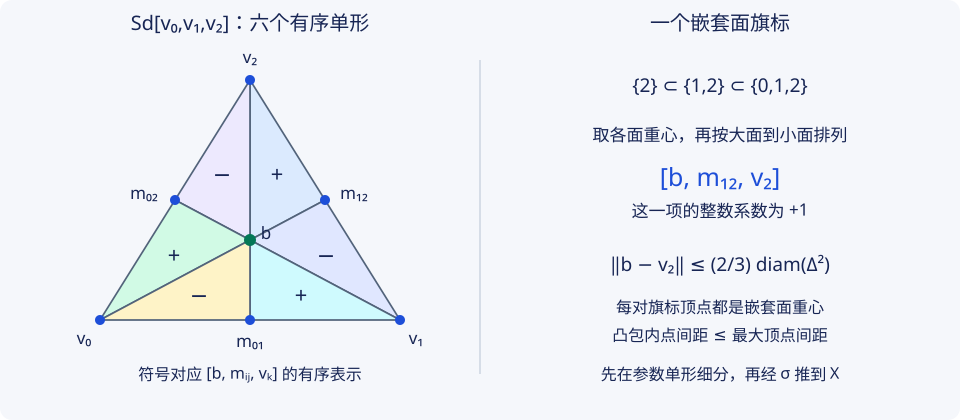

# H2 · 相对同调、切除与 Mayer–Vietoris

研究生课程 · 先修：H1、P4；自由阿贝尔群、核像、紧致度量空间 本批展开小链、切除和 Mayer–Vietoris 的链级证明。状态：Reviewed（作者及非编写模型逐式复核）；人类审稿与形式化验证未完成。

## 1. 学习目标 {#h2-objectives}

完成本章后，你应能为短正合列构造连接同态并证明自然性；在增广仿射链上写出锥、重心细分和链同伦的完整公式；从网格直径与紧致性证明小链定理；用相对链逐代表元证明切除；正确计算 Mayer–Vietoris 连接映射的符号。你还应能从两开集覆盖计算球面和圆盘对，而不借用尚未证明的胞腔同调。

## 2. 先修知识 {#h2-prerequisites}

先读 [H1 · 整数奇异链](singular-chains.md)：自由基是连续单形，链只有有限支撑，边界平方零，连续映射诱导链映射，同伦通过棱柱算子诱导相同同调映射。核、像、商和自由阿贝尔群见 [PRE5](../../preliminaries/groups-modules.md)；紧致性见 [P4](../../point-set/compactness-metric.md)。本章使用标准单形在欧氏空间中紧致这一基础分析事实，并在正文证明所需的 Lebesgue 数结论。

本章不要求空间 Hausdorff、局部可缩或带三角剖分。仿射坐标只在参数单形中使用；一般拓扑空间没有可用来“连直线”的向量运算。后续 [H3](cellular-coefficients.md) 将引用本章，不能反过来用胞腔同调来证明这里的球面计算。

## 3. 问题引入与直观解释 {#1}

相对链把落在子空间中的链视为零，适合研究“附加了什么”。例如圆盘本身可缩，但把边界视为零后，整个圆盘能留下一个相对循环。计算时又希望把空间拆成开集；然而一条奇异单形可能横跨数个开集，不能未经细分就把整个链复形拆开。

本章的技术路线是：在参数单形内把单形切小，再证明切小不改变同调类，而且这段链同伦不离开原单形的像。支撑控制既保证普通小链定理，也保证对子空间取商后的切除定理。

## 4. 严格定义 {#2}

**相对链与相对循环。** 对任意子空间 $A\subseteq X$，包含将 $C_n(A;\mathbb Z)$ 识别为 $C_n(X;\mathbb Z)$ 中由像落在 $A$ 的单形生成的自由子群。定义相对链复形（relative chain complex）

$$C_n(X,A)=C_n(X)/C_n(A),\qquad H_n(X,A)=H_n(C_*(X,A)).$$

其边界良定义，因为子空间单形的各面仍落在该子空间。由 $z\in C_n(X)$ 表示的商类为循环，当且仅当 $\partial z\in C_{n-1}(A)$；它为相对边界，当且仅当存在 $b\in C_{n+1}(X),a\in C_n(A)$ 使 $z=\partial b+a$。相对循环不一定是绝对循环。

**正合与小链。** 序列在某项正合（exact），指进入映射的像等于离开映射的核。链复形的短正合列要求每个次数的群序列正合，且箭头与边界交换。对开覆盖 $\mathcal U$，小链复形（small-chain complex）$C_*^{\mathcal U}(X)$ 由每个像包含于某个 $U\in\mathcal U$ 的单形生成。覆盖成员可随单形改变，不要求一条链整体落在同一成员。

记 $C_*^{\mathcal U}(A)=C_*(A)\cap C_*^{\mathcal U}(X)$，即对限制覆盖 $\{A\cap U:U\in\mathcal U\}$ 的小链。此等号可逐个自由基检查。所有普通链群在负次数为零。

**约化约定。** 需要约化序列时，使用增广复形 $\widetilde C_n(X)=C_n(X)$（$n\ge0$）、$\widetilde C_{-1}(X)=\mathbb Z$，且 $\partial_0=\epsilon$ 为零链系数和。它的同调记 $\widetilde H_n$。对非空空间 $\widetilde H_{-1}=0$；本章若遇空空间，明确约定 $\widetilde H_{-1}(\varnothing)=\mathbb Z$、其他次数为零。不要在空交集的约化序列中擅自把 $-1$ 次项删去。

## 5. 定理与证明 {#3}

### 连接同态先在链级构造

**完整证明（阿贝尔链复形与核像先修下）** · 代表元、正合性与自然性均展开

**定理 H2.1（长正合列，long exact sequence）。** 对阿贝尔群链复形的短正合列

$$0\longrightarrow A_*\xrightarrow{i}B_*\xrightarrow{q}C_*\longrightarrow0,$$

有连接同态 $\delta:H_n(C_*)\to H_{n-1}(A_*)$，与 $i_*,q_*$ 组成自然长正合列。此处 $A_*,B_*,C_*$ 是抽象链复形，不是后文的空间名称。

**证明：良定义。** 对循环 $c\in C_n$，用 $q_n$ 满射取提升 $b\in B_n$。因 $q\partial b=\partial c=0$，唯一有 $a\in A_{n-1}$ 使 $i(a)=\partial b$。又 $i\partial a=\partial^2b=0$，由 $i$ 单射得 $\partial a=0$。定义 $\delta[c]=[a]$。

若改提升为 $b+i(u)$，其中 $u\in A_n$，则 $a$ 改成 $a+\partial u$，同调类不变。若改循环代表为 $c+\partial v$，取 $v$ 的提升 $\widetilde v\in B_{n+1}$，则 $b+\partial\widetilde v$ 是新代表的提升，其边界仍为 $i(a)$。任意其他提升再由前一种情况处理。将两次提升相加可作为和的提升，因此 $\delta$ 是群同态。

**证明：三处核像。** 若 $\delta[c]=0$，写 $a=\partial u$，则 $b-i(u)$ 为循环且仍提升 $c$，故 $\ker\delta\subseteq\operatorname{im}q_*$。反之从循环提升得到的 $a$ 为零，给反向包含。

若循环 $b\in B_n$ 满足 $q_*[b]=0$，写 $q(b)=\partial c'$，提升 $c'$ 为 $b'\in B_{n+1}$。于是 $b-\partial b'=i(a)$，且 $i\partial a=0$，所以 $a$ 是循环，$[b]=i_*[a]$。反向包含由 $qi=0$，故 $\ker q_*=\operatorname{im}i_*$。

若循环 $a\in A_{n-1}$ 满足 $i_*[a]=0$，写 $i(a)=\partial b$。此时 $q(b)$ 是循环，按定义 $\delta[q(b)]=[a]$。反向包含来自 $i(a)=\partial b$，故 $\ker i_*=\operatorname{im}\delta$。这三处在所有次数重复给出长正合列；普通非负链在末端为 $H_0(B)\to H_0(C)\to0$。

**证明：自然性。** 若链映射 $f_A,f_B,f_C$ 把上述短正合列送到另一条短正合列，并满足 $f_Bi=i'f_A$、$q'f_B=f_Cq$，则 $f_Bb$ 是 $f_Cc$ 的提升，且 $\partial f_Bb=i'f_Aa$。因此

$$
\begin{array}{ccc}
H_n(C_*)&\xrightarrow{\delta}&H_{n-1}(A_*)\\
\downarrow H_n(f_C)&&\downarrow H_{n-1}(f_A)\\
H_n(C'_*)&\xrightarrow{\delta'}&H_{n-1}(A'_*)
\end{array}
$$

交换；其余箭头的自然性直接来自链级方块。$\square$

取 $0\to C_*(A)\to C_*(X)\to C_*(X,A)\to0$ 得空间对的长正合列。对映射 $f:(X,A)\to(Y,B)$，即连续 $f:X\to Y$ 且 $f(A)\subseteq B$，这些序列自然交换。其连接映射有特别直接的公式：$\delta[z]=[\partial z]$。

### 技术引理：锥只在仿射模型中取

为保留旧版 H2.1–H2.4 的引用，下面新增引理编号从 H2.5 开始，并放在使用它们的小链定理之前。

**完整证明** · 使用增广、保留退化有序单形

**引理 H2.5（增广仿射锥，augmented affine cone）。** 令 $E$ 为实向量空间中的非空凸集。$\mathcal A_n(E)$ 的自由基为全部有序元组 $[v_0,\ldots,v_n]$，表示从 $\Delta^n$ 到 $E$ 的仿射映射；重复顶点允许，且**不取顶点置换的反对称商，也不把退化单形置零**。令 $\mathcal A_{-1}(E)=\mathbb Z\langle[]\rangle$，$\partial[v]=[]$，$\partial[]=0$。对 $b\in E$ 定义

$$b*[v_0,\ldots,v_n]=[b,v_0,\ldots,v_n],\qquad b*[]=[b].$$

则对次数 $n\ge0$ 的仿射链有

$$\partial(b*c)=c-b*(\partial c).$$

**证明。** 对一个有序元组，删除首顶点 $b$ 的面是 $[v_0,\ldots,v_n]$；删除原第 $i$ 个顶点的符号为 $(-1)^{i+1}$，所以其余各面之和为 $-b*\partial[v_0,\ldots,v_n]$。$n=0$ 时，这个等式正是 $\partial[b,v]=[v]-[b]=[v]-b*[]$。这是增广不可省略的地方；普通零维边界取零时，右边会少一项。$\square$

在 $-1$ 次还直接有 $\partial(b*[])=[]$。这些恒等式在仿射链与一般奇异链的区别上必须清楚：不能把 $[b,v]$ 理解为任意拓扑空间中自动存在的线段。

**完整证明** · 仿射自然性、奇异面相容、低维与支撑逐项说明

**引理 H2.6（重心细分与支撑保持的链同伦）。** 存在自然链映射 $\mathrm{Sd}:C_*(X)\to C_*(X)$ 和自然次数 $+1$ 算子 $T$，满足

$$\partial T+T\partial=\mathrm{id}-\mathrm{Sd},\qquad T_0=0.$$

每个 $\mathrm{Sd}(\sigma)$、$T(\sigma)$ 的单形像均包含于原 $\sigma(\Delta^n)$。同样约定用于增广链，$\mathrm{Sd}_{-1}=\mathrm{id},T_{-1}=0$。

**证明：仿射细分递归。** 对有序仿射单形 $s=[v_0,\ldots,v_n]$，令 $b_s=(v_0+\cdots+v_n)/(n+1)$。定义

$$\mathrm{Sd}_{-1}([])=[],\qquad \mathrm{Sd}_0([v])=[v],\qquad
\mathrm{Sd}_n(s)=b_s*\mathrm{Sd}_{n-1}(\partial s)\quad(n\ge1).$$

线性延拓后，每个次数都是群同态。零次的增广与此定义交换。归纳假设低一维已与边界交换，H2.5 给

$$
\partial\mathrm{Sd}(s)=\mathrm{Sd}(\partial s)-b_s*\partial\mathrm{Sd}(\partial s)
=\mathrm{Sd}(\partial s)-b_s*\mathrm{Sd}(\partial^2s)=\mathrm{Sd}(\partial s).
$$

因此它是增广链映射。$n=1$ 公式中的零维边界同样使用增广，$\partial^2s=0$ 仍成立。

**证明：仿射链同伦递归。** 置 $T_{-1}=T_0=0$。假定低于 $n$ 次的 $T$ 已构造且满足同伦式，对 $n\ge1$ 定义

$$R_n(s)=s-\mathrm{Sd}(s)-T_{n-1}(\partial s),\qquad T_n(s)=b_s*R_n(s).$$

利用已证 $\partial\mathrm{Sd}=\mathrm{Sd}\partial$ 和低次同伦式，

$$
\partial R_n(s)=\partial s-\mathrm{Sd}(\partial s)-\partial T(\partial s)
=\partial s-\mathrm{Sd}(\partial s)-(\mathrm{id}-\mathrm{Sd})(\partial s)=0.
$$

这里 $T\partial^2s=0$，因此没有遗漏项。H2.5 遂给 $\partial T_n(s)=R_n(s)$，即所需同伦等式。在零次它是 $0=[v]-[v]$；在 $-1$ 次同样为零。

例如边 $[a,b]$ 的重心记 $m$，则

$$
\mathrm{Sd}[a,b]=[m,b]-[m,a],\qquad
T[a,b]=[m,a,b]-[m,m,b]+[m,m,a].
$$

两个含重复顶点的三角形不可直接删除。若 $a=b=v$，公式给 $\mathrm{Sd}[v,v]=0$、$T[v,v]=[v,v,v]$，且后者边界为 $[v,v]$。这与同伦式一致；把所有退化单形先置零属于另一条链复形，不能无说明地混用。

**证明：仿射自然性与面相容。** 任意仿射映射 $L:E\to E'$ 把重心送到重心，满足 $L_\#(b*c)=L(b)*L_\#c$，并与删面和增广交换。递归归纳先得 $L_\#\mathrm{Sd}=\mathrm{Sd}L_\#$，再得 $L_\#T=TL_\#$。不要求 $L$ 单射；常值映射也包括在内。

现在取标准单形的恒等仿射单形 $\iota_n=[e_0,\ldots,e_n]$。对一般空间的奇异单形 $\sigma:\Delta^n\to X$ 定义

$$\mathrm{Sd}(\sigma)=\sigma_\#\mathrm{Sd}(\iota_n),\qquad T(\sigma)=\sigma_\#T(\iota_n).$$

这里 $\sigma_\#$ 将参数单形内每个仿射单形后合成为 $X$ 中的奇异单形。对面嵌入 $\delta_i:\Delta^{n-1}\to\Delta^n$，刚证的仿射自然性给

$$\mathrm{Sd}((\delta_i)_\#\iota_{n-1})=(\delta_i)_\#\mathrm{Sd}(\iota_{n-1}),\qquad
T((\delta_i)_\#\iota_{n-1})=(\delta_i)_\#T(\iota_{n-1}).$$

因此把参数单形的链映射和同伦等式推前，边界中的每个面都恰好对应奇异 $\mathrm{Sd}(\sigma\delta_i)$ 与 $T(\sigma\delta_i)$，证明奇异版本的两式。连续 $f:X\to Y$ 只改变后合成 $\sigma\mapsto f\sigma$，故 $f_\#\mathrm{Sd}=\mathrm{Sd}f_\#$、$f_\#T=Tf_\#$。

删去增广的 $-1$ 次并将 $\partial_0$ 改为零，就回到普通奇异链：零次 $\mathrm{Sd}=\mathrm{id}$、$T_0=T_{-1}=0$，所以链映射和同伦等式仍成立，正次数计算不变。

**证明：支撑。** 仿射递归只用原顶点、各面中的重心及向这些点作锥，故全部新顶点和单形都留在原顶点凸包内。归纳同样适用于 $T$ 的各项。推前后，所有像留在 $\sigma(\Delta^n)$。于是 $\mathrm{Sd},T$ 同时保持任意子空间链和任意覆盖的小链，未在 $X$ 内作锥。$\square$

**完整证明** · 精确网格界与有限链的细分次数

**引理 H2.7（网格缩小与 Lebesgue 数）。** 在有限维赋范空间中，一个仿射 $n$ 单形 $K$（允许退化）的每个一次重心细分 $n$ 单形 $K'$，$n\ge1$，满足

$$\operatorname{diam}K'\le\frac{n}{n+1}\operatorname{diam}K.$$

对任意空间开覆盖 $\mathcal U$ 和任意有限奇异链 $c$，存在依赖于 $c,\mathcal U$ 的整数 $N\ge0$，使 $\mathrm{Sd}^Nc$ 为小链。

**证明：直径估计。** 递归细分的每个单形的顶点，是同一原单形一串嵌套非空指标子集的重心；从完整集合逐次删去一个指标，得到完整旗标。重复顶点仍按指标计数。若 $S\subsetneq R$，$|S|=s,|R|=r$，则

$$b_R=\frac{s}{r}b_S+\frac{r-s}{r}b_{R\setminus S},\qquad
\|b_R-b_S\|\le\frac{r-s}{r}\operatorname{diam}K\le\frac{n}{n+1}\operatorname{diam}K.$$

其中两个重心都在 $K$。凸包的直径不超过最大顶点距离：若 $x=\sum_i\alpha_i v_i,y=\sum_j\beta_jv_j$，则 $x-y=\sum_{i,j}\alpha_i\beta_j(v_i-v_j)$，系数非负且和为一，三角不等式给此结论。因此细分单形中的任意两点也满足同一界。迭代得到网格至多为 $(n/(n+1))^N\operatorname{diam}K$。零单形已经是一个点，不需要使用这个幂次估计。

**证明：所需 Lebesgue 数。** 把覆盖通过 $\sigma$ 拉回紧致度量空间 $\Delta^n$。对每个参数点 $x$，选 $r_x>0$ 及覆盖成员，使相对球 $B(x,2r_x)$ 落在该成员的逆像内。有限个 $B(x_i,r_i)$ 覆盖 $\Delta^n$；令 $\lambda=\min_i r_i>0$。任一非空集合 $S$ 若直径小于 $\lambda$，取 $y\in S\cap B(x_i,r_i)$，则每个 $z\in S$ 满足 $d(z,x_i)<\lambda+r_i\le2r_i$，故 $S$ 落在同一逆像覆盖成员内。

取 $N$ 使参数细分网格小于 $\lambda$，每个生成单形推前后便为小单形。链只有有限个生成元，可分别选择次数再取最大值；进一步细分小单形仍小，所以这个最大值适用于整条链。不同链一般需要不同的 $N$。这个缩小率是参数单形的网格界，并不声称任意连续 $\sigma$ 的像也按同一 Lipschitz 比率缩小；覆盖先经 $\sigma$ 拉回，正是为避免这个错误。奇异迭代与参数域迭代一致，由 H2.6 的自然性保证。$\square$

### 小链同构不靠一个全局统一的细分次数

**完整证明** · 普通与相对同调的满射、单射分别构造

**定理 H2.2（小链）。** 对开覆盖 $\mathcal U$，包含 $C_*^{\mathcal U}(X)\hookrightarrow C_*(X)$ 诱导同调同构。对每个子空间 $A\subseteq X$，商复形的包含同样诱导同构

$$H_n\bigl(C_*^{\mathcal U}(X)/C_*^{\mathcal U}(A)\bigr)\xrightarrow{\cong}H_n(X,A).$$

**证明：有限次同伦。** 对固定整数 $N\ge0$，令

$$T_N=\sum_{j=0}^{N-1}T\mathrm{Sd}^j,\qquad T_0=0.$$

因 $\mathrm{Sd}$ 与边界交换，

$$\partial T_N+T_N\partial=\sum_{j=0}^{N-1}(\mathrm{id}-\mathrm{Sd})\mathrm{Sd}^j
=\mathrm{id}-\mathrm{Sd}^N.$$

每一项保持子空间和小链，故 $T_N$ 也保持。此公式对每个固定 $N$ 是全链复形上的恒等式，但令一切链都变小的统一 $N$ 并未由它得到。

**普通满射。** 对有限循环 $z$，取 $N$ 使 $\mathrm{Sd}^Nz$ 小。它仍为循环，且 $z-\mathrm{Sd}^Nz=\partial T_Nz$，所以每个大复形同调类有小代表。

**普通单射。** 若小循环 $z$ 在大复形中为 $\partial b$，选 $N$ 使 $\mathrm{Sd}^Nb$ 小。则

$$z=\mathrm{Sd}^Nz+\partial T_Nz=\partial(\mathrm{Sd}^Nb+T_Nz).$$

$T_Nz$ 小是因为 $z$ 原本小，而不是因为 $T$ 会使任意链变小。括号中两项都小，因此 $z$ 在小复形中已为边界。

**相对满射。** 相对循环代表 $z$ 满足 $\partial z\in C_*(A)$，不要求 $\partial z=0$。取 $N$ 使 $\mathrm{Sd}^Nz$ 小，其边界同时在小链和 $A$ 中。等式

$$z-\mathrm{Sd}^Nz=\partial T_Nz+T_N\partial z$$

最后一项落在 $C_*(A)$，所以两者在相对同调中同类。

**相对单射。** 若小相对循环 $z$ 在大商中为边界，写 $z=\partial b+a$，$a\in C_n(A)$。取同一个 $N$ 使 $\mathrm{Sd}^Nb$、$\mathrm{Sd}^Na$ 都小。由同伦式，

$$z=\partial(\mathrm{Sd}^Nb+T_Nz)+(\mathrm{Sd}^Na+T_N\partial z).$$

第一括号为小链；第二括号为小的 $A$ 中链，因为 $\partial z\in C_*^{\mathcal U}(A)$ 且 $T_N$ 保持它。因此 $z$ 在小商中已为边界。$\square$

这些包含诱导的同构也自然：若 $f:X\to Y$ 将源覆盖的每个成员映入目标覆盖的某个成员，且 $f(A)\subseteq B$，链级包含方块交换，便得到同调方块。这里没有构造一个全局链同伦逆；按链选择 $N$ 的办法本身也不自动定义可加的逆算子。

### 切除：把相对链的两个余项写清楚

**完整证明** · 任意子集 Z，保留闭包落在内部的假设

**定理 H2.3（切除，excision）。** 若 $Z\subseteq A\subseteq X$ 满足 $\overline Z\subseteq\operatorname{int}_X A$，则包含

$$(X\setminus Z,A\setminus Z)\hookrightarrow(X,A)$$

诱导每个普通次数的相对同调同构。$Z$ 本身不要求开或闭。

**证明：合适的链子复形。** 记 $B=X\setminus Z$，$D_*=C_*(A)+C_*(B)\subseteq C_*(X)$。两个开集 $\operatorname{int}_X A$、$X\setminus\overline Z$ 覆盖 $X$，分别包含于 $A,B$。因此 H2.7 保证每条有限链的某次细分落在 $D_*$。$\mathrm{Sd},T,T_N$ 均保持 $D_*$ 和 $C_*(A)$，因为保持各单形像。

逐个奇异单形自由基可见 $C_*(A)\cap C_*(B)=C_*(A\cap B)$。故包含诱导规范链同构

$$C_*(B)/C_*(A\cap B)\xrightarrow{\cong}D_*/C_*(A).$$

单射来自上述交，满射来自 $D$ 的元素可写为 $a+b$，模掉 $a$ 后由 $b$ 表示。

**证明：商包含满射。** 取 $C(X)/C(A)$ 中相对循环代表 $z$。选择 $N$ 使 $\mathrm{Sd}^Nz\in D$。它仍满足边界在 $C(A)$，且 $z-\mathrm{Sd}^Nz=\partial T_Nz+T_N\partial z$，最后一项属于 $C(A)$。所以 $D/C(A)$ 的同调映到目标满射。

**证明：商包含单射。** 若 $z\in D$ 且 $\partial z\in C(A)$，并在大商中满足 $z=\partial b+a$、$a\in C(A)$，选择 $N$ 使 $\mathrm{Sd}^Nb\in D$。此时

$$z=\partial(\mathrm{Sd}^Nb+T_Nz)+(\mathrm{Sd}^Na+T_N\partial z).$$

因 $z\in D$，第一括号在 $D$；第二括号在 $C(A)$，不需要将全部 $A$ 中链变小。这说明 $z$ 在 $D/C(A)$ 中已经为边界。结合前一链同构得到结论。$\square$

切除同构是包含诱导的映射。若两套满足假设的数据之间有连续 $f:X\to X'$，$f(A)\subseteq A'$ 且 $f(X\setminus Z)\subseteq X'\setminus Z'$，则它给两个空间对的交换方块，因而切除同构与之自然相容。仅有 $f(Z)\subseteq Z'$ 并不足以保证第二个包含。

### Mayer–Vietoris：边界就是交集中的差异

**完整证明** · 自由基核像、连接映射、自然性及约化端点

**定理 H2.4（Mayer–Vietoris）。** 设 $U,V$ 为 $X$ 的开子空间，$X=U\cup V$，$i:U\cap V\to U$、$j:U\cap V\to V$ 为包含，则有自然长正合列

$$\cdots\to H_n(U\cap V)\xrightarrow{(i_*,-j_*)}H_n(U)\oplus H_n(V)
\xrightarrow{+}H_n(X)\xrightarrow{\delta}H_{n-1}(U\cap V)\to\cdots.$$

**证明：链短正合列。** 令 $D_*=C_*^{\{U,V\}}(X)=C_*(U)+C_*(V)$。序列

$$0\to C_*(U\cap V)\xrightarrow{w\mapsto(w,-w)}C_*(U)\oplus C_*(V)
\xrightarrow{(a,b)\mapsto a+b}D_*\to0$$

的第一箭头单射，最后箭头按 $D$ 定义满射。若 $a+b=0$，则 $a=-b\in C(U)\cap C(V)$；由自由基的交等式，它唯一来自 $w\in C(U\cap V)$，故中间正合。所有箭头都是链映射。应用 H2.1，再用 H2.2 的自然包含同构 $H_n(D)\cong H_n(X)$，得到所列序列。

**连接映射的具体公式。** 对任意循环 $z\in C_n(X)$，先细分到小循环 $z'=\mathrm{Sd}^Nz$，再写 $z'=a+b$，$a\in C_n(U),b\in C_n(V)$。因为 $\partial a+\partial b=0$，存在交集中的链 $w=\partial a=-\partial b$，且 $\partial w=0$。定义给

$$\delta[z]=[w]=[\partial a].$$

换分解为 $a+w',b-w'$（$w'\in C_n(U\cap V)$），结果改变边界 $\partial w'$。换小循环代表的无关性由 H2.1；在 $X$ 中的类唯一对应于 $H_n(D)$，故也不依赖初始细分次数。更具体地，再细分 $a,b$ 时连接代表变为 $\mathrm{Sd}^N\partial a$，它与 $\partial a$ 在交集内同调，因为 $T_N$ 保持交集。

**自然性。** 若 $f:X\to X'$ 连续，且 $f(U)\subseteq U'$、$f(V)\subseteq V'$，其中 $X'=U'\cup V'$ 也是有序开覆盖，则 $f_\#$ 给上述三项的短正合列映射。连接代表直接满足 $\partial f_\#a=f_\#\partial a$，所以

$$
\begin{array}{ccc}
H_n(X)&\xrightarrow{\delta_{U,V}}&H_{n-1}(U\cap V)\\
\downarrow f_*&&\downarrow(f|_{U\cap V})_*\\
H_n(X')&\xrightarrow{\delta_{U',V'}}&H_{n-1}(U'\cap V')
\end{array}
$$

交换。若交换 $U,V$ 的顺序，公式使用 $\partial b=-\partial a$，所以在交集按恒等识别下连接映射取负，不是原来的同一符号。

**约化版本。** 将三个链复形增广，在 $-1$ 次另有正合列 $0\to\mathbb Z\xrightarrow{t\mapsto(t,-t)}\mathbb Z^2\xrightarrow{(r,s)\mapsto r+s}\mathbb Z\to0$；它与零次的系数和边界交换。H2.1 仍适用，小链包含在 $-1$ 次为恒等。因此得到约化 Mayer–Vietoris。若交集为空，$\widetilde H_{-1}(U\cap V)=\mathbb Z$，不能把这一项置零；例如两个不交非空可缩开集的并正需此项表达其约化零次同调。约化零次连接公式使用增广边界：若 $\epsilon(a+b)=0$，则 $\delta[a+b]$ 由整数 $\epsilon(a)=-\epsilon(b)$ 在 $\widetilde H_{-1}(U\cap V)$ 中表示。$\square$

## 6. 典型例题：正例与反例 {#4}

### 基础正例：相对循环可以有非零边界

在 $([0,1],\{0,1\})$ 中，路径 $\sigma(t)=t$ 的普通边界为 $[1]-[0]\ne0$，但它是相对循环。长正合列把它送到 $[1]-[0]\in H_0(\{0,1\})$。区间可缩，$H_1([0,1])=0$，而 $H_0(\{0,1\})\to H_0([0,1])$ 为 $(a,b)\mapsto a+b$，故 $H_1([0,1],\{0,1\})\cong\mathbb Z$，由这条相对路径生成。

### 非平凡正例：球面计算不使用胞腔同调

对 $n\ge1$，写 $S^n\subset\mathbb R^{n+1}$，北、南极为 $N,S$，取 $U=S^n\setminus\{N\}$、$V=S^n\setminus\{S\}$。它们开放。$U$ 沿

$$H_U(x,t)=\frac{(1-t)x+tS}{\|(1-t)x+tS\|}$$

收缩到 $S$：分母只可能在 $x=N,t=1/2$ 为零，而该点已排除；非极点在 $t<1$ 保留非零水平坐标，故路径不经过 $N$。$V$ 同理收缩到 $N$。交集与 $S^{n-1}\times(-1,1)$ 同胚，映射为

$$(u,s)\longmapsto(\sqrt{1-s^2}\,u,s),$$

逆映射将前 $n$ 个坐标单位化并保留最后坐标。令 $s\mapsto(1-t)s$ 给到赤道的形变收缩，包括 $n=1$ 时两个交集分支。

由 H1 的同伦不变性，约化 Mayer–Vietoris 对 $k\ge1$ 给

$$\widetilde H_k(S^n)\cong\widetilde H_{k-1}(S^{n-1}).$$

零次也由序列得零，因为 $U\cap V\ne\varnothing$，其 $\widetilde H_{-1}=0$。$S^0$ 是两个点，连续单形的像只能在某一点内，故链复形为两个点复形的直和，$\widetilde H_0(S^0)=\mathbb Z$、其余非负次零。归纳得到

$$\widetilde H_k(S^n;\mathbb Z)=\begin{cases}\mathbb Z,&k=n,\\0,&k\ne n,\end{cases}\qquad(n,k\ge0).$$

因此 $n\ge1$ 时普通 $H_0(S^n)=\mathbb Z$，还在 $n$ 次为 $\mathbb Z$；$n=0$ 时普通 $H_0(S^0)=\mathbb Z^2$。

### 综合计算：圆盘对与连接生成元

对 $n\ge1$，$D^n$ 非空可缩，$S^{n-1}$ 非空。增广复形的空间对短正合列商在 $-1$ 次为零，正是普通相对链，所以长正合列给

$$H_k(D^n,S^{n-1};\mathbb Z)\cong\widetilde H_{k-1}(S^{n-1};\mathbb Z)\quad(k\ge1).$$

$H_0(S^{n-1})\to H_0(D^n)$ 满射，故相对零次为零。于是仅 $k=n$ 时相对群为 $\mathbb Z$，其他普通次数为零。连接映射将相对代表 $z$ 送到边界类 $[\partial z]$，是上述同构；$n=1$ 要用 $\widetilde H_0(S^0)$，不是 $H_0(S^0)$。$n=0$ 单独看 $(D^0,\varnothing)$：其普通零次为 $\mathbb Z$、更高次为零。

### 反例一：不能随意切除相对边界

对 $(X,A)=([0,1],\{0,1\})$，删去 $Z=\{0\}$。此时 $\operatorname{int}_X A=\varnothing$，不满足闭包条件。原来的相对 $H_1\cong\mathbb Z$，而 $(X\setminus Z,A\setminus Z)=((0,1],\{1\})$ 两空间均可缩且零次包含为同构，由长正合列其全部相对同调为零。切除失败的不是数值精度，而是缺少假设。

### 反例二：任意覆盖不自动给 Mayer–Vietoris

取 $X=[0,1]$、$U=[0,1)$、$V=\{1\}$。$U$ 在 $X$ 中开，$V$ 不开，且交集为空。两块各道路连通，但若照搬所列序列，就会要求 $0=H_0(U\cap V)$ 的像等于 $H_0(U)\oplus H_0(V)=\mathbb Z^2\to H_0(X)=\mathbb Z$ 的核；后者是非零的 $\mathbb Z(1,-1)$，矛盾。小链在这个非开覆盖中无法表达跨越到端点的道路同调关系。

## 7. 原创图解：重心旗标与支撑

左图显示 $\Delta^2$ 内的六个小三角形。每个小三角形由“整个三角形重心—一条边的重心—该边的一个顶点”组成，顶点顺序与 H2.6 的首点作锥约定一致。图中颜色只区别区域，不替代整数符号；不同旗标的系数由递归边界决定。右侧标出一个嵌套旗标和直径估计中的比例。所有构造先在参数三角形内完成，随后才经任意连续 $\sigma$ 推到 $X$，像可以自交或退化。

## 8. 编程实验：精确有理仿射链

仓库 `scripts/subdivision_chains.py` 使用整数链系数和 `Fraction` 坐标，操作有序元组并保留重复顶点。坐标有理不表示单形的连续映射以 $\mathbb Q^d$ 为目标：其仿射像仍在 $\mathbb R^d$ 中。以下代码从仓库根执行，仅调用标准库与该模块。

~~~python
from fractions import Fraction
from scripts.subdivision_chains import (
    Chain, boundary, subdivision, homotopy, mesh_linf,
)

triangle = Chain.generator([(0, 0), (1, 0), (0, 1)])
small = subdivision(triangle)
assert len(small.terms) == 6
assert boundary(small) == subdivision(boundary(triangle))
assert (boundary(homotopy(triangle)) + homotopy(boundary(triangle))
        == triangle - small)
assert mesh_linf(small) <= Fraction(2, 3) * mesh_linf(triangle)

constant_edge = Chain.generator([(0,), (0,)])
assert subdivision(constant_edge) == 0 * constant_edge
assert homotopy(constant_edge) == Chain.generator([(0,), (0,), (0,)])
assert boundary(homotopy(constant_edge)) == constant_edge
~~~

运行 `python -m unittest discover -s scripts -p "test_subdivision*.py"` 检查更多精确有限例。本节只核查所给有理仿射链；一般奇异链的小链同构、对任意开覆盖的存在性及切除定理，依据第5节的证明，不由测试推出。此处没有把 $T$ 当成单纯形数量很少的优化算法；重复细分可能迅速增加链的项数。

## 9. 课后习题 {#5}

1. **相对计算。** 计算 $H_k(D^n,S^{n-1};\mathbb Z)$（$n\ge1$），分别说明 $k=0$、$n=1$ 的处理，以及连接映射如何识别生成元。
2. **连接符号。** 在 $S^1$ 中取 $p=(1,0),q=(-1,0)$、$U=S^1\setminus\{N\}$、$V=S^1\setminus\{S\}$。令 $\alpha(t)=(\cos\pi t,-\sin\pi t)$，$\beta(t)=(-\cos\pi t,\sin\pi t)$。求 $\delta[\alpha+\beta]$，证明它生成 $\widetilde H_0(U\cap V)$，并说明交换覆盖顺序的影响。
3. **同伦证明。** 证明 $T_N=\sum_{j=0}^{N-1}T\mathrm{Sd}^j$ 的恒等式及支撑性质。解释为什么“每条有限链存在一个 $N$”不能直接定义一条全局线性的细分逆映射。
4. **低维与退化。** 在增广仿射链中展开 $\partial(b*[v])$、$T[a,b]$，再令 $a=b=v$ 计算 $\mathrm{Sd}[v,v]$ 和 $T[v,v]$。说明哪些项不能擅自删除。
5. **网格估计。** 证明凸包直径不超过最大顶点距离，并由嵌套面重心推出 $n/(n+1)$ 界。若参数单形直径为 $D>0$、Lebesgue 数为 $\lambda>0$，写出一个保证变小的 $N$ 选择准则，保留严格不等号。
6. **相对单射。** 已知小相对循环 $z$ 在 $C(X)/C(A)$ 中为边界。仅从 $z=\partial b+a$、$a\in C(A)$ 出发，给出小相对边界代表；必须解释 $T_N\partial z$ 为什么属于小的 $A$ 中链，不能把 $\partial z$ 当成零。
7. **自然性迁移。** 给定短正合列之间的交换链映射，证明连接方块交换。应用到有序开覆盖间的连续映射，推导 Mayer–Vietoris 连接自然性；说明交换 $U,V$ 时为何不是不变而是取负。
8. **挑战与反例。** 完整计算正文的“切除一个端点”反例；再证明 $[0,1]=[0,1)\cup\{1\}$ 不满足所列 Mayer–Vietoris 序列。分别指出两次错误推断遗漏的精确假设。

??? tip "第一层提示"
    1：使用约化零次群。2：先求两条道路各自的边界。3：逐项望远镜求和。4：零单形的增广边界是空元组。5：比较大小为 $s,r$ 的嵌套面重心。6：用同伦式保留两个括号。7：把所选提升经映射推过去。8：分别看相对一次与普通零次的核像。

??? tip "第二层提示"
    1：$H_0(S^{n-1})\to H_0(D^n)$ 满射。2：$\partial\alpha=q-p$，在交集两分支中非零。3：$N$ 依赖链，未给可加的选择规则。4：$T[a,b]$ 含 $[m,m,b]$ 与 $[m,m,a]$。5：选 $(n/(n+1))^ND<\lambda$。6：小性来自 $z$ 及其边界原本小，保 $A$ 来自支撑。7：连接同态用第一分量的边界。8：两块零次到区间零次是求和映射。

<noscript>即时反馈需要 JavaScript；分步提示与完整书面解答仍可阅读。</noscript>

## 10. 习题解答

[H2 八题完整论证式解答](../../exercises/h2-solutions.md)。请先独立写出对象、次数、系数及每一步所用假设，再对照答案。涉及有限程序的题目仍要求解释一般论证。

## 11. 本章总结

小链方法的关键并非只有“细分足够多次”，还包括仿射递归的面自然性、正确的增广符号，以及同伦不离开原单形像的支撑控制。相对切除必须同时控制循环边界与填充链；Mayer–Vietoris 则把拆分链两边抵消的边界保留在交集中。

本章从奇异链直接完成球面、圆盘对计算，为 H3 的胞腔比较提供输入。一般胞腔比较、上同调比较和 Poincaré 对偶不因这些计算完成而自动得到证明。

## 12. 参考书目 {#6}

- Allen Hatcher, *Algebraic Topology*, Cambridge University Press, 2002，§2.1 的相对同调、切除、细分与 Mayer–Vietoris 内容。[作者教材页](https://pi.math.cornell.edu/~hatcher/AT/ATpage.html)在本批实际访问成功；未声称逐页核验全章，不提供未经核验的页码或定理号。
- Glen E. Bredon, *Topology and Geometry*, Springer, 1993，同调及正合序列相关内容；本批未访问原书全文，作为进一步阅读定位。

正文、符号安排、证明叙述、例题、图解与习题均原创。逐项范围及尚待人工复核的对象见 [H2 审查记录](../../project/reviews/H2.md)。
