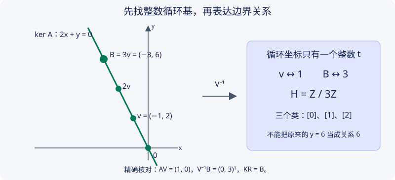

# CT1 · 整数同调与 Smith 标准形

本章状态：**Reviewed，已完成非编写模型交叉检查；独立人类审阅未完成**；[审查记录](../project/reviews/CT1.md)。计算实现已通过精确证书及独立库对照；有限测试不构成所有输入上的形式化验证。

## 1. 学习目标

你将证明有限整数矩阵的 Smith 标准形存在，解释不变量因子如何确定一个给定有限表示的商群，并用可核验的整数基变换计算 $\ker A/\operatorname{im}B$。完成后，你应能计算三角形、射影平面与 Klein 瓶给定链模型的整数同调，指出域上秩丢失的挠子信息，并区分算法证明、输入复形的正确性和有限软件测试三个层次。

## 2. 先修知识

必需：[PRE5 · 群、商群与整数模](../preliminaries/groups-modules.md)，特别是自由子群、幺模矩阵与商群。需要整数带余除法、矩阵乘法与有限行列式；使用域上秩时指 $\mathbb Q$ 上的秩。几何例子使用 [三角形的同调](../algebraic/03-homology.md) 的链概念；本章写明整数有向边界及所用矩阵，不要求读者从记忆恢复符号。

射影平面和 Klein 瓶的矩阵来自胞腔边界。此处完整证明的是**给定矩阵的整数同调计算**；这些胞腔链模型与奇异同调的一致性依赖胞腔同调定理。[H3 · 胞腔同调](../algebraic/homology/cellular-coefficients.md)现已展开有限非正则 CW 的骨架比较与附加度公式；读本章时可先把空间比较作为后续证明的输入，不能用矩阵测试代替几何论证。H3 的无限 CW、胞腔逼近与空间乘积比较仍未展开。本章只交付 CT1 中的整数同调与 Smith 标准形；CT1 规划中的立方复形专题仍待建设。

## 3. 问题引入与直观解释：秩相同，为何群不同

两个矩阵 $(1)$ 与 $(2)$ 在 $\mathbb Q$ 上均有秩一，但它们的整数余核分别是 $0$ 与 $\mathbb Z/2$。若只计算“变量数减秩”，会漏掉第二个结果中的非零挠子。

另一个隐蔽问题是坐标：为了求循环，我们会改变中间链群的基。边界也生活在这个链群中，必须同步换坐标；若保留旧边界坐标再截行，就可能凭空把 $\mathbb Z/3$ 算成 $\mathbb Z/6$。

## 4. 严格定义

**定义 CT1.1（有限自由整数链复形）。** 一列有限秩自由阿贝尔群 $C_k$ 和同态 $\partial_k:C_k\to C_{k-1}$，若 $\partial_k\partial_{k+1}=0$，称自由整数链复形（free integer chain complex）。选基后，固定次数的输入为

$$
\mathbb Z^q\xrightarrow{B}\mathbb Z^n\xrightarrow{A}\mathbb Z^p,\qquad
A\in\mathbb Z^{p\times n},\quad B\in\mathbb Z^{n\times q},\quad AB=0.
$$

循环（cycle）群为 $Z=\ker A$，边界（boundary）群为 $E=\operatorname{im}B\subset Z$，同调（homology）为 $H=Z/E$。允许 $p,n,q$ 为零；零行或零列矩阵的形状仍须保存。余核（cokernel）定义为 $\operatorname{coker}B=\mathbb Z^n/\operatorname{im}B$，它一般不等于 $H$。

**定义 CT1.2（Smith 标准形，Smith normal form）。** 整数矩阵 $M\in\mathbb Z^{m\times n}$ 的 Smith 分解是

$$
UMV=D=\operatorname{diag}(d_1,\ldots,d_r,0,\ldots),\qquad
0<d_1\mid d_2\mid\cdots\mid d_r,
$$

其中 $U\in GL_m(\mathbb Z),V\in GL_n(\mathbb Z)$ 幺模。矩形对角矩阵 $D$ 除对角位置外全零；$d_i$ 称不变量因子（invariant factor），等于 $1$ 的因子允许保留。零矩阵时 $r=0$。

**定义 CT1.3（秩与饱和）。** 一个有限秩自由阿贝尔群的秩（rank）是基数；对整数矩阵可在 $\mathbb Q$ 上求秩。子群 $K\le\mathbb Z^n$ 饱和（saturated），指 $tx\in K$、$x\in\mathbb Z^n$、非零整数 $t$ 推出 $x\in K$。直和分解 $\mathbb Z^n=K\oplus L$ 意味着每个元素唯一写成 $k+\ell$。

下面证明 Smith 分解，同时给出有限表示群的自由秩与挠子；不依赖浮点“数值秩”。

## 5. 定理与证明：算法正确性

### 整数消元为何终止

**定理 CT1.4（Smith 分解存在）。** 每个有限整数矩阵都有 CT1.2 所述分解，可用交换、乘 $-1$、加另一行或列的整数倍这些初等操作求出，并同步记录 $U,V$。

**证明。** 对矩阵的行列数作有限递归。若矩阵全零或某一维为零，已是所需形式。否则把一个非零元素交换到左上角并令其正，记为 $a>0$。

对第一列中的元素 $b$ 作 $b=qa+r$、$0\le r<a$，用“该行减 $q$ 倍第一行”将其改成 $r$。若 $r>0$，交换这行与第一行，新正主元严格小于原主元，重新开始；若 $r=0$，清除该位置。对第一行用列操作做同样的除法。发生主元交换时必须重查整条行和列，因为旧零可能被破坏。

每次非零余数交换都严格降低正整数主元，因此只可能发生有限次。在不交换主元的一轮中，有限次行操作清第一列，接着有限次列操作清第一行；这些列操作不破坏已经为零的第一列。因此最终得到

$$
\begin{pmatrix}a&0\\0&T\end{pmatrix}.
$$

如果 $a$ 不整除 $T$ 中的某元素 $t_{ij}$，把该元素所在的整行加到第一行。第一列主元仍是 $a$，第一行现在包含 $t_{ij}$。随后做带余除法时，某个不被 $a$ 整除的第一行元素产生严格较小的正余数，换列后再次降低主元。故这种补救也只能有限次。最终 $a$ 整除剩余块的全部元素。

对剩余块递归。只在剩余行列做整数操作，不碰已完成的主元；旧主元整除该块的所有元素，故也整除所有后续整数线性组合，最终 $d_1\mid d_2\mid\cdots$。每个初等操作都有整数逆；左乘操作积为 $U$，右乘操作积为 $V$，始终保持 $UMV$ 等于当前矩阵。$\square$

这是教学算法的终止与代数正确性论证，不是多项式位复杂度证明。中间整数和变换矩阵可能明显增大；实现适合可审查的小规模例题，大规模任务应使用成熟整数线性代数库。

**命题 CT1.5（不变量因子唯一）。** 正的不变量因子由 $M$ 唯一确定。若 $\Delta_j$ 是全部 $j$ 阶子式生成的整数理想的非负生成元，$\Delta_0=1$，则对 $1\le j\le r$，

$$
\Delta_j=d_1\cdots d_j,\qquad d_j=\Delta_j/\Delta_{j-1}.
$$

**证明。** 初等行交换或变号只改变子式符号或顺序。把某行加另一行的整数倍时，行列式的多线性把新子式写成旧子式的整数线性组合：若来源行已在子式中，额外项有重复行而为零；否则它是替换一行所得的子式，至多相差符号。因此新子式理想包含于旧理想；逆操作给反向包含。列操作相同，故 $\Delta_j$ 在算法中不变。

对 Smith 对角矩阵，每个非零 $j$ 阶子式是某 $j$ 个不同对角因子的乘积。写所选下标 $i_1<\cdots<i_j$，由 $i_k\ge k$ 及整除链，$d_k\mid d_{i_k}$，故每个乘积被 $d_1\cdots d_j$ 整除。而前 $j$ 个对角位置恰给这个子式，所以它就是非负生成元。超过 $r$ 的全部子式为零。由这些量逐项恢复因子，证明唯一。$\square$

### 从矩阵到群

**定理 CT1.6（有限整数表示的商群）。** 若 $M:\mathbb Z^n\to\mathbb Z^m$ 的 Smith 因子为 $d_1,\ldots,d_r$，则

$$
\operatorname{coker}M\cong
\mathbb Z^{m-r}\oplus\bigoplus_{i=1}^{r}\mathbb Z/d_i\mathbb Z.
$$

其中 $\mathbb Z/1=0$，不能把 $d_i>1$ 的项删掉。

**证明。** 右乘 $V$ 只改变定义域基，所以 $\operatorname{im}(MV)=\operatorname{im}M$。左乘 $U$ 是陪域自同构，将 $\operatorname{im}M$ 送至 $\operatorname{im}D$，因而诱导余核同构。对角像由 $d_i e_i$ 生成，每个坐标独立取商：前 $r$ 个坐标模 $d_i$，其余仍为整数。映射将坐标分别取余，核恰是该对角像，满射性可逐坐标检查。$\square$

每个有限生成阿贝尔群 $G$ 都是有限整数表示的商：由生成元取满射 $\mathbb Z^m\to G$，其核由 PRE5.10 有有限基，将这些基作列便得关系矩阵。因此该算法也给有限生成阿贝尔群的分解存在性。CT1.5 证明的是给定矩阵在整数基变换下的因子唯一；不同表示给出同一个抽象群时的完整分类唯一性还可用各素数幂挠子子群恢复，本文不把这项额外论证默认为已经完成。

**定理 CT1.7（核基与边界坐标算法）。** 设 $AB=0$，取 $UAV=D$、$\operatorname{rank}A=r$。令 $K$ 为 $V$ 的最后 $n-r$ 列，令 $R$ 为 $V^{-1}B$ 的最后 $n-r$ 行，则 $K$ 的列是 $\ker A$ 的整数基，$KR=B$，并有

$$
H\cong\operatorname{coker}R.
$$

若 $R$ 的非零 Smith 因子为 $s_1,\ldots,s_t$，则 $H$ 的自由秩为 $n-r-t$，非平凡挠子因子恰是全部 $s_i>1$。

**证明。** 将原坐标 $x$ 写成 $Vy$。$Ax=0$ 当且仅当 $Dy=0$。由于前 $r$ 个对角元为非零整数，而整数无零因子，这等价于 $y_1=\cdots=y_r=0$；其余整数坐标任意。因此 $K$ 给从 $\mathbb Z^{n-r}$ 到整数核的同构，不只是一个有理核基。

由 $AB=0$ 得 $D(V^{-1}B)=UAB=0$，逐列应用上述条件知前 $r$ 行必须为零。于是 $V^{-1}B=\binom{0}{R}$，左乘 $V$ 得 $B=KR$。同构 $K$ 把 $\operatorname{im}R$ 恰映成 $\operatorname{im}B$，故诱导所需商群同构；最后应用 CT1.6。$\square$

**命题 CT1.8（独立对照可用的另一公式）。** 对同样的有限整数链，$\ker A$ 是 $\mathbb Z^n$ 的一个直和项，并且

$$
\operatorname{Tor}H\cong\operatorname{Tor}(\operatorname{coker}B),\qquad
\operatorname{rank}H=n-\operatorname{rank}A-\operatorname{rank}B.
$$

因此，若只要抽象群的自由秩与挠子，可以利用原始 $A$ 的秩和原始 $B$ 的 Smith 因子；若要实际循环代表与边界在循环中的坐标，CT1.7 还提供相应证书。

**证明。** $\operatorname{im}A$ 是 $\mathbb Z^p$ 的子群，PRE5.10 说明它自由。选其有限基 $a_1,\ldots,a_r$，各选一个原像 $x_i\in\mathbb Z^n$，定义同态 $s(\sum c_i a_i)=\sum c_i x_i$。由于基表达唯一，$s$ 良定义且 $As$ 恒等。任意 $x$ 写成 $(x-sAx)+sAx$，第一项在核中。若 $s(a)\in\ker A$，则 $a=As(a)=0$，所以两子群交为零。故

$$
\mathbb Z^n=\ker A\oplus s(\operatorname{im}A).
$$

因 $\operatorname{im}B\subset\ker A$，取商得
$\operatorname{coker}B\cong H\oplus s(\operatorname{im}A)$。第二项自由、无挠，因此两边挠子一致；自由秩相差 $r$。CT1.6 给余核自由秩为 $n-\operatorname{rank}B$，从而得公式。此核也饱和：$A(tx)=tAx=0$，而 $\mathbb Z^p$ 无挠，故 $Ax=0$。$\square$

这解释了独立参考程序为何可以绕开本实现的核基。错误的是**改了 $A$ 的基，却把原始 $B$ 截行当新坐标**；不是所有分别计算两矩阵 Smith 信息的方法都错误。

**推论 CT1.9（有限链的 Euler 核对）。** 对只有有限个非零链群的自由整数链复形，令 $\beta_k$ 为 $H_k$ 的自由秩，则

$$
\sum_k(-1)^k\operatorname{rank}C_k=\sum_k(-1)^k\beta_k.
$$

**证明。** CT1.8 给 $\beta_k=n_k-r_k-r_{k+1}$，其中 $r_k=\operatorname{rank}\partial_k$。交替求和时每个 $r_k$ 出现两次且符号相反，有限性允许直接配对消去。挠子不计入自由秩，所以 Euler 核对无法单独检测挠子算错。$\square$

## 6. 典型例题：正例与反例

**例1：有向三角形。** 顶点依次为 $0,1,2$，边为 $e_{01},e_{12},e_{02}$，则

$$
\partial_1=A=
\begin{pmatrix}-1&0&-1\\1&-1&0\\0&1&1\end{pmatrix},
\qquad
\partial_2=B=\begin{pmatrix}1\\1\\-1\end{pmatrix}.
$$

矩阵乘积 $AB=0$；解 $Ax=0$ 给 $x=t(1,1,-1)$。空心三角形没有二维单形，$B$ 是 $3\times0$ 矩阵，所以 $H_1=\mathbb Z$。填入一个面后，$\operatorname{im}B=\ker A$，故 $H_1=0$。两者 $H_0=\mathbb Z$，因为边差关系把三个顶点识别为同一个生成元；填面不改变零次群。Euler 数分别为 $3-3=0$ 与 $3-3+1=1$，与自由秩交替和一致。

**例2：改基但忘记变换边界。** 取 $A=(2\ \ 1)$，$B=(-3,6)^T$。整数核由 $v=(-1,2)^T$ 生成，$B=3v$，所以 $H=\mathbb Z/3$。若仅因为核维数为一就截取 $B$ 的最后一行，会把关系误写成 $6$。正确使用例如

$$
V=\begin{pmatrix}0&-1\\1&2\end{pmatrix},
\quad AV=(1\ \ 0),\quad
V^{-1}B=\begin{pmatrix}0\\3\end{pmatrix}.
$$

算法的具体 $V$ 可能不同，但必须给同一个商群及 $KR=B$ 的精确证书。

**例3：逐个有理核向量清分母仍可能不够。** 对 $A=(2\ \ 1\ \ 1)$，常见有理核基为 $(-1/2,1,0)$、$(-1/2,0,1)$。各自乘二得到整数向量 $(-1,2,0)$、$(-1,0,2)$，却漏掉整数核中的 $(-1,1,1)$，因为前两向量的后两个坐标均为偶数。若以此遗漏的向量为边界，所得整数同调实际为 $\mathbb Z$，而不完整的“核格”甚至无法表达输入边界。CT1.7 的幺模基避免这一步错误。

**例4：射影平面与系数。** 标准 CW 结构各有一个 $0,1,2$ 维胞腔，边界为 $\partial_2=(2),\partial_1=(0)$。其几何来源是二维胞腔的附着圆在一维圆上绕两次。给定这个链模型，得到

$$
H_0=\mathbb Z,\quad H_1=\mathbb Z/2,\quad H_2=0.
$$

改用 $\mathbb F_2$ 系数时乘二变为零，故此模型 $H_2(-;\mathbb F_2)=\mathbb F_2$。因此一般不能把 $H_2(-;\mathbb Z)\otimes\mathbb F_2$ 当成全部模二同调；这里前者为零，后者非零。这是系数变换的明确计算，不需要假称已经证明通用系数定理。

**例5：Klein 瓶的挠子。** 标准一顶点、两条边、一个面模型中，附着词可取 $aba^{-1}b$，故 $\partial_2=(0,2)^T$，$\partial_1=0$。结果为 $H_0=\mathbb Z,H_1=\mathbb Z\oplus\mathbb Z/2,H_2=0$。同调矩阵只看附着词中各生成元的指数和，不能据此说基本群也是阿贝尔群。几何识别与胞腔同调定理属于外部理论依赖。

**零维边界情况。** 三个孤立点对应 $A: \mathbb Z^3\to0$ 与 $B:0\to\mathbb Z^3$，所以 $H_0=\mathbb Z^3$。若中间链群为零，则同调为零，不能因空数组丢失矩阵列数而误判维数。

## 7. 几何直观与原创图解

图中 $v=(-1,2)$ 是循环直线上的一个整数步长，$B=3v$ 规定“三步为零”，留下三个剩余类。坐标轴上 $B$ 的第二个分量是六，却不是循环方向上的关系倍数。图用于解释坐标变化；$AV=(1,0)$ 与 $V^{-1}B=(0,3)^T$ 是可复核的代数依据。

## 8. 编程实验与独立对照

仓库脚本采用 Python 任意精度整数；精确有理数只用于验证或计算幺模矩阵的逆，逆矩阵必须全部为整数。没有浮点距离、舍入、小区间过滤或秩容差。输入必须为 Python 整数，拒绝浮点数和布尔值。

从仓库根目录运行下段代码。它验证非坐标核例、Smith 证书与射影平面，而不需要 SymPy：

~~~python
import sys
sys.path.insert(0, "scripts")
from integer_homology import (
    ZMatrix, zeros, smith_normal_form, integer_homology
)

A = ZMatrix([[2, 1]])
B = ZMatrix([[-3], [6]])
h = integer_homology(A, B)
assert h.description() == {"free_rank": 0, "torsion": [3]}
assert (A @ h.cycle_basis).is_zero()
assert h.cycle_basis @ h.boundary_in_cycles == B
snf = smith_normal_form(ZMatrix([[6, 0], [0, 10]]))
assert snf.invariant_factors == (2, 30)
assert snf.left @ ZMatrix([[6, 0], [0, 10]]) @ snf.right == snf.diagonal
assert integer_homology(zeros(1, 1), ZMatrix([[2]])).torsion == (2,)
assert integer_homology(ZMatrix([[2]]), zeros(1, 0)).free_rank == 0
~~~

完整复现命令：

~~~text
python scripts/test_integer_homology.py
python -m pip install -r requirements-integer.txt
python scripts/verify_integer_independent.py --output validation/v05/integer-independent.json
~~~

第一条只用标准库。第二条为独立对照安装固定版本 SymPy；参考函数是官方整数域上的 Smith 分解。第三条在相同原始整数输入上，对照 186 个 Smith 矩阵和 120 组链复形，种子为 20261014。它按 CT1.8 使用原始 $A,B$ 的 Smith 信息，不复用被测程序算出的核基；同时核验 $UAV=D$、幺模逆、$AK=0$ 和 $KR=B$。

已测范围含零矩阵、矩形矩阵、零行零列、负系数、大于浮点精确整数范围的数、非坐标核、挠子与无挠案例。随机有限案例支持实现检查，不证明所有矩阵正确，也不验证输入来自某个指定空间的正确三角剖分。对完整复形还须逐次数检查边界复合为零及 Euler 等式；对给定链模型的群计算，不等于同胚分类。

## 9. 课后习题 { #ct1-exercises }

1. **基础计算。** 对 $\operatorname{diag}(6,10)$ 求 Smith 因子及余核；解释为什么 $(6,10)$ 本身不是按整除链排列的 Smith 因子。
2. **改基。** 用例2的 $V$ 手算 $V^{-1}$、$AV$ 和 $V^{-1}B$，再求同调。指出截原矩阵最后一行的错误。
3. **有向边界。** 重做例1的 $AB=0$，求空心和实心三角形的全部非零同调群及 Euler 数。换掉一条边的方向时，应同步改变哪些矩阵坐标？
4. **系数。** 用射影平面模型分别计算 $\mathbb Z,\mathbb Q,\mathbb F_2$ 系数的 $H_1,H_2$，解释“自由秩零”不等于“群零”。
5. **证明。** 给出 CT1.8 中的直和分解，并说明原始 $B$ 的 Smith 因子为何能独立对照同调挠子；为什么余核的自由秩还须减掉 $\operatorname{rank}A$？
6. **综合计算。** 链群为 $C_2=\mathbb Z,C_1=\mathbb Z^2,C_0=\mathbb Z$，其余次数均零，边界取 $A=\partial_1=0$ 与 $B=\partial_2=(0,2)^T$。求中间同调及顶次同调；把 $B$ 换为 $(0,1)^T$，指出哪一项变化、哪一个 Euler 数不变。
7. **退化与非法输入。** 分别分析 $A$ 为 $0\times3$、$B$ 为 $3\times0$ 的情形，以及 $A=(2),B=(1)$。后者为什么必须拒绝，而不能输出一个商群？
8. **挑战。** 对 $A=(2\ \ 1\ \ 1)$、$B=(-1,1,1)^T$，构造完整整数核基并证明 $H\cong\mathbb Z$。解释对两个有理核向量逐列清分母为何遗漏指数二子格之外的循环。

??? tip "第一层提示"
    1：先用一阶子式的最大公因数。2：$V$ 的行列式是1。3：边方向也是链群的基选择。4：模二时乘二是零，在有理数上却可逆。5：提升 $\operatorname{im}A$ 的基。6：关系只作用在第二个坐标。7：先检查 $AB$。8：用 $x,y$ 或两个整数参数表达全部解，检查奇偶条件。

??? tip "第二层提示"
    1：$\Delta_1=2,\Delta_2=60$。2：$V^{-1}=\left(\begin{smallmatrix}2&1\\-1&0\end{smallmatrix}\right)$。3：换向同时给 $A$ 相应列和 $B$ 相应行变号。5：$\operatorname{coker}B\cong H\oplus\operatorname{im}A$。6：顶次核为零，Euler 数是 $1-2+1=0$。8：取 $k_1=(-1,1,1),k_2=(0,1,-1)$，由 $y+z=-2x$ 解出整数系数。

<noscript>两层提示与完整解答不依赖 JavaScript。</noscript>

## 10. 习题解答

[CT1 八题完整解答](../exercises/ct1-solutions.md)。解答同时检查整数生成性、线性独立与系数环，不能只给一次浮点消元输出。

## 11. 本章总结

Smith 标准形保留整数关系的整除信息；整数同调还要求正确定位循环子群。幺模基变换、边界坐标同步变换以及 $AB=0$ 是算法的数学契约。独立实现对照和精确证书加强软件可信度，但不替代一般算法证明、空间模型核验或人工数学审阅。

## 12. 参考书目

- Allen Hatcher, *Algebraic Topology*, 第2章（同调、胞腔计算）与第3章（系数相关理论）；[作者教材入口](https://pi.math.cornell.edu/~hatcher/AT/ATpage.html)。原书用于理论主题定位，本章不声称已经展开胞腔同调定理或通用系数定理的完整证明。
- David S. Dummit and Richard M. Foote, *Abstract Algebra*, 第3版，Wiley，主理想整环上有限生成模与不变量因子相关章节。未取得全文逐页核验，不给未核实的页码或定理编号。
- [SymPy 1.14.0 Matrix Normal Forms](https://docs.sympy.org/latest/modules/matrices/normalforms.html)：官方明确给出主理想整环上的 Smith 标准形接口及整数域示例；本批实际运行整数域独立对照。

正文、算法说明、例题与图形均原创。验证报告中的“通过”只涉及记录的输入与断言，未将其写成任意空间上的拓扑分类结论。
