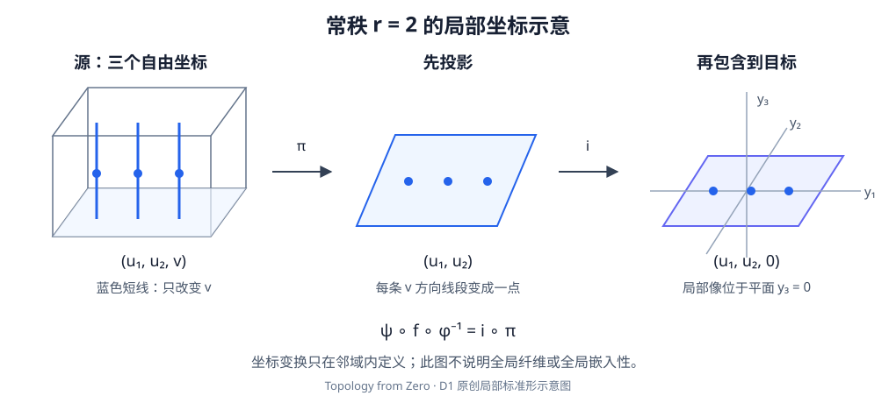

# D1 · 光滑流形、切空间与秩定理

研究生课程 · 状态：Reviewed（已写核心与题解，经非作者模型复核） 范围：从坐标相容性构造切空间，证明局部秩定理，并完整构造光滑单位分解。保留原 D1.1–D1.4 编号及旧章节锚点。

## 1. 学习目标 {#learning-goals}

完成本章后，你应能检验图册的光滑相容性，证明曲线速度定义的切空间及其线性结构与坐标选择无关，计算切映射并使用链式法则。你还应能重构常秩定理的坐标变换，准确使用正则值原像定理，区分浸入、嵌入和适当映射，并从紧穷竭与局部隆起函数构造一个从属于任意开覆盖的光滑单位分解。

## 2. 先修知识 {#prerequisites}

- [P2 · 分离与可数性](../point-set/separation-countability.md)：Hausdorff、第二可数、Lindelöf。
- [P6 · 局部紧致](../point-set/local-compactness.md)：紧邻域、紧集闭性与适当映射。
- [P9 · 局部有限与单位分解](../point-set/local-properties-partitions.md)：局部有限集合族、支集和连续单位分解。下面会重新证明光滑情形所需的具体构造。
- 外部多元微积分：欧氏空间中导数、链式法则、Jacobian 矩阵、逆函数定理（inverse function theorem，IFT）、中值定理。IFT 的使用版本是：光滑映射 $F:U\subseteq\mathbb R^m\to\mathbb R^m$ 在一点的导数可逆，则在该点附近有光滑局部反函数。本章引用而不证明该分析定理。
- 指数函数光滑以及指数比任意幂增长快的初等分析事实，用于隆起函数；正文给出所需估计。无理环面例子还使用鸽巢原理与复指数 $e^{it}=\cos t+i\sin t$ 的基本性质。

本章不使用常微分方程存在定理；后续[梯度流与 Morse 理论](morse-handles.md)才需要它。空流形的切空间命题无点可检查，单位分解取空族；以下涉及指定点的证明均在非空情形进行。

## 3. 问题引入：直观解释 {#1}

拓扑流形只要求每个点附近能用欧氏坐标描述。光滑结构还要求两套坐标间可以平滑转换。沿曲线行走时，坐标速度的数值会随着坐标变化，但应存在一个不依赖这套坐标的切向量。

同样，导数的矩阵依赖坐标，秩却不应依赖坐标。常秩定理把这项不变量变成一个局部几何结论：在合适坐标下，映射只保留前 $r$ 个变量，其余输出坐标全为零。该结论局部成立，不保证不同地方的像不会相遇，也不保证到像的反函数连续。

最后，一个局部构造未必能直接拼成全局对象。单位分解使用光滑权重，而且每一点附近只允许有限项参与。这个“附近有限”的条件比“每个点处有限”强，不能省略。

## 4. 严格定义 {#2}

### 定义 D1.Def1：坐标图、图册与光滑结构

拓扑 $m$ 维流形（topological manifold）是 Hausdorff、第二可数空间 $M$，每点有开邻域 $U$ 同胚于 $\mathbb R^m$ 中的开集。本文 $m$ 是有限非负整数，默认无边界；有边界时另行声明。坐标图（chart）是同胚 $\varphi:U\to\varphi(U)\subseteq\mathbb R^m$。

图册（atlas）是一族定义域覆盖 $M$ 的坐标图。若每对图的转移映射（transition map）

$$
\psi\circ\varphi^{-1}:\varphi(U\cap V)\longrightarrow\psi(U\cap V)
$$

都为 $C^\infty$ 映射，图册称光滑。交换两张图后也在这一条件内，故转移映射的逆同样光滑。两本图册若合并后仍光滑，称相容；一个光滑结构（smooth structure）可由一个光滑图册及与它相容的全部坐标图指定。带此结构的 $M$ 称光滑流形（smooth manifold）。

映射 $f:M\to N$ 光滑，指它连续，且各局部坐标表达 $\psi\circ f\circ\varphi^{-1}$ 光滑。只需在覆盖源、目标的指定图册上检验：其他坐标表达是与光滑转移映射的复合。微分同胚（diffeomorphism）是光滑双射且逆映射光滑；集合双射或拓扑同胚本身都不够。

### 定义 D1.Def2：曲线切向量与切映射

过 $p$ 的光滑曲线是某个 $(-\varepsilon,\varepsilon)$ 上的光滑映射 $c$，满足 $c(0)=p$。称两条这样的曲线 $c,d$ 一阶等价，若在一张含 $p$ 的坐标图中

$$
(\varphi\circ c)'(0)=(\varphi\circ d)'(0).
$$

必要时缩小时间区间使曲线留在图中。等价类称为切向量（tangent vector），它们组成 $T_pM$；下节证明该关系和自然线性结构不依赖图。

对光滑 $f:M\to N$，候选切映射（tangent map / differential）为

$$
df_p:T_pM\longrightarrow T_{f(p)}N,\qquad[c]\longmapsto[f\circ c].
$$

下节将证明代表无关与线性性，而不是仅由符号假定它们成立。

### 定义 D1.Def3：秩、浸入、浸没与嵌入

$f$ 在 $p$ 的秩是线性映射 $df_p$ 的秩。若它处处单射，$f$ 称浸入（immersion）；处处满射称浸没（submersion）。光滑嵌入（smooth embedding）要求 $f$ 为单射浸入，且 $f:M\to f(M)$ 对像的子空间拓扑为同胚。

$y\in N$ 是正则值（regular value），若每个 $p\in f^{-1}(y)$ 上的 $df_p$ 满射。空逆像满足这个全称条件。适当映射或真映射（proper map）是紧集逆像均紧的连续映射；这里沿用 P6 的约定。

### 定义 D1.Def4：嵌入子流形

子集 $S\subseteq M^m$ 是 $k$ 维嵌入子流形（embedded submanifold），若每个 $p\in S$ 有环境坐标图，使 $S$ 在图内恰对应坐标开集与 $\mathbb R^k\times\{0\}^{m-k}$ 的交。可交换坐标把零坐标写在前面。$S$ 取子空间拓扑，切片的 $k$ 个自由坐标给它的光滑图册；这些坐标之间的转换由环境转换限制得到。

### 定义 D1.Def5：光滑单位分解

光滑函数 $\rho:M\to\mathbb R$ 的支集（support）是 $\operatorname{supp}\rho=\overline{\{p:\rho(p)\ne0\}}$。一族集合局部有限（locally finite），指每点有邻域只遇到族中有限多个成员。

从属于开覆盖 $\mathcal U$ 的光滑单位分解（smooth partition of unity）是一族光滑 $\phi_j:M\to[0,1]$，满足支集族局部有限、$\sum_j\phi_j(p)=1$，且每个支集包含于某个原覆盖成员。索引 $j$ 可来自原覆盖的加细，不要求与原覆盖一一对应。记 $V\Subset W$ 表示 $\overline V$ 紧致且包含于 $W$。

## 5. 定理与证明 {#3}

### 引理 D1.A：切空间的良定义与线性结构

曲线一阶等价与坐标选择无关；$T_pM$ 有唯一使每张图的速度映射 $v_\varphi:[c]\mapsto(\varphi c)'(0)$ 成为线性同构的向量空间结构，维数为 $m$。

**证明。** 对另一张图 $\psi$，欧氏链式法则给

$$
(\psi c)'(0)=D(\psi\varphi^{-1})_{\varphi(p)}(\varphi c)'(0).
$$

转移映射与逆映射的导数复合为恒等，所以该 Jacobian 可逆。两曲线在一图下速度相同，当且仅当在另一图下相同。自反、对称、传递因而由向量相等的对应性质得到，等价类有意义。

$v_\varphi$ 按定义单射。对任意 $u\in\mathbb R^m$，曲线 $c(t)=\varphi^{-1}(\varphi(p)+tu)$ 在足够小时间内有定义，且 $v_\varphi([c])=u$，所以满射。利用这个双射，把 $\mathbb R^m$ 的加法和数乘搬到 $T_pM$。另一张图与它之间的变化恰是固定点处的可逆**线性**映射 $D(\psi\varphi^{-1})_{\varphi(p)}$，故保持加法和数乘，两套搬回的运算相同。维数与线性同构的唯一性随之成立。$\square$

注意不能把坐标曲线直接在流形中相加；线性结构属于同一点的速度等价类，不是整个流形的加法。

### 引理 D1.B：切映射与链式法则

$df_p$ 良定义且线性，坐标矩阵为 $D(\psi f\varphi^{-1})_{\varphi(p)}$。对光滑 $f:M\to N$、$g:N\to P$，

$$
d(g\circ f)_p=dg_{f(p)}\circ df_p,\qquad d(\operatorname{id}_M)_p=\operatorname{id}_{T_pM}.
$$

**证明。** 令 $F=\psi f\varphi^{-1}$。对过 $p$ 的曲线，链式法则给 $(\psi f c)'(0)=DF_{\varphi(p)}(\varphi c)'(0)$，因此等价曲线的像仍等价，映射良定义；右侧对速度线性，故 $df_p$ 线性。复合将 $[c]$ 依次送到 $[fc]$、$[gfc]$，恰等于复合映射的切映射，恒等式同理。换图使矩阵左右分别乘可逆 Jacobian，故秩与图无关。$\square$

### 定理 D1.1：常秩局部标准形

若光滑映射 $f:M^m\to N^n$ 在 $p$ 的某个开邻域上秩恒为 $r$，则可取以 $p,f(p)$ 为坐标原点的局部图，使

$$
(\psi\circ f\circ\varphi^{-1})(x_1,\ldots,x_m)
=(x_1,\ldots,x_r,0,\ldots,0).
$$

**证明：秩为正的情形。** 先取旧坐标，把两个指定点移到原点，记局部表达为 $F$。由于 $\operatorname{rank}DF_0=r>0$，重排输入和输出坐标后，前 $r$ 个分量关于前 $r$ 个变量的 $r$ 阶子式非零。定义

$$
G(x)=(F_1(x),\ldots,F_r(x),x_{r+1},\ldots,x_m).
$$

$DG_0$ 的左上块是该可逆子式，右下块是恒等，左下块为零，所以可逆。引用 IFT，缩小邻域使 $G$ 为光滑坐标变换。再在其像内取包含原点的开矩形 $Q=Q'\times Q''$，其中前 $r$ 个坐标为 $u$，后 $m-r$ 个为 $v$。则

$$
F\circ G^{-1}(u,v)=(u,g(u,v)),\qquad
D(FG^{-1})=\begin{pmatrix}I_r&0\\ *&D_vg\end{pmatrix}.
$$

通过行消元，右侧秩为 $r+\operatorname{rank}D_vg$。源坐标变换不改变秩，故常秩假设迫使 $D_vg=0$ 于整个 $Q$。固定 $u$ 后，在凸矩形 $Q''$ 内沿线段从 $0$ 到 $v$ 积分导数，或逐坐标使用中值定理，可得 $g(u,v)=g(u,0)=h(u)$。这是选矩形的用途；不能仅从一个点处的偏导为零作此结论。

目标变换 $H(y',y'')=(y',y''-h(y'))$ 在 $Q'\times\mathbb R^{n-r}$ 上有显式光滑逆 $(z',z'')\mapsto(z',z''+h(z'))$。把它限制到旧目标坐标开集，并必要时再缩小源邻域，便得 $HFG^{-1}(u,v)=(u,0)$。由于 $F(0)=0$，有 $h(0)=0$，新图仍以指定点为原点。若 $r=m$ 或 $r=n$，空的变量块省去，同一论证有效。

**证明：秩为零的情形。** 取一个包含原点的凸坐标矩形。每个分量的所有偏导处处为零，对矩形内任意两点沿线段使用一元中值定理，得到 $F$ 在该矩形上常值。目标坐标以 $f(p)$ 为原点，故其表达为全零映射。$m=0$ 或 $n=0$ 时相应坐标空间只有一个点，结论也按此解释。$\square$

### 推论 D1.2：正则值原像

若 $f:M^m\to N^n$ 光滑，$y$ 为正则值且 $S=f^{-1}(y)$ 非空，则 $m\ge n$，$S$ 是余维 $n$ 的嵌入子流形，且在包含映射下

$$
T_pS=\ker df_p\subseteq T_pM\qquad(p\in S).
$$

**证明。** 先设 $n>0$。在 $p\in S$，导数满射给一个非零 $n$ 阶子式。该子式连续，所以在一个邻域上仍非零；秩至多 $n$，故该邻域秩恒为 $n$。D1.1 把方程变为前 $n$ 个坐标为零，其余 $m-n$ 个坐标自由。该切片给子空间拓扑和光滑图册；重叠图的限制与逆限制都光滑。子空间遗传 Hausdorff 和第二可数性，所以确为流形。切片的包含映射导数单射，且其速度恰是前 $n$ 个分量为零的向量；标准形的切映射核也是这个空间。换回坐标，由 D1.B 得所述等式。

若 $n=0$，目标流形的每点都是开集，故 $f^{-1}(y)$ 是 $M$ 的开子流形，维数为 $m$。它在每点的切空间就是 $T_pM$；目标切空间为零，$df_p$ 的核也为整个 $T_pM$。空原像不违反正则值定义，但不在这里宣称它含有指定维数的点。$\square$

### 命题 D1.3：适当单射浸入是嵌入

若 $f:M\to N$ 是适当的单射浸入，则它为光滑嵌入。特别地，紧流形到 Hausdorff 流形的单射浸入为嵌入。

**证明。** 先证明适当映射闭。设 $A\subseteq M$ 闭，$y\notin f(A)$。流形的坐标小球给紧邻域 $K$，取开 $W$ 使 $y\in W\subseteq K$。由适当性，$A\cap f^{-1}(K)$ 是紧集；其像 $C$ 紧，而 $N$ Hausdorff，所以 $C$ 闭。$W\setminus C$ 是 $y$ 的开邻域，且避开 $f(A)$：若其点属于 $f(A)$，因它在 $K$ 内，已应属于 $C$。于是 $f(A)$ 闭。

单射闭连续映射 $M\to f(M)$ 是闭双射，所以逆连续：逆函数对 $M$ 中闭集的逆像就是其在 $f$ 下的闭像。结合浸入假设，得到嵌入。若 $M$ 紧，任一紧 $K\subseteq N$ 在 Hausdorff 空间 $N$ 中闭，$f^{-1}(K)$ 为 $M$ 的闭子集，故紧，自动满足适当性。$\square$

### 引理 D1.C：可计算的欧氏隆起函数

定义

$$
\eta(s)=\begin{cases}e^{-1/s},&s>0,\\0,&s\le0.\end{cases}
$$

它光滑，且在 $0$ 的所有阶导数为零。给中心 $z$ 与 $0<a<b$，函数

$$
\beta(y)=\frac{\eta(b^2-\|y-z\|^2)}
{\eta(b^2-\|y-z\|^2)+\eta(\|y-z\|^2-a^2)}
$$

光滑、取值于 $[0,1]$，在闭球 $\overline B(z,a)$ 上为一，在 $\mathbb R^m\setminus B(z,b)$ 上为零。

**证明。** 在 $s>0$，反复求导得到多项式 $P_k$ 使 $\eta^{(k)}(s)=P_k(1/s)e^{-1/s}$。对任意非负整数 $d$，指数级数给 $e^t\ge t^{d+1}/(d+1)!$，所以 $t^de^{-t}\to0$。故全部正侧导数趋零，负侧恒为零；逐阶用中值定理检验在零点的差商，得到光滑延零且导数全零。

分母不为零：两个自变量之和为 $b^2-a^2>0$，至少一个正。分子和分母光滑，故商光滑。若 $\|y-z\|\le a$，第二项为零而第一项正；若 $\|y-z\|\ge b$，第一项为零而第二项正。其余区域两项均非负，给出范围与支集结论。$\square$

### 命题 D1.4：光滑单位分解

本章约定的光滑流形上，每个开覆盖 $\mathcal U$ 都有从属于它的光滑单位分解。

**证明第一步：实际构造紧穷竭。** 每点可选坐标球，其欧氏闭球仍在图内。它在 $M$ 中的闭包是该闭球的连续像，故紧；Hausdorff 性保证该像闭，因此闭包确与坐标闭球相同。这些预紧坐标球覆盖 $M$。第二可数蕴含 Lindelöf，故可取可数子覆盖 $O_1,O_2,\ldots$；有限覆盖时允许重复编号。

令 $K_{-1}=K_0=\varnothing$、$K_1=\overline O_1$。已构造紧 $K_i$ 后，用有限多个 $O_j$ 覆盖紧集 $K_i\cup\overline O_{i+1}$，令 $K_{i+1}$ 为所选 $O_j$ 的闭包之并。于是 $K_{i+1}$ 紧，且

$$
K_i\cup\overline O_{i+1}\subseteq\bigcup_{j\text{ 被选}}O_j
\subseteq\operatorname{int}K_{i+1}.
$$

归纳得到 $K_i\subseteq\operatorname{int}K_{i+1}$，$O_i\subseteq K_i$，故 $M=\bigcup_iK_i=\bigcup_i\operatorname{int}K_i$。这一列称紧穷竭（compact exhaustion）。

**第二步：逐环带选有限对嵌套球。** 对 $i\ge1$，设

$$
A_i=K_i\setminus\operatorname{int}K_{i-1},\qquad
E_i=\operatorname{int}K_{i+1}\setminus K_{i-2}.
$$

$A_i$ 紧，$E_i$ 开，且 $A_i\subseteq E_i$：一方面 $K_i\subseteq\operatorname{int}K_{i+1}$；另一方面 $K_{i-2}\subseteq\operatorname{int}K_{i-1}$，所以 $A_i$ 不遇 $K_{i-2}$。每点首次进入某个 $K_i$ 时位于 $A_i$，故这些环带覆盖 $M$。

对 $x\in A_i$，选原覆盖成员 $U_x\ni x$，再在 $U_x\cap E_i$ 中选坐标球中心为 $x$、半径 $0<a_x<b_x<c_x$，使最大闭球仍含于这个开集。记最小开球为 $V_{i,x}$、最大开球为 $W_{i,x}$，于是

$$
\overline V_{i,x}\subset W_{i,x},\qquad
\overline W_{i,x}\subset U_x\cap
\bigl(\operatorname{int}K_{i+1}\setminus K_{i-2}\bigr).
$$

紧致性从这些 $V_{i,x}$ 中选有限个覆盖 $A_i$，记为 $V_{i,j}$，同时保留相应 $W_{i,j}$。空环带不选球。

**第三步：严格检验局部有限。** 固定 $p\in M$，选 $N$ 使 $p\in\operatorname{int}K_N$。若 $i\ge N+2$，则 $K_N\subseteq K_{i-2}$，而 $W_{i,j}$ 避开 $K_{i-2}$，所以它不遇邻域 $\operatorname{int}K_N$。可能遇到的只有 $i=1,\ldots,N+1$ 这些层，每层只有有限个球。因此 $\{W_{i,j}\}$ 局部有限。这里同时控制了一个邻域内的所有点，不只是点 $p$ 上的取值。

**第四步：构造并归一化权重。** 在每对球的坐标中，用 D1.C 的半径 $a_{i,j}<b_{i,j}<c_{i,j}$ 构造 $\rho_{i,j}$。它在 $\overline V_{i,j}$ 上为一，支集是包含于 $W_{i,j}$ 的紧集，位于中间闭球内。把它在坐标域外定义为零仍光滑：其支集是坐标域内的紧闭集，域外每点有避开该支集的邻域，函数在那里恒零。

支集族因从属于局部有限的 $W_{i,j}$ 而局部有限，所以

$$
s(p)=\sum_{i,j}\rho_{i,j}(p)
$$

在每点附近是有限个光滑函数之和，因而光滑。$V_{i,j}$ 覆盖 $M$，故 $s(p)\ge1$。令 $\phi_{i,j}=\rho_{i,j}/s$，则光滑、非负、总和为一，且 $\operatorname{supp}\phi_{i,j}=\operatorname{supp}\rho_{i,j}\subseteq U_x$。因此得到所需单位分解。对空流形取空族；零维流形中坐标球是一点，上述构造按同样公式成立。$\square$

### 引用定理：Whitney 嵌入

每个本章约定的 $m$ 维光滑流形，当 $m>0$ 时都可光滑嵌入 $\mathbb R^{2m}$。这是全局嵌入定理；本章不证明 Whitney 定理，也不把常秩局部标准形当成其证明。参考定位见第 12 节。

## 6. 典型例题：正例与反例 {#4}

### 例 A：投影、包含与常秩

投影 $\pi:\mathbb R^{r+s}\to\mathbb R^r$，$(u,v)\mapsto u$ 的导数为 $(I_r\ 0)$，处处满射；每条纤维是维数 $s$ 的仿射空间。包含 $i:\mathbb R^r\to\mathbb R^{r+s}$，$u\mapsto(u,0)$ 的导数单射，逆映射在像上由投影给出，所以是光滑嵌入。一般常秩映射局部是先投影、再包含的复合；它可能同时丢掉输入方向、遗漏目标方向。

### 例 B：球面与切空间的综合计算

令 $F:\mathbb R^{n+1}\to\mathbb R$，$F(x)=\sum_{i=0}^n x_i^2$。在 $p\in F^{-1}(1)$，$dF_p(v)=2p\cdot v$，由于 $p\ne0$，这是非零线性泛函，故满射。因此 $S^n=F^{-1}(1)$ 是光滑 $n$ 维嵌入子流形，D1.2 给

$$
T_pS^n=\{v\in\mathbb R^{n+1}:p\cdot v=0\}.
$$

对圆周，局部角参数 $t\mapsto(\cos t,\sin t)$ 的速度不为零，给局部坐标参数化；全局参数化应理解为从 $\mathbb R/2\pi\mathbb Z$ 到圆周的映射，不能把周期性的 $\mathbb R\to S^1$ 称为单射嵌入。圆周自身到 $\mathbb R^2$ 的标准包含则是紧定义域的单射浸入，D1.3 保证嵌入。

### 例 C：尖点的单射不能补救退化导数

$c:\mathbb R\to\mathbb R^2$，$c(t)=(t^2,t^3)$ 单射：第二坐标的实立方函数已能区分输入。但 $dc_0=0$，所以它不是浸入，也不是光滑嵌入。它到像仍为拓扑同胚，因为反函数由第二个输出坐标的实立方根给出，并且连续。于是“到像为同胚”与“光滑嵌入”是不同要求。

### 例 D：无理环面上的单射浸入不是嵌入

固定无理数 $\alpha$，令 $T^2=S^1\times S^1$，

$$
f:\mathbb R\longrightarrow T^2,\qquad f(t)=(e^{it},e^{i\alpha t}).
$$

若 $f(t)=f(s)$，则 $t-s=2\pi k$、$\alpha(t-s)=2\pi\ell$，其中 $k,\ell\in\mathbb Z$。$k\ne0$ 会推出 $\alpha=\ell/k$，故只能 $k=0$，于是 $t=s$。第一分量导数 $ie^{it}$ 永不为零，所以 $df_t$ 单射，$f$ 为浸入。

下面实际构造无界回返序列。给正整数 $N$，把 $[0,1)$ 分成 $N$ 个等长半开区间；$N+1$ 个数 $0,\alpha,\ldots,N\alpha$ 的小数部分中，至少两个落在同一区间。因此有 $1\le q_N\le N$ 与整数 $p_N$ 使

$$
|q_N\alpha-p_N|<1/N.
$$

这批 $q_N$ 不能有统一上界：若都至多为 $Q$，有限个正数 $\operatorname{dist}(q\alpha,\mathbb Z)$，$1\le q\le Q$，有正的最小值；充分大的 $N$ 就与上式矛盾。沿递增指标取子列，使 $q_{N_k}\to\infty$，令 $t_k=2\pi q_{N_k}$。则

$$
t_k\longrightarrow+\infty,\qquad
f(t_k)=(1,e^{2\pi i(q_{N_k}\alpha-p_{N_k})})\longrightarrow(1,1)=f(0).
$$

这也是像的子空间拓扑中的收敛。若 $f:\mathbb R\to f(\mathbb R)$ 的逆连续，就会把该收敛序列送到趋于 $0$ 的序列，与 $t_k\to\infty$ 矛盾。因此 $f$ 不为嵌入。失败是全局回返造成的，不违反每一点附近的浸入标准形。

## 7. 几何直观与原创图解 {#rank-diagram}

[打开原始 SVG 查看细节](../assets/d1-rank-charts.svg)。窄屏阅读时可单独打开图像放大。

图以 $m=n=3,r=2$ 为例。每条沿第三坐标的短线段被送到一个点；这些像点组成目标坐标平面中的一片开区域。图中的坐标图只代表局部邻域，不宣称原空间全局是平面或所有纤维全局都是直线。标准形的正确性来自 D1.1 中的两次坐标变换。

## 8. 编程实验适用性：理论推导与计算的边界 {#theory-and-computation}

本章主要研究任意流形、局部坐标与无限覆盖，使用完整书面证明，不强制附加数值实验。可以手算例 A、B 的 Jacobian 来检查一个具体模型，但有限采样无法证明导数在整个邻域常秩，也无法证明一个无限函数族局部有限。

[三维拓扑曲面实验](../labs/surfaces.md)可以辅助观察球面和环面的形状；其渲染网格不是本章光滑流形或切空间的定义。正则值、适当性与光滑嵌入性应按本章假设逐项证明。尤其不能用“屏幕上看不出自交”替代像的子空间拓扑检查。

## 9. 课后习题 {#5}

原有的球面切空间、浸入复合和 Riemann 度量三题保留为第 1–3 题，并补充准确的构造要求。

1. **基础·球面切空间。** 求 $S^n$ 在 $p$ 处的切空间，并分别解释切片核公式和曲线速度为何给同一个结果。对于任意 $v\perp p$，构造一条过 $p$ 的球面曲线，其初速度为 $v$。
2. **证明·复合。** 证明浸入的复合仍为浸入。再证明浸没的复合仍为浸没，写明使用的线性代数事实及切映射的作用点。
3. **综合·Riemann 度量。** 证明每个本章约定的光滑流形有 Riemann 度量，即一族随点光滑变化的正定对称双线性型 $g_p$。用光滑单位分解拼接坐标欧氏内积，并说明乘积在图外延零的光滑性与全局正定性。
4. **基础与反例·图册。** 在通常拓扑的 $\mathbb R$ 上，$\varphi(x)=x$、$\psi(x)=x^3$ 都是全局坐标图。它们能放在同一本光滑图册中吗？计算两个方向的转移映射，解释为什么只检查一个方向不够。
5. **计算与反例·常秩假设。** 对 $F:\mathbb R^2\to\mathbb R^2$，$F(x,y)=(x,xy)$，计算每点的导数和秩。在 $(0,0)$ 附近能否把它化为恒秩 1 的标准形？求 $F^{-1}(0,0)$，解释正则值条件是子流形结论的充分条件而非必要条件。
6. **证明·回返与适当性。** 使用例 D 的 $t_k\to\infty$、$f(t_k)\to f(0)$，证明集合 $C=\{f(0)\}\cup\{f(t_k):k\ge1\}$ 在 $T^2$ 中紧，再证明该无理浸入不是适当映射。不能仅因定义域非紧、目标紧就跳过紧集逆像的定义检查。
7. **综合反例·两个假设不能混用。** 证明 $a:\mathbb R\to\mathbb R$，$a(t)=\arctan t$ 是光滑嵌入却非适当。证明 $b(t)=t^3$ 是适当光滑单射且为拓扑同胚，但不是光滑嵌入。指出 D1.3 是什么方向的结论。
8. **挑战·逐点有限不够。** 在 $\mathbb R$ 上构造光滑非负函数 $\rho_n$，满足 $\rho_n(2^{-n})=1$，支集包含于 $[2^{-n}-2^{-n-2},2^{-n}+2^{-n-2}]$。证明支集两两不交、每点至多一个非零项，但 $\sum_n\rho_n$ 在 $0$ 不连续；指出 D1.4 的哪一步排除了这个现象。

第一层提示：先找定义中的条件

1：对恒等式 $\|c(t)\|^2=1$ 求导，反向考虑归一化曲线。2：先写 $d(gf)_p$。3：支集包含于坐标域比“在域外任意补零”强。4：反函数是实立方根。5：秩要在邻域每一点相同。6：收敛序列加极限的紧致性可直接用开覆盖证明。7：分别看导数和紧区间的逆像。8：用 D1.C 缩放平移隆起函数，检查 $0$ 的每个邻域。

第二层提示：关键构造与中间结论

1：$c(t)=(p+tv)/\|p+tv\|$ 在小区间内有定义。3：定义 $g=\sum_j\phi_j h_j$，其中 $h_j$ 为局部欧氏内积；任一点有某个 $\phi_j>0$。5：Jacobian 为 $\begin{pmatrix}1&0\\y&x\end{pmatrix}$。6：紧集的逆像包含无界的 $t_k$。7：$[-2,2]$ 在反正切下的逆像为整个实线；立方函数在零点导数为零。8：相邻支集的端点满足 $(5/4)2^{-(n+1)}<(3/4)2^{-n}$，而峰值点趋于零。

<noscript>即时反馈需要 JavaScript；八道书面题、两级提示和完整解答无需运行脚本。</noscript>

## 10. 习题解答 {#solutions}

[D1 八道完整解答](../exercises/d1-solutions.md)包含曲线构造、反例的逆映射检查以及局部有限条件的具体失败方式。请先按假设写出自己的论证，再对照完整解答；一个 Jacobian 数值或一张图不能代替所需的邻域论证。

## 11. 本章总结 {#summary}

光滑结构把不同坐标表达联系起来；转移映射的可逆 Jacobian 使切空间、切映射及秩成为坐标无关的对象。常秩与正则原像定理给出局部形状，而适当性是把单射浸入升级为全局嵌入的一项充分条件。

单位分解的核心是先构造局部有限覆盖，再把光滑隆起函数归一化。紧穷竭中的环带控制使无限构造在每点附近仍是有限计算。后续[横截性](transversality-degree.md)、[微分形式](forms-derham.md)和[Morse 理论](morse-handles.md)会反复使用这些工具，并各自声明进一步的分析依赖。

## 12. 参考书目 {#6}

- John M. Lee. *Introduction to Smooth Manifolds*, 2nd ed., Springer, 2013。Chapter 1 “Smooth Manifolds”；Chapter 2 “Smooth Maps”（含单位分解）；Chapter 3 “Tangent Vectors”；Chapter 4 “Submersions, Immersions, and Embeddings”；Chapter 5 “Submanifolds”；Chapter 6 “Sard's Theorem”（含 Whitney 嵌入）。版次与年份见[作者书页](https://sites.math.washington.edu/~lee/Books/ISM/)，章节定位来自实际读取的[作者目录 PDF](https://sites.math.washington.edu/~lee/Books/ISM/front-matter.pdf)，并与出版方书目交叉核对。这是目录与书目信息核验，没有声称逐页核查全部证明。
- Victor Guillemin and Alan Pollack. *Differential Topology*, Prentice-Hall, 1974。保留为延伸参考；本批未核对其具体章节或页码。
- John Milnor. *Morse Theory*, Princeton University Press, 1963。保留为后续 Morse 理论的延伸参考；本章不引用未核对的页码或定理编号。

正文证明编排、例题、习题答案和 SVG 均为原创。IFT 与 Whitney 的完整证明不在本章展开；其余证明的复核范围及未完成事项见 [D1 审查记录](../project/reviews/D1.md)。
