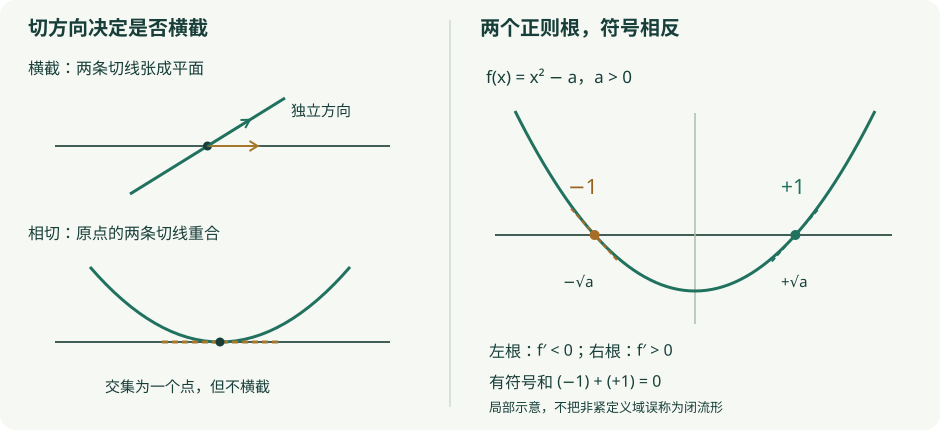

# D2 · 横截性、交叉与映射度

微分拓扑 · 状态：Reviewed（已写核心与题解，经非作者模型复核） 证明边界：横截原像与参数横截线性判据在本章展开；Sard、一般基本类与局部定向比较作为明确外引。

## 1. 学习目标 {#objectives}

完成本章后，你应能用切空间和法商检验横截性，证明横截原像定理，完整解释参数横截性中的两个线性代数方向，并指出 Sard 定理在论证中负责哪一步。你还应能在完整的紧致性与定向假设下计算圆周幂映射和球面反足映射的度，区分整数度、模 2 度与无符号解数。

## 2. 先修知识 {#prerequisites}

- [D1 · 光滑流形与秩定理](manifolds-rank.md)：切映射、嵌入子流形、逆函数定理和正则值原像。
- [H3 · 胞腔同调与系数](../algebraic/homology/cellular-coefficients.md)、[Q2 · 定向与对偶](../algebraic/cohomology/duality.md)：整数同调、模 2 系数、基本类的含义。
- [同调同伦不变性](../algebraic/homology/singular-chains.md)：连续同伦的两端诱导相同同调映射。
- 线性代数：直和、核、商向量空间、满射与行列式符号；多元微积分的链式法则。
- Sard 的证明需要测度论，作为外部先修定理使用。第 5 节还精确列出一般流形基本类与局部度的外引内容；只读过有限 PL 情形不能自动认为已掌握其一般证明。
- 可选的配边解释另需有边界流形的横截原像定理、紧一维流形的区间/圆周分类及相对横截逼近；该解释不参与本章主证明。

## 3. 问题引入：直观解释 {#1}

一条曲线穿过水平线时，微小扰动往往只是移动交点；若曲线恰好相切，扰动则可能产生或消除一对交点。区别在于相交处是否提供了足够的独立切向方向。横截性（transversality）把这种方向条件变成精确的线性方程。

即使正则逆像有有限多个点，无符号数量也未必在变形中固定。需要给局部保向交点记 $+1$、反向交点记 $-1$，再说明哪些全局假设阻止交点从边界或无穷远逃走。映射度（degree）正是带这些假设的全局代数量。

## 4. 严格定义 {#2}

**约定 D2.Def1。** 除 Sard 的有限可微版本及明确声明的有边界讨论外，本章的 $M^m,N^n,P^p$ 均为有限维、Hausdorff、第二可数、无边界的光滑流形，映射为 $C^\infty$。嵌入子流形 $S\subseteq N$ 无边界、余维恒为 $c$，但**不默认它是闭子集**。闭流形（closed manifold）指紧且无边界；这与“作为某空间的闭子集”是两个概念。

**定义 D2.Def2（横截与法商）。** 设 $f:M\to N$ 光滑。在 $x\in f^{-1}(S)$ 处写 $y=f(x)$，若

$$
df_x(T_xM)+T_yS=T_yN,
$$

则称 $f$ 在该点横截于 $S$。若每个逆像点都满足，记为 $f\pitchfork S$。空逆像自动满足横截条件。法商空间（normal quotient）是向量空间 $Q_y=T_yN/T_yS$，商投影记 $q_y$。横截性等价于 $q_y\circ df_x:T_xM\to Q_y$ 满射；这里没有选 Riemann 度量，不需要把法商当作某个已指定的正交补。

对两个嵌入子流形 $A,S\subseteq N$，说它们横截，指包含映射 $A\hookrightarrow N$ 横截于 $S$，即每个交点处 $T_yA+T_yS=T_yN$。

**定义 D2.Def3（正则值）。** $y\in N$ 是 $f$ 的正则值（regular value），若每个 $x\in f^{-1}(y)$ 的 $df_x$ 满射。它等价于 $f\pitchfork\{y\}$。不在像中的点也是正则值。导数不满射的点称临界点（critical point），其像称临界值（critical value）。

**定义 D2.Def4（整数度与局部符号）。** 以下只对**非空、连通、闭、定向、同维且 $n\ge1$** 的 $M^n,N^n$ 定义本章的整数度。使用第 5 节外引的基本类定理，固定与定向一致的生成元 $[M]\in H_n(M;\mathbb Z)$ 和 $[N]\in H_n(N;\mathbb Z)$，由

$$
f_*[M]=\deg(f)[N]
$$

定义整数 $\deg(f)$。若 $x$ 是正则逆像点，等维条件使 $df_x$ 可逆。以定义域和目标的正定向基表示它，行列式的符号记作 $\operatorname{sgn}(df_x)\in\{+1,-1\}$。换成其他正定向基只乘上正行列式，所以此符号良定义。

闭连通零维流形只有一个点，需单独约定其定向生成元；$S^0$ 则有两个分支，顶维同调为 $\mathbb Z^2$。本章的单整数公式及球面例子均限定 $n\ge1$，不把 $S^0$ 偷渡进连通假设。

## 5. 定理与证明 {#3}

### 横截原像：局部方程与全局限制

**定理 D2.1（横截原像）。** 在 D2.Def1 的约定下，若 $f\pitchfork S$，则 $W=f^{-1}(S)$ 的每个点有嵌入子流形邻域，余维为 $c$，且

$$
T_xW=\{v\in T_xM:df_x(v)\in T_{f(x)}S\}
=\ker(q_{f(x)}\circ df_x).
$$

若 $W\ne\varnothing$，其维数为 $m-c$。若 $c>m$，横截性强迫 $W=\varnothing$，不能宣称存在负维流形。该结论不自动说明 $W$ 闭或紧；若 $S$ 在 $N$ 中闭，则 $W$ 在 $M$ 中闭，进一步若 $M$ 紧，则 $W$ 紧。

**证明。** 固定 $x\in W$，令 $y=f(x)$。嵌入子流形坐标给出目标开邻域 $U$ 及坐标 $\psi$，使

$$
\psi(U\cap S)=\psi(U)\cap
\bigl(\mathbb R^{n-c}\times\{0\}\bigr).
$$

在包含 $x$ 且映入 $U$ 的开邻域 $V$ 上，令 $g=\operatorname{pr}_{\mathrm{last}\ c}\circ\psi\circ f:V\to\mathbb R^c$，于是 $W\cap V=g^{-1}(0)$。线性映射 $\operatorname{pr}_{\mathrm{last}\ c}\circ d\psi_y$ 满射且核为 $T_yS$，因此在法商 $Q_y$ 上诱导一个线性同构到 $\mathbb R^c$。所以 $dg_x$ 满射当且仅当 $q_y\circ df_x$ 满射，也当且仅当 $df_x(T_xM)+T_yS=T_yN$。

由横截性，$W\cap V$ 的每一点都满足 $dg$ 满射。D1 的正则值原像定理将这个零集在局部坐标中写成 $c$ 个独立坐标为零。因此它是具有子空间拓扑的嵌入子流形，维数 $m-c$。这些局部描述都是同一零集的子流形坐标，转移由 $M$ 的光滑坐标限制得到，故能相容拼接。零集的切空间正是 $\ker dg_x$，利用法商同构即得所述切空间公式。

若 $c>m$，从 $m$ 维空间到 $c$ 维法商的线性映射不可能满射，因此不能有逆像点。若没有逆像点，横截条件真空成立，不需要赋予空集某个负维数。当 $c=0$ 时，$S$ 是开子流形，$W$ 是开子集，法商为零空间，证明仍成立。

最后，闭性的附加结论只是连续映射对闭集的逆像闭；紧致性的附加结论使用紧空间的闭子集紧。这两项不来自局部秩计算。证毕。

### Sard 的准确使用范围

**外引定理（Sard，完整证明未在本教材展开）。** 设 $f:M^m\to N^n$ 是 $C^r$ 映射，$r$ 是满足

$$
r>\max\{m-n,0\}
$$

的正整数，流形仍满足上述 Hausdorff、第二可数、无边界约定。若 $n>0$，临界值集在目标任意坐标图中是 Lebesgue 零测集；因此正则值在 $N$ 中稠密。这里“零测”是坐标意义，不需要目标已经配备某个体积形式。第二可数性允许使用可数图册；坐标变换局部为 $C^1$ 微分同胚，保持零测性。

若 $n=0$，所有导数都映到零空间，自动满射，所以临界点和临界值均为空，全部值正则；此时直接用这个结论，无需诉诸正维 Lebesgue 测度。若 $m<n$，每个定义域点都临界，Sard 的结论是整个像为零测，不是“映射没有像”。

本章光滑映射满足所有有限 $r$ 要求。Sard 的一般证明依赖测度估计与临界集合分层，本章未展开；参见第 12 节 Lee 的 Sard 章节。下面引用的是此定理，不是以图形或有限采样替代它。

### 参数横截：展开两个线性方向

**定理 D2.2（参数横截性）。** 设 $F:M\times P\to N$ 光滑且 $F\pitchfork S$，则除 $P$ 中一个坐标意义下的零测参数集外，切片 $F_a:M\to N$，$F_a(x)=F(x,a)$，都横截于 $S$。当 $P$ 为零维时，每个参数都满足结论。无需假设 $S$ 闭、$M$ 紧或 $P$ 紧。

**证明。** D2.1 给出子流形 $W=F^{-1}(S)$。考虑光滑投影 $\pi:W\to P$。在 $w=(x,a)\in W$ 处，令 $y=F(x,a)$、$Q=T_yN/T_yS$，并写

$$
L=q_y\circ dF_{(x,a)}:T_xM\oplus T_aP\longrightarrow Q,
\qquad L(u,v)=A(u)+B(v).
$$

$F$ 的横截性保证 $L$ 满射，且由 D2.1，$T_wW=\ker L$。$d\pi_w$ 就是限制在这个核上的第二因子投影。我们逐向证明

$$
d\pi_w:\ker L\twoheadrightarrow T_aP
\quad\Longleftrightarrow\quad
A:T_xM\twoheadrightarrow Q.
$$

若 $d\pi_w$ 满射，任取 $q\in Q$。由 $L$ 满射，存在 $(u,v)$ 使 $A(u)+B(v)=q$。再由核上投影满射，存在 $u'$ 使 $(u',v)\in\ker L$，即 $A(u')+B(v)=0$。相减得到 $A(u-u')=q$，因此 $A$ 满射。这里必须使用 $L$ 的总满射，不能只凭投影满射推出结论。

反过来，若 $A$ 满射，任取 $v\in T_aP$。可以选 $u\in T_xM$ 使 $A(u)=-B(v)$。则 $(u,v)\in\ker L$ 且 $d\pi_w(u,v)=v$，所以核上投影满射。

因为 $A=q_y\circ d(F_a)_x$，右侧正是切片在 $x$ 处的横截条件。因此 $a$ 是 $\pi$ 的正则值，当且仅当 $F_a\pitchfork S$，包括切片逆像为空的情形。若 $W$ 为空，全部参数已经满足结论；否则对 $\pi$ 应用光滑 Sard 定理，其临界值集为零测，得到结论。若 $P$ 零维，投影的导数总满射，等价判据给出全部切片横截。证毕。

“除零测集外”并不自动意味着良好参数集合是开集。本定理也没有证明任意给定映射均能在任何指定约束下逼近为横截映射；后者需要构造合适的参数族或另引相对横截逼近定理。

**良好参数集不一定开的具体例子。** 令 $g(x)=e^{-x}\sin x$，$F(x,a)=g(x)-a$，取 $M=P=N=\mathbb R$、$S=\{0\}$。参数导数恒为 $-1$，所以总映射横截。$g(x)=0$ 的根为 $j\pi$，其导数 $g'(j\pi)=(-1)^j e^{-j\pi}\ne0$，因此参数 $a=0$ 是良好参数。然而在 $x_k=\pi/4+k\pi$ 处，$g'(x_k)=e^{-x_k}(\cos x_k-\sin x_k)=0$，对应坏参数

$$
a_k=g(x_k)=\frac{(-1)^k}{\sqrt2}e^{-\pi/4-k\pi}\longrightarrow0
\qquad(k\to+\infty).
$$

每个 $a_k$ 的切片都在 $x_k$ 处不横截，所以任何包含良好参数 $0$ 的开区间都含坏参数。这里定义域非紧，D2.2 的零测结论仍成立。

### 整数度：明确外部定理与条件推导

**外引工具（基本类与局部定向比较，完整一般证明未在本教材展开）。** 对非空连通闭定向 $n$ 维流形 $X$（$n\ge1$），有 $H_n(X;\mathbb Z)\cong\mathbb Z$ 及与定向一致的基本类 $[X]$。它在每个局部相对群 $H_n(X,X\setminus\{x\};\mathbb Z)\cong\mathbb Z$ 中限制为指定局部定向生成元。对有限集合 $E\subset X$，切除给出

$$
H_n(X,X\setminus E;\mathbb Z)
\cong\bigoplus_{x\in E}H_n(X,X\setminus\{x\};\mathbb Z),
$$

并把基本类送至各局部生成元组成的向量。光滑局部微分同胚在这些局部同调群上诱导乘以其切映射定向符号。

这里一般基本类的存在、局部限制兼容性，以及“切映射符号等于局部同调作用”是外部定向定理的内容。Q2 的有限 PL 顶维循环给出可核对的特例，不能由此声称已证明每个一般流形的情形。

**命题 D2.3（度的计数公式）。** 在 D2.Def4 的完整假设下，对每个正则值 $y\in N$，其逆像有限且

$$
\deg(f)=\sum_{x\in f^{-1}(y)}\operatorname{sgn}(df_x).
$$

空和为零。该整数不依赖正则值，并且在连续同伦下不变。

**相对于上述外引工具的条件证明。** 正则原像的维数为零，所以逆像离散。它还是紧空间 $M$ 中闭集 $f^{-1}(\{y\})$，因而紧；离散紧空间有限，因为其单点开覆盖必须有有限子覆盖。记此有限集为 $E$。

若 $E\ne\varnothing$，在每个逆像点处，逆函数定理给出局部微分同胚；定义域邻域可以取为两两不交。比较绝对同调到相对同调的自然映射，得到交换图

$$
\begin{array}{ccc}
H_n(M;\mathbb Z)&\xrightarrow{f_*}&H_n(N;\mathbb Z)\\
\downarrow&&\downarrow\\
H_n(M,M\setminus E;\mathbb Z)&\xrightarrow{f_*}&
H_n(N,N\setminus\{y\};\mathbb Z).
\end{array}
$$

这确实是对空间对的映射，因为 $f(M\setminus E)\subseteq N\setminus\{y\}$。由外引基本类兼容性，左下方的基本类像在每个局部分量都是正生成元；各局部微分同胚把它送为目标局部生成元的 $\operatorname{sgn}(df_x)$ 倍。因此沿下方计算得到所有局部符号之和。沿上方先得到 $\deg(f)[N]$，再限制为目标局部生成元的 $\deg(f)$ 倍。交换性使两整数相等。

若 $E=\varnothing$，左下群是 $H_n(M,M;\mathbb Z)=0$，同一个交换图给出 $\deg(f)=0$。这直接处理没有逆像的正则值。

对任意连续同伦 $f\simeq g$，同调同伦不变性给出 $f_*=g_*$，所以度相同。正则值独立性则来自所有这些局部总和都等于定义中的同一个整数。以上推导完整列出了对外引工具的使用，但没有把该工具的一般证明补齐。证毕。

**推论 D2.4（满射与复合）。** 在 D2.Def4 的假设下，若 $\deg(f)\ne0$，则 $f$ 满射。若另有连通闭定向 $n$ 维流形 $L$ 和光滑 $g:N\to L$，则

$$
\deg(g\circ f)=\deg(g)\deg(f).
$$

**证明。** 若 $y\notin f(M)$，则它是空逆像正则值，D2.3 给度为零，取逆否即得满射结论。复合公式直接由函子性计算：$(g\circ f)_*[M]=g_*(\deg(f)[N])=\deg(f)\deg(g)[L]$。证毕。

**系数边界。** 在 D2.Def4 中只去掉定向要求，保留非空、连通、闭、同维且 $n\ge1$ 的其他假设，模 2 基本类仍存在。这也是基本类理论的外引内容。改用 $\mathbb F_2$ 定义的度 $\deg_2(f)\in\mathbb F_2$ 等于正则逆像点数的奇偶性，因局部的 $+1,-1$ 在该域中相等。整数度需要上述定向，不能给不可定向情形任意补上符号。无符号整数点数自身不是这里的同伦不变量。

**可选配边解释，仅作证明路线。** 若一个光滑同伦 $H:M\times[0,1]\to N$ 及其两个端点映射都横截于同一个 $y$，则有边界横截原像定理使 $H^{-1}(y)$ 成为紧定向一维流形；其带符号边界总和为零，给出两端计数相同。这里需要端点横截、边界定向兼容及一维流形分类。一般同伦并不会自动横截；若要相对端点扰动，还需相对横截逼近定理。此段不是对这些外部定理的完整证明，也不替代前面的同调论证。

## 6. 典型例题：正例与反例 {#4}

### 例 1：横截是一阶条件，不是流形性的必要条件

直线 $y=0$ 与斜线 $y=x$ 在原点切空间分别为 $\operatorname{span}(1,0)$、$\operatorname{span}(1,1)$，它们的和为 $\mathbb R^2$，所以横截。抛物线 $y=x^2$ 在原点的切线却同为水平线，与 $y=0$ 不横截。

对函数 $f:\mathbb R\to\mathbb R$，$f(x)=x^2$，零值不正则，但 $f^{-1}(0)=\{0\}$ 仍是嵌入零维流形。因此正则原像定理给的是充分条件，非正则不必导致奇异。相反，$h:\mathbb R^2\to\mathbb R$，$h(x,y)=xy$ 的零集是两坐标轴的并，原点导数为零。任意包含原点的足够小相对开邻域，删去原点后有四条互不连通的臂；一维流形的区间邻域删去中心只有两个分支，故此处不是一维流形。这两例共同说明，秩条件失败后必须单独分析解集。

### 例 2：嵌入子流形不必闭

令 $f:\mathbb R^2\to\mathbb R^2$ 为恒等映射，$S=(0,1)\times\{0\}$。$df$ 满射，因而横截于 $S$；原像就是这条开线段，是嵌入一维子流形，却不闭也不紧。

即使定义域紧，也不能省去闭性：令 $M=N=S^1$，$f$ 为恒等映射，$S$ 为一个真开圆弧。它是余维零的嵌入子流形，横截条件自动成立；原像开圆弧仍不闭且不紧。D2.1 的闭性与紧性附加条件分别在这里发挥作用。

### 例 3：参数族中的相反符号解

设 $F(x,a)=x^2-a$，$M=P=N=\mathbb R$，$S=\{0\}$。总导数为 $(2x,-1)$，所以总映射处处横截于零。$W=\{(x,a):a=x^2\}$ 是光滑曲线，而 $\pi(x,x^2)=x^2$ 的唯一临界值为 $a=0$。

当 $a>0$ 时，切片有两根 $\pm\sqrt a$，导数符号分别为 $-1,+1$；当 $a<0$ 时没有根；$a=0$ 时双根不正则。正则切片的有符号和均为零，无符号个数却从零变为二。这里展示局部抵消机制，定义域 $\mathbb R$ 不是闭流形，不能不加说明地套用 D2.Def4 的全局度定义。

### 例 4：圆周的所有整数幂

给 $S^1$ 取逆时针方向，定义 $f_k(z)=z^k$，$k\in\mathbb Z$。负幂在单位圆上光滑，因为没有 $z=0$。当 $k\ne0$ 时，用 $z=e^{i\theta}$ 写出 $f_k(e^{i\theta})=e^{ik\theta}$；切向导数在正定向角坐标中为乘 $k$。每个目标点有 $|k|$ 个逆像，全部正则，故

$$
\deg(f_k)=|k|\operatorname{sgn}(k)=k.
$$

当 $k=0$ 时，$f_0$ 恒为 $1$。任选 $y\ne1$，它是空逆像正则值，因此度为零；$y=1$ 则不是正则值，不能把整个圆周的逆像当成“可直接求和的无限点集”。

### 例 5：球面反足映射的定向符号

对 $n\ge1$，球面 $S^n\subset\mathbb R^{n+1}$ 使用外法向在前的边界定向：$T_pS^n$ 的基 $(v_1,\ldots,v_n)$ 为正，当且仅当 $(p,v_1,\ldots,v_n)$ 为环境正基。

反足映射 $A(p)=-p$ 的导数把 $v_i$ 送为 $-v_i$，目标外法向是 $-p$。组合基 $(-p,-v_1,\ldots,-v_n)$ 与原组合基相比共有 $n+1$ 次变号，故每点的局部定向符号为 $(-1)^{n+1}$。每个目标点仅有一个逆像，由 D2.3 得

$$
\deg(A)=(-1)^{n+1}.
$$

特别地，圆周反足映射为旋转半周，度为 $+1$；二维球面反足映射的度为 $-1$。不能只数切向量的 $n$ 个负号而遗漏外法向同时翻转。

### 例 6：非紧定义域上的解可从无穷远逃走

令 $f_t(x)=t x$，$x\in\mathbb R$，$0\le t\le1$，固定目标值 $y=1$。对 $t>0$ 有一个正则根 $x=1/t$，局部符号 $+1$；对 $t=0$ 逆像为空，仍是正则值。有符号计数从 $1$ 变为 $0$，因为根在 $t\downarrow0$ 时逃向无穷远。没有紧致定义域，也没有控制整个同伦的适当性，就不能用闭流形的计数不变性。

第 8 题进一步展示：即使每个切片各自为适当映射，也不保证整个同伦适当。这是局部或逐参数条件不足以替代全局紧致控制的另一例。

## 7. 几何直观与原创图解 {#diagram}

[打开原始 SVG 查看细节](../assets/d2-transverse-degree.svg)。窄屏阅读时可单独打开图像放大。

左图需比较交点的切方向，右图的符号由映射 $x\mapsto x^2-a$ 的导数 $2x$ 决定；坐标轴的显示位置不改变定义。该图是原创局部示意，没有把透视效果或交点像素计数作为横截性证明。

## 8. 编程实验适用性：理论与实验边界 {#theory-and-computation}

本章以线性代数、微积分和同调推导为主，不另外添加没有证明价值的交互部件。对具体多项式，精确求根与 Jacobian 检查可以核对有限例子的横截条件；对近零浮点行列式，数值阈值只能提示不确定性，不能替代可逆性的证明。

已有[曲面实验](../labs/surfaces.md)可帮助区分球面、环面与莫比乌斯带，但它不计算本章一般映射的度，也不验证 Sard 定理或一般基本类。球面反足映射的符号应按例 5 的边界定向推导，而非根据旋转画面猜测。

## 9. 课后习题 {#5}

前 3 题保留原章题目，并要求完整论证；第 4–8 题补足线性判据、假设反例与综合计算。

1. **基础。** 求直线 $y=0$ 与抛物线 $y=x^2$ 在原点是否横截。
2. **证明。** 证明度非零的闭定向同维流形映射必满射。写明本章要求的连通性、正维、非空以及正则值约定。
3. **基础计算。** 求 $S^2$ 反足映射的度，并解释为什么环境行列式有三个负号。
4. **证明与反例。** 设 $A:U\to Q$、$B:V\to Q$ 为有限维线性映射，$L(u,v)=A(u)+B(v)$ 满射。证明 $\ker L\to V$ 的投影满射当且仅当 $A$ 满射；再构造删除 $L$ 满射假设后其中一个方向失败的例子。
5. **综合。** 对 $F(x,a)=x^2-a$，分别计算总映射的横截条件、$W$ 的切空间和投影的临界值。逐类给出 $a<0,a=0,a>0$ 时的逆像及局部符号，说明哪一类不能使用正则值计数。
6. **反例构造。** 给出横截原像不是闭集的例子；再给出非横截但原像是流形、非横截且原像不是一维流形的两个例子。最后证明：若 $\operatorname{codim}S>\dim M$ 且 $f\pitchfork S$，逆像必须为空。
7. **综合计算。** 计算 $f_k:S^1\to S^1$，$z\mapsto z^k$ 对全部整数 $k$ 的度，特别处理 $k=0$ 和 $k<0$。再用复合公式核对 $f_\ell\circ f_k=f_{k\ell}$，并说明整数度与模 2 度的关系。
8. **挑战。** 考虑 $h_t:\mathbb R\to\mathbb R$，$h_t(x)=x+t x^2$，$t\in[0,1]$。证明每个 $h_t$ 都适当，$0$ 是每个切片的正则值，但有符号逆像计数在 $t=0$ 与 $t>0$ 不同。找出整个同伦 $H(x,t)=h_t(x)$ 不适当的证据，解释这不违背 D2.3。

第一层提示：先确定需要核对的对象

1：比较两个切空间的和。2：像外点也正则。3：定向约定包括外法向。4：反向从任意 $q\in Q$ 出发，并使用总满射。5：总导数与切片导数不相同。6：可分别考虑恒等映射、$x^2$ 和 $xy$。7：角坐标只需在每个局部使用，不需要全圆单一角坐标。8：把方程因式分解，并追踪额外根的位置。

第二层提示：关键中间步骤

1：两个切空间都由 $(1,0)$ 张成。2：空和给零度，再取逆否。3：使用 $(-p,-v_1,-v_2)$。4：若 $A=B=0$、$Q\ne0$，核上投影仍满射。5：$T_{(x,x^2)}W=\{(u,2xu):u\in\mathbb R\}$。6：法商维数太大时导数不可能满射。7：$k\ne0$ 时有 $|k|$ 个逆像，符号均为 $\operatorname{sgn}(k)$；常映射选像外正则值。8：$t>0$ 时根为 $0,-1/t$，导数值为 $1,-1$；检查 $H^{-1}(\{0\})$ 是否紧。

<noscript>即时反馈需要 JavaScript；书面习题、两级提示及完整解答可直接阅读。</noscript>

## 10. 习题解答 {#solutions}

[D2 八道习题的完整解答](../exercises/d2-solutions.md)逐题给出切空间计算、量词边界与紧致性反例。请先独立写出定义域、目标、定向和系数，再对照计算。

## 11. 本章总结 {#summary}

横截条件等价于切映射到法商的满射，因此约束方程可以局部化为独立坐标。参数横截定理先使用这个线性判据，再依赖 Sard 控制坏参数的大小。映射度把各正则逆像点的定向符号与基本类联系起来；其不变性需要明确的全局假设，不能由局部求根图像推出。

后续[微分形式与 de Rham 上同调](forms-derham.md)将提供另一种表达定向和度的语言；[Morse 理论](morse-handles.md)则继续研究临界值附近怎样改变空间。此处尚未证明的 Sard、一般基本类与相对横截逼近仍是公开的外部依赖。

## 12. 参考书目 {#6}

- John M. Lee, *Introduction to Smooth Manifolds*, 2nd ed., Springer, 2013。[作者书籍页](https://sites.math.washington.edu/~lee/Books/ISM/)与[第二版目录](https://sites.math.washington.edu/~lee/Books/ISM/front-matter.pdf)已核对书名、版次及 Chapter 6 “Sard's Theorem”、Chapter 15 “Orientations”。本章只核目录定位，没有声称逐页核查书中证明。
- Victor Guillemin and Alan Pollack, *Differential Topology*, Prentice-Hall, 1974。真实标准参考书；本批未访问其完整正文，未据此虚构页码或定理编号。
- John Milnor, *Morse Theory*, Princeton University Press, 1963。保留原章进阶参考，主要用于后续 Morse 理论，不作为本章 Sard 或基本类证明已经完成的证据。
- Allen Hatcher, *Algebraic Topology*, Cambridge University Press, 2002。流形定向、基本类与局部同调的进一步参考；本章一般比较定理明确外引，不声称已在此完整重证。

正文、习题编排、解答和 SVG 均由本项目原创。[本章审查记录](../project/reviews/D2.md)保留证明边界与未完成的独立复核项。
