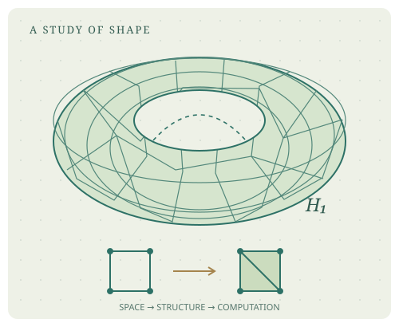

---
hide:
  - toc
---

TOPOLOGY FROM ZERO / 中文开放教材

# 从形状出发， 理解空间。

一条不断裂的路径，一个不能填满的环。 从这些朴素问题走向拓扑的语言，再用代码检验有限的例子。

[选择学习路线 →](start/index.md){ .md-button .md-button--primary }
[进入实验室](labs/index.md){ .md-button }

<strong>{{ course.planned_parts }}</strong> 规划部分<strong>{{ course.chapters }}</strong> 已有正文<strong>{{ course.labs }}</strong> 浏览器交互实验<strong>{{ course.notebooks }}</strong> Python Notebook

## 动手改变一个空间

[三角形的洞](labs/triangle.md){ .md-button }
[点云与 Barcode](labs/point-cloud.md){ .md-button }
[旋转三维曲面](labs/surfaces.md){ .md-button }
[AI 拓扑实验](labs/ai-topology.md){ .md-button }
[覆盖与道路提升](labs/covering-space.md){ .md-button }

切换一个面、改变观察尺度，或转动一张曲面。AI 实验进一步比较损失、分割孔洞和不可微位置；浏览器探索与下面的严格定义、证明以及 Python Notebook 相互补充。

## 先读懂三个问题

01

### 没有距离，还能谈附近吗？

用开集描述空间。从度量的直观出发，亲手验证拓扑的三条公理。

[从距离到拓扑 →](introduction/01-spaces.md)

02

### 连续究竟保留了什么？

用逆像刻画连续，再用开覆盖证明：紧致空间的连续像仍然紧致。

[连续映射与紧致性 →](point-set/02-continuity.md)

03

### 一个环，何时不再是洞？

把点、边和三角形写成矩阵。区分闭合的链与能够被填充的边界。

[环、边界与同调 →](algebraic/03-homology.md)

## 学习路线图

| 学习入口 | 连续学习与阶段目标 |
| --- | --- |
| [A · 零基础入门](start/beginner.md) | 8课，从集合到连续与连通，完成一份证明项目 |
| [B · 数学专业进阶](start/advanced.md) | 补齐点集与整数代数桥梁，再进入覆盖、同调、上同调与流形 |
| [C · 计算与 AI](start/computational.md) | 有限链、持续同调与实际神经网络训练；保留负结果 |

各路线有预计学习时间、先修诊断、上一课/下一课和本机自评进度。路线A另有[八课三级证明训练](exercises/proof-workshop.md)：理解目标、补齐理由、独立迁移。正文状态与个人完成勾选分开。

按[研究生课程地图](curriculum.md)学习八个方向。点集拓扑构成通用基础；代数拓扑拆分为基本群、覆盖、同调、上同调；微分与几何拓扑建立流形路线；计算 → 持续同调 → AI 构成独立实验路径。旧章节号与 URL 全部保留。

| 新增基础 | 解决的问题 | 读前准备 |
| --- | --- | --- |
| [基础 A · 拓扑基与子基](point-set/bases-subbases.md) | 如何由小块生成拓扑，如何使用子空间与积空间 | 第一章、集合并交 |
| [基础 B · 连通性](point-set/connectedness.md) | 连通为何不同于道路连通 | 连续映射、子空间；进阶反例需实分析 |
| [基础 C · 同伦与基本群](algebraic/homotopy-fundamental-group.md) | 为什么环路的同伦类组成群 | 积拓扑、道路；群公理在章内定义 |
| [基础 D · 商空间与边界识别](point-set/quotient-spaces.md) | 如何严格定义粘合，为何接缝编号很重要 | 子空间、连续映射、等价关系 |
| [代数预备 · 链群与线性商空间](algebraic/linear-algebra-primer.md) | 循环模掉边界意味着什么，秩公式从何而来 | 集合、有限求和、模 2 加法 |

<small>01 / 建立语言 · 正文与证明</small>

### [拓扑学导论](introduction/index.md)
从开集与邻域开始。目标：辨认一个集合族是否构成拓扑。

<small>02 / 研究空间 · 正文与证明</small>

### [点集拓扑](point-set/index.md)
连续、紧致、连通与分离。目标：把直观陈述变成可证明的命题。

<small>03 / 提取不变量 · 正文与证明</small>

### [代数拓扑](algebraic/index.md)
同伦、基本群与同调。目标：理解代数怎样区分空间。

<small>04 / 把定义变成算法 · 理论与实验</small>

### [计算拓扑](computational/index.md)
复形、边界矩阵与消元。目标：计算小型复形的 Betti 数。

<small>05 / 在尺度间追踪 · 理论与实验</small>

### [持续同调](persistence/index.md)
滤过、区间与稳定性。目标：理解一个洞何时出生、何时死亡。

<small>06 / 连接数据学习 · 基线实验</small>

### [拓扑与人工智能](ai/index.md)
拓扑特征、模型与评估。目标：判断拓扑信息何时对学习任务有帮助。

<small>07 / 光滑结构与映射</small>

### [微分拓扑](differential/index.md)
流形、横截、微分形式、Morse 理论与向量丛。

<small>08 / 流形、结与粘合</small>

### [几何拓扑](geometric/index.md)
PL 范畴、紧曲面、结补空间与三维填充。

## 怎样使用这本书

原42篇正文按照“直观解释 → 严格定义 → 定理与证明 → 正例与反例 → 练习 → 参考书目”展开。PRE1–PRE3采用十二项完整模板，并提供独立题解。建议先独立完成习题，再展开提示。Notebook 中的计算只验证具体有限例子；证明负责一般结论。

{{ course.chapters }} 篇正文都提供一个有两级提示的即时自检。选择后点击“检查答案”会给出针对该选项的解释，可以重新作答；答案只在本页处理，不上传、不计分。书面习题仍需自己完成证明。进入第三章前可先学代数预备；想理解曲面粘合可在第二章之后学习基础 D。

!!! info "教材进度与证据"
    当前{{ course.chapters }}篇正文，{{ course.template_chapters }}章采用十二项模板；长期{{ course.planned_parts }}部分{{ course.planned_units }}单元仍未全部完成。H3空间乘积、Q1上链比较、Q2对偶及G1等证明保留明确义务，见[逐定理台账](project/proof-ledger.md)。A3–A8已有线上版本；各批次提交与部署由[版本记录](project/release-status.md)区分。

构建来源见版本记录；页面可访问不等于数学审查完成。

[查看教材进度](progress.md) · [实际训练项目 C](ai/projects/topology-optimization.md) · [完整依赖图](project/PREREQUISITE_GRAPH.md)

[真实二维图像项目 D](ai/projects/image-topology.md)提供固定小样本细胞图分割与完整负结果：期望Euler约束在该协议下未改善指标。项目C保留合成机制验证，项目D检验真实数据上的限制。
