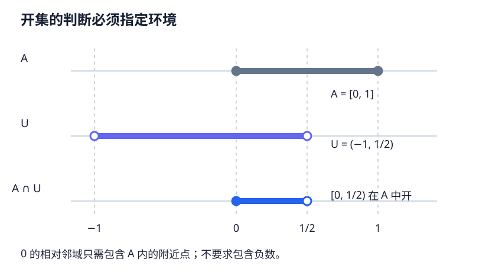

# PS1 · 子空间拓扑与相对性质

本章状态：**Reviewed（独立模型复核）**；[审查记录](../project/reviews/PS1.md)。尚无人类审稿或形式化验证。本章使用开集逆像定义连续性并在章内完成所需证明，不以前置方式调用后续连续映射章。

## 1. 学习目标

完成本章后，你应能验证子空间拓扑公理，从环境基得到子空间基，证明子空间的映入泛性质，计算相对闭包、内部和边界，并判断开闭性质何时可以传回环境空间。你还应能证明连续映射的限制与缩陪域定理，识别“每个局部片段连续”背后的覆盖条件。

## 2. 先修知识

先读[基础 A · 拓扑基与子基](bases-subbases.md)。需要集合逆像的并、交、补运算，拓扑公理，以及通常实数拓扑的开区间基。本章会重述连续、闭包、内部的最小定义；后续[连续映射](02-continuity.md)与[闭包及网](closure-nets.md)提供更系统的发展，不作为本章证明先修。

## 3. 问题引入：直观解释

在 $\mathbb R$ 上，$[0,1/2)$ 不是开集，因为点 $0$ 周围任何开区间都伸到负半轴；但若研究范围限定为 $A=[0,1]$，负数已不属于空间，只需在 $A$ 内留出邻域。此时它成为开集。

“相对”不是放宽标准，而是更换环境空间后重新使用同一拓扑定义。连续曲线落在一张曲面上时，也必须能把“作为环境空间值的连续映射”与“作为曲面值的连续映射”联系起来。子空间拓扑正是实现这个要求的拓扑。

## 4. 严格定义

**定义 PS1.1（子空间拓扑，subspace topology）。** 设 $(X,\tau_X)$ 为拓扑空间，$A\subseteq X$，令

$$
\tau_A=\{A\cap U:U\in\tau_X\}.
$$

称 $(A,\tau_A)$ 为子空间。$O\subseteq A$ 在 $\tau_A$ 中称相对开（relatively open）；$F\subseteq A$ 相对闭，指 $A\setminus F$ 相对开。包含映射 $i:A\to X$ 定义为 $i(a)=a$。环境 $A$ 必须明确；同一集合在两个空间中可有不同开闭性质。

**定义 PS1.2（连续，continuous）。** 映射 $f:Z\to Y$ 连续，指每个 $Y$ 中开集 $U$ 的逆像 $f^{-1}(U)$ 在 $Z$ 中开。复合连续由 $(g\circ f)^{-1}(U)=f^{-1}(g^{-1}(U))$ 直接成立，恒等映射连续。这里仅使用这一最小定义。

**定义 PS1.3（闭包、内部、边界）。** 对拓扑空间 $Y$ 中的 $B\subseteq Y$，闭包（closure）$\overline B^{\,Y}$ 是所有包含 $B$ 的闭集之交；内部（interior）$\operatorname{int}_Y B$ 是所有包含于 $B$ 的开集之并；边界（boundary）为

$$
\partial_Y B=\overline B^{\,Y}\setminus\operatorname{int}_YB.
$$

闭集对任意交封闭，因为取补变成开集任意并；故闭包是最小闭上集。点 $y\in\overline B^{\,Y}$ 当且仅当每个含 $y$ 的开集都与 $B$ 相交：若某开集避开 $B$，其闭补集包含 $B$ 而不含 $y$；反过来若 $y$ 不在某个包含 $B$ 的闭集中，它的开补集就是这种开集。类似地，$y\notin\operatorname{int}_YB$ 当且仅当 $y$ 的每个开邻域都与 $Y\setminus B$ 相交。

## 5. 定理与证明

**命题 PS1.4（拓扑公理与基）。** $\tau_A$ 是 $A$ 上的拓扑。若 $\mathcal B$ 是 $X$ 的基，则 $\{A\cap B:B\in\mathcal B\}$ 是 $A$ 的基。

**证明。** 有 $\varnothing=A\cap\varnothing$、$A=A\cap X$。对于任意族 $(U_j)$，

$$
\bigcup_j(A\cap U_j)=A\cap\bigcup_jU_j,
$$

因此任意并仍在 $\tau_A$。同样，有限交 $\bigcap_{j=1}^n(A\cap U_j)=A\cap\bigcap_{j=1}^n U_j$，对 $n=0$ 在环境 $A$ 中的空交为 $A$，仍开。若 $O=A\cap U$，将 $U$ 写成 $X$ 的基元素之并，再与 $A$ 相交，就把 $O$ 写成所列相对基元素之并；反向每个相对基元素在 $A$ 中开，所以它们确实生成 $\tau_A$。$A=\varnothing$ 时结论也成立。$\square$

**定理 PS1.5（子空间的映入泛性质，universal property）。** 对任意拓扑空间 $Z$ 及集合映射 $f:Z\to A$，

$$
f:Z\to A\text{ 连续}\quad\Longleftrightarrow\quad i\circ f:Z\to X\text{ 连续}.
$$

此外 $\tau_A$ 是使 $i$ 连续的最粗拓扑，并由上述对全部 $Z,f$ 的等价条件唯一确定。

**证明。** 包含映射连续，因为 $i^{-1}(U)=A\cap U\in\tau_A$；由复合规则得正向。若 $i\circ f$ 连续，对任意相对开集 $A\cap U$，因 $f$ 的值已经在 $A$ 内，有

$$
f^{-1}(A\cap U)=(i\circ f)^{-1}(U),
$$

右侧开，故反向成立。若 $A$ 上的另一拓扑 $\sigma$ 使 $i$ 连续，则每个 $A\cap U$ 都在 $\sigma$ 中，故 $\tau_A\subseteq\sigma$，证明最粗性。

若 $\sigma$ 也满足对所有 $Z,f$ 的等价条件，先取 $Z=(A,\sigma)$、$f=\mathrm{id}$，得其包含到 $X$ 连续，从而 $\tau_A\subseteq\sigma$。再取 $Z=(A,\tau_A)$，其包含到 $X$ 已连续，等价条件使 $\mathrm{id}:(A,\tau_A)\to(A,\sigma)$ 连续；每个 $\sigma$ 开集的恒等逆像就在 $\tau_A$ 中，所以 $\sigma\subseteq\tau_A$。$\square$

**命题 PS1.6（相对闭集与开闭传递）。** $F\subseteq A$ 在 $A$ 中闭，当且仅当存在 $X$ 中闭集 $C$ 使 $F=A\cap C$。若 $A$ 在 $X$ 中开，则 $A$ 的每个相对开集也在 $X$ 中开；若 $A$ 在 $X$ 中闭，则 $A$ 的每个相对闭集也在 $X$ 中闭。

**证明。** 若 $A\setminus F=A\cap U$ 且 $U$ 在 $X$ 开，则 $F=A\cap(X\setminus U)$。反向取补使用同一个恒等式。开传递来自 $A$ 与 $U$ 的交在 $X$ 中开；闭传递来自 $A$ 与 $C$ 的交在 $X$ 中闭。$\square$

**定理 PS1.7（相对闭包、内部与边界）。** 对 $B\subseteq A\subseteq X$，

$$
\overline B^{\,A}=A\cap\overline B^{\,X},
\qquad
\operatorname{int}_A B=A\setminus\overline{A\setminus B}^{\,X},
$$

$$
\partial_A B=A\cap\overline B^{\,X}\cap\overline{A\setminus B}^{\,X}.
$$

通常只有 $A\cap\operatorname{int}_X B\subseteq\operatorname{int}_A B$，不保证相等。

**证明。** 对 $a\in A$，每个相对开邻域具有 $A\cap U$ 的形式，其中 $U$ 是含 $a$ 的环境开集。因 $B\subseteq A$，$(A\cap U)\cap B=U\cap B$。故所有相对开邻域交 $B$，等价于所有环境开邻域交 $B$，由 PS1.3 得第一式。

由 PS1.3 的最后判据，$\operatorname{int}_A B=A\setminus\overline{A\setminus B}^{\,A}$。代入第一式，并使用在 $A$ 内取补，得到第二式。再将闭包和内部公式代入边界定义，得到第三式。任何环境开集包含于 $B$，与 $A$ 相交后仍相对开且包含于 $B$，因此给出内部的包含关系。$\square$

**命题 PS1.8（嵌套子空间与连续限制）。** 若 $B\subseteq A\subseteq X$，先从 $X$ 取 $A$ 的子空间拓扑、再取 $B$，与直接从 $X$ 取 $B$ 相同。若 $f:X\to Y$ 连续，则对任意 $A\subseteq X$，限制 $f|_A:A\to Y$ 连续；若又有 $f(A)\subseteq D\subseteq Y$，则 $f|_A:A\to D$ 仍连续。

**证明。** 嵌套相对开集为 $B\cap(A\cap U)=B\cap U$，恰是直接子空间开集。对 $Y$ 的开集 $V$，$(f|_A)^{-1}(V)=A\cap f^{-1}(V)$，在 $A$ 中开。再用 PS1.5 把陪域缩到 $D$，其中到 $Y$ 的复合就是刚证明连续的限制。$\square$

**命题 PS1.9（开覆盖上的局部性）。** 若 $(A_j)_{j\in J}$ 是 $X$ 的开覆盖，且 $f:X\to Y$ 的每个限制 $f|_{A_j}$ 连续，则 $f$ 连续。

**证明。** 对 $Y$ 中开集 $V$，每个 $A_j\cap f^{-1}(V)$ 在 $A_j$ 中相对开。因为 $A_j$ 在 $X$ 中开，由 PS1.6 它也在 $X$ 中开。覆盖条件给 $f^{-1}(V)=\bigcup_j(A_j\cap f^{-1}(V))$，所以逆像开。$\square$

任意子集覆盖不能替代开覆盖；第 6 节的单点覆盖给出反例。有限闭覆盖也有粘合结论，但需另外证明，不能由这里的任意开并论证直接替换得到。

## 6. 典型例题：正例与反例

**基础例：半开区间。** 在 $A=[0,1]$ 中，$[0,1/2)=A\cap(-1,1/2)$ 相对开，但在 $\mathbb R$ 中不开。$(0,1]$ 在自身中既开又闭，却在 $\mathbb R$ 中既不开也不闭。集合在自身中总是开闭，不等于环境性质。

**非平凡正例：趋向缺失的端点。** 令 $A=(0,1)$、$B=(0,1/2)$。则 $\overline B^{\,\mathbb R}=[0,1/2]$，$\overline B^{\,A}=(0,1/2]$，$\partial_A B=\{1/2\}$。在环境空间的边界还有 $0$，但它根本不是子空间的点。

**反例：内部不按闭包公式变化。** 取 $A=B=[0,1]$。$\operatorname{int}_A B=A$，而 $A\cap\operatorname{int}_{\mathbb R}B=(0,1)$。闭包可以与 $A$ 直接取交，内部一般不行。

**反例：相对稠密不是环境稠密。** 取 $A=[0,1]$，$B=\mathbb Q\cap[0,1]$。由有理数在实数中的稠密性和 PS1.7，$\overline B^{\,A}=A$；但 $\overline B^{\,\mathbb R}=[0,1]\ne\mathbb R$。稠密（dense）的定义必须写明在哪个空间中闭包等于全空间。

**错误反例：所有单点限制连续仍不够。** $f:\mathbb R\to\{0,1\}$ 取 $f(0)=1$、其余为零，陪域取离散拓扑。每个单点子空间上的限制都连续，但 $f^{-1}(\{1\})=\{0\}$ 不是实数开集，故 $f$ 不连续。单点族覆盖 $\mathbb R$，却不是开覆盖。

**综合例：有限子空间。** 令 $X=\{a,b,c\}$，$\tau_X=\{\varnothing,\{a\},\{a,b\},X\}$，$A=\{a,c\}$。则 $\tau_A=\{\varnothing,\{a\},A\}$，$\{c\}$ 在 $A$ 中闭而不开；$\overline{\{a\}}^{\,A}=A$。一个有限空间的子空间不一定离散，有限性本身不能保证单点开。

## 7. 几何直观与原创图解



图把环境中的 $U=(-1,1/2)$ 与子空间 $A=[0,1]$ 分层绘出；交集是 $[0,1/2)$。实心端点表示属于集合，空心端点表示不属于。点 $0$ 属于交集并不妨碍相对开放，因为邻域只需在 $A$ 内比较。

## 8. 编程实验：有限拓扑的逐项核对

下面用标准库核对第 6 节有限例子的相对开集、闭包和全部两点子集。算法枚举环境拓扑中的开集，不用距离模拟一个本来没有给定度量的空间。

```python
from itertools import combinations

X = frozenset("abc")
tau = {frozenset(), frozenset("a"), frozenset("ab"), X}
A = frozenset("ac")
tau_A = {A & U for U in tau}

def closure(B, space, topology):
    return frozenset(x for x in space
                     if all(U & B for U in topology if x in U))

assert tau_A == {frozenset(), frozenset("a"), A}
assert closure(frozenset("a"), A, tau_A) == A
for n in range(len(A) + 1):
    for items in combinations(sorted(A), n):
        B = frozenset(items)
        assert closure(B, A, tau_A) == A & closure(B, X, tau)
```

这里检查了 $A$ 的四个子集，包含空集。它给出可复查的有限例子，PS1.7 对任意拓扑空间的结论仍来自邻域证明。后续若编写有限拓扑输入器，应另外验证输入集合族满足拓扑公理。

## 9. 课后习题 { #ps1-exercises }

1. **基础。** 验证 $\tau_A$ 的拓扑公理，分别写明空并、空有限交及 $A=\varnothing$。若环境基包含空集，相对基是否必须删除空集？
2. **计算。** 在 $A=[0,1]$ 中分别求 $B_1=[0,1/2)$、$B_2=\{0\}$、$B_3=(0,1)$ 的内部、闭包与边界，并判断各自相对开闭。
3. **证明。** 完整证明 PS1.5 的等价条件和最粗性。为什么“包含映射连续”单独不足以唯一确定 $A$ 上的拓扑？给出反例。
4. **证明与反例。** 证明相对闭集的环境表示及开闭传递；各给一个例子说明若 $A$ 不在 $X$ 中开或闭，传递结论可能失败。
5. **综合。** 证明 PS1.7，并证明 $\partial_A B\subseteq A\cap\partial_XB$。构造严格包含的例子；解释为何边界不能总像闭包一样取交。
6. **计算与连续性。** 对第 6 节的有限 $X,A$，列出 $A$ 的闭集。令 $Z=\{0,1\}$ 带平凡拓扑，$f(0)=a,f(1)=c$，判断 $f:Z\to A$ 和 $i\circ f:Z\to X$ 是否连续，给出相同的失败逆像。
7. **证明与反例。** 证明限制和缩陪域连续性，再证明开覆盖局部性。用单点覆盖反例解释为什么从每个限制连续不能无条件恢复全局连续。
8. **挑战。** 称 $B\subseteq A$ 在 $A$ 中稠密，若 $\overline B^{\,A}=A$。证明这等价于 $A\subseteq\overline B^{\,X}$，并证明若 $B$ 在 $A$ 稠密且 $A$ 在 $X$ 稠密，则 $B$ 在 $X$ 稠密。给出只满足第一个条件时结论失败的例子。

??? tip "第一层提示"
    1：相交与并、有限交交换；空交的环境是 $A$。2：对端点使用相对邻域。3：看恒等映射在两种拓扑之间的逆像。4：取相对补集。5：$A\setminus B\subseteq X\setminus B$。6：找 $\{a\}$ 的逆像。7：必须把相对开集传回环境。8：先把相对闭包写成环境闭包的交。

??? tip "第二层提示"
    2：$\{0\}$ 在 $[0,1]$ 中闭而不开；$(0,1)$ 的相对闭包为整个 $A$。3：在非离散子空间上另取离散拓扑，包含仍连续。5：取 $B=A=[0,1]$。6：$\{0\}$ 不是平凡拓扑的开集。7：孤立单点上的任意映射连续，不能传递到非离散环境。8：闭集 $\overline B^{\,X}$ 一旦包含 $A$ 就包含它的闭包。

<div class="admonition question" data-exercise="ps1-subspaces"></div>
<noscript>两层提示与完整书面答案可以直接阅读。</noscript>

## 10. 习题解答

[PS1 八题完整解答](../exercises/ps1-solutions.md)。建议在每个开集、闭集、闭包或边界符号旁明确所用环境，尤其不要省去子空间端点。

## 11. 本章总结

子空间拓扑由与环境开集取交得到，保持了映入连续性的精确含义。相对闭包可直接与子空间取交，内部和边界则要考虑子空间中的补集；限制与缩陪域连续性由同一逆像公式统一解释。这些工具是后续连通子集、紧致子集、嵌入和商空间比较的基础。

## 证明训练：从理解到独立迁移

**新增迁移任务（保留原有习题）。**仍设 A 在 X 稠密、U 在 X 开。证明 cl_X(A∩U)=cl_X(U)。给出取消 U 开后等式失败的例子。两侧闭包均在 X 取，不是在 U 中。

请先写出目标、量词顺序与假设，再独立论证。[进入 PS1 三级证明训练](../exercises/proof-workshop.md#ps1)，可检查引导步骤的依赖，并查看分步提示、自核量规和完整论证。自由证明不由系统自动判真；无需保存或上传草稿。

## 12. 参考书目

- James R. Munkres, *Topology*, 第 2 版，第 2 章 §16 “The Subspace Topology”、§17 “Closed Sets and Limit Points”、§18 “Continuous Functions”。[MIT 18.901 阅读安排](https://ocw.mit.edu/courses/18-901-introduction-to-topology-fall-2004/pages/readings/)提供相关主题定位。
- Sidney A. Morris, *Topology Without Tears*，拓扑与子空间章节；[作者公开教材入口](https://www.topologywithouttears.net/)。不同公开版本分页可能变化，故不填写未核实页码。

本章所有主要命题已给出完整初等证明，不靠后续连续性章节支撑循环论证。正文、题解、有限例子和图形为原创；参考书目用于标准术语定位，不声称逐页核查原书。
