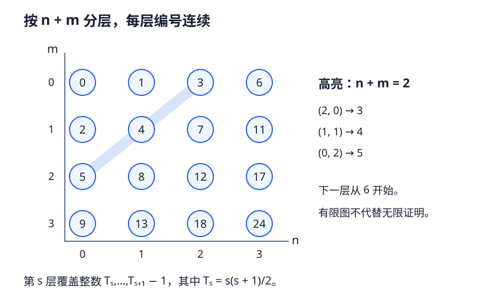

# PRE4 · 可数性、选择与集合论工具

本章状态：**Reviewed（独立模型复核）**；[审查记录](../project/reviews/PRE4.md)。尚无人类审稿或形式化验证。集合论采用 ZFC，同时标出哪些论证不调用选择公理。

## 1. 学习目标

完成本章后，你应能给出可数集合的明确编码，区分逐行编码已给定与需要同时选择编码的两种“可数并”证明，完整证明 Cantor–Bernstein 定理，并正确检查 Zorn 引理的链上界假设。你还应能识别“极大”与“最大”、“枚举存在”与“枚举已给出”的差别。

## 2. 先修知识

先读 [PRE2 · 量词、证明方法与反例](proofs-counterexamples.md)，并掌握其先修 [PRE1 · 集合、映射与等价类](sets-maps-relations.md)。使用自然数归纳、良序性质与整数分数的初等运算。$\mathbb N=\{0,1,2,\ldots\}$。本章不从公理构造自然数，也不证明 Zorn 引理与选择公理的等价性。

## 3. 问题引入：直观解释

把所有有理数写成一列，可以按分母、分子逐层扫描，跳过重复数。但是“每一排都可以列出来”与“已经同时拿到全部排的列表”仍有一个逻辑区别：前者只给逐排存在，后者给一个函数族。拓扑中第二可数性、可分性、紧致性证明经常出现这种选择步骤，不能只画一条对角线就把它隐去。

另一个问题是：若 $A$ 能装进 $B$，$B$ 也能装进 $A$，能否无遗漏地一一配对？Cantor–Bernstein 定理回答“能”，而且可以只用两个给定单射作出构造。

## 4. 严格定义

**定义 PRE4.1（可数，countable）。** 若存在单射 $j:A\to\mathbb N$，称 $A$ 至多可数；本教材简称可数，包含有限集与空集。若存在双射 $\mathbb N\to A$，称 $A$ 可数无限（countably infinite）。不存在上述单射的集合称不可数（uncountable）。某些书把“可数”只用于可数无限，阅读时须核对约定。

**定义 PRE4.2（选择函数与可数选择）。** 对一族非空集合 $(A_i)_{i\in I}$，选择函数（choice function）是函数 $c:I\to\bigcup_iA_i$，满足 $c(i)\in A_i$。选择公理（axiom of choice，AC）断言每个这样的集合指标族都有选择函数。可数选择公理（countable axiom of choice，$\mathrm{AC}_\omega$）只断言 $I=\mathbb N$ 的情况。AC 蕴含 $\mathrm{AC}_\omega$。

从某个非空集合固定一个元素，是通常存在量词的使用；给每个非空集合同时固定元素才涉及这种族的选择问题。若各集合是非空自然数子集，直接取最小元素就给出选择函数，无须额外调用 AC。

**定义 PRE4.3（偏序、链与极大元）。** 偏序（partial order）$\le$ 满足自反、反对称与传递。链（chain）是其中任意两元素可比较的子集，允许空链。$u$ 是 $C$ 的上界，指 $u$ 属于所讨论偏序集且 $x\le u$ 对所有 $x\in C$ 成立。元素 $m$ 极大（maximal），指 $m\le x$ 推出 $x=m$；元素 $g$ 最大（greatest），指所有 $x$ 都满足 $x\le g$。极大元可以多个，也未必与每个元素可比较。

## 5. 定理与证明

**命题 PRE4.4（列举与编码）。** 非空集合 $A$ 可数，当且仅当有满射 $e:\mathbb N\to A$。任何可数集合的子集及其函数像仍可数。无限的可数集合是可数无限，即存在由自然数编号的无重复列举。以上均不需要 AC。

**证明。** 若有满射 $e$，给每个 $a\in A$ 定义 $j(a)=\min\{n:e(n)=a\}$，不同元素的最早编号不同，故是单射。反过来，若有单射 $j$ 且 $A$ 非空，固定一个 $a_0\in A$，令 $e(n)$ 在 $n\in j(A)$ 时为唯一原像，否则为 $a_0$，便为满射。这里只固定一个元素。

子集可限制原单射。若 $f:A\to B$，像非空时对 $b\in f(A)$ 取集合 $\{j(a):f(a)=b\}$ 的最小值，得到像到 $\mathbb N$ 的单射；像空时结论已成立。如果 $A$ 无限，则 $j(A)$ 是无限自然数子集。依次取尚未取出的最小元素 $s_0,s_1,\ldots$，每一步余集非空；它列尽 $j(A)$，因为给定 $s\in j(A)$ 之前至多有 $s$ 个更小自然数。与 $j^{-1}$ 复合得到所需双射。$\square$

**命题 PRE4.5（配对与有编码的可数并）。** 函数

$$
\pi(n,m)=\frac{(n+m)(n+m+1)}2+m
$$

是 $\mathbb N^2\to\mathbb N$ 的双射。若集合族 $(A_n)_{n\in\mathbb N}$ 连同单射族 $(j_n:A_n\to\mathbb N)$ **已经给定**，则 $\bigcup_n A_n$ 可数，不再需要选择公理。

**证明。** 对角线 $n+m=s$ 的像依次是从 $T_s=s(s+1)/2$ 到 $T_s+s=T_{s+1}-1$ 的所有整数。不同 $s$ 的这些整数段不重叠且相邻，从 $T_0=0$ 起覆盖自然数；在每段由 $m=k-T_s$ 唯一恢复 $m$ 和 $n=s-m$。故 $\pi$ 双射。

对 $a\in\bigcup_nA_n$，令 $n(a)=\min\{n:a\in A_n\}$，定义 $J(a)=\pi(n(a),j_{n(a)}(a))$。若 $J(a)=J(b)$，配对单射先给 $n(a)=n(b)=n$，再给 $j_n(a)=j_n(b)$，由 $j_n$ 单射得 $a=b$。重复出现在不同排的元素因此只使用其最早排。空并集的空映射也是单射。$\square$

**推论 PRE4.6（可数选择下的可数并）。** 假设 $\mathrm{AC}_\omega$。若每个 $A_n$ 可数，则 $\bigcup_nA_n$ 可数。

**证明。** 对每个 $n$，令 $E_n$ 为全部单射 $A_n\to\mathbb N$ 的集合；可数性保证 $E_n$ 非空，包括 $A_n=\varnothing$ 时的唯一空映射。由可数选择，存在 $j_n\in E_n$ 的函数族。现在应用 PRE4.5。$\square$

本推论用 $\mathrm{AC}_\omega$ 作为充分的公理假设，**不声称该推论与完整可数选择等价**。有明确统一编码时，PRE4.5 已足够；不能把所有可数并证明都标成使用完整 AC，也不能在仅知逐项存在时默默写出一个未经说明的枚举族。

**定理 PRE4.7（Cantor–Bernstein）。** 若存在单射 $f:A\to B$ 与 $g:B\to A$，则存在双射 $h:A\to B$。证明不调用 AC。

**证明。** 定义

$$
A_0=A\setminus g(B),\qquad A_{n+1}=g(f(A_n)),\qquad C=\bigcup_{n\ge0}A_n.
$$

若 $a\notin C$，它尤其不属于 $A_0$，所以 $a\in g(B)$，存在唯一的 $g^{-1}(a)\in B$。令

$$
h(a)=\begin{cases}f(a),&a\in C,\\g^{-1}(a),&a\notin C.\end{cases}
$$

两支分别单射。若 $a\in C,a'\notin C$ 却有 $f(a)=g^{-1}(a')$，则 $a'=g(f(a))$。某个 $n$ 有 $a\in A_n$，故 $a'\in A_{n+1}\subset C$，矛盾。因此两支像不交，$h$ 单射。

再取 $b\in B$。若 $g(b)\notin C$，则 $h(g(b))=b$。若 $g(b)\in C$，它不属于 $A_0$，因而属于某个 $A_{n+1}=g(f(A_n))$。存在 $a\in A_n$ 满足 $g(b)=g(f(a))$；由 $g$ 单射得 $b=f(a)=h(a)$。两种情况都得到原像，故 $h$ 满射。全部构造只用已给函数、自然数递归、并集和唯一原像，没有从任意非空集合族中选择代表。空集合情形也包含在该论证内。$\square$

**引用定理 PRE4.8（Zorn 引理，Zorn's lemma）。** 若非空偏序集 $P$ 的每条链都有一个属于 $P$ 的上界，则 $P$ 有极大元。

**完整证明未在本教材展开。** 本教材在 ZFC 中使用它；它与 AC 的等价性是外引集合论定理。建立该等价性需要良序/超限递归等本章未建设的工具。这里的证明义务是使用时逐项验证偏序、非空性与**每条链在偏序集内部的上界**，不能把“每个有限子集有上界”替换进去。参考 Munkres 第 1 章 §11 与 Halmos 的选择公理、良序及 Zorn 相关章节；本章不伪称已全证。

**命题 PRE4.9（极大独立顶点集）。** 设图由集合 $V$ 及二元素子集族 $E\subseteq\{\{u,v\}:u,v\in V,u\ne v\}$ 给出。若 $S_0\subseteq V$ 不同时含任何边的两个端点，则存在包含 $S_0$ 的极大独立集。此证明使用 Zorn 引理。

**证明。** 令 $P$ 为包含 $S_0$ 的所有独立顶点子集，按包含排序。$S_0\in P$，所以非空。若非空链 $\mathcal C\subseteq P$，令 $U=\bigcup_{S\in\mathcal C}S$。它包含 $S_0$。若 $u,v\in U$ 且 $\{u,v\}\in E$，存在 $S,T\in\mathcal C$ 分别含它们；链条件使其中一个集合包含另一个，较大集合便同时含这条边两端点，与独立性矛盾。故 $U\in P$，是链上界。空链以 $S_0$ 为上界。由 Zorn 有极大元，它即所需集合。$\square$

## 6. 典型例题：正例与反例

**基础例：整数与有理数。** 将 $z\in\mathbb Z$ 编码为 $2z$（$z\ge0$）或 $-2z-1$（$z<0$），得到 $\mathbb Z\to\mathbb N$ 双射。每个有理数写成唯一的既约形式 $p/q$，$q\ge1$，再把整数编码与 $q-1$ 配对，得到 $\mathbb Q\to\mathbb N$ 单射。这里的“唯一既约形式”提供规则，不是在每个等价类中任意挑代表。

**非平凡正例：有限词。** 一个固定有限字母表上的全部有限词可按长度分层，再按给定字母次序编码。每层编码有统一公式，因此可用 PRE4.5，不必额外选择每层的枚举。可数的有限词并不使无限字母序列也可数。

**不可数反例。** 对任意 $F:\mathbb N\to\mathcal P(\mathbb N)$，集合 $D=\{n:n\notin F(n)\}$ 与每个 $F(n)$ 在位置 $n$ 不同，所以 $F$ 不满。若 $\mathcal P(\mathbb N)$ 可数，PRE4.4 会给出这样的满射，矛盾。等价地，所有无限零一序列不可数，而所有有限零一词可数。对角论证的逻辑参见 PRE2。

**极大不等于最大。** 路径 $a-b-c$ 中，$\{b\}$ 与 $\{a,c\}$ 都是包含意义下的极大独立集；前者不是基数最大的独立集。整个独立集偏序没有最大元素：一个最大元素应同时包含两者，从而包含相邻顶点。

**综合计算：两个单射的改接。** 在 $A=B=\mathbb N$ 取 $f(n)=2n,g(n)=n+1$。PRE4.7 的构造给 $A_0=\{0\}$、$A_n=\{2^n-1\}$。因此 $h(2^n-1)=2^{n+1}-2$，其余 $a$ 使用 $h(a)=a-1$。这是一套完整双射公式；只检查前若干项不构成其一般证明。

## 7. 几何直观与原创图解



每一条斜对角线对应固定 $n+m$，编号构成相邻整数段。图只画有限窗口，覆盖所有自然数的结论来自 PRE4.5 的整数段证明。把点换成各排的已给编码，就得到可数并的编码方式；图本身不能提供尚未选择的各排函数。

## 8. 编程实验：有限编码核对

以下标准库代码核对一个有限窗口的配对单射和 Cantor–Bernstein 例子中的两支公式；它不检验 AC，不证明无限全称结论。

```python
def pair(n, m):
    return (n + m) * (n + m + 1) // 2 + m

def cb_example(a):
    # a 在 C 中当且仅当 a+1 是正的 2 的幂。
    x = a + 1
    return 2 * a if x & (x - 1) == 0 else a - 1

values = [pair(n, m) for n in range(20) for m in range(20)]
assert len(values) == len(set(values)) == 400
assert [pair(2, 0), pair(1, 1), pair(0, 2)] == [3, 4, 5]
assert [cb_example(a) for a in range(8)] == [0, 2, 1, 6, 3, 4, 5, 14]
assert len({cb_example(a) for a in range(1000)}) == 1000
```

程序中的整数运算是精确的。无穷可数性、Cantor–Bernstein 的满射性及 Zorn 的链条件仍须依据书面论证；有限输入不会为公理选择提供实验判据。

## 9. 课后习题 { #pre4-exercises }

1. **基础。** 证明非空集合是 $\mathbb N$ 的满射像当且仅当它可数，并指出空集为何必须单独处理。若给定 $A\to\mathbb N$ 单射，如何无额外选择地给 $f(A)$ 编码？
2. **计算。** 求 $\pi(2,3)$，解码整数 $17$，并写出 $-3/5$ 按正文有理数规则的编码。证明该有理数编码不会把两个不同有理数合并。
3. **证明。** 给定每个 $A_n$ 的单射 $j_n$，写出并集编码并证明单射。若只知道每个 $A_n$ 可数，指出使用 $\mathrm{AC}_\omega$ 的准确集合族；为何不能直接说这一命题等价于完整可数选择？
4. **综合。** 对 $f(n)=2n,g(n)=n+1$ 推导全部 $A_n$ 和 $h$，再为任意 $b\in\mathbb N$ 写出 $h^{-1}(b)$ 的分支公式，并验证。
5. **证明。** 在 Cantor–Bernstein 构造中证明 $C=A_0\cup g(f(C))$，解释为何 $A\setminus C$ 上的 $g^{-1}$ 有定义，以及两支的像为何不相交。
6. **反例。** 证明有限零一词集合可数而无限零一序列集合不可数。说明“每个坐标只用两个值”为什么不足以推出序列集合可数。
7. **概念与反例。** 在路径 $a-b-c$ 上列出全部极大独立集。分别判断是否有最大元素、基数最大独立集，以及两个概念的差别。
8. **挑战。** 对 $\mathbb N$ 的有限子集按包含排序，每个有限族有上界却没有极大元。完整证明，并指出哪条链没有内部上界。比较 PRE4.9 的链并为何留在偏序集内。

??? tip "第一层提示"
    1：取每个像值最早出现的编号。2：先找到三角数区间。3：考虑所有可用编码组成的非空集合。4：迭代 $g\circ f(n)=2n+1$。5：自然数递归移一位。6：无限序列逐坐标翻转。7：极大只排除严格包含的独立超集。8：考虑初始段 $\{0,\ldots,n\}$。

??? tip "第二层提示"
    2：$T_5=15,T_6=21$，整数17位于第5条对角线。3：所选对象是函数，不是仅从 $A_n$ 取一个元素。4：分支像是 $\{2^{n+1}-2:n\ge0\}$；在该像外尝试 $b+1$。5：若 $f(a)=g^{-1}(a')$ 则 $a'=g(f(a))$。6：有限词给定长度后按二进制编码。8：任意有限子集都能加一个新自然数；链的并虽存在，却不再有限。

<div class="admonition question" data-exercise="pre4-countability-choice"></div>
<noscript>两层提示及完整书面答案不依赖 JavaScript。</noscript>

## 10. 习题解答

[PRE4 八题完整解答](../exercises/pre4-solutions.md)。请在每次使用“选取”时注明它是唯一规则、一个存在见证，还是从一族集合中同时选择。

## 11. 本章总结

可数性通过单射、列举和配对编码转化为可检查的构造。可数并的对角方法以逐排编码为输入；缺少这个函数族时，需要明确选择步骤。Cantor–Bernstein 在不调用 AC 的情况下把相互单射改接成双射；Zorn 则作为公开引用的集合论工具，为后续极大滤子等对象提供存在性。

## 12. 参考书目

- James R. Munkres, *Topology*, 第 2 版，第 1 章 §6–7（有限与可数集合）、§9（无限集与选择）、§11（极大性原理）。[MIT 18.901 阅读安排](https://ocw.mit.edu/courses/18-901-introduction-to-topology-fall-2004/pages/readings/)可核对相关章节主题。
- Paul R. Halmos, *Naive Set Theory*, Springer，关于可数集合、基数、Schröder–Bernstein 定理、选择公理与 Zorn 引理的章节；[出版社入口](https://link.springer.com/book/10.1007/978-1-4757-1645-0)。不提供未核验的页码或定理号。
- Richard Hammack, *Book of Proof*, 第 3 版，第 13 章（集合基数）；[作者公开教材页](https://richardhammack.github.io/BookOfProof/)。

正文、证明组织、题目和图形为本项目原创。参考定位不表示已经逐页核对原书；Zorn 与 AC 的等价性明确保留为外引。
