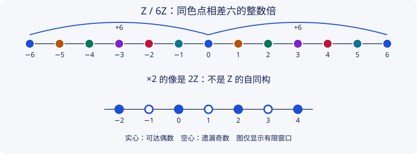

# PRE5 · 群、商群与整数模

本章状态：**Reviewed，已完成非编写模型交叉检查；独立人类审阅未完成**；[审查记录](../project/reviews/PRE5.md)。本章为基本群、整数同调与系数变换提供代数先修，不把整数模当成向量空间。

## 1. 学习目标

完成本章后，你应能检查商群运算是否与代表元无关，证明第一同构定理，构造有限秩自由阿贝尔群的子群基，辨别整数基变换与有理数消元，并用一个明确反例说明张量积为什么不保留所有单射。你还应能解释自由群与自由阿贝尔群的差别，以及同一个自由秩为何不能确定一个阿贝尔群。

## 2. 先修知识

先读 [PRE1 · 集合、映射与等价类](sets-maps-relations.md) 和 [PRE2 · 证明方法与反例](proofs-counterexamples.md)。使用整数带余除法、自然数归纳、整数矩阵乘法，以及行列式的乘法公式和伴随矩阵公式；后两项属于公开列出的线性代数先修。

本章不要求先学同调，也不要求先读 [CT1 · 整数同调](../computational/integer-homology.md)。[域上商空间预备](../algebraic/linear-algebra-primer.md)可作对照阅读，但整数模不能直接套用域上基的所有性质。除非另行说明，群可以非交换；阿贝尔群写加法。张量积一节只讨论 $\mathbb Z$ 上的阿贝尔群。

## 3. 问题引入与直观解释：被除掉的关系留下什么

整数直线上的位置可以整体平移。若规定移动六步回到同一状态，就得到六个状态的加法群 $\mathbb Z/6\mathbb Z$。若把“六步”在有理数中当作可逆标量，用除以六的行操作消掉它，就会把这六种状态全部丢失。拓扑中的挠子正是这种整数关系留下的信息。

另一个问题来自环路：若两条环路被某种等价关系视为相同，拼接它们是否仍给出同一个等价类？集合的商只产生等价类；要让原有运算下降到商上，还必须验证代表元的改变不影响答案。

## 4. 严格定义

**定义 PRE5.1（群，group）。** 群是集合 $G$ 及运算 $G\times G\to G$，满足结合律，存在单位元 $e$，且每个 $g$ 存在双侧逆元 $g^{-1}$。若任意两元素交换，称阿贝尔群（abelian group）。子群（subgroup）$H\le G$ 是包含 $e$ 且对乘法和取逆封闭的子集，使用限制后的运算。

**定义 PRE5.2（正规子群与陪集）。** 左陪集是 $gH=\{gh:h\in H\}$。等价关系 $g\sim g'$ 定义为 $g^{-1}g'\in H$，等价类正是左陪集。若 $gHg^{-1}=H$ 对每个 $g\in G$ 成立，称 $H$ 正规（normal），记 $H\trianglelefteq G$。此时希望在陪集集合上定义 $(gH)(kH)=gkH$；是否良定义由 PRE5.7 证明。

**定义 PRE5.3（同态、核与像）。** 群同态（homomorphism）$f:G\to K$ 满足 $f(gh)=f(g)f(h)$。其核（kernel）为 $\ker f=\{g:f(g)=e_K\}$，像（image）为 $\operatorname{im}f=f(G)$。双射同态称同构（isomorphism）；逆映射也保运算，因为可将陪域中的元素写成原像。

**定义 PRE5.4（环与模）。** 本章的环（ring）$R$ 有交换加法群、结合乘法、乘法单位元 $1$ 及左右分配律；本章使用的环 $\mathbb Z$ 与域均为交换环。一个含单位的左 $R$ 模（module）是阿贝尔群 $M$ 连同标量作用，满足

$$
r(m+n)=rm+rn,\quad (r+s)m=rm+sm,\quad (rs)m=r(sm),\quad 1m=m.
$$

模同态同时保持加法和标量作用。子模是 $M$ 的加法子群且对标量作用封闭，特别地必须含 $0$；商模按 $m+N$ 相加并作标量乘法，代表元无关由子模条件保证。域上的模就是向量空间，但整数 $2$ 在 $\mathbb Z$ 中不是单位。

**定义 PRE5.5（自由、有限生成与挠子）。** 若每个元素都能唯一写成有限和 $\sum_i a_i e_i$、$a_i\in\mathbb Z$，则阿贝尔群 $F$ 是以 $(e_i)$ 为基的自由阿贝尔群（free abelian group）。有限基含 $n$ 个元素时 $F\cong\mathbb Z^n$。一组元素若只要求生成而不要求表达唯一，称生成元；存在有限生成集称有限生成（finitely generated）。

阿贝尔群中的元素 $x$ 若存在正整数 $d$ 满足 $dx=0$，称挠元素（torsion element）。全部挠元素组成子群 $\operatorname{Tor}(M)$：若 $dx=ey=0$，则 $de(x-y)=0$。若只有零挠元素，称无挠（torsion-free）。在 $\mathbb Z^n$ 中，逐坐标使用整数无零因子便知它无挠。无挠阿贝尔群不一定是有限秩自由群。

“自由群”（free group）通常不要求交换。两个生成元的自由群与自由阿贝尔群 $\mathbb Z^2$ 不同；本章所有线性组合与整数矩阵描述的都是后者。

## 5. 定理与证明

### 从陪集到商群

**引理 PRE5.6（整数子群）。** 每个子群 $H\le\mathbb Z$ 唯一写为 $d\mathbb Z$，其中 $d\ge0$。

**证明。** 若 $H=\{0\}$，取 $d=0$。否则取非零元素，必要时换负号，得正元素；由自然数良序取最小正元素 $d\in H$。对 $h\in H$ 作带余除法 $h=qd+r$，$0\le r<d$。因为 $r=h-qd\in H$，最小性迫使 $r=0$。故 $H\subset d\mathbb Z$，反向包含来自子群封闭性。非零子群的最小正元素唯一；零子群只对应 $d=0$。$\square$

**定理 PRE5.7（商群的条件）。** 公式 $(gH)(kH)=gkH$ 在全部左陪集上良定义，当且仅当 $H\trianglelefteq G$。这时它给出群 $G/H$。

**证明。** 若 $H$ 正规，将代表元改成 $gh_1,kh_2$，则

$$
(gh_1)(kh_2)=gk(k^{-1}h_1k)h_2\in gkH.
$$

所以结果陪集不变。结合律从 $G$ 下降，单位为 $H$，$gH$ 的逆为 $g^{-1}H$。

反之，假设公式良定义。对任意 $g\in G,h\in H$，$ghH=gH$，故将它们分别乘 $g^{-1}H$，得 $ghg^{-1}H=H$，即 $ghg^{-1}\in H$。于是 $gHg^{-1}\subset H$。将 $g$ 换成 $g^{-1}$ 后再共轭，得反向包含。$\square$

**定理 PRE5.8（第一同构定理，first isomorphism theorem）。** 对群同态 $f:G\to K$，$\ker f\trianglelefteq G$，且

$$
G/\ker f\ \xrightarrow{\ \cong\ }\ \operatorname{im}f,\qquad g\ker f\longmapsto f(g).
$$

**证明。** 先由 $f(e)=f(e)^2$ 得 $f(e)=e$，再由 $f(g)f(g^{-1})=e$ 得 $f(g^{-1})=f(g)^{-1}$。因此核是子群；对核中 $h$ 有 $f(ghg^{-1})=f(g)e f(g)^{-1}=e$，正规性随之成立。若 $g'=gh$、$h\in\ker f$，则 $f(g')=f(g)$，故诱导映射良定义。它保持乘法，按像的定义满射。如果 $f(g)=f(g')$，则 $f(g^{-1}g')=e$，所以 $g\ker f=g'\ker f$，从而单射。$\square$

### 整数模与整数基

**命题 PRE5.9（阿贝尔群就是 $\mathbb Z$ 模）。** 每个阿贝尔群唯一带有含单位的 $\mathbb Z$ 模结构；群同态自动是 $\mathbb Z$ 模同态。

**证明。** 对 $n>0$ 定义 $nx$ 为 $n$ 个 $x$ 的和，$0x=0$，$(-n)x=-(nx)$。结合律、交换律及重复求和分别验证四个模公理；涉及负数时用加法逆元，便延续到全部整数。任何含单位的标量作用都满足 $nx=(1+\cdots+1)x$，故只能是这个作用。加法同态保持有限和与负元，所以保持整数倍。$\square$

**定理 PRE5.10（自由阿贝尔群的子群）。** 若 $H\le\mathbb Z^n$、$n<\infty$，则 $H$ 是有限秩自由阿贝尔群，且存在至多 $n$ 个基元素。这里不声称这组基能扩充为环境 $\mathbb Z^n$ 的基。

**证明。** 对 $n$ 归纳。$n=0$ 时仅零群，空集为基。设 $\pi:\mathbb Z^n\to\mathbb Z$ 为最后坐标投影。PRE5.6 给 $\pi(H)=d\mathbb Z$。令 $K=H\cap\ker\pi$；它可看作 $\mathbb Z^{n-1}$ 的子群，由归纳假设有基 $k_1,\ldots,k_r$，$r\le n-1$。

若 $d=0$，则 $H=K$。若 $d>0$，取 $h\in H$ 满足 $\pi(h)=d$。任意 $x\in H$ 的最后坐标唯一写为 $qd$，于是 $x-qh\in K$，所以 $k_1,\ldots,k_r,h$ 生成 $H$。若 $\sum a_i k_i+bh=0$，投影给 $bd=0$，所以 $b=0$，再由 $K$ 的基得全部 $a_i=0$。故表达唯一且基数不超过 $n$。$\square$

**命题 PRE5.11（可逆整数基变换）。** 整数方阵 $P$ 的列是 $\mathbb Z^n$ 的一组基，当且仅当存在整数逆矩阵，当且仅当 $\det P=\pm1$。这样的矩阵称幺模矩阵（unimodular matrix）。

**证明。** 列构成整数基等价于映射 $x\mapsto Px$ 是 $\mathbb Z$ 模同构；逆像作用于标准基，便形成整数逆矩阵。若 $PQ=I$、$Q$ 整数，则 $\det P\det Q=1$，两整数只能都为单位。反之，伴随矩阵公式 $P^{-1}=(\det P)^{-1}\operatorname{adj}P$ 给出整数逆。$n=0$ 使用唯一的空矩阵和空基，行列式约定为 $1$。$\square$

允许的基本操作是交换两行/列、某行/列乘 $-1$、把另一行/列的整数倍加到本行/列。它们都有同类逆操作。将一行除以 $2$ 即使得到整数矩阵，也未必给整数模同构。

### 张量积不是逐项相乘

**定义 PRE5.12（张量积，tensor product）。** 对阿贝尔群 $M,N$，构造以所有形式符号 $[m,n]$ 为基的自由阿贝尔群 $F$（元素是有限支撑的整数系数和），再除以由

$$
[m+m',n]-[m,n]-[m',n],\qquad
[m,n+n']-[m,n]-[m,n']
$$

生成的子群。所得商群记 $M\otimes_{\mathbb Z}N$，$[m,n]$ 的类记 $m\otimes n$。任意元素是有限个纯张量的和，未必能写成一个纯张量。

该构造满足泛性质：对任意阿贝尔群 $P$，分别对两个变量可加的映射 $b:M\times N\to P$，唯一分解为 $b(m,n)=\widetilde b(m\otimes n)$，其中 $\widetilde b$ 是群同态。确实，先在自由阿贝尔群 $F$ 上按生成元线性延伸；双可加性恰好令两类关系映为零，于是可下降到商。唯一性来自纯张量生成整个商群。这也说明定义不是未证明的存在性要求。

**命题 PRE5.13（单位与商的张量公式）。** 对阿贝尔群 $M,N$ 及子群 $L\le M$，有自然同构

$$
\mathbb Z\otimes N\cong N,\qquad
(M/L)\otimes N\cong (M\otimes N)/J,
$$

其中 $J$ 是所有 $\ell\otimes n$、$\ell\in L,n\in N$ 在 $M\otimes N$ 中生成的子群，即映射 $L\otimes N\to M\otimes N$ 的像。特别地，对 $d\ge1$，

$$
(\mathbb Z/d\mathbb Z)\otimes N\cong N/dN.
$$

**证明。** 双可加映射 $(a,n)\mapsto an$ 诱导 $\mathbb Z\otimes N\to N$。其逆为 $n\mapsto1\otimes n$；整数双线性给 $a\otimes n=1\otimes an$，所以两个复合均为恒等。

商映射 $M\to M/L$ 诱导 $M\otimes N\to(M/L)\otimes N$，在 $J$ 上为零，故诱导从右边商群到左边的映射。反向将 $(m+L,n)$ 送到 $m\otimes n+J$。若 $m$ 改成 $m+\ell$，差为 $\ell\otimes n\in J$，故良定义且双可加，由泛性质得反向同态。两个复合在每个纯张量上恒等，因纯张量生成群而在全部群上恒等。最后取 $M=\mathbb Z,L=d\mathbb Z$，在第一个同构下 $J$ 正是 $dN$。$\square$

**反例 PRE5.14（张量不保持所有单射）。** 映射 $\mathbb Z\xrightarrow{\times2}\mathbb Z$ 单射。与 $N=\mathbb Z/2$ 张量后，在 PRE5.13 的同构下成为 $N\xrightarrow{\times2}N$，即非零群上的零映射，因而不单射。PRE5.13 只说取商对应除去一个**像**，没有断言 $L\otimes N$ 必定嵌入 $M\otimes N$。

本章例题中的自由秩指 $\operatorname{rank}M=\dim_{\mathbb Q}(\mathbb Q\otimes_{\mathbb Z}M)$；有理数标量作用在第一个因子上，并保持张量关系。有限生成时这维数有限，因为生成元 $m_1,\ldots,m_s$ 给出 $1\otimes m_i$ 的向量空间生成集。若 $M$ 是挠群，则任意纯张量 $q\otimes m=(q/d)\otimes dm=0$（取 $dm=0$），故秩为零；对 $\mathbb Z^r$，按坐标双线性可得到 $\mathbb Q\otimes\mathbb Z^r\cong\mathbb Q^r$。CT1 将证明它等于有限生成群分解中自由直和项的个数。

## 6. 典型例题：正例与反例

**基础正例：余数群。** 同态 $\mathbb Z\to\mathbb Z/d$ 的核为 $d\mathbb Z$，剩余类 $[0],\ldots,[d-1]$ 在加法下构成群。若 $d>1$，$[1]$ 是非零挠元素，所以这个商不是自由阿贝尔群。

**非交换反例。** 在三元素置换群 $S_3$ 中，$H=\{e,(12)\}$ 是子群，但 $(123)(12)(123)^{-1}=(23)\notin H$，所以它不正规，陪集不能用 PRE5.7 的公式成为商群。这里置换从右向左作用；“子群”本身不够。

**自由子群不一定能扩基。** $2\mathbb Z\le\mathbb Z$ 以 $2$ 为自身的基，但整数直线的基只能是 $1$ 或 $-1$。它的商 $\mathbb Z/2$ 有挠子。相比之下，向量空间中子空间的基可扩充到环境基；把这条结论搬到整数模会出错。

**综合计算：一个斜着放置的关系。** 令 $F=\mathbb Z^2$、$L=\mathbb Z(-1,2)$。同态 $f(x,y)=2x+y$ 满射，且核等于 $L$：$2x+y=0$ 给 $(x,y)=(-t,2t)$。PRE5.8 给 $F/L\cong\mathbb Z$。将 $L$ 换为 $3L$，在整数基 $e=(0,1)$、$v=(-1,2)$ 下有

$$
F=\mathbb Ze\oplus\mathbb Zv,\qquad
F/3L\cong\mathbb Z\oplus\mathbb Z/3.
$$

基矩阵列为 $e,v$，行列式为 $1$。三个关系倍数不能用有理数缩放消除。

**张量计算。** PRE5.13 给 $(\mathbb Z/6)\otimes(\mathbb Z/4)\cong(\mathbb Z/4)/6(\mathbb Z/4)\cong\mathbb Z/2$，因为乘六与乘二有同一个像 $\{[0],[2]\}$。相同的自由秩零并不能区分这些有限群；完整信息需要挠子关系。

## 7. 几何直观与原创图解

同色点构成一个 $6\mathbb Z$ 的陪集，往右移动六步保持颜色。图上只画有限窗口，但整个陪集无限；下方的 $\times2$ 显示偶数子格漏掉奇数点，因此它是到自身像的同构，却不是整数直线的自同构。

## 8. 编程实验：有限群运算与整数倍

下面的标准库代码穷举检查 $\mathbb Z/6$ 的群运算，并核对乘二在 $\mathbb Z/2$ 上变成零。有限穷举针对具体有限群；一般商群与张量公式仍由第5节证明。

~~~python
from itertools import product

q = range(6)
add = lambda a, b: (a + b) % 6
assert all(add(add(a, b), c) == add(a, add(b, c))
           for a, b, c in product(q, repeat=3))
assert all(add(a, 0) == a and add(a, (-a) % 6) == 0 for a in q)
assert {(2 * x) % 2 for x in range(2)} == {0}
assert {(6 * x) % 4 for x in range(4)} == {0, 2}
~~~

进入 [CT1](../computational/integer-homology.md) 后，将用精确整数矩阵自动化这些关系计算；本段代码不需要额外第三方库。

## 9. 课后习题 { #pre5-exercises }

1. **基础与计算。** 令 $f:\mathbb Z^2\to\mathbb Z/6$，$f(x,y)=[x+2y]$。求核的一组整数基，证明满射，并识别 $\mathbb Z^2/\ker f$。
2. **反例。** 对 $S_3$ 中 $H=\{e,(12)\}$，以 $g=(123),h=(12)$ 比较 $ghH$ 与 $gH$，再比较 $ghg^{-1}H$ 与 $H$，明确展示代表元改变造成的失败。
3. **综合。** 令 $L$ 由 $(2,0),(1,3)$ 生成。证明它们是 $L$ 的基，再用 $f(x,y)=[3x+y]\in\mathbb Z/6$ 证明 $\mathbb Z^2/L\cong\mathbb Z/6$。不要只凭行列式猜群结构。
4. **概念。** 证明 $\mathbb Z/4$ 与 $\mathbb Z/2\oplus\mathbb Z/2$ 不同构，尽管两者均有四个元素且自由秩均为零。
5. **证明与反例。** 解释 $2\mathbb Z$ 的基为何不能扩充为 $\mathbb Z$ 的基。证明 $(-1,2)$ 可以作为 $\mathbb Z^2$ 一组基的成员，并计算 $\mathbb Z^2/\mathbb Z(-1,2)$。
6. **证明。** 若 $\varphi:\mathbb Z^n\to F$ 是群同态、$F$ 为有限秩自由阿贝尔群，证明 $\mathbb Z^n=\ker\varphi\oplus L$ 对某子群 $L$ 成立。先对 $\operatorname{im}\varphi$ 取基再提升，不能把任意子群都当成直和项。
7. **张量计算。** 对正整数 $m,n$ 证明 $(\mathbb Z/m)\otimes(\mathbb Z/n)\cong\mathbb Z/\gcd(m,n)$；计算 $m=6,n=4$ 与 $m=2,n=3$ 两例。约定 $\mathbb Z/1=0$。
8. **挑战。** 证明包含映射 $i:2\mathbb Z\hookrightarrow\mathbb Z$ 张量 $\mathbb Z/2$ 后是零映射，但定义域仍同构于 $\mathbb Z/2$。说明这与 $2\mathbb Z\cong\mathbb Z$、以及 PRE5.13 的商公式为何不冲突。

??? tip "第一层提示"
    1：从 $x+2y=6t$ 参数化核。2：注意 $hH=H$，共轭后却未必。3：把 $3x+y=6t$ 先模三看。4：同构保留元素阶。5：一维整数基矩阵必须幺模。6：像是自由群的子群。7：使用 PRE5.13，再找乘 $m$ 的像。8：$2\mathbb Z$ 的基元素是 $2$，不是 $1$。

??? tip "第二层提示"
    1：$(x,y)=t(6,0)+y(-2,1)$。2：$ghg^{-1}=(23)$。3：写 $y=3k$，再证 $x-k$ 为偶数。5：用 $(0,1),(-1,2)$ 作列。6：提升像的基得到截面 $s$，分解 $x=(x-s\varphi x)+s\varphi x$。7：整数关系子群为 $m\mathbb Z+n\mathbb Z=\gcd(m,n)\mathbb Z$。8：$2\otimes[1]$ 在源中是生成元，但其像等于 $1\otimes[2]=0$。

<noscript>两层提示与完整书面解答不依赖 JavaScript。</noscript>

## 10. 习题解答

[PRE5 八题完整解答](../exercises/pre5-solutions.md)。写商群或张量公式时，请明确“定义域是什么”和“关系在哪个群中生成”。

## 11. 本章总结

商结构需要先证明运算与代表元无关；整数关系保留了域上线性代数看不到的挠子。有限秩自由阿贝尔群的子群仍自由，却未必是环境的直和项。张量积能将双可加映射变成线性映射，但不保留所有单射。这些区别将在整数同调、通用系数与上同调中再次出现。

本章没有证明有限生成阿贝尔群的完整分类；[CT1](../computational/integer-homology.md)以 Smith 标准形给出有限整数表示的分解及其算法证明。

## 12. 参考书目

- David S. Dummit and Richard M. Foote, *Abstract Algebra*, 第3版，Wiley。群、商群、模、张量积及主理想整环上有限生成模的相关章节；本批未取得原书全文，不提供未经核验的页码或定理编号。
- Allen Hatcher, *Algebraic Topology*, 第2章与第3章涉及自由阿贝尔链群、系数与张量积的代数应用；[作者教材页](https://pi.math.cornell.edu/~hatcher/AT/ATpage.html)。该页已经访问，未声称对全书逐页核验。
- [SymPy Matrix Normal Forms 官方文档](https://docs.sympy.org/latest/modules/matrices/normalforms.html)用于后续 CT1 的整数矩阵对照，不作为本章群论证明的替代。

正文、例题、证明组织及图形均为项目原创；外部资料用于主题定位与事实交叉检查，不翻译复制教材正文。
