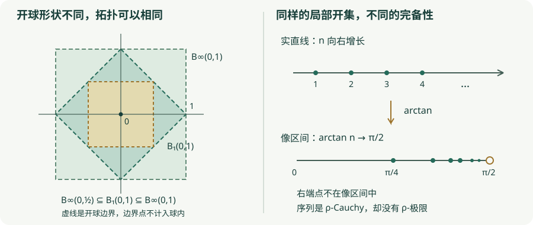

# PRE3 · 度量空间：从距离到拓扑

数学预备知识 · 状态：Reviewed（独立模型复核；非人类同行评审） 范围：度量产生的拓扑、序列、连续性与完备性的区别；一般拓扑中的网与滤子留待后续。

## 1. 学习目标

完成本章后，你应能检验度量公理，证明开球生成拓扑，用序列判定度量空间间映射的连续性，并分别解释“拓扑相同”“一致等价”“双 Lipschitz 等价”。你还应能构造同拓扑却完备性不同的两个度量，说明这一反例为什么不违背实数的完备性。

## 2. 先修知识

- [PRE1 · 集合、映射与等价关系](sets-maps-relations.md)：逆像、任意并、等价类。
- [PRE2 · 证明方法与反例](proofs-counterexamples.md)：量词否定、反证法、三角不等式估计。
- 外部实分析工具：实数绝对值、实数的上确界性质，以及由它推出的“每个实 Cauchy 序列收敛”。本章把这一实数完备性定理作为先修，不在这里重建实数。
- 在唯一的反正切例子中，使用实分析已知事实：$\arctan:\mathbb R\to(-\pi/2,\pi/2)$ 连续严格递增、逆函数 $\tan$ 连续、$\lim_{t\to+\infty}\arctan t=\pi/2$，以及中值定理与 $\arctan'(t)=1/(1+t^2)$。其余定理不依赖微积分。

## 3. 问题引入：直观解释

在平面上，“靠近”可以表示直线距离小，也可以表示横纵坐标变化量之和小。这些距离数值不同，却可能给出同样的开集。反过来，两个距离即使产生同样的开集，也未必以同样方式判断一个序列是否 Cauchy。

拓扑记录的是**每一点附近有哪些可接受的邻域**。Cauchy 条件要求序列的所有充分靠后的项彼此靠近，不事先指定极限点。后者要求跨越整个空间的一致尺度控制，所以比开集信息更细。本章会把这两个量词层次拆开。

## 4. 严格定义

**定义 PRE3.1（度量与伪度量）。** 设 $X$ 是集合。度量（metric）是函数 $d:X\times X\to[0,\infty)$，对所有 $x,y,z\in X$ 满足：

1. $d(x,y)=0$ 当且仅当 $x=y$；
2. $d(x,y)=d(y,x)$；
3. $d(x,z)\le d(x,y)+d(y,z)$，称三角不等式（triangle inequality）。

二元组 $(X,d)$ 称度量空间（metric space）。若把第一条替换为仅要求 $d(x,x)=0$，允许不同点距离为零，则称伪度量（pseudometric）。这里距离总是有限实数；不讨论允许 $+\infty$ 的扩展度量。空集上也有唯一的空度量，所有涉及点的公理真空成立。

**定义 PRE3.2（开球与度量开集）。** 对 $x\in X$、实数 $r>0$，开球（open ball）为

$$
B_d(x,r)=\{y\in X:d(x,y)<r\}.
$$

集合 $U\subseteq X$ 称 $d$-开集，如果每个 $x\in U$ 都有某个 $r_x>0$ 使 $B_d(x,r_x)\subseteq U$。半径可以依赖于 $x$。所有这样的集合组成 $\mathcal T_d$。相对于 $X$，开集的补集称闭集（closed set）。名称“闭球”指 $\{y:d(x,y)\le r\}$；它是否为开集不由这个名称决定。

**定义 PRE3.3（收敛、Cauchy、完备）。** 以下截断指标 $N$ 与序列指标 $m,n$ 都取正整数。序列 $(x_n)_{n\ge1}$ 收敛（converges）到 $x$，若

$$
\forall\varepsilon>0\ \exists N\ge1\ \forall n\ge N,
\qquad d(x_n,x)<\varepsilon.
$$

它是 Cauchy 序列（Cauchy sequence），若

$$
\forall\varepsilon>0\ \exists N\ge1\ \forall m,n\ge N,
\qquad d(x_m,x_n)<\varepsilon.
$$

若每个 Cauchy 序列都在 $X$ 中收敛，$(X,d)$ 称完备（complete）。这一定义也适用于伪度量，但伪度量极限可以不唯一。空空间没有取值其中的序列，因而按此定义完备。

**定义 PRE3.4（连续与一致连续）。** 对度量空间 $(X,d),(Y,e)$，函数 $f:X\to Y$ 在 $x\in X$ 连续（continuous），若

$$
\forall\varepsilon>0\ \exists\delta>0\ \forall y\in X,
\quad d(x,y)<\delta\Longrightarrow e(f(x),f(y))<\varepsilon.
$$

若每一点都连续，则称 $f$ 连续。若同一个 $\delta$ 可以用于所有 $x,y\in X$，即

$$
\forall\varepsilon>0\ \exists\delta>0\ \forall x,y\in X,
\quad d(x,y)<\delta\Longrightarrow e(f(x),f(y))<\varepsilon,
$$

则称一致连续（uniformly continuous）。两定义的差别在于 $\delta$ 是否可依赖中心点。

**定义 PRE3.5（三种比较）。** 设 $d,\rho$ 是同一个集合 $X$ 上的两个度量。

- 拓扑等价（topologically equivalent）：$\mathcal T_d=\mathcal T_\rho$。
- 一致等价（uniformly equivalent）：恒等映射在两个方向均一致连续。
- 双 Lipschitz 等价（bi-Lipschitz equivalent）：存在常数 $0<c\le C<\infty$，对所有 $x,y$ 有 $c\,d(x,y)\le\rho(x,y)\le C\,d(x,y)$。

“等价度量”在不同教材里可能有不同约定，本教材在每次使用时指明是哪一种。连续且逆映射也连续的双射称同胚（homeomorphism）；拓扑等价恰好说两个度量空间之间的恒等映射是同胚。

## 5. 定理与证明

**定理 PRE3.6（开球生成拓扑）。** 对任意度量空间，每个开球都是 $d$-开集；$\mathcal T_d$ 包含 $\varnothing,X$，对任意并及有限交封闭。因此它是拓扑（topology）。每个 $d$-开集都是开球的并。

**证明。** 若 $y\in B_d(x,r)$，令 $s=r-d(x,y)>0$。对 $z\in B_d(y,s)$，三角不等式给出

$$
d(x,z)\le d(x,y)+d(y,z)<d(x,y)+s=r.
$$

因此 $B_d(y,s)\subseteq B_d(x,r)$，证明了开球为开集。

空集的逐点条件真空成立；$X$ 中每个点的任意正半径球都包含在 $X$ 中。设每个 $U_i$ 开，若 $x\in\bigcup_i U_i$，则存在一个 $i$ 使 $x\in U_i$；$U_i$ 中包含的一个以 $x$ 为中心的球也在该并集中，所以任意并开。这里并集指标集允许为空。

若 $U_1,\ldots,U_k$ 开且 $x$ 在它们的交中，分别取球半径 $r_1,\ldots,r_k>0$。当 $k\ge1$ 时，$r=\min_i r_i>0$，且 $B_d(x,r)$ 同时包含在全部 $U_i$ 中。空族的交约定为 $X$，已经处理。因此有限交开。无限交不能用这一步，因为正数族的下确界可能为零。

最后，若 $U$ 开，对每个 $x\in U$ 考虑全部满足 $B_d(x,r)\subseteq U$ 的正半径球。这些球的并包含 $U$ 的每个点，又包含于 $U$，故等于 $U$。这种写法不需要为每个点同时作一次任意选择。证毕。

**定理 PRE3.7（极限唯一与 Cauchy 必要性）。** 度量空间中的序列至多有一个极限；每个收敛序列都是 Cauchy 序列。

**证明。** 若 $x_n\to x$ 且 $x_n\to y$ 而 $x\ne y$，令 $a=d(x,y)>0$。当 $n$ 同时充分大时，$d(x,x_n)<a/3$ 且 $d(x_n,y)<a/3$，所以 $a<2a/3$，矛盾。

若 $x_n\to x$，给定 $\varepsilon>0$，取 $N$ 使 $n\ge N$ 时 $d(x_n,x)<\varepsilon/2$。对 $m,n\ge N$，有 $d(x_m,x_n)\le d(x_m,x)+d(x,x_n)<\varepsilon$。这证明 Cauchy 条件。该方向不要求空间完备。证毕。

**定理 PRE3.8（序列判连续）。** 对度量空间间的映射 $f:(X,d)\to(Y,e)$ 和点 $x\in X$，以下两条等价：

1. $f$ 在 $x$ 连续。
2. 对每个收敛到 $x$ 的序列 $x_n$，都有 $f(x_n)\to f(x)$。

**证明。** 若连续，给定目标误差 $\varepsilon>0$，由连续性取 $\delta>0$。收敛给出 $N$，使 $n\ge N$ 时 $d(x_n,x)<\delta$，于是 $e(f(x_n),f(x))<\varepsilon$。

反之，若在 $x$ 不连续，把定义的量词逐个否定，得到存在 $\varepsilon_0>0$，使每个 $\delta>0$ 都有 $y\in X$ 满足 $d(x,y)<\delta$ 且 $e(f(x),f(y))\ge\varepsilon_0$。对每个 $n$ 用 $\delta=1/n$ 选出这样的 $x_n$。则 $x_n\to x$，但其像始终不能进入 $B_e(f(x),\varepsilon_0)$，与第 2 条矛盾。这里使用通常数学框架中的可数选择；本教材后续集合论模块会讨论弱选择公理。证毕。

本定理的逆向利用了度量给出的可数球族。一般拓扑空间不能无条件用序列替代连续性的开集定义；后续的[网与闭包](../point-set/closure-nets.md)会给出准确边界。

**定理 PRE3.9（连续性的开集判据）。** 度量空间间的映射 $f$ 连续，当且仅当对每个 $e$-开集 $V\subseteq Y$，逆像 $f^{-1}(V)$ 是 $d$-开集。

**证明。** 若 $f$ 连续且 $x\in f^{-1}(V)$，由 $V$ 开可取 $\varepsilon>0$ 使 $B_e(f(x),\varepsilon)\subseteq V$。在 $x$ 的连续性给出 $\delta>0$，于是 $B_d(x,\delta)\subseteq f^{-1}(V)$。

反之，固定 $x\in X$ 和 $\varepsilon>0$。定理 PRE3.6 保证 $B_e(f(x),\varepsilon)$ 开，故其逆像是包含 $x$ 的开集。取 $\delta>0$ 使 $B_d(x,\delta)$ 包含在该逆像中，正好得到在 $x$ 连续的条件。证毕。

**定理 PRE3.10（一致等价保持完备性）。** 若同一个集合上的度量 $d,\rho$ 一致等价，则它们有相同的 Cauchy 序列、相同的收敛序列及极限；$(X,d)$ 完备当且仅当 $(X,\rho)$ 完备。

**证明。** 假设 $(x_n)$ 为 $d$-Cauchy。给定 $\varepsilon>0$，由从 $d$ 到 $\rho$ 的一致连续性取 $\delta>0$，再用 Cauchy 条件取 $N$。对 $m,n\ge N$，$d(x_m,x_n)<\delta$，故 $\rho(x_m,x_n)<\varepsilon$。反向使用另一方向的一致连续性。

一致连续蕴含逐点连续，故由 PRE3.8，两种度量的收敛序列和极限相同。若 $d$ 完备而 $(x_n)$ 为 $\rho$-Cauchy，它也为 $d$-Cauchy，因而在 $d$ 下收敛到某个 $x\in X$，再在 $\rho$ 下收敛到同一 $x$。交换两种度量即得逆向。证毕。

**命题 PRE3.11（蕴含关系）。** 双 Lipschitz 等价蕴含一致等价，一致等价蕴含拓扑等价。两个逆向在一般情况下均不成立。

**证明。** 若 $c\,d\le\rho\le C\,d$，给定 $\rho$ 方向的误差 $\varepsilon$，取 $\delta=\varepsilon/C$；反向取 $\delta=c\varepsilon$。这证明双向一致连续。一致连续蕴含连续，由 PRE3.9，双向恒等映射连续即开集族相同。逆向反例分别见下节的平方根度量与反正切度量；该节给出所需计算。证毕。

## 6. 典型例题：正例与反例

### 例 1：实直线与离散距离

$d(x,y)=|x-y|$ 是 $\mathbb R$ 上的度量：绝对值的分离性与对称性直接给出前两公理，绝对值三角不等式给出第三公理。其球为开区间 $(x-r,x+r)$，所以每个通常的开区间都是开集，每个开集都是这些区间的并。

任意集合 $X$ 上的离散度量（discrete metric）定义为 $d(x,y)=0$ 若 $x=y$，否则为 $1$。若 $x\ne z$，中间点 $y$ 不可能同时等于两者，所以 $d(x,y)+d(y,z)\ge1=d(x,z)$；若 $x=z$，不等式由非负性得到。半径 $1/2$ 的球为单点集，所以每个子集均开。特别地，单点集既开又闭；“开”和“闭”不是逻辑上的互斥选项。

### 例 2：坐标距离与球包含

在 $\mathbb R^2$ 上定义

$$
d_1(x,y)=|x_1-y_1|+|x_2-y_2|,
\qquad d_\infty(x,y)=\max\{|x_1-y_1|,|x_2-y_2|\}.
$$

$d_1$ 的三角不等式由两个绝对值三角不等式相加得到。对每个坐标 $i$，$|x_i-z_i|\le d_\infty(x,y)+d_\infty(y,z)$，取最大值便得到 $d_\infty$ 的三角不等式。其余公理从坐标相等的含义可直接逐条检查。

非负数的最大值不超过其和，而两项之和不超过最大值的两倍，故

$$
d_\infty(x,y)\le d_1(x,y)\le2d_\infty(x,y).
$$

因此 $B_\infty(x,r/2)\subseteq B_1(x,r)\subseteq B_\infty(x,r)$。这既是一组可检查的球包含，也是它们双 Lipschitz 等价的证明；不能仅凭球“看上去形状相似”作结论。

### 例 3：伪度量与不唯一极限

在 $\mathbb R^2$ 上令 $p(x,y)=|x_1-y_1|$。非负性、对称性和三角不等式都成立，但 $p((0,0),(0,1))=0$，所以它不是度量。常序列 $x_n=(0,0)$ 在 $p$ 下收敛到每一个 $(0,t)$。PRE3.7 的唯一性证明之所以不能照搬，正是因为不同点未必有正距离。

### 例 4：一致等价不必双 Lipschitz 等价

在进入三种等价性的区别前，可以先读导论的[截断度量完整例题](../introduction/01-spaces.md#truncated-metric)：$|x-y|$ 与 $\min\{1,|x-y|\}$ 的小半径球相同，诱导同一拓扑，但距离函数不同。本章第 4 题进一步证明任意度量与其截断度量一致等价。

在 $\mathbb R$ 上取 $d(x,y)=|x-y|$，$\sigma(x,y)=\sqrt{|x-y|}$。由 $\sqrt{a+b}\le\sqrt a+\sqrt b$（平方后右侧多出非负项 $2\sqrt{ab}$）和 $d$ 的三角不等式，$\sigma$ 是度量。

给定 $\varepsilon>0$，若 $d(x,y)<\varepsilon^2$ 则 $\sigma(x,y)<\varepsilon$；若 $\sigma(x,y)<\sqrt\varepsilon$ 则 $d(x,y)<\varepsilon$，所以二者一致等价。若存在统一上界 $\sigma\le C d$，取 $x=0,y=t>0$ 得 $1/\sqrt t\le C$，让 $t\downarrow0$ 即矛盾。因此不存在双 Lipschitz 等价。这个反例也提醒我们：没有线性尺度界，不等于没有任何一致尺度界。

### 例 5：同拓扑不保完备性——综合计算

**命题 PRE3.12。** 实直线上的

$$
d(x,y)=|x-y|,
\qquad \rho(x,y)=|\arctan x-\arctan y|
$$

是拓扑等价的两个度量；$d$ 完备而 $\rho$ 不完备，二者不一致等价。

**证明。** 反正切单射给出 $\rho$ 的分离性；对称性和三角不等式来自其像区间内的绝对值。因此 $\rho$ 是度量。映射 $a(x)=\arctan x$ 是 $(\mathbb R,\rho)$ 到通常度量区间 $(-\pi/2,\pi/2)$ 的保距双射（isometry）。作为通常拓扑间映射，$a$ 与 $\tan$ 均连续，所以 $\rho$ 产生的开集与 $d$ 的开集相同。

实数的先修完备性定理说明 $d$ 完备。令 $x_n=n$，则 $\arctan n\to\pi/2$，所以像序列在实数中 Cauchy，$(n)$ 在 $\rho$ 下 Cauchy。若它在 $\rho$ 下收敛到某个 $x\in\mathbb R$，则 $\arctan n\to\arctan x$。实数极限唯一性给出 $\arctan x=\pi/2$，但 $\arctan x$ 总在开区间内，矛盾。因此 $\rho$ 不完备。

还可直接辨认不一致连续的方向。中值定理给出 $\rho(x,y)\le d(x,y)$，所以从 $d$ 到 $\rho$ 的恒等映射一致连续。而 $\rho(n,n+1)\to0$，同时 $d(n,n+1)=1$。以目标误差 $1/2$ 检验反向一致连续性，不论给出什么 $\delta>0$，充分大的 $n$ 都违反条件。证毕。

不完备的原因是像区间遗漏了端点，不是实数通常距离缺少极限。“某个指定度量完备”与“某拓扑存在一个完备相容度量”也不是同一句话；此例中后者成立，因为通常度量 $d$ 就是这样的度量。

## 7. 几何直观与原创图解

左图比较 $d_1$ 与 $d_\infty$ 的单位球，并以半径 $1/2$ 的小方形展示上节球包含。边界线只作位置提示，开球本身不包含边界。右图中的点仅作示意：严格的端点趋近和不收敛结论来自 PRE3.12 的证明，图形不能代替量词论证。

## 8. 编程实验

[基础实验：有限距离矩阵](../labs/foundations.md)接收有限集合上的距离矩阵，检查零对角、非负、对称、分离性与每个有序三元组的三角不等式，并计算指定严格半径下的开球。点 $a,b,c$ 在界面依次记为 $0,1,2$。把第 1 题的整数矩阵逐个输入，先预测“度量／仅伪度量／违反三角不等式”，再核对失败位置。

本章实验针对有限整数输入作精确检查，输入和输出都应保留具体顶点标签。它可以证实这一个矩阵的全部有限公理实例，不能验证所有实数距离函数，也不能从有限采样证明 PRE3.12 的不完备性。一致连续性、无穷序列与极限仍由正文证明处理。边界 $d(x,y)=r$ 的点不在开球内，不应以显示容差擅自纳入。

## 9. 课后习题 {#exercises}

1. **基础·有限检验。** 在 $X=\{a,b,c\}$ 上按该顺序读取下列矩阵。逐个判断它是度量、仅为伪度量、还是两者都不是。写出 $A$ 下的 $B(a,3)$ 和 $B$ 下的 $B(a,1)$。

    $$
    A=\begin{pmatrix}0&2&3\\2&0&4\\3&4&0\end{pmatrix},
    \quad B=\begin{pmatrix}0&0&1\\0&0&1\\1&1&0\end{pmatrix},
    \quad C=\begin{pmatrix}0&1&3\\1&0&1\\3&1&0\end{pmatrix}.
    $$

2. **基础·离散空间。** 证明离散度量下的序列收敛当且仅当最终为一个固定值；证明每个离散度量空间完备。说明为什么无限离散空间的所有子集仍然开。
3. **证明·距离函数。** 证明反三角不等式 $|d(x,z)-d(y,z)|\le d(x,y)$。若 $A\subseteq X$ 非空，定义 $\operatorname{dist}(x,A)=\inf_{a\in A}d(x,a)$，证明这个函数为 $1$-Lipschitz。找出 $x\notin A$ 但距离为零的例子。
4. **证明·截断度量。** 对任意度量 $d$，令 $d'(x,y)=\min\{1,d(x,y)\}$。证明 $d'$ 是度量，与 $d$ 一致等价，且完备性相同。证明它们在无界空间上不一定双 Lipschitz 等价。
5. **反例·序列与连续性。** 令 $f:\mathbb R\to\mathbb R$ 在 $0$ 取 $1$，其余点取 $0$。两端都用通常度量时，证明它在 $0$ 不连续而在每个非零点连续。若定义域改用离散度量，结论怎样改变？说明改变的是哪一个结构。
6. **综合·尺度量词。** 对 PRE3.12 的 $d,\rho$，证明固定点 $x$ 的足够小 $\rho$-球总包含在 $B_d(x,1/2)$ 中，同时不存在一个对全部 $x$ 有效的统一 $\rho$-半径。解释这两个结论为何不矛盾。
7. **综合·完备子空间。** 若 $(X,d)$ 完备且 $F\subseteq X$ 闭，证明限制度量下 $F$ 完备。反之，证明任意度量空间的完备子空间必闭。给出不闭子空间不完备的具体例子，并说明第二方向不需要 $X$ 完备。
8. **挑战·把伪度量变成度量。** 对伪度量 $p$，定义 $x\sim y$ 当且仅当 $p(x,y)=0$。证明这是等价关系，并证明 $\bar p([x],[y])=p(x,y)$ 在等价类集合上良定义且为度量。若 $q(x)=[x]$，证明 $q^{-1}(B_{\bar p}([x],r))=B_p(x,r)$。在例 3 中识别这个度量空间。

第一层提示：先找量词或公理

1：相等距离的边界不属于开球。2：使用小于 $1$ 的误差。3：分别写两个方向的三角不等式。4：先证明 $\min(1,a+b)\le\min(1,a)+\min(1,b)$。5：试 $x_n=1/n$。6：固定点可用 $\tan$ 的连续性，统一控制用 $n,n+1$ 反驳。7：用闭集的开补集或从球内选序列。8：先估计改变一个代表元后距离能变化多少。

第二层提示：关键中间结论

3：对每个 $a\in A$ 有 $d(x,a)\le d(x,y)+d(y,a)$，再取下确界；取 $A=(0,1),x=0$。4：小于 $1$ 的尺度上两个距离完全相同。6：所需半径可由 $\arctan(x\pm1/2)$ 与 $\arctan x$ 的两个正差的最小值给出。7：若闭性失败，在距离 $1/n$ 的球内逐个选点。8：证明 $|p(x,y)-p(x',y')|\le p(x,x')+p(y,y')$。

<noscript>即时反馈需要 JavaScript；八道书面题、提示和完整解答无需运行脚本。</noscript>

## 10. 习题解答

[阅读 PRE3 的八道完整解答](../exercises/pre3-solutions.md)。先写出自己的量词、估计或反例，再对照答案的假设和关键步骤；提示不能替代完整证明。

## 11. 本章总结

度量先给出开球，再经任意并形成拓扑。连续性只涉及逐点的邻域控制；在度量空间里，这种控制能用序列刻画。Cauchy 性与完备性要求一致尺度信息，因此同一拓扑可以来自完备性不同的度量。

接下来可读[拓扑空间导论](../introduction/01-spaces.md)与[拓扑基、子基及子空间](../point-set/bases-subbases.md)，把开球例子推广为一般生成规则；关于完备化和 Baire 定理的后续课程见[完备化与范畴](../point-set/completion-baire.md)。推广时始终检查证明究竟用了距离、可数邻域，还是仅用了拓扑公理。

## 12. 参考书目

- James R. Munkres, *Topology*, 2nd ed., Prentice Hall, 2000，§20 “The Metric Topology”、§21 “The Metric Topology (continued)”。章节定位可由 [MIT 18.901 阅读表](https://ocw.mit.edu/courses/18-901-introduction-to-topology-fall-2004/pages/readings/)核对。该核验针对目录与课程阅读安排，不表示已逐页核读原书。书名和目录另经出版方 Pearson 目录核对。
- 本章所有解释、证明编排、例题、习题与 SVG 均为本项目原创。反正切性质、中值定理和实数完备性属于第 2 节明确列出的外部实分析先修；这里没有声称已给出它们的完整证明。

[本章审查记录](../project/reviews/PRE3.md)
