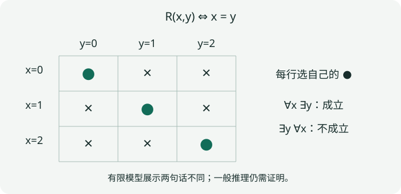

# PRE2 · 量词、证明方法与反例构造

本章状态：Reviewed（独立模型复核）；审查过程与证据见[独立记录](../project/reviews/PRE2.md)。本章的“证明”指通常数学论证，不表示已经由证明助手形式化验证。

## 1. 学习目标

完成本章后，你应能准确否定含两层量词的陈述，选择直接证明、逆否、反证、归纳或构造法，证明一个不能由有限枚举解决的命题，并用明确反例否定错误的拓扑直觉。

## 2. 先修知识

先读 [PRE1：集合、映射与等价类](sets-maps-relations.md)。本章使用自然数的归纳原理、实数的次序和绝对值；归纳原理作为自然数体系的基本性质，不在这里从集合论公理构造自然数。自然数约定 $\mathbb N=\{0,1,2,\ldots\}$，正整数写 $n\ge1$。

## 3. 问题引入：直观解释

“每个人都有一把钥匙”与“有一把钥匙能开所有人的门”不是同一句话。在连续性、紧致性和收敛中，同样的差别决定了一个半径能否依赖于点，或者一个指标能否依赖于误差。

例如对每个 $x\in(0,1)$ 都能找到整数 $n\ge1$ 使 $1/n<x$，但没有一个固定的 $n$ 对所有这样的 $x$ 成立。若把这两个量词交换，证明就会悄悄加入一个不存在的统一选择。

## 4. 严格定义

**定义 PRE2.1（命题与谓词）。** 命题（proposition）在指定数学语境中有真值。谓词（predicate）$P(x)$ 含有变量；须指定 $x$ 的取值集合。蕴含 $P\Rightarrow Q$ 仅在 $P$ 真而 $Q$ 假时为假；等价 $P\Leftrightarrow Q$ 要求两个方向都成立。这里采用经典逻辑。

**定义 PRE2.2（量词）。** 全称量词（universal quantifier）$\forall x\in X$ 要求 $X$ 中每个元素满足；存在量词（existential quantifier）$\exists x\in X$ 要求至少一个满足。空集上的全称陈述为真，存在陈述为假。存在唯一 $\exists!x\,P(x)$ 同时要求存在与唯一，不能只证明“若存在则唯一”。

**定义 PRE2.3（反例）。** 对 $\forall x\in X,\ P(x)\Rightarrow Q(x)$，反例（counterexample）是一个 $x_0\in X$，满足 $P(x_0)$ 且不满足 $Q(x_0)$。不满足前提的对象不构成反例。

一个陈述中的选择依赖由顺序决定：$\forall x\exists y$ 允许 $y$ 依赖 $x$；$\exists y\forall x$ 要求同一个 $y$。除非另有证明，不能交换它们。

## 5. 定理与证明

**命题 PRE2.4（否定规则与逆否）。** 在经典逻辑中，

$$
\neg(\forall x\in X\ P(x))\iff\exists x\in X\ \neg P(x),\qquad
\neg(\exists x\in X\ P(x))\iff\forall x\in X\ \neg P(x).
$$

此外 $P\Rightarrow Q$ 与 $\neg Q\Rightarrow\neg P$ 等价，与逆命题 $Q\Rightarrow P$ 一般不等价。

**证明。** 全称陈述为假恰好是至少一个对象使谓词为假；不存在见证恰好是每个对象均不满足。空集时前一等价两侧皆假、后一等价两侧皆真。两种蕴含的唯一失败情形同为 $P$ 真且 $Q$ 假，所以真值相同。取 $P$ 假、$Q$ 真，原蕴含真但逆命题假，说明后一种替换不合法。$\square$

**命题 PRE2.5（有限交与量词展开）。** 对固定全集 $X$ 中的子集 $A_1,\ldots,A_n$，

$$
X\setminus\bigcap_{j=1}^n A_j=\bigcup_{j=1}^n(X\setminus A_j).
$$

这里 $n=0$ 时左侧取 $X\setminus X=\varnothing$，右侧为空并。

**证明。** 对任意 $x\in X$，左侧条件是“不对所有 $j\in\{1,\ldots,n\}$ 都有 $x\in A_j$”。用 PRE2.4，这是“有一个 $j$ 使 $x\notin A_j$”，即右侧条件。逐元素等价证明集合相等，也覆盖空指标情形。$\square$

这个证明通过定义直接完成。另一种合法策略是归纳：先证明 $n=0$；假定 $n$ 成立，用二集合的 De Morgan 公式把第 $n+1$ 项拆开。归纳步中只能使用较小指标的结论，不能假设待证的全部结论。

**定理 PRE2.6（Cantor 对角论证）。** 对任意集合 $X$，不存在满射 $f:X\to\mathcal P(X)$。

**证明。** 给定任意这样的映射，构造集合

$$
D=\{x\in X:x\notin f(x)\}\in\mathcal P(X).
$$

若 $D=f(a)$，则由定义 $a\in D\iff a\notin f(a)\iff a\notin D$，矛盾。因此 $D$ 不在 $f$ 的像中，$f$ 不满。这里 $D$ 是从集合 $X$ 中分离得到的子集，不是所谓“所有集合组成的集合”。即使 $X=\varnothing$，也有 $\mathcal P(X)=\{\varnothing\}$，空映射不满，证明范围没有遗漏。$\square$

**命题 PRE2.7（有限检验的逻辑边界）。** 给定 $m\ge1$，存在两个从正整数到整数的函数，它们在 $1,\ldots,m$ 上相等，却不处处相等。

**证明。** 取 $a(n)=0$ 和 $b(n)=\prod_{j=1}^m(n-j)$。前 $m$ 个输入至少有一项为零，而 $b(m+1)=m!\ne0=a(m+1)$。所以无论有限样本多长，“这些输入上相等”都不足以推出任意输入相等。若另有可证明的有限判定定理，则可以用它将无限问题转为有限检验；本命题不否定这样的理论。$\square$

## 6. 典型例题：正例与反例

**基础例：必要与充分。** 在整数中，“被4整除”是“为偶数”的充分条件；它不是必要条件，$2$ 即反例。“必要”对应结论能否反推前提，不是说某条件更重要。

**非平凡正例：唯一性要分两步。** 对双射 $f:X\to Y$，每个 $y$ 的原像由满射性保证存在，由单射性保证唯一。因此可定义反函数。单凭单射只得到至多一个原像，例如 $f:\mathbb N\to\mathbb N, f(n)=n+1$ 没有 $0$ 的原像。

**常见错误：无穷运算偷换为有限运算。** 每个 $(-1/n,1/n)$ 都是通常实线的开区间，但其交为 $\{0\}$。证明：$0$ 总在其中；若 $x\ne0$，取 $n>1/|x|$ 则 $|x|>1/n$，所以 $x$ 不在该项。任何正半径区间都含非零点，故 $\{0\}$ 不是开集。这个例子将在拓扑公理中区分有限交与任意交。

**综合推导：否定“趋于零”。** 序列 $x_n$ 趋于0的条件为

$$
\forall\varepsilon>0\ \exists N\ \forall n\ge N:\ |x_n|<\varepsilon.
$$

其否定是 $\exists\varepsilon_0>0\ \forall N\ \exists n\ge N:|x_n|\ge\varepsilon_0$。对 $x_n=(-1)^n$，取 $\varepsilon_0=1/2$，每个尾部的任何一项都是见证。仅发现一个早期项超出误差不够，因为 $N$ 可以越过它。

## 7. 几何直观与原创图解

图中 $X=Y=\{0,1,2\}$，关系为 $R(x,y)\iff x=y$。每行有见证，因此 $\forall x\exists y\ R(x,y)$；任何一列均有两个失败行，因此 $\exists y\forall x\ R(x,y)$ 为假。这是量词区别的有限模型，不是对任意关系的结论。

## 8. 编程实验

在[基础实验台](../labs/foundations.md)寻找“像是否保交”的有限反例，再将屏幕结果翻译为三行数学论证：输入满足何种假设，左侧是多少，右侧是多少。对三点集合的拓扑生成，可以用有限性证明二元并交闭合已经足够；不能把同一算法不加论证地推广到无限集合。

PRE2.6 不需要数值实验：幂集增长的柱状图不能证明任意集合上的 Cantor 定理。它依赖对每个候选映射都能构造遗漏子集的逻辑。

## 9. 课后习题

1. **基础。** 否定 $\forall x\in\mathbb R\ \exists y\in\mathbb R:\ y>x$。分别判断原命题与否定的真值。
2. **基础。** 判断空集上的 $\forall x\in\varnothing:x\ne x$ 与 $\exists x\in\varnothing:x=x$，解释为什么不矛盾。
3. **证明。** 用逆否证明：若整数 $n^2$ 为偶数，则 $n$ 为偶数。说明直接将逆命题当作原命题为什么不算证明。
4. **归纳。** 对 $n\ge1$ 证明 $1+3+\cdots+(2n-1)=n^2$，写出基例及归纳步。
5. **反例。** 用三点集合上的关系证明 $\forall x\exists y\ R(x,y)$ 不推出 $\exists y\forall x\ R(x,y)$，并判断反方向是否成立。
6. **综合。** 对任意 $m\ge1$，构造前 $m$ 项均为0但不趋于0的实数序列，并按收敛的否定给出见证。
7. **构造。** 若映射 $f:X\to Y$ 有左逆 $g:Y\to X$（$g\circ f=\operatorname{id}_X$），证明 $f$ 单射；构造单射且存在左逆但不满射的例子。
8. **挑战。** 不使用 Cantor 定理作为黑箱，证明所有二元序列 $\{0,1\}^{\mathbb N}$ 不能由自然数列完；解释为什么列中重复项不影响论证。

??? tip "分步提示"
    1–2：否定时交换量词，逐个看取值集合。3：把奇数写为 $2k+1$。4：下一项是 $2n+1$。5：画出上图矩阵。

??? tip "进一步提示"
    6：有限前缀不会限制后续项。7：对 $f(x)=f(x')$ 两边用 $g$。8：第 $n$ 个新坐标与第 $n$ 个候选序列的第 $n$ 坐标不同。

<noscript>即时自检需要JavaScript；全部书面题和完整答案可直接阅读。</noscript>

## 10. 习题解答

[PRE2 的八题完整解答](../exercises/pre2-solutions.md)分别核对量词、前提、构造及唯一性；请在展开提示前先独立尝试。

## 11. 本章总结

证明从明确对象和量词开始；反例要满足原假设；存在与唯一、原命题与逆命题、有限验证与一般证明各是不同义务。[度量空间](metric-spaces.md)会立即用到这些区别：连续性的半径可依赖点，一致连续性的半径必须同时服务所有点。

## 证明训练：从理解到独立迁移

**新增迁移任务（保留原有习题）。**对整数 a,b，证明 a²+b² 为奇数，当且仅当 a,b 恰有一个为奇数。必须证明两个方向，并用一个例子反驳“a²+b² 为偶数就说明 a,b 都偶”。

请先写出目标、量词顺序与假设，再独立论证。[进入 PRE2 三级证明训练](../exercises/proof-workshop.md#pre2)，可检查引导步骤的依赖，并查看分步提示、自核量规和完整论证。自由证明不由系统自动判真；无需保存或上传草稿。

## 12. 参考书目

- Richard Hammack, *Book of Proof*, 3rd ed.：第2章逻辑、第4–10章证明方法、第14章基数。[作者目录与下载页](https://richardhammack.github.io/BookOfProof/)已核验这些主题；未照译书中段落或习题。
- James R. Munkres, *Topology*, 2nd ed.，第1章集合论与逻辑。[MIT 18.901 阅读安排](https://ocw.mit.edu/courses/18-901-introduction-to-topology-fall-2004/pages/readings/)核验其课程定位。本轮查阅目录/阅读安排，不声称逐页校核原书。

本章命题、例题、习题、说明与SVG均为本项目原创组织的标准数学材料。
