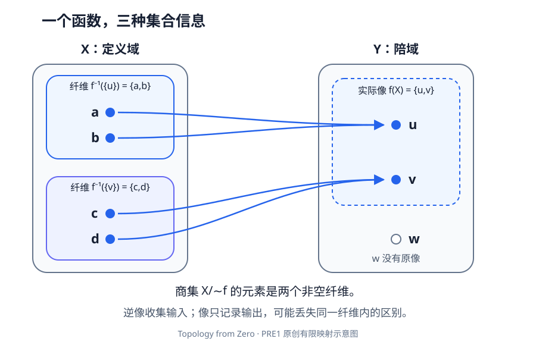

# PRE1 · 集合、映射、关系与商集

数学预备知识 · 状态：Reviewed（独立模型复核；非人类同行评审） 目标：读懂拓扑定义中的集合运算，并能证明一个按等价类定义的映射没有歧义。

## 1. 学习目标

完成本章后，你应能够：

- 区分元素、子集和由子集组成的集合族，并正确处理空并与空交。
- 给定映射的定义域与陪域，计算像、逆像和纤维，判断单射、满射和双射。
- 证明逆像保持任意并、任意交和补集，解释像的对应公式何时失败。
- 在等价关系与集合划分之间转换，用代表无关性检验商集上的定义。
- 构造商集泛性质中的唯一映射，说明它与后续商拓扑的关系。

## 2. 先修知识

本章不要求拓扑知识。需要能够阅读整数、实数的基本运算；含平方与整数余数的例子只用初等代数。证明使用的逻辑会在下一章系统整理：本章中的“当且仅当”要求证明两个方向，“任意”要求论证适用于每个允许的对象。

我们在通常的集合论语言中工作，但不在这里构造自然数、实数或集合论公理体系。所有补集都相对于明确的环境集合。讨论的集合族由一个**集合**作指标，不把“所有集合”当成一个可任意操作的集合。后续 Tychonoff 定理使用的选择原则会另行声明；本章商集泛性质不需要先为所有等价类选择代表。

## 3. 问题引入：直观解释

把学生分配到教室，是从学生集合到教室集合的映射。几个学生可以去同一教室，也可能有教室没有学生。这里至少有三个不同对象：全部教室、实际使用的教室、分到某间教室的学生。

拓扑中的连续性正是通过这种“向后找原对象”的运算定义：给出输出空间的开集，检查它的逆像是否开。商空间则把某些对象当成同一类。若班级名单按组存储，为一组赋分时却仍按某一个组员任意决定分数，结果可能不确定；数学中这叫**代表元依赖**。

本章先在集合层面解决这些问题。此时没有距离、开集或连续性；以后加入拓扑结构时，仍须先满足本章的集合条件。

## 4. 严格定义

### 定义 PRE1.1：集合、集合族与运算

记号 $x\in X$ 表示 $x$ 是集合 $X$ 的元素；$A\subseteq X$ 表示 $A$ 的每个元素都属于 $X$。空集（empty set）$\varnothing$ 没有元素。幂集（power set）$\mathcal P(X)$ 是 $X$ 的全部子集组成的集合；例如 $\{0\}\subseteq\{0,1\}$，而 $\{0\}\in\mathcal P(\{0,1\})$。

固定环境集合 $X$。给指标集 $I$ 及 $A_i\subseteq X$，定义

$$
\bigcup_{i\in I}A_i=\{x\in X:\text{存在 }i\in I\text{ 使 }x\in A_i\},
$$

$$
\bigcap_{i\in I}A_i=\{x\in X:\text{每个 }i\in I\text{ 都有 }x\in A_i\}.
$$

当 $I=\varnothing$ 时，没有指标能满足存在条件，所以空并为 $\varnothing$；不存在违反全称条件的指标，所以**在环境集合 $X$ 内的空交为 $X$**。空交不能脱离环境集合单独使用。

补集写作 $X\setminus A=\{x\in X:x\notin A\}$。差集 $A\setminus B$ 由属于 $A$ 而不属于 $B$ 的元素组成。笛卡尔积（Cartesian product）为 $X\times Y=\{(x,y):x\in X,y\in Y\}$，有序对满足 $(x,y)=(x',y')$ 当且仅当两坐标分别相等。

### 定义 PRE1.2：映射、像、逆像与纤维

映射或函数（map / function）$f:X\to Y$ 给**每个** $x\in X$ 指定**唯一**一个 $f(x)\in Y$。$X$ 是定义域（domain），$Y$ 是陪域（codomain）。对 $A\subseteq X$、$B\subseteq Y$，定义像（image）与逆像（preimage）

$$
f(A)=\{f(x):x\in A\},\qquad
f^{-1}(B)=\{x\in X:f(x)\in B\}.
$$

实际像集 $f(X)$ 可能严格小于陪域。点 $y\in Y$ 的纤维（fiber）为 $f^{-1}(\{y\})$，允许为空。逆像符号 $f^{-1}(B)$ **不要求**存在反函数。

映射 $f$ 是单射（injective），指 $f(x)=f(x')$ 蕴含 $x=x'$；是满射（surjective），指每个 $y\in Y$ 都等于某个 $f(x)$；同时满足两者称双射（bijective）。双射恰能定义反函数 $g:Y\to X$：满射给原像存在，单射给唯一，因而 $g(f(x))=x$、$f(g(y))=y$。反过来，存在这样的两侧反函数就分别推出单射和满射。

若 $f:X\to Y$、$g:Y\to Z$，复合（composition）为 $(g\circ f)(x)=g(f(x))$；右侧的 $f$ 先作用。恒等映射（identity map）$\operatorname{id}_X$ 将每点送回自身。

### 定义 PRE1.3：关系与等价关系

$X$ 上的二元关系（binary relation）是子集 $R\subseteq X\times X$；写 $xRy$ 表示 $(x,y)\in R$。等价关系（equivalence relation）$\sim$ 满足：

1. 自反性：每个 $x\in X$ 有 $x\sim x$。
2. 对称性：$x\sim y$ 蕴含 $y\sim x$。
3. 传递性：$x\sim y$ 且 $y\sim z$ 蕴含 $x\sim z$。

点 $x$ 的等价类（equivalence class）是 $[x]=\{y\in X:y\sim x\}$。商集（quotient set）$X/{\sim}=\{[x]:x\in X\}$ 收集的是类，不是每类随便挑一个原来的点。商映射在本章只指集合投影 $q:X\to X/{\sim}$，$q(x)=[x]$；后续“商映射”的拓扑定义还要求特定的连续性条件。

### 定义 PRE1.4：划分与代表无关性

$X$ 的划分（partition）是由**非空**子集组成的集合族 $\mathcal A$，其成员两两不交且并为 $X$。空集的划分是空集合族。若用 $h([x])=F(x)$ 定义类上的函数，必须证明

$$
x\sim x'\quad\Longrightarrow\quad F(x)=F(x').
$$

这称为代表无关，或定义良好（well-defined）。两个不同写法可以指同一个类；函数不能因此给这个类两个输出。

## 5. 定理与证明

### 定理 PRE1.5：逆像的集合运算

设 $f:X\to Y$，$B_i\subseteq Y$，指标集 $I$ 可以为空。则

$$
f^{-1}\left(\bigcup_{i\in I}B_i\right)=\bigcup_{i\in I}f^{-1}(B_i),\qquad
f^{-1}\left(\bigcap_{i\in I}B_i\right)=\bigcap_{i\in I}f^{-1}(B_i),
$$

$$
f^{-1}(Y\setminus B)=X\setminus f^{-1}(B).
$$

第二式左侧的空交在 $Y$ 内取，右侧的空交在 $X$ 内取。

**证明。** 对任意 $x\in X$，$x$ 属于第一式左侧，当且仅当 $f(x)$ 属于某个 $B_i$，当且仅当 $x$ 属于某个 $f^{-1}(B_i)$，这就是右侧的元素条件。将“某个”换成“每个”，得到第二式。补集公式来自

$$
x\in f^{-1}(Y\setminus B)\iff f(x)\notin B\iff x\notin f^{-1}(B).
$$

这里利用了 $f(x)$ 总在 $Y$ 中。当指标集为空时，前两式分别成为 $f^{-1}(\varnothing)=\varnothing$ 与 $f^{-1}(Y)=X$；因此没有例外。$\square$

### 定理 PRE1.6：像保持并，但一般不保持交

对任意 $A_i\subseteq X$，包括空指标集，有

$$
f\left(\bigcup_{i\in I}A_i\right)=\bigcup_{i\in I}f(A_i),\qquad
f\left(\bigcap_{i\in I}A_i\right)\subseteq\bigcap_{i\in I}f(A_i).
$$

若 $f$ 单射且 $I\ne\varnothing$，第二式是等号。若 $I=\varnothing$，等号成立当且仅当 $f$ 满射。

**证明。** 像并公式的两边都描述“存在一个指标 $i$ 和一个 $x\in A_i$ 使 $y=f(x)$”，故相等；空指标时两边都空。若 $y=f(x)$ 且 $x$ 属于每个 $A_i$，则 $y$ 属于每个 $f(A_i)$，给出交公式的包含关系。空指标时它是 $f(X)\subseteq Y$。

现在设 $I$ 非空且 $f$ 单射。给 $y\in\bigcap_i f(A_i)$，固定一个 $i_0\in I$，取 $x\in A_{i_0}$ 使 $f(x)=y$。对任意 $i$，由于 $y\in f(A_i)$，存在 $x_i\in A_i$ 满足 $f(x_i)=y$；单射性迫使 $x_i=x$，所以这个同一个 $x$ 属于所有 $A_i$。于是 $y\in f(\bigcap_iA_i)$。此论证只在任取的 $i$ 上使用存在性，不需要同时选出一个无限的代表族。空指标的等号则正是 $f(X)=Y$，即满射性。$\square$

### 命题 PRE1.7：往返运算与纤维

对任意 $A\subseteq X$、$B\subseteq Y$，有

$$
A\subseteq f^{-1}(f(A)),\qquad f(f^{-1}(B))=B\cap f(X).
$$

第一式的等号对所有 $A$ 都成立，当且仅当 $f$ 单射；第二式等于 $B$ 对所有 $B$ 都成立，当且仅当 $f$ 满射。

**证明。** $x\in A$ 时 $f(x)\in f(A)$，给第一包含。更精确地，$f^{-1}(f(A))$ 是所有与 $A$ 的某点有相同输出的点组成的集合。若 $f$ 单射，这些点必已在 $A$。反向，若每个 $A$ 都给等号且 $f(x)=f(x')$，取 $A=\{x\}$，便有 $x'\in f^{-1}(f(A))=\{x\}$，所以 $x'=x$。

第二公式中，左侧的 $y$ 必在 $B$ 且来自某个 $x\in X$，所以属于右侧；右侧的 $y$ 有原像 $x$，又因 $y\in B$，该 $x$ 属于 $f^{-1}(B)$，所以 $y$ 在左侧。若 $f$ 满射，$B\cap f(X)=B$；若所有 $B$ 都满足该等号，取 $B=Y$ 就得 $f(X)=Y$。$\square$

### 定理 PRE1.8：等价关系与划分一一对应

一个等价关系的等价类组成 $X$ 的划分。反过来，每个划分通过“属于同一块”给出等价关系，且两种构造互逆。

**证明。** 每点属于自己的类，故各类非空并覆盖 $X$。若 $[x]\cap[y]$ 含 $z$，则 $z\sim x$ 且 $z\sim y$；对称性与传递性给 $x\sim y$。对任意 $w\in[x]$，有 $w\sim x\sim y$，所以 $w\in[y]$，反向同理；于是两类相等。因此不同类不交。

给划分 $\mathcal A$，定义 $x\sim y$ 当且仅当二者同属某块。覆盖给自反性，同属一块的条件对称。若 $x,y$ 同属块 $A$，$y,z$ 同属块 $B$，则 $y\in A\cap B$，两两不交条件迫使 $A=B$，故 $x,z$ 同块，得到传递性。此关系下 $x$ 的类恰为包含 $x$ 的那一块。因此从划分出发再取类返回原划分；从关系出发，$[x]=[y]$ 当且仅当 $x\sim y$，也返回原关系。空空间的两种构造都给空族，结论仍成立。$\square$

### 定理 PRE1.9：商集的泛性质

设 $\sim$ 是 $X$ 上的等价关系，$q:X\to X/{\sim}$ 是投影，$f:X\to Y$ 是映射。存在映射 $\bar f:X/{\sim}\to Y$ 满足 $f=\bar f\circ q$，当且仅当 $f$ 在每个等价类上常值。若存在，这个 $\bar f$ 唯一。

**证明。** 若已有分解，$x\sim x'$ 给 $q(x)=q(x')$，故 $f(x)=\bar f(q(x))=\bar f(q(x'))=f(x')$，所以类上常值。

反向，给一个等价类 $C$，它非空；$f$ 在 $C$ 上常值，所以集合 $f(C)$ 恰有一个元素。把该唯一元素定义为 $\bar f(C)$，便不必先为所有类选择代表。等价写法是 $\bar f([x])=f(x)$；类上常值已保证代表无关。于是对每个 $x$，有 $\bar f(q(x))=f(x)$。

若还有 $h$ 满足同一等式，对任意类 $C=[x]$，有 $h(C)=h(q(x))=f(x)=\bar f(C)$，所以 $h=\bar f$。空 $X$ 时商集也空，唯一的空映射给相同结论。$\square$

“泛性质”（universal property）在此指这项由存在性和唯一性描述的性质。它并不说任意 $f$ 都能下降到商集。

### 推论 PRE1.10：每个映射都通过其纤维分解

给 $f:X\to Y$，定义 $x\sim_f x'$ 当且仅当 $f(x)=f(x')$。则这是等价关系，且有双射

$$
\widehat f:X/{\sim_f}\longrightarrow f(X),\qquad [x]\longmapsto f(x).
$$

因此 $f$ 分成商投影、该双射以及包含映射 $f(X)\hookrightarrow Y$ 的复合。

**证明。** 等号的自反、对称、传递性质给出关系的三条公理；类恰是非空纤维。PRE1.9 给映射良定义。若两类的输出相同，其代表按定义等价，所以两类相同，得到单射；每个像点按定义有原像，得到满射。三个映射作用于 $x$ 后依次得到 $[x]$、$f(x)$、$f(x)$，故复合确为 $f$。$\square$

## 6. 典型例题：正例与反例

### 例 A：有限映射的完整计算

令 $X=\{a,b,c,d\}$、$Y=\{u,v,w\}$，并规定

$$
f(a)=f(b)=u,\qquad f(c)=f(d)=v.
$$

三个纤维依次为 $\{a,b\}$、$\{c,d\}$、$\varnothing$。因此 $f(X)=\{u,v\}$，映射既非单射也非满射。若 $A=\{a,c\}$，则 $f(A)=\{u,v\}$，而 $f^{-1}(f(A))=X$，严格大于 $A$：像忘掉了同一纤维中是哪一个点。

关系 $\sim_f$ 给两类 $\{a,b\}$、$\{c,d\}$。商集到实际像的映射是双射，但商集到陪域 $Y$ 的映射仍不是满射。改变陪域会改变满射性，即使每个输入的输出完全不变。

### 例 B：实数上的非平凡商集

令 $f:\mathbb R\to[0,\infty)$，$f(x)=x^2$。它满射，因为 $y\ge0$ 有原像 $\sqrt y$；它非单射，因为 $f(1)=f(-1)$。对应关系为 $x\sim y$ 当且仅当 $|x|=|y|$。零的类是 $\{0\}$，非零点的类是 $\{x,-x\}$。

按 PRE1.10，$[x]\mapsto x^2$ 是商集到 $[0,\infty)$ 的双射。也可直接求逆：$t\mapsto[\sqrt t]$。这里仅证明集合双射，尚未给商集指定拓扑，不能此时声称它是同胚。

### 例 C：像的交公式会失败

在例 A 中取 $A=\{a\}$、$B=\{b\}$。有 $A\cap B=\varnothing$，所以 $f(A\cap B)=\varnothing$；但 $f(A)\cap f(B)=\{u\}$。错误发生在同一输出可以由两个不同的输入见证。对逆像没有这个问题：检查的是同一个已固定输入 $x$。

补集也不能直接穿过像。仍取 $A=\{a\}$，则 $f(X\setminus A)=\{u,v\}$，而 $Y\setminus f(A)=\{v,w\}$；一个包含 $u$，另一个包含没有原像的 $w$。

### 例 D：空集合不是异常输入

从 $\varnothing$ 到任意 $Y$ 有唯一映射，因为没有输入需要指定输出。它总是单射：不存在违反单射条件的两个点；它满射当且仅当 $Y=\varnothing$。从非空 $X$ 到 $\varnothing$ 则不存在映射，因为任何一个输入都无法得到所要求的输出。

所以“单射保持任意交”若包含空族就不正确：取 $\varnothing\to\{w\}$，左侧空交的像为 $\varnothing$，右侧在陪域内的空交却为 $\{w\}$。

### 例 E：不是每种“相似”都是等价关系

在实数上令 $xRy$ 当且仅当 $|x-y|\le1$。该关系自反、对称，但 $0R1$、$1R2$，却没有 $0R2$，所以不传递。围绕每点的“距离不超过 1”的集合会重叠而不相等，不能直接把它们作为一个划分的块。

## 7. 几何直观与原创图解

图中的箭头表示例 A 的函数值；左边每个浅色框是一条非空纤维。右边 $w$ 属于陪域，却不属于实际像。把左侧每个框压成一个对象，就得到商集的两个元素。图只说明这一个有限集合例子；PRE1.8 与 PRE1.10 的证明才覆盖任意集合。

该 SVG 为本项目原创，元素、箭头、文字均保留为可编辑的矢量对象，没有复用教材插图。

## 8. 编程实验

进入[有限映射与关系实验](../labs/foundations.md)，枚举一个有限函数的像、逆像与纤维，并观察合并两个输出后何时破坏像的交公式。

使用实验时，先在纸上固定定义域、陪域、函数值和待求子集，再计算；把输出与 PRE1.5–PRE1.10 的相应公式逐项对应。必须保留没有原像的陪域点，否则会把原本不满射的映射悄悄改为满射。空定义域是合法情况，非空定义域与空陪域则不能组成函数。

这是**有限输入的可运行实验**。它能检查指定列表的结果，不能枚举任意无限集合，也不能替代上面的全称命题证明。

## 9. 课后习题

每题先写出涉及的环境集合。第 1–2 题是基础计算，第 3–4 题练习集合证明，第 5–6 题同时包含反例，第 7 题综合使用泛性质，第 8 题为挑战。

1. **基础：集合层次。** 令 $X=\{0,1,2\}$、$A=\{0,1\}$、$B=\{1,2\}$。列出 $A\cup B$、$A\cap B$、$X\setminus A$、$\mathcal P(A)$，并写出环境 $X$ 中空并、空交。解释为什么 $\{0\}\in\mathcal P(A)$ 与 $\{0\}\subseteq A$ 可以同时成立，却表达不同关系。
2. **基础：纤维计算。** 对例 A 的映射，取 $A=\{a,c\}$、$C=\{b,c\}$、$B=\{v,w\}$，求 $f(A\cap C)$、$f(A)\cap f(C)$、$f^{-1}(B)$、$f(f^{-1}(B))$。解释为什么最后一个结果不是 $B$。
3. **证明：差集与对称差。** 对任意 $f:X\to Y$ 和 $B,C\subseteq Y$，证明 $f^{-1}(B\setminus C)=f^{-1}(B)\setminus f^{-1}(C)$。定义对称差 $B\mathbin{\triangle}C=(B\setminus C)\cup(C\setminus B)$，再证明逆像保持对称差。
4. **证明与反例：单射判据。** 证明 $f$ 单射当且仅当对所有 $A,C\subseteq X$ 有 $f(A\cap C)=f(A)\cap f(C)$。若进一步要求包括空族在内的所有交都保持，$f$ 必须满足什么条件？证明你的结论。
5. **综合：复合不能随意倒推。** 设 $f:X\to Y$、$g:Y\to Z$。证明 $g\circ f$ 单射蕴含 $f$ 单射，$g\circ f$ 满射蕴含 $g$ 满射。构造一个 $g\circ f$ 为双射、但 $f$ 非满射且 $g$ 非单射的有限例子。
6. **等价关系与代表反例。** 在 $\mathbb Z$ 上令 $m\sim n$ 当且仅当 $3$ 整除 $m-n$。证明它是等价关系并列出全部类。候选规则 $h([n])=$“$n$ 除以 2 的余数”是否良定义？规则 $k([n])=$“$n^2$ 除以 3 的余数”是否良定义？分别证明。
7. **商集综合。** 对例 A 的关系 $\sim_f$，定义 $g:X\to\mathbb R$，其中 $g(a)=g(b)=2$、$g(c)=g(d)=5$。构造唯一 $\bar g:X/{\sim_f}\to\mathbb R$ 使 $g=\bar g\circ q$，并判断 $\bar g$ 的单满射性。若只把 $g(b)$ 改成 $3$，这个分解还能成立吗？说明唯一性与存在性在哪一步不同。
8. **挑战：划分的粗细与商映射。** 设 $\sim,\approx$ 是同一集合 $X$ 上的等价关系，投影为 $q_{\sim},q_{\approx}$。证明：存在 $h:X/{\sim}\to X/{\approx}$ 使 $h\circ q_{\sim}=q_{\approx}$，当且仅当 $x\sim y$ 蕴含 $x\approx y$。证明这样的 $h$ 唯一且满射，并证明它双射当且仅当两个关系相同。你的论证也应涵盖空 $X$。

??? tip "分步提示 1：选择要检查的元素"
    第 3 题固定一个 $x\in X$，将“在差集中”展开为一个成立条件与一个不成立条件。第 4 题的逆向可用两个单点集。第 5 题先写 $g(f(x))$，再考虑 $Y$ 中不在 $f(X)$ 内的额外点。

??? tip "分步提示 2：先确认类上的规则"
    第 6 题比较同类的 $0$ 与 $3$，并使用 $m^2-n^2=(m-n)(m+n)$。第 7 题先检查每个纤维是否常值。第 8 题尝试 $h([x]_{\sim})=[x]_{\approx}$；每一步都须解释为什么与代表无关。

<noscript>即时反馈需要 JavaScript；上方题目、提示和完整解答链接仍可阅读。</noscript>

## 10. 习题解答

[PRE1 完整习题解答](../exercises/pre1-solutions.md)给出全部 8 题的计算与论证。建议先写出自己的证明，再对照每次使用的是单射、满射、类上常值还是空族约定；只抄最后的集合或数值无法检查这些区别。

## 11. 本章总结

逆像检查的是固定输入的函数值，因此它与逻辑中的“存在、所有、否定”相容，保持并、交与补集。像则引入“有一个原像”的存在条件；多个原像可能来自不同子集，所以像通常不保持交。

等价关系把一个集合划分成不交的类；商集将这些类作为新元素。映射能否从商集出发，取决于它是否在每类上常值，随后才讨论连续性、线性或其他结构。继续阅读[从距离到拓扑](../introduction/01-spaces.md)时，拓扑就是 $\mathcal P(X)$ 中一个满足集合运算公理的集合族；[连续映射](../point-set/02-continuity.md)与[商空间](../point-set/quotient-spaces.md)将直接使用本章证明的规则。

## 12. 参考书目

- James R. Munkres. *Topology*, 2nd ed. Prentice Hall, 2000，Chapter 1 “Set Theory and Logic”。[MIT 18.901 阅读安排](https://ocw.mit.edu/courses/18-901-introduction-to-topology-fall-2004/pages/readings/)将该章 §§1–2 用于逻辑基础，§§3–9 用于关系、基数与选择等预备主题。
- Richard Hammack. *Book of Proof*, 3rd ed., 2018，Chapter 1 “Sets”、Chapter 11 “Relations”、Chapter 12 “Functions”。[作者提供的教材与目录](https://richardhammack.github.io/BookOfProof/)。

本章参考定位核验限于上述课程阅读安排与作者目录，没有声称逐页查阅原书。正文、证明组织、有限例题、习题答案与 SVG 均为本项目原创表述。数学复核范围见[PRE1 审查记录](../project/reviews/PRE1.md)。
