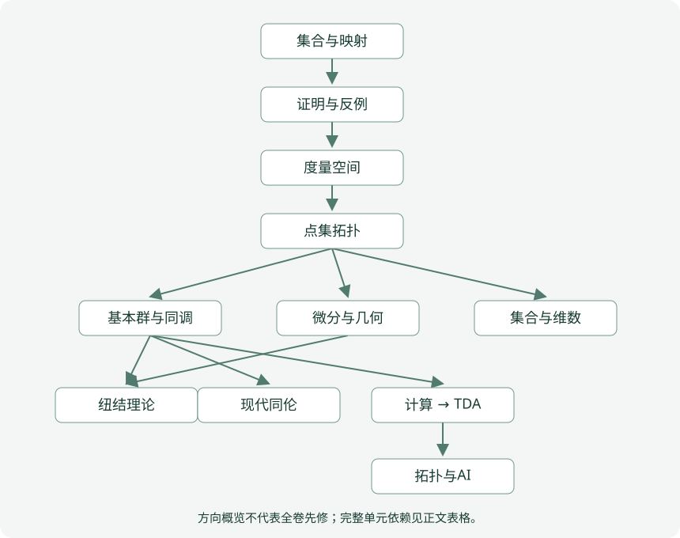
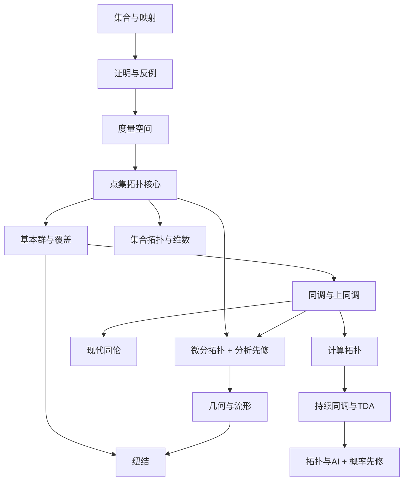

# 课程先修依赖图

箭头表示“先学 → 后学”，不是等价关系。完整逐章邻接表在下方；课程目录是可读页面清单，计划节点不是已完成正文。实数完备性、多元分析/ODE、概率等外部先修见总计划。

以下保留可维护的Mermaid源文本，完整88节点的精确关系见后表。

上图是方向概览，不表示必须把整个前卷全部学完；例如K1仅要求有限链/同调相关先修，实验路径不必先读完整微分卷。详细图以单元依赖为准，正向按先修闭包选课。

## 逐章依赖与后继

| 单元 | 直接先修 | 直接后继 |
| --- | --- | --- |
| PRE1 · 集合、映射、关系与等价类 | 无 | PRE2, PRE3, quotient, linear-quotient |
| PRE2 · 量词、证明方法与反例构造 | PRE1 | PRE3, PRE4, linear-quotient, KN3 |
| PRE3 · 度量空间与收敛 | PRE1, PRE2 | spaces, P8, ST6, TD1, A7 |
| PRE4 · 可数性、选择与集合论工具 | PRE2 | P2, P5, ST1 |
| spaces · 拓扑空间、开闭集与邻域 | PRE3 | bases |
| bases · 拓扑基与子基 | spaces | PS1, continuity, P3 |
| PS1 · 子空间拓扑与相对性质 | bases | continuity |
| continuity · 连续映射与同胚 | bases, PS1 | P1, quotient, connectedness, P4 |
| P1 · 闭包、内部、边界与网 | continuity | P2, P3, P4 |
| P2 · 分离公理与可数性 | P1, PRE4 | P4, P6, P7, P9, D1, ST1, ST2 |
| P3 · 乘积、箱拓扑与拓扑和 | bases, P1 | connectedness, P4, P5, P7, P10, homotopy, ST2 |
| quotient · 商拓扑与商映射 | continuity, PRE1 | P6, homotopy, F2, T1 |
| connectedness · 连通与道路连通 | continuity, P3 | P9, homotopy, C2, CT3, A4 |
| P4 · 紧致性与度量判据 | P1, P2, P3, continuity | P5, P6, P7, P8, P10, C1, H2, ST1 |
| P5 · 滤子、超滤子与Tychonoff | P3, P4, PRE4 | P6, ST3 |
| P6 · 局部紧致与紧化 | P2, P4, P5, quotient | P8, P9, P10, D1, ST3 |
| P7 · Urysohn、Tietze与度量化 | P2, P3, P4 | P9, P10, ST2, ST3, ST4, ST5 |
| P8 · 完备化与Baire范畴 | PRE3, P4, P6 | P10, DT1 |
| P9 · 局部性质、仿紧致与单位分解 | P2, P6, P7, connectedness | P10, D1, ST4 |
| P10 · 函数空间与紧开拓扑 | P3, P4, P6, P7, P8, P9 | ST5 |
| homotopy · 道路、同伦与基本群 | connectedness, P3, quotient | F1, H1 |
| F1 · 基点变化、函子性与形变收缩 | homotopy | C1, F2 |
| C1 · 覆盖、道路提升与圆周 | F1, P4 | F2, C2, D5 |
| F2 · Seifert–van Kampen与图 | C1, F1, quotient | AT1, H3, T2, T3 |
| C2 · 覆盖分类与提升判据 | C1, connectedness | AT1, G1 |
| AT1 · 自由群、胞腔粘合与综合计算 | F2, C2 | 本计划终端 |
| linear-quotient · 自由群组、链群与商空间预备 | PRE1, PRE2 | homology, H1 |
| homology · 有向单纯形与单纯同调 | linear-quotient | K1, A4, A6 |
| H1 · 奇异链、函子性与同伦不变性 | homotopy, linear-quotient | H2 |
| H2 · 相对同调、切除与长正合列 | H1, P4 | H3, T4, TD3 |
| H3 · CW复形、胞腔同调与整数计算 | H2, F2 | Q1, AT2, AT3, D2, D4, T1, KN2, HT2, K1, CT1, AI2 |
| Q1 · 上链、泛系数与杯积 | H3 | Q2, AT2, AT3, D3, D5, AI2 |
| Q2 · 定向与Poincaré对偶 | Q1 | AT3, D2, D3, T2, GT2, G1 |
| AT2 · Künneth、系数与Tor/Ext | H3, Q1 | AT3 |
| AT3 · 典型空间的完整同调计算 | H3, Q1, Q2, AT2 | 本计划终端 |
| D1 · 光滑流形、切空间与秩定理 | P2, P6, P9 | DT1, D2, D3, D4, D5, T1 |
| DT1 · 向量场、流与嵌入 | D1, P8 | 本计划终端 |
| D2 · 正则值、Sard与横截性 | D1, H3, Q2 | D4, GT1 |
| D3 · 定向、微分形式与de Rham | D1, Q1, Q2 | D5 |
| D4 · Morse函数、不等式与柄 | D1, D2, H3 | T4, CT2 |
| D5 · 向量丛与特征类 | D1, D3, C1, Q1 | HT5 |
| T1 · TOP、PL、DIFF与三角剖分 | quotient, H3, D1 | T2, GT1, T3, CT4 |
| T2 · 曲面、多边形与连通和 | T1, F2, Q2 | T4 |
| GT1 · 流形嵌入与低维方法 | T1, D2 | 本计划终端 |
| T4 · 三维流形、Heegaard与Dehn手术 | T2, T3, H2, D4 | GT2, KN4 |
| GT2 · 四维特殊性与分类边界 | T4, Q2 | 本计划终端 |
| T3 · 纽结、链环、同痕与纽结群 | T1, F2 | T4, KN1 |
| KN1 · 投影与Reidemeister变换 | T3 | KN2, KN3 |
| KN2 · Seifert曲面与Alexander多项式 | KN1, H3 | KN4 |
| KN3 · Jones多项式与状态和 | KN1, PRE2 | KN4 |
| KN4 · 亏格、补空间与三维联系 | KN2, KN3, T4 | 本计划终端 |
| G1 · 高阶同伦、纤维化与谱序列入口 | C2, Q2 | HT1 |
| HT1 · 纤维化、同伦纤维与映射锥 | G1 | HT2, HT3 |
| HT2 · CW逼近、Hurewicz与Whitehead | HT1, H3 | HT3, HT4 |
| HT3 · 同伦极限、余极限与Serre序列 | HT1, HT2 | HT4 |
| HT4 · 稳定同伦、谱与广义理论 | HT2, HT3 | HT5 |
| HT5 · K理论与现代方向 | HT4, D5 | 本计划终端 |
| ST1 · 有序拓扑、序数与长直线 | PRE4, P2, P4 | ST2 |
| ST2 · Sorgenfrey、乘积与正规性反例 | P2, P3, P7, ST1 | ST4 |
| ST3 · Alexander子基与Stone–Čech | P5, P6, P7 | ST5 |
| ST4 · 一般度量化与集合论公理 | P7, P9, ST2 | 本计划终端 |
| ST5 · 覆盖维数与归纳维数 | P7, P10, ST3 | ST6 |
| ST6 · 分形维数与无限维拓扑 | ST5, PRE3 | 本计划终端 |
| K1 · 有限复形、边界算法与不变量 | homology, H3 | CT1, CT2, CT3, CT5, TD1, R1, A4, A6 |
| CT1 · 立方复形、整数同调与SNF | K1, H3 | CT4, AI3 |
| CT2 · 复形约化与离散Morse | K1, D4 | CT4, CT5 |
| CT3 · Reeb图、Contour Tree与Mapper | K1, connectedness | 本计划终端 |
| CT4 · 网格、重建与拓扑保持 | CT1, CT2, T1 | CT5, AI3 |
| CT5 · 复杂度、内存与数值退化 | K1, CT2, CT4 | TD4 |
| TD1 · Čech、Rips、Alpha与滤过 | PRE3, K1 | R1 |
| R1 · 持续模、区间与矩阵约化 | K1, TD1 | R2, TD3, TD4, A8 |
| R2 · 图距离、交错与稳定性 | R1 | TD2, TD4, A1 |
| TD2 · 景观、图像与统计推断 | R2 | A1 |
| TD3 · Zigzag、Extended与多参数 | R1, H2 | 本计划终端 |
| TD4 · 软件对照与可复现TDA | R1, R2, CT5 | AI5 |
| A1 · 拓扑表示与机器学习 | R2, TD2 | A2, AI1, A3, A7 |
| A2 · 分类器、基线与可信评估 | A1 | AI1, AI2, A3, A4, A6, A7 |
| AI1 · 神经网络拓扑约束与损失 | A1, A2 | AI3, AI4 |
| AI2 · GNN、单纯与胞腔神经网络 | H3, Q1, A2 | AI4 |
| AI3 · 点云、视觉与医学分割 | AI1, CT1, CT4 | AI5 |
| AI4 · 异常检测、生成与表示学习 | AI1, AI2 | AI5 |
| AI5 · 论文复现与研究边界 | AI3, AI4, TD4 | 本计划终端 |
| A3 · 拓扑损失：目标、梯度与约束的边界 | A1, A2 | A5, A8 |
| A4 · 图像分割：像素误差与拓扑错误 | homology, K1, connectedness, A2 | A5 |
| A5 · 医学图像：骨架、拓扑先验与评价边界 | A3, A4 | 本计划终端 |
| A6 · 高阶关系、Hodge 算子与神经网络 | homology, K1, A2 | 本计划终端 |
| A7 · 点云学习：几何、持续同调与稳定性 | PRE3, A1, A2 | 本计划终端 |
| A8 · 可微持续同调：局部导数与配对切换 | A3, R1 | 本计划终端 |

## 前置缺口与补齐顺序

现有spaces直接假定集合/映射/实数，现有商空间假定等价关系；PRE1–PRE3首先补齐。PRE4补选择与不可数工具，PS1把现有分散的子空间论证组织为完整教学单元；然后逐章补习题解答和定理审查。代数预备尚需自由阿贝尔群/一般模完整先修；微分卷的分析先修不能用拓扑摘要替代。

现有正文的可执行依赖在 `scripts/curriculum.json`，长期计划在 `scripts/master-plan.json`。两者分别测试无环、代码解析与页面存在性；计划节点不要求有虚构页面。导航次序是主题分组，跨组先修以本图为准。

## AI 新增正文的实际学习支线

A1/A2 → A3 → A8 是损失与微分支线；同调、K1、连通性与 A2 → A4 → A5 是分割与解剖支线，A5还依赖A3；同调、K1 与 A2 → A6 是高阶网络；PRE3与A1/A2 → A7 是点云支线。A3–A8均已有正文、八题及完整答案，独立模型复核与实验范围按单章记录。原AI1–AI5保留为长期主题包，不将新增六章视作其全部完成。
